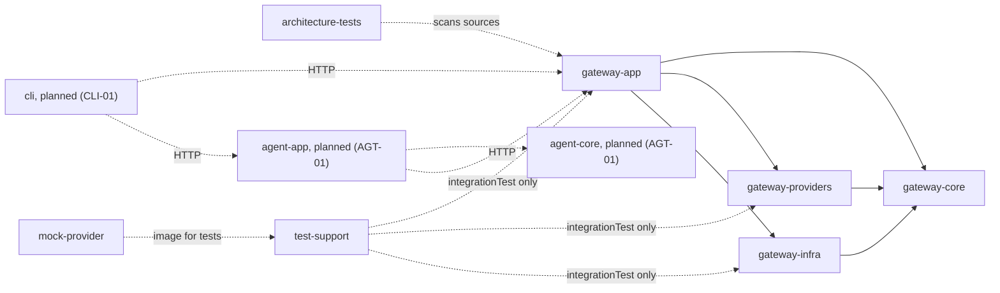

# Module graph

Updated: 2026-11-04 (built modules; GW-04 added `gateway-infra`)

- A solid arrow is a compile dependency, and it points inward (ADR-005). A dashed one is a test, tool or HTTP relation, or a planned module.
- `TeamStoreConfiguration` is the only `main` code in `gateway-app` naming `.gateway.infra` (ARCH-12).
- `gateway-core`'s `testFixtures` (`InMemoryTeamStore`, `TeamStoreContract`, `TestKeys`) serve the test suites of `gateway-app`, `gateway-providers` and `gateway-infra`.
- `mock-provider` and `test-support` import nothing of ours.
