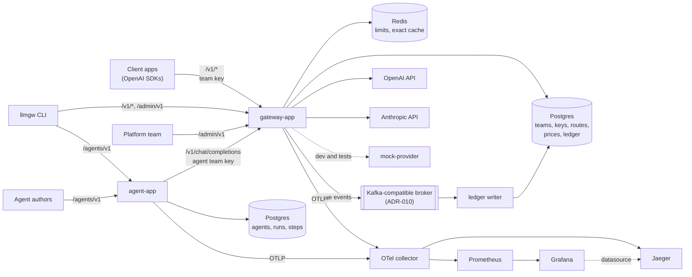

# Container overview

Updated: 2026-11-04 (target design; FND-03 note; FND-02 local stack; GW-03 provider selection; GW-04 auth and Postgres)

- The agent runtime reaches models only through the gateway (ADR-011).
- `gateway-app` reaches each provider through its own adapter and connection pool, chosen by `RoutingChatModelPort`. OpenAI is on by default, Anthropic off unless enabled (GW-03).
- `mock-provider` (`:8090`) answers the OpenAI and Anthropic paths with scripted tool calls on both, and exposes `/__mock` for scenarios, counters and the request journal (FND-03, GW-03).
- Built on the Postgres edge: `teams` and `team_keys` ([er-teams-and-keys](er-teams-and-keys.md)), over R2DBC with Flyway at startup (GW-04). Routes, prices and the ledger are later items. `gateway-app` needs Postgres to start, in `local` too.
- `/v1/*` and `/admin/v1` are authenticated by `AuthWebFilter`, with a team key and the admin key (GW-04). The modules are in [container-modules](container-modules.md).
- In development all infrastructure runs from `deploy/compose.yaml` on loopback ports (CLAUDE.md); the apps and the mock run on the host (FND-02).
- The semantic-cache vector store (ADR-009) and the broker choice (ADR-010) are open; the diagram changes when CACHE-02 and COST-02 settle them.
