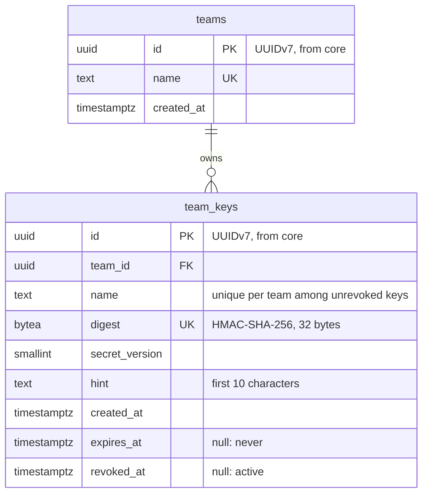

# Data model: teams and keys

Updated: 2026-11-04 (built, GW-04)

- From `V1__teams_and_keys.sql`. `flyway_schema_history` is left out.
- Rows are never deleted. IDs, times and digests come from core; the database generates nothing.
- `team_keys_digest_key` serves the hot-path lookup, `team_keys_team_name_active` is the partial unique index on `(team_id, name) WHERE revoked_at IS NULL`, and `team_keys_team_id_id` serves keyset listing.
- `secret_version` is written; reading two versions is GW-12.
