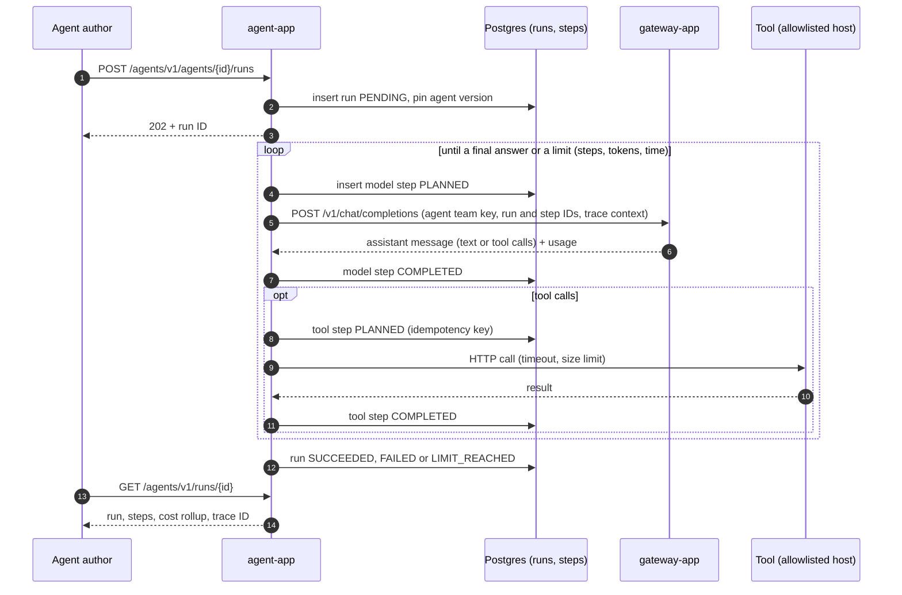

# Agent run with tool calls

Updated: 2026-11-03 (target design, before AGT-01)

- A step's state is written before its side effect. After a crash the executor resumes `RUNNING` runs, skips `COMPLETED` steps and re-executes `PLANNED` ones with the same idempotency key (AGT-03).
- Orchestration patterns (AGT-04) compose runs of several agents; each agent's calls still go through the gateway.
