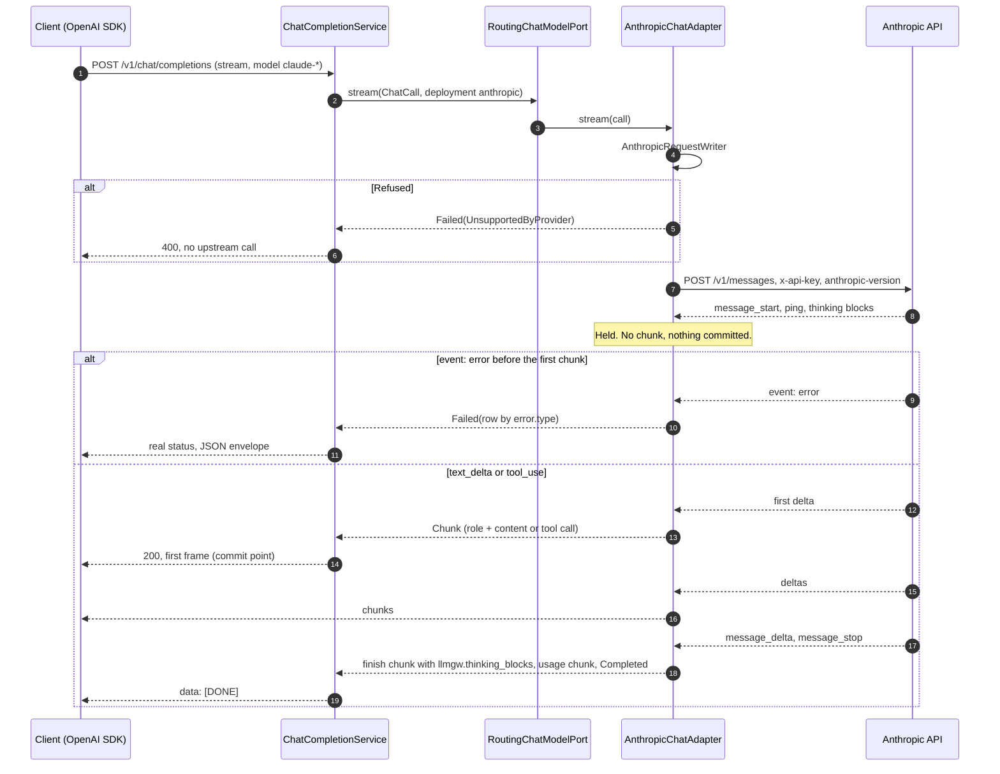

# Anthropic stream translation

Updated: 2026-11-04 (GW-03, built)

- `AnthropicStreamDecoder` holds everything until the first text or tool delta (ADR-GW-03-007), so an `overloaded_error` right after `message_start` is a 503 and RTE-02 keeps its fallback window.
- An `event: error` after the first frame is one error frame, no `[DONE]` and a clean end (ADR-019).
- Tool indexes are renumbered from 0; Anthropic counts every content block (ADR-GW-03-012).
- The chunks pass through `StreamTally` and `ChatStreamFrames`, as on OpenAI. `SseStreamCall` and `StreamLifecycle` in `.gateway.providers.upstream` run the call and the end of the stream.
