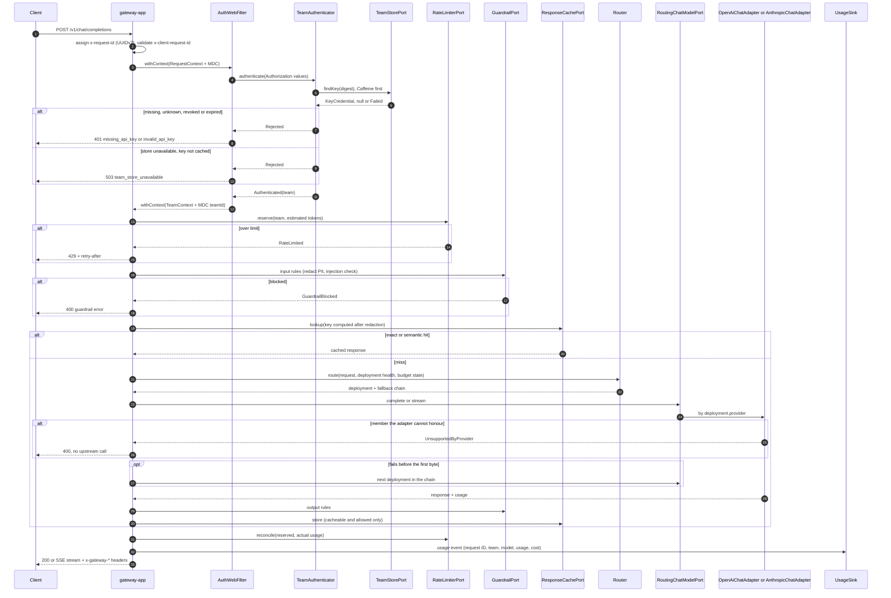

# Request pipeline: chat completion

Updated: 2026-11-04 (target design; GW-01 to GW-04 built the first slice)

- Every error in the diagram (401, 503, 429, 400 guardrail, 400 unsupported member) is written by the one mapper, `GatewayErrorWebExceptionHandler`, as the OpenAI envelope and carries `x-request-id` (FND-04).
- Auth precedes routing and the body is never read before it, so a rejected request costs no buffering, and an unauthenticated 404, 405 or preflight under `/v1` is a 401 (ADR-GW-04-003).
- Rate limiting runs next so a rejected request costs one Redis call.
- Input guardrails run before the cache: the key is computed on the redacted prompt, and a prompt blocked today is not served from a cache filled before the rule existed.
- On a stream, output rules scan a sliding window (GRD-05), and reconciliation and the usage event happen when the stream ends or the client disconnects. A stream is cold: the provider call starts when the body is subscribed, and a failure before the first chunk is still an error status.
- Each participant is a span (OBS-01).
- Built by GW-01 to GW-04: request ID, auth, `ModelResolver`, `RoutingChatModelPort` over both adapters, `complete` and `stream` with the team on `ChatCall`, the reply, SSE with commit at the first frame. Limits, guardrails, cache and usage events are later items. Until RTE-01 `PrefixModelResolver` stands in for the router and there is no fallback chain.
- The Anthropic branch of a stream is in [sequence-anthropic-stream](sequence-anthropic-stream.md).
