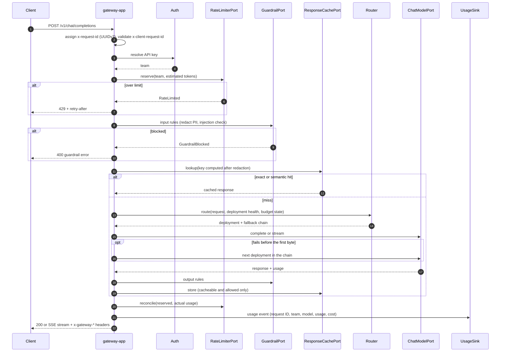

# Request pipeline: chat completion

Updated: 2026-11-03 (target design, before GW-01)

- Every error in the diagram (429, 400 guardrail) is written by the one mapper, `GatewayErrorWebExceptionHandler`, as the OpenAI envelope and carries `x-request-id` (FND-04).
- Rate limiting runs first so a rejected request costs one Redis call.
- Input guardrails run before the cache: the key is computed on the redacted prompt, and a prompt blocked today is not served from a cache filled before the rule existed.
- On a stream, output rules scan a sliding window (GRD-05), and reconciliation and the usage event happen when the stream ends or the client disconnects.
- Each participant is a span (OBS-01).
