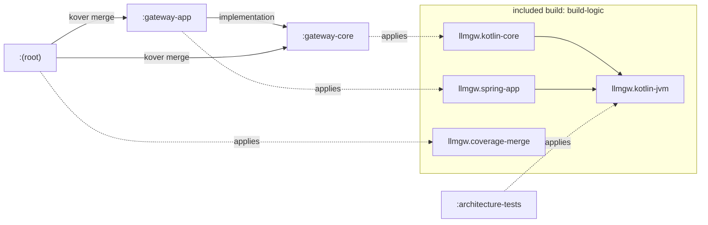

# FND-01: Gradle multi-module skeleton

## 1. Context and goal

There is no code yet. Every later item needs a build that compiles Kotlin, runs tests, enforces style, static analysis and coverage, and keeps the hexagon (ADR-005), the agent runtime (ADR-011) and the CLI (ADR-012) apart from the first line of code, locally on Windows and on Linux CI.

FND-01 sets that build: a Gradle wrapper, a version catalog, convention plugins, the first three modules, a Spring Boot `gateway-app` that boots and answers its health endpoint, the Konsist architecture rules, Kover thresholds, and the CI build job. It pins the then-current stable Kotlin, Spring Boot and LTS JDK (ADR-002).

It serves no VISION pillar directly; it is the precondition for all of them, and the boundary rules it ships protect pillars 2 (low overhead: non-blocking core) and 7 (agents as gateway clients). It must not drift into any runtime feature: no endpoints beyond health, no domain types, no ports.

## 2. Scope

### In
- Gradle wrapper 9.7.1 with a pinned distribution checksum; `gradle.properties`; root `settings.gradle.kts` and `build.gradle.kts`.
- `gradle/libs.versions.toml` with every version below, including those first used later (Testcontainers, BlockHound).
- An included build `build-logic/` with four precompiled convention plugins (section 5).
- Modules `gateway-core` (no sources yet), `gateway-app`, `architecture-tests` (ADR-014).
- `gateway-app`: Spring Boot 4.1.2 WebFlux application, actuator health on port 8080, one context test.
- ktlint (via ktlint-gradle), detekt with type resolution, Kover per-module and merged thresholds, Konsist rules ARCH-1 to ARCH-8 with violating fixtures.
- `.github/workflows/ci.yml` build job updated.
- Doc edits: CLAUDE.md (Architecture module list, Testing commands, Project structure), `verify-gates` skill, README status line, ADR-002 dated note, roadmap row, this spec.

### Out
- Any domain type, port, error model or request ID (FND-04), provider adapter (GW-01), Testcontainers base classes and `deploy/compose.yaml` (FND-02), `mock-provider` (FND-03).
- Any module other than the three above (ADR-014 says which item creates each).
- JSON library choice (Jackson 3 or kotlinx.serialization), logging format, OpenTelemetry (OBS-01), container images (OPS-03).
- Dependabot or Renovate, build scans, test-report artifact upload in CI.
- Upgrading to Spring Boot 4.2 or detekt 2.0 GA when they ship (follow-up, see Log).

## 3. Acceptance criteria

Checkable. All ticked before the row becomes `[x]`. "Deliberate violation" checks are made in the working tree, observed failing, and reverted before commit.

- [x] `./gradlew --version` reports Gradle 9.7.1. `gradle/wrapper/gradle-wrapper.properties` has `distributionSha256Sum=acd53f1edaf02f1a8ff99879f8a34b302661a057d9b063ae9e35b552f804d20a`, and `sha256sum gradle/wrapper/gradle-wrapper.jar` prints `7a9ce74cff467ca1bf60a4fcd9f05185acceda4d0f382434d393e17864262c5d` (gradle.org/release-checksums).
- [x] On a clean tree (no `build/`, `.gradle/`, `build-logic/build/`, `.kotlin/`), `./gradlew build --console=plain` exits 0 in Git Bash with the daemon on the local JDK 21; Gradle provisions the JDK 25 toolchain itself (`./gradlew -q javaToolchains` lists a 25).
- [x] The same command exits 0 with the daemon on JDK 25 (`JAVA_HOME` pointed at the provisioned JDK 25), which is how CI runs it.
- [x] `./gradlew projects` lists exactly `architecture-tests`, `gateway-app`, `gateway-core`.
- [x] `GatewayApplicationTest` passes: `GET /actuator/health` returns 200 with `"status":"UP"`. Manual: `./gradlew :gateway-app:bootRun`, `curl -s localhost:8080/actuator/health` prints `{"groups":["liveness","readiness"],"status":"UP"}`; the app is stopped afterwards.
- [x] `./gradlew :architecture-tests:test` passes, including one fixture test per rule ARCH-1 to ARCH-7 that asserts the rule fails on its fixture.
- [x] Deliberate violation: a file `gateway-core/src/main/kotlin/io/github/pdroacordi/llmgateway/gateway/core/Probe.kt` with `import org.springframework.stereotype.Component` makes `./gradlew :architecture-tests:test` fail with ARCH-1 naming that file and import (and `:gateway-core:compileKotlin` fails too: Spring is not on the core classpath).
- [x] Deliberate violation: a file in `gateway-app` declaring `package io.github.pdroacordi.llmgateway.agent.app` fails ARCH-7; a file `scratch-module/src/main/kotlin/X.kt` (not included in settings) fails ARCH-8.
- [x] Changing only a file in `gateway-core` makes `:architecture-tests:test` run again (not `UP-TO-DATE`) on the next build.
- [x] `./gradlew koverVerify` exits 0 and `./gradlew :koverLog` prints the merged line coverage. Deliberate violation: an untested top-level function in `gateway-core` makes `./gradlew :gateway-core:koverVerify` fail on the 80% rule, and `./gradlew build` fails with it (`check` depends on `koverVerify`).
- [x] Deliberate violations: a 121-column line fails `./gradlew ktlintCheck`; `GlobalScope.launch { }` in `gateway-core` main fails `./gradlew detektMain` (coroutines rule set active).
- [x] No detekt baseline file, no ktlint baseline, no `@Suppress` in the committed code.
- [x] `git ls-files -s gradlew` shows mode `100755`; `gradlew.bat` is CRLF, `gradlew` LF (existing `.gitattributes`).
- [x] `.github/workflows/ci.yml` matches section 5 (CI). It parses (`actionlint` if installed, otherwise a YAML parser). Its CI result is recorded in the Log at the first push the user makes; it is not a gate for `[x]` because nothing is pushed without the user (CLAUDE.md rule 4).
- [x] `verify-gates` green (coverage: core ≥ 80%, overall ≥ 70%; with `gateway-core` empty the core rule has nothing to measure, see ADR-FND-01-006)
- [x] Smoke scenarios: n/a. Nothing is HTTP-observable beyond actuator health, which the context test and the manual `bootRun` check cover; there is no gateway behaviour for `gateway-smoke` to exercise.
- [x] Eval: n/a (no threshold, classifier or routing policy).
- [x] Living docs updated (`docs-update`): CLAUDE.md edits in step 4, `verify-gates` skill, README, ADR-002 note, roadmap row with spec link. No systems entry: the build is not a system in the CLAUDE.md table.

## 4. Contract

| Method | Path | Response | Notes |
|---|---|---|---|
| GET | `/actuator/health` on `gateway-app` port 8080 | 200, `{"groups":["liveness","readiness"],"status":"UP"}` (`application/vnd.spring-boot.actuator.v3+json` or `application/json`) | Spring Boot 4.1.2 actuator default: details hidden (`show-details` default `never`), liveness and readiness probe groups listed (probes stay on). |

No `/v1`, `/admin/v1` or `/agents/v1` endpoint, no `x-gateway-*` header, no OpenAI error envelope (FND-04). ADR-004 is unaffected: actuator lives outside the OpenAI-compatible surface. Whether actuator moves to a separate management port is OPS-03's call.

## 5. Design

### Versions (ADR-FND-01-001)

Checked 2026-11-03. Dates marked * show only day and month on the source page; the year is inferred from release order.

| Component | Pinned | Released | Compatibility evidence |
|---|---|---|---|
| Gradle (wrapper, `-bin`) | 9.7.1 | 2026-08-19 | KGP 2.4.20-2.4.21 fully supports Gradle 7.6.3-9.7.0 (Kotlin "Configure a Gradle project" table). Spring Boot 4.1.2: "Gradle 8.x (8.14 or later) and 9.x". 9.8.2 (2026-10-19) is newer but outside KGP's declared range. |
| JDK toolchain | 25 (Temurin in CI) | LTS, 2025-09 | Gradle toolchain support for 25 since 9.1.0. Spring Boot 4.1.2: Java 17-27. Daemon runs on any JDK 21+ (ADR-FND-01-003). |
| Kotlin (KGP, stdlib, allopen) | 2.4.21 | 2026-10-08 | Latest stable; 2.4 line supported to 2027-12-03. Gradle 9.8 docs: "tested with Kotlin 2.0.0 through 2.4.20-RC2". |
| Spring Boot (plugin + BOM) | 4.1.2 | 2026-10-22* | Latest GA ("Latest" on GitHub releases; 4.2.0-RC1 is a pre-release). Requires Kotlin ≥ 2.2; its BOM manages Kotlin 2.3.21, overridden to 2.4.21 (see dependency rule). |
| kotlinx-coroutines (BOM) | 1.11.0 | 2026-05-08* | Latest stable; Boot 4.1.2 manages 1.10.2. |
| ktlint engine | 1.8.0 | 2025-11-14* | Latest stable; 2.0.0-ALPHA-4 is a pre-release with new Maven coordinates. |
| ktlint-gradle (`org.jlleitschuh.gradle.ktlint`) | 14.2.0 | 2026-03-12 | Latest on the Plugin Portal; Gradle 9 support since 13.1.0, Isolated Projects in 14.2.0. Fallback kotlinter 5.7.0 (ADR-FND-01-002). |
| detekt (`dev.detekt`) | 2.0.0-alpha.6 | 2026-08-04 | Pre-release. Built against Kotlin 2.4.10, Gradle 9.6.1, tested on JDK 25 (detekt compatibility table). 1.23.8 targets Kotlin 2.0.21 (ADR-FND-01-002). |
| Kover (`org.jetbrains.kotlinx.kover`) | 0.9.11 | 2026-09-29* | Latest; 0.9.9 fixed a Gradle 9.6 deprecation. |
| Konsist (`com.lemonappdev:konsist`) | 0.18.1 | 2026-10-10* | 0.18.0 built with Kotlin 2.4.21, minimum Kotlin 2.0. |
| JUnit (BOM) | 6.1.3 | 2026-08-07* | Latest stable; Boot 4.1.2 manages 6.0.3. |
| MockK | 1.14.11 | 2026-05-29* | Latest on Maven Central; its build uses Byte Buddy 1.18.2. First used in FND-04. |
| BlockHound (+ `blockhound-junit-platform`) | 1.0.18 | 2026-10-26* | Latest; Byte Buddy 1.18.14. First used in FND-02 or GW-02. |
| Testcontainers (BOM) | 2.0.5 | 2026-04-20* | Latest, and the version Boot 4.1.2 manages. First used in FND-02. |
| foojay-resolver-convention | 1.0.0 | 2025-05-19 | Latest; the toolchain resolver recommended in the Kotlin Gradle docs. |
| actions/checkout | `v7` | v7.0.1, 2026-07-20* | Latest major. |
| actions/setup-java | `v6` | v6.1.0, 2026-10-14* | Latest major. |
| gradle/actions/setup-gradle | `v6` | v6.4.1, 2026-10-28* | Latest major; v6.4.1 carries a security fix for `dependency-submission`. |

**Combinations not confirmed by a public source** (step 1 is a spike that settles each; the fallback is decided in advance):

| # | Combination | Risk | Fallback if step 1 fails |
|---|---|---|---|
| U1 | ktlint-gradle 14.2.0 with KGP 2.4.21 | Released before Kotlin 2.4.0; no public report either way. | kotlinter 5.7.0 (explicit Kotlin 2.4 support); commands become `lintKotlin` / `formatKotlin` in CLAUDE.md and `verify-gates`. |
| U2 | ktlint 1.8.0 parsing Kotlin 2.4 sources | Engine built on an older Kotlin parser; new 2.3/2.4 syntax may not parse. FND-01 code uses none. | Record a gotcha when it happens; avoid the syntax until ktlint 2.0 is stable. |
| U3 | detekt 2.0.0-alpha.6 (Kotlin 2.4.10) with KGP 2.4.21, Gradle 9.7.1, configuration cache | Pre-release; patch-level Kotlin skew; type resolution on a JDK 25 classpath. | First: drop Kotlin to 2.4.10 (detekt's exact build version). If still red: configuration cache `problems=warn` for detekt tasks only, with a gotcha entry. |
| U4 | Spring Boot 4.1.2 with Kotlin 2.4.21, coroutines 1.11.0, JUnit 6.1.3 | Boot 4.1.x is tested with 2.3.21, 1.10.2, 6.0.3. | Use the Boot-managed version of the failing library (catalog pin lowered to it). |
| U5 | Kover 0.9.11 agent on Java 25 bytecode; Kover on a module with no classes | Kover docs say a bound is compared "only if the value is present", which implies an empty module passes; not confirmed by a run. | Java 25: `useJacoco()` with JaCoCo ≥ 0.8.14 (official Java 25 support). Empty module: `koverVerify` `onlyIf` the module has main Kotlin sources. |
| U6 | MockK 1.14.11 on JDK 25 | Byte Buddy 1.18.x should read class file 69; not stated by MockK. | Verified in FND-04 (first MockK test); fallback is a newer Byte Buddy via a constraint. |
| U7 | foojay-resolver-convention 1.0.0 on Gradle 9.7.1 | Released before Gradle 9.0. | Install Temurin 25 locally and point `org.gradle.java.installations.paths` at it in the user's `~/.gradle/gradle.properties` (not the repo). |
| U8 | BlockHound on JDK 25 needs `-XX:+AllowRedefinitionToAddDeleteMethods` | OpenJDK review JDK-8358890 (2025-07) proposes obsoleting the flag in JDK 26 and expiring it in 27; merge status not confirmed. Fine on 25; a risk for the next LTS. | FND-02 / GW-02 own it; noted here so the JDK upgrade item checks it. |
| U9 | Gradle 9 `wrapper` task in a directory without a settings file | Gradle 9 rejects builds without settings; whether `wrapper` is exempt was not confirmed. | The plan writes a one-line `settings.gradle.kts` first. |

### Build layout and modules (ADR-FND-01-004, ADR-FND-01-005, ADR-014)



| Convention plugin | Applies | Configures |
|---|---|---|
| `llmgw.kotlin-jvm` | `org.jetbrains.kotlin.jvm`, ktlint-gradle, `dev.detekt`, Kover | `kotlin { jvmToolchain(25) }`; `compilerOptions.allWarningsAsErrors = true` (no extra null-safety flag: Kotlin ≥ 2.1 enforces JSpecify strictly, Spring Boot Kotlin docs); `implementation(platform(kotlin-bom))`, `implementation(platform(kotlinx-coroutines-bom))`, `testImplementation(platform(junit-bom))`, `testImplementation(junit-jupiter)`, `testRuntimeOnly(junit-platform-launcher)`; `tasks.test { useJUnitPlatform { excludeTags("live") } }`, failures logged with full exception format; ktlint `version = 1.8.0` (rules from the existing `.editorconfig`: `ktlint_official`, 120 columns); detekt `buildUponDefaultConfig = true`, `config = rootDir/config/detekt/detekt.yml`, `jdkHome` and `jvmTarget` from the Java toolchain (needed for type resolution when the daemon runs on 21), `check` depends on `detektMain` and `detektTest` instead of the plain `detekt` task; `check` depends on `koverVerify`. |
| `llmgw.kotlin-core` | `llmgw.kotlin-jvm` | `implementation(kotlinx-coroutines-core)`; `testImplementation(mockk, kotlinx-coroutines-test)`; Kover rule "core line coverage": `minBound(80)`, `CoverageUnit.LINE`, `COVERED_PERCENTAGE`. Nothing from Spring, Reactor or any I/O library; task `checkCoreClasspath` (a `check` dependency) fails when the resolved `compileClasspath` or `runtimeClasspath` holds a forbidden group (Spring, Reactor, Netty, R2DBC, Lettuce, Jedis, Kafka, OpenTelemetry SDK and exporters, coroutines-reactor/reactive, jOOQ, HikariCP, JDBC drivers, OkHttp, Ktor, Apache HttpClient). |
| `llmgw.spring-app` | `llmgw.kotlin-jvm`, `org.jetbrains.kotlin.plugin.spring`, `org.springframework.boot` | `implementation(platform(spring-boot-dependencies))` (Gradle-native platform, not `io.spring.dependency-management`); `spring-boot-starter-webflux`, `spring-boot-starter-actuator`, `kotlin-reflect`, `kotlinx-coroutines-reactor`; `testImplementation(spring-boot-starter-webflux-test)`; Kover filter excludes classes `*ApplicationKt` (the `main` entry point, exercised by `bootRun`, not by tests). |
| `llmgw.coverage-merge` | `base`, Kover, ktlint-gradle | Root only: merged report over the modules listed as `kover(project(...))` in the root build; rule "overall line coverage": `minBound(70)`, LINE; the root build excludes the exact class `io.github.pdroacordi.llmgateway.gateway.app.GatewayApplicationKt`; root `check`, `ktlintCheck` and `ktlintFormat` depend on the same tasks of the included build `build-logic` (task selectors do not reach included builds), so the convention plugins are linted and formatted; ktlint covers the root `*.gradle.kts` scripts. `base` gives the root project the `check` and `build` tasks that `./gradlew build` needs. |

`architecture-tests` applies only `llmgw.kotlin-jvm` and adds `testImplementation(konsist)`; a dedicated convention for one module is not worth it.

**Dependency rule.** Every version lives in `gradle/libs.versions.toml`. BOMs are Gradle `platform(...)` dependencies, which only recommend versions, so where Spring Boot also manages a library the catalog version must be greater than or equal to Boot's (otherwise the higher one silently wins in the apps and the build runs two versions across modules). Today: Kotlin 2.4.21 ≥ 2.3.21, coroutines 1.11.0 ≥ 1.10.2, JUnit 6.1.3 ≥ 6.0.3, Testcontainers 2.0.5 = 2.0.5. Platforms are per configuration, so detekt's own `detekt` configuration keeps its compiler version (the detekt docs warn that the dependency-management plugin overrides `kotlin-compiler-embeddable` there).

**Version catalog** (`gradle/libs.versions.toml`), aliases the implementer creates:

| Section | Alias | Coordinates / id | Version ref |
|---|---|---|---|
| versions | `kotlin`, `spring-boot`, `kotlinx-coroutines`, `ktlint`, `ktlint-gradle`, `detekt`, `kover`, `konsist`, `junit`, `mockk`, `blockhound`, `testcontainers` | | table above |
| libraries | `kotlin-bom` | `org.jetbrains.kotlin:kotlin-bom` | kotlin |
| | `kotlin-reflect` | `org.jetbrains.kotlin:kotlin-reflect` | (from kotlin-bom) |
| | `kotlinx-coroutines-bom` | `org.jetbrains.kotlinx:kotlinx-coroutines-bom` | kotlinx-coroutines |
| | `kotlinx-coroutines-core`, `-reactor`, `-test` | `org.jetbrains.kotlinx:kotlinx-coroutines-*` | (from BOM) |
| | `spring-boot-dependencies` | `org.springframework.boot:spring-boot-dependencies` | spring-boot |
| | `spring-boot-starter-webflux`, `-actuator`, `-webflux-test` | `org.springframework.boot:spring-boot-starter-*` | (from Boot BOM) |
| | `junit-bom` | `org.junit:junit-bom` | junit |
| | `junit-jupiter`, `junit-platform-launcher` | `org.junit.jupiter:junit-jupiter`, `org.junit.platform:junit-platform-launcher` | (from junit-bom) |
| | `mockk` | `io.mockk:mockk` | mockk |
| | `konsist` | `com.lemonappdev:konsist` | konsist |
| | `blockhound`, `blockhound-junit-platform` | `io.projectreactor.tools:blockhound`, `:blockhound-junit-platform` | blockhound |
| | `testcontainers-bom` | `org.testcontainers:testcontainers-bom` | testcontainers |
| | plugin artifacts for `build-logic` | `org.jetbrains.kotlin:kotlin-gradle-plugin`, `org.jetbrains.kotlin:kotlin-allopen`, `org.springframework.boot:spring-boot-gradle-plugin`, `org.jetbrains.kotlinx:kover-gradle-plugin`, `dev.detekt:detekt-gradle-plugin`, `org.jlleitschuh.gradle:ktlint-gradle` | kotlin, kotlin, spring-boot, kover, detekt, ktlint-gradle |
| plugins | `ktlint` | `org.jlleitschuh.gradle.ktlint` | ktlint-gradle (used by `build-logic`'s own build script) |

`build-logic/settings.gradle.kts` imports the same TOML (`from(files("../gradle/libs.versions.toml"))`). Precompiled script plugins cannot use the `libs` accessor in their `plugins {}` block; they apply plugins by id without a version (the version comes from `build-logic`'s dependencies) and read libraries through `VersionCatalogsExtension.named("libs").findLibrary(...)` (Gradle version catalog docs).

**Settings.** `pluginManagement { includeBuild("build-logic") }`; `plugins { id("org.gradle.toolchains.foojay-resolver-convention") version "1.0.0" }`; `dependencyResolutionManagement { repositoriesMode = FAIL_ON_PROJECT_REPOS; repositories { mavenCentral() } }`; `rootProject.name = "kotlin-llm-gateway"`; `include("gateway-core", "gateway-app", "architecture-tests")`.

**`gradle.properties`.** `org.gradle.jvmargs=-Xmx2g -XX:MaxMetaspaceSize=512m -Dfile.encoding=UTF-8`, `org.gradle.parallel=true`, `org.gradle.caching=true`, `org.gradle.configuration-cache=true`, `kotlin.code.style=official`.

**`config/detekt/detekt.yml`.** Only overrides of the default config, each with a one-line comment giving the reason: `style>MaxLineLength.maxLineLength: 120` (same as ktlint); the `coroutines` rule set active with `GlobalCoroutineUsage` (named `GlobalScopeUsage` before 2.0), `InjectDispatcher`, `RedundantSuspendModifier`, `SleepInsteadOfDelay`, `SuspendFunSwallowedCancellation`, `SuspendFunWithFlowReturnType` active (CLAUDE.md: no `GlobalScope`, never swallow `CancellationException`). Rule names are checked against the default config shipped with 2.0.0-alpha.6 (`./gradlew detektGenerateConfig` into the scratchpad, not the repo), since 2.0 renamed some keys. The ktlint wrapper rule set is not used: ktlint runs on its own.

### Packages and the Konsist rules (ADR-FND-01-007, ADR-014)

Module root packages are the ADR-014 table (`io.github.pdroacordi.llmgateway.gateway.core`, `.gateway.app`, `.architecture`, and the future ones). `architecture-tests` holds that table as `Modules.kt` (module name, root package, role: core, adapter, app, client, tool), listing all ten target modules so that a module is covered from its first file.

| ID | Rule | Applies to | Protects |
|---|---|---|---|
| ARCH-1 | No import or inline fully qualified reference in `org.springframework`, `reactor`, `io.netty`, `io.r2dbc`, `java.sql`, `javax.sql`, `org.jooq`, `io.lettuce`, `redis.clients`, `org.apache.kafka`, `io.opentelemetry.sdk`, `io.opentelemetry.exporter`, `java.net`, `javax.net`, `okhttp3`, `io.ktor.client`, `org.apache.hc`, `kotlinx.coroutines.reactor`, `kotlinx.coroutines.reactive`; allowed from `java.net`: `URI`, `URISyntaxException`, `URLEncoder`, `URLDecoder` | role core | CLAUDE.md "Core modules are plain Kotlin"; ADR-005, ADR-006 |
| ARCH-2 | Core imports nothing from the adapter or app packages of its family (`.gateway.core` ↛ `.gateway.providers`, `.gateway.infra`, `.gateway.app`; `.agent.core` ↛ `.agent.app`) | role core | ADR-005: dependencies point inward |
| ARCH-3 | Adapters import nothing from `.gateway.app`; `.gateway.providers` and `.gateway.infra` do not import each other | role adapter | ADR-005 module graph in CLAUDE.md |
| ARCH-4 | `agent-*` imports nothing from `io.github.pdroacordi.llmgateway.gateway` | `agent-core`, `agent-app` | ADR-011 |
| ARCH-5 | `cli` imports nothing from `.gateway` or `.agent` | `cli` | ADR-012 |
| ARCH-6 | Classes, functions and properties annotated with `org.springframework.stereotype.*`, `org.springframework.context.annotation.Configuration`, `org.springframework.context.annotation.Bean`, `org.springframework.boot.autoconfigure.SpringBootApplication`, `org.springframework.web.bind.annotation.RestController` or `org.springframework.boot.context.properties.ConfigurationProperties` exist only in role app, whether the annotation is imported, aliased, star-imported, written fully qualified or reached through a typealias; a non-app module may not import them either | all modules | CLAUDE.md "Wire in the app module only" |
| ARCH-7 | Every Kotlin file's package starts with its module's root package (main and test source sets) | all modules except the `fixtures` source set | makes ARCH-2 to ARCH-5 sound: a package-keyed rule is only as good as the package layout |
| ARCH-8 | Every module that holds a Kotlin file under `src/` is in the module table | whole repository except `build-logic/` and any `build/` directory | a new module cannot sit outside every rule |
| ARCH-9 | A module imports or references only its own root package and those of the modules in its `dependsOn` (table in `Modules.kt`, from the CLAUDE.md graph: `gateway-app` → `gateway-core`, `gateway-providers`, `gateway-infra`; adapters → `gateway-core`; `agent-app` → `agent-core`; every other module → none) | every module in the table | ADR-005, ADR-014: dependencies point inward, and families stay apart (a `gateway-*` module never imports `.agent`) |

Mechanics:

- The production scope is `Konsist.scopeFromProject()` minus the `fixtures` source set, `build-logic/` and generated code under `build/`. Rules select files by `moduleName` through the table; they never call `scopeFromModule` for a module that may not exist yet. `assertArchitecture` with layers is not used: a layer with no files throws (Konsist docs), which would force placeholder modules.
- Import prefixes match on a segment boundary (`name == p || name.startsWith("$p.")`), so star imports match and `...gateway` does not match `...gatewayx`.
- Each failure message names the rule ID, the file, the offending import or annotation, and the ADR.
- Each of ARCH-1 to ARCH-7 and ARCH-9 has a fixture (ARCH-1 and ARCH-6 one per spelling of the violation) in `architecture-tests/src/fixtures/kotlin/arch-<n>-<case>/` that breaks it; `RuleFixturesTest` asserts the rule fails on it ([`patterns/architecture-rule-with-violating-fixture`](../knowledge/patterns/architecture-rule-with-violating-fixture.md)). ARCH-8's classification is a pure function (observed modules, table) tested with plain lists. `src/fixtures` is not a source set: never compiled, linted or analysed.
- `architecture-tests`' `test` task declares as inputs every `**/*.kt` file under the root directory (the scope Konsist reads), excluding `**/build/**`, `**/.gradle/**`, `**/.kotlin/**` and `.git/**`, with relative path sensitivity (root path read through `isolated.rootProject.projectDirectory`). It reruns when any module changes and stays cacheable, instead of the `upToDateWhen { false }` the Konsist docs offer.
- Fully qualified names written inline are matched in the file text too (outside import and package lines, comments and string literals): JDK packages such as `java.net` and `java.sql` are on every classpath, so the Gradle classpath does not stop them. Konsist reads no `.kts`, so a forbidden library added to a core build script is caught by `checkCoreClasspath` in `llmgw.kotlin-core` (fails `check` when the resolved compile or runtime classpath holds a forbidden group). The fast grep in `verify-gates` gate 4 stays as a pre-check; Konsist is authoritative.

### gateway-app

- `GatewayApplication.kt`: `@SpringBootApplication class GatewayApplication` and `fun main(vararg args: String)` calling `runApplication<GatewayApplication>(*args)` (`vararg` satisfies detekt `SpreadOperator`, see Log).
- `application.yaml`: `spring.application.name: gateway-app`, `server.port: 8080` (CLAUDE.md local ports), `management.endpoints.web.exposure.include: health`.
- `GatewayApplicationTest`: `@SpringBootTest(webEnvironment = RANDOM_PORT)` with `@AutoConfigureWebTestClient` (Boot 4 moved it to `org.springframework.boot.webtestclient.autoconfigure`, provided through `spring-boot-starter-webflux-test`); asserts 200 and `status` = `UP` on `/actuator/health`. No Testcontainers, no Docker.

### Gradle wrapper (ADR-FND-01-008)

Without a global `gradle`, in Git Bash (each step's output checked before the next):

1. Create a new empty directory `<scratchpad>/gradle-dist/`. Download `https://services.gradle.org/distributions/gradle-9.7.1-bin.zip` into it (`curl -fsSL -o`; the URL redirects to `downloads.gradle.org`).
2. Verify: `sha256sum` of the zip equals `acd53f1edaf02f1a8ff99879f8a34b302661a057d9b063ae9e35b552f804d20a`. Stop on mismatch.
3. Extract it in that directory (`unzip`, or PowerShell `Expand-Archive`).
4. In the repo root, write `settings.gradle.kts` with only `rootProject.name = "kotlin-llm-gateway"` (U9).
5. From the repo root run `<scratchpad>/gradle-dist/gradle-9.7.1/bin/gradle wrapper --gradle-version 9.7.1 --distribution-type bin --gradle-distribution-sha256-sum acd53f1edaf02f1a8ff99879f8a34b302661a057d9b063ae9e35b552f804d20a`.
6. Check `gradle/wrapper/gradle-wrapper.jar` against `7a9ce74cff467ca1bf60a4fcd9f05185acceda4d0f382434d393e17864262c5d`, and that the properties file has `distributionSha256Sum` and `validateDistributionUrl=true`.
7. `./gradlew --version` (downloads the distribution again through the wrapper and verifies the checksum).
8. When staging: `git add gradlew` then `git update-index --chmod=+x gradlew` (Windows does not record the executable bit; Linux CI needs it).

### CI (ADR-FND-01-009)

`.github/workflows/ci.yml`:

- Workflow level: `permissions: contents: read`.
- `docs` job: `actions/checkout@v7` with `persist-credentials: false`; otherwise unchanged.
- `build` job: `runs-on: ubuntu-latest`, `timeout-minutes: 30`; steps `actions/checkout@v7` with `persist-credentials: false` (no job pushes, so the token is not left in `.git/config`); `actions/setup-java@v6` with `distribution: temurin`, `java-version: '25'`; `gradle/actions/setup-gradle@v6` with `cache-provider: basic`; run `./gradlew build --console=plain --warning-mode=all`.
- The "Detect the Gradle build" step and its `if:` conditions are removed: after FND-01 a missing wrapper is a failure, not a skip.
- `setup-gradle` validates the wrapper jar against Gradle's known checksums by default.

### Data

n/a: no tables, Redis keys or topics. The only sources of truth this item creates are `gradle/libs.versions.toml` (every version) and the module table in `architecture-tests` (mirrored in ADR-014).

### Flow

n/a for requests. Build graph: the Mermaid chart above. No `docs/diagrams/` change: `container-overview.md` shows runtime containers, not modules.

### Failure model

No runtime dependency (provider, Redis, Postgres, broker) exists yet; `gateway-app` starts with none. Build-time failures and the intended behaviour:

| Event | Behaviour | Why |
|---|---|---|
| Gradle distribution checksum mismatch | Wrapper refuses to run | Pinned `distributionSha256Sum`. |
| Wrapper jar replaced by an unknown one | CI fails in `setup-gradle` | Built-in wrapper validation. |
| JDK 25 not installed and no network | Build fails at toolchain resolution with Gradle's message | No silent fallback to JDK 21 bytecode. |
| A rule, threshold, lint or detekt finding fails | `./gradlew build` fails | All are wired into `check`; no baselines. |
| Konsist rule scope matches nothing | Fixture test still proves the rule fires; ARCH-8 catches an unclassified module | Vacuous rules are the main failure mode of architecture tests (ArchUnit "Fail Rules on Empty Should"). |

### Observability

n/a: no spans, metrics or logs are added. Actuator health is the only endpoint and reports no details. Nothing records prompt text because nothing handles prompts.

### Configuration

| Property | Where | Value | Unit / note |
|---|---|---|---|
| `server.port` | `gateway-app/src/main/resources/application.yaml` | 8080 | CLAUDE.md local ports |
| `spring.application.name` | same | `gateway-app` | |
| `management.endpoints.web.exposure.include` | same | `health` | the Boot default, made explicit |
| `org.gradle.jvmargs` | `gradle.properties` | `-Xmx2g -XX:MaxMetaspaceSize=512m -Dfile.encoding=UTF-8` | daemon heap |
| `org.gradle.parallel`, `org.gradle.caching`, `org.gradle.configuration-cache` | same | `true` | |
| Kover core rule | `llmgw.kotlin-core` | 80 | % of lines, per core module |
| Kover overall rule | `llmgw.coverage-merge` | 70 | % of lines, merged |

## 6. Reuse

- ADR-002 (Kotlin + Spring Boot, pin the then-current versions), ADR-005 (modules, Konsist), ADR-006 (WebFlux + coroutines: the app starter and the core forbidden list), ADR-011 and ADR-012 (ARCH-4, ARCH-5), ADR-013 (base package), ADR-014 (module creation, package roots; written by this plan).
- Existing `.editorconfig` (ktlint style, 120 columns), `.gitattributes` (LF, CRLF for `.bat`, binary `.jar`), `.gitignore` (`build/`, `.gradle/`, `.kotlin/`, wrapper jar kept).
- Pattern [`patterns/architecture-rule-with-violating-fixture`](../knowledge/patterns/architecture-rule-with-violating-fixture.md), new with this plan.
- Gotcha [`gotchas/git-bash-grep-ignore-case-fixed-strings-aborts`](../knowledge/gotchas/git-bash-grep-ignore-case-fixed-strings-aborts.md): any shell check written for this item (checksums, mode bits) avoids `grep -iF` and checks grep's exit code.

## 7. Execution plan

Steps of about half a day each; tick as they land. Run Gradle from Git Bash at the repo root; never two builds at once.

- [x] **Step 1: wrapper and compatibility spike.** Wrapper (section 5, steps 1-8). `gradle.properties`, `gradle/libs.versions.toml`, full `settings.gradle.kts`, `build-logic/` with `llmgw.kotlin-jvm`, `config/detekt/detekt.yml`, `gateway-core/build.gradle.kts` applying `llmgw.kotlin-core` (write `llmgw.kotlin-core` here too). Run `./gradlew build --console=plain --warning-mode=all` with a temporary throwaway source in `gateway-core` to exercise ktlint, detekt type resolution, Kover on Java 25 and the configuration cache; then delete it and run again to see Kover on an empty module. Settle U1, U3, U5, U7, U9 with the predecided fallbacks; record each outcome in the Log and, if a fallback is taken, a dated revision line on the ADR concerned.
- [x] **Step 2: Spring app and coverage.** `llmgw.spring-app`, `llmgw.coverage-merge`, root `build.gradle.kts`, `gateway-app` (application class, `application.yaml`, context test). Daemon-on-21 and daemon-on-25 builds. Manual `bootRun` and `curl`. Kover deliberate violation. Settle U4.
- [x] **Step 3: architecture tests.** `architecture-tests/build.gradle.kts` with the declared inputs; `Modules.kt`, `ArchitectureRules.kt`, the rule tests, fixtures and `RuleFixturesTest`. Run the deliberate violations of section 3 (ARCH-1, ARCH-7, ARCH-8, rerun after a `gateway-core` change).
- [x] **Step 4: CI, docs and gates.** `ci.yml`; ktlint and detekt deliberate violations; then the doc edits:
  - CLAUDE.md, Architecture: replace "The module list is a target; FND-01 sets the real one and updates this section." with the built modules (`gateway-core`, `gateway-app`, `architecture-tests`), a pointer to ADR-014 for when each target module appears, and one line on adding a module (settings include, one convention plugin, root Kover merge line, root package from the ADR-014 table).
  - CLAUDE.md, Testing: drop "Commands exist once FND-01 lands."; commands become `./gradlew test`, `./gradlew :architecture-tests:test` (Konsist rules), `./gradlew koverVerify`, `./gradlew ktlintCheck detektMain detektTest`, `./gradlew ktlintFormat`, `./gradlew build`; one line: Gradle runs on JDK 21+ and provisions the JDK 25 toolchain itself. Keep the compose line (FND-02).
  - CLAUDE.md, Project structure: add `build-logic/` (convention plugins), `gradle/` (wrapper, version catalog), `config/detekt/`.
  - `.claude/skills/verify-gates/SKILL.md`: remove the "Until FND-01 lands" paragraph; gate 3 command becomes `./gradlew ktlintCheck detektMain detektTest`.
  - README.md: status line says the build skeleton exists (FND-01) and code continues with FND-02.
  - `docs/DECISIONS.md`, ADR-002 Consequences: append "2026-11-03 (FND-01): pinned Kotlin 2.4.21, Spring Boot 4.1.2, JDK 25 toolchain; see ADR-FND-01-001 and ADR-FND-01-003."
  - Roadmap row, this spec's status and Log. Then `verify-gates`, review, commit.

**Files created** (exact list):

```
gradlew
gradlew.bat
gradle/wrapper/gradle-wrapper.jar
gradle/wrapper/gradle-wrapper.properties
gradle/libs.versions.toml
gradle.properties
settings.gradle.kts
build.gradle.kts
config/detekt/detekt.yml
build-logic/settings.gradle.kts
build-logic/build.gradle.kts
build-logic/src/main/kotlin/llmgw.kotlin-jvm.gradle.kts
build-logic/src/main/kotlin/llmgw.kotlin-core.gradle.kts
build-logic/src/main/kotlin/llmgw.spring-app.gradle.kts
build-logic/src/main/kotlin/llmgw.coverage-merge.gradle.kts
gateway-core/build.gradle.kts
gateway-app/build.gradle.kts
gateway-app/src/main/kotlin/io/github/pdroacordi/llmgateway/gateway/app/GatewayApplication.kt
gateway-app/src/main/resources/application.yaml
gateway-app/src/test/kotlin/io/github/pdroacordi/llmgateway/gateway/app/GatewayApplicationTest.kt
architecture-tests/build.gradle.kts
architecture-tests/src/test/kotlin/io/github/pdroacordi/llmgateway/architecture/Modules.kt
architecture-tests/src/test/kotlin/io/github/pdroacordi/llmgateway/architecture/ArchitectureRules.kt
architecture-tests/src/test/kotlin/io/github/pdroacordi/llmgateway/architecture/CoreRulesTest.kt          (ARCH-1, ARCH-2)
architecture-tests/src/test/kotlin/io/github/pdroacordi/llmgateway/architecture/AdapterRulesTest.kt       (ARCH-3)
architecture-tests/src/test/kotlin/io/github/pdroacordi/llmgateway/architecture/ClientIsolationTest.kt    (ARCH-4, ARCH-5)
architecture-tests/src/test/kotlin/io/github/pdroacordi/llmgateway/architecture/WiringRulesTest.kt        (ARCH-6)
architecture-tests/src/test/kotlin/io/github/pdroacordi/llmgateway/architecture/PackageLayoutTest.kt      (ARCH-7)
architecture-tests/src/test/kotlin/io/github/pdroacordi/llmgateway/architecture/ModuleClassificationTest.kt (ARCH-8)
architecture-tests/src/test/kotlin/io/github/pdroacordi/llmgateway/architecture/ModuleDependenciesTest.kt   (ARCH-9)
architecture-tests/src/test/kotlin/io/github/pdroacordi/llmgateway/architecture/RuleFixturesTest.kt
architecture-tests/src/fixtures/kotlin/arch-1-core-imports-spring/...   (one or two .kt files per case,
architecture-tests/src/fixtures/kotlin/arch-1-fully-qualified-jdk-client/...
architecture-tests/src/fixtures/kotlin/arch-2-core-imports-app/...       laid out as <module>/src/main/kotlin/<package>/X.kt
architecture-tests/src/fixtures/kotlin/arch-3-provider-imports-infra/... so Konsist derives a module name)
architecture-tests/src/fixtures/kotlin/arch-4-agent-imports-gateway/...
architecture-tests/src/fixtures/kotlin/arch-5-cli-imports-agent/...
architecture-tests/src/fixtures/kotlin/arch-6-component-outside-app/...
architecture-tests/src/fixtures/kotlin/arch-6-fully-qualified/...
architecture-tests/src/fixtures/kotlin/arch-6-star-import/...
architecture-tests/src/fixtures/kotlin/arch-6-typealias/...
architecture-tests/src/fixtures/kotlin/arch-7-wrong-package/...
architecture-tests/src/fixtures/kotlin/arch-9-gateway-imports-agent/...
```

`gateway-core` has no source file in FND-01; FND-04 adds the first. If the step 1 spike shows that a fixture's derived module name does not come from its nested path, `RuleFixturesTest` passes the module name explicitly to the rule function instead (the rule functions take module names as parameters for that reason).

**Files edited:** `.github/workflows/ci.yml`, `CLAUDE.md`, `.claude/skills/verify-gates/SKILL.md`, `README.md`, `docs/DECISIONS.md` (ADR-002 line), `docs/roadmap.md`, this spec. No change to `.gitignore`, `.gitattributes` or `.editorconfig`.

## 8. Tests

- **Core unit (TDD):** none in `gateway-core` (no code yet). The rule self-tests are the unit tests of this item: `RuleFixturesTest` (each ARCH-1 to ARCH-7 rule fails on its fixture, message names file and import or annotation), the ARCH-8 classification function with plain lists (unknown module reported, known module not, `build-logic` ignored), and the prefix matcher (exact match, star import, segment boundary). Written test-first.
- **Architecture (Konsist, real modules):** ARCH-1 to ARCH-8 over the production scope.
- **Integration:** `GatewayApplicationTest` (Spring context on a random port, actuator health). No Testcontainers (FND-02), no BlockHound yet (FND-02 / GW-02 add it to the integration tests).
- **Smoke scenarios (`gateway-smoke`):** n/a. Nothing HTTP-observable beyond health, which the context test and the manual `bootRun` check cover.
- **Eval (`ai-eval`):** n/a.

## 9. Success metrics

Measured in step 4 and recorded in the Log; targets, not gates.

- Warm `./gradlew build` with no changes (configuration cache hit, all tasks up to date): under 15 s locally.
- `./gradlew build` after a one-file change in `gateway-core`: under 60 s locally.
- CI `build` job on a cold cache: under 8 min; warm: under 4 min.
- Zero Gradle deprecation warnings printed with `--warning-mode=all`, or each one named in the Log with the plugin that causes it.

## 10. ADRs (local)

### ADR-FND-01-001: Pinned versions
- **Context:** ADR-002 asks FND-01 to pin the then-current stable Kotlin, Spring Boot and LTS JDK. The tools around them (detekt, ktlint, Kover, Konsist) embed or depend on the Kotlin compiler, so the Kotlin version decides what else can work. Spring Boot 4.1.2 manages Kotlin 2.3.21; Kotlin 2.4.21 is the current stable.
- **Options considered:**
  - A) Kotlin 2.4.21 with Spring Boot 4.1.2, Gradle 9.7.1, the latest stable libraries, detekt 2.0.0-alpha.6. Konsist 0.18 is built with 2.4.21 and detekt alpha.6 with 2.4.10; Boot accepts Kotlin ≥ 2.2.
  - B) Kotlin 2.3.21, the version Boot 4.1.2 manages and tests. Rejected: one minor behind the current stable on day one, while Konsist 0.18 and the detekt alpha that understands it are built on 2.4; no tool in the set needs 2.3.
  - C) Gradle 9.8.2 (newest). Rejected: KGP 2.4.21 declares full support only up to Gradle 9.7.0 ("newer releases can be used, but you may see deprecation warnings or some new features may not work"); 9.7.1 is the newest release inside the declared range.
  - D) Spring Boot 4.2.0-RC1. Rejected: a release candidate; 4.2.0 GA is a later upgrade.
- **Decision:** A, with the version table in section 5 and the "catalog ≥ Boot-managed" dependency rule. The unconfirmed combinations U1-U9 are settled by the step 1 spike, each with its fallback decided in advance.
- **Consequences:** Apps run Kotlin 2.4.21, coroutines 1.11.0 and JUnit 6.1.3 above Boot's tested set (U4). Upgrading Spring Boot to 4.2 and detekt to 2.0 GA is a follow-up once they ship. Buys: one Kotlin version across compiler, stdlib, Konsist and detekt.
- **Date:** 2026-11-03

### ADR-FND-01-002: ktlint and detekt integration
- **Context:** The row asks for ktlint and detekt; CLAUDE.md and `verify-gates` already call `ktlintCheck` and `detekt`. detekt 1.23.8, the latest stable, targets Kotlin 2.0.21, and the Kotlin evolution principles say a compiler reads binaries of the next language release at most ("1.9 can understand most binaries from 2.0, but not 2.1"), so its type resolution cannot read 2.4 stdlib metadata. detekt's useful coroutine rules (`InjectDispatcher`, `RedundantSuspendModifier`, `SuspendFunSwallowedCancellation`, ...) need type resolution.
- **Options considered:**
  - A) ktlint-gradle 14.2.0 + ktlint 1.8.0; detekt 2.0.0-alpha.6 with type resolution (`detektMain`, `detektTest`) wired into `check`.
  - B) kotlinter 5.7.0 instead of ktlint-gradle: explicit Kotlin 2.4 support and a more recent release (2026-08-09), but its task names (`lintKotlin`) differ from the documented commands and it does not lint build scripts by default. Kept as the fallback for U1.
  - C) detekt 1.23.8 with its compiler forced to 2.0.21. Rejected: parses with a 2.0 front end and cannot type-resolve against 2.4 binaries; it would report noise or nothing.
  - D) No detekt until 2.0 GA, relying on ktlint, Konsist and `allWarningsAsErrors`. Rejected: the row asks for detekt, and the coroutine rules check CLAUDE.md conventions (no `GlobalScope`, never swallow cancellation) that nothing else checks.
  - E) Plain `detekt` task (no type resolution) in `check`. Rejected: most coroutine rules need type resolution; running both doubles the work.
- **Decision:** A. detekt is pinned to the exact alpha; `check` depends on `detektMain` and `detektTest`; no baseline. The detekt docs' warning about the dependency-management plugin overriding detekt's compiler is avoided by ADR-FND-01-004 (native platforms).
- **Consequences:** A pre-release in the build: config keys can change between alphas, so upgrades are deliberate. The static-analysis command becomes `./gradlew ktlintCheck detektMain detektTest` (CLAUDE.md and `verify-gates` edits in step 4). ktlint 1.8.0 may not parse future Kotlin syntax (U2).
- **Date:** 2026-11-03

### ADR-FND-01-003: JVM toolchain 25
- **Context:** The local JDK is 21.0.8 and CI sets up 21. JDK 25 has been the current LTS since September 2025. ADR-002 says "LTS JDK", the current one. Spring Boot 4.1.2 supports Java 17-27, Kotlin 2.4 targets 25, detekt alpha.6 is tested on JDK 25, Gradle supports toolchain 25 since 9.1.0.
- **Options considered:**
  - A) Toolchain 21: no download, matches the local JDK and today's CI. Rejected: starts the project on the previous LTS, and container images (OPS-03) would follow it.
  - B) Toolchain 25 for compilation and tests, provisioned by Gradle (foojay resolver) when missing; the Gradle daemon runs on any JDK 21+, so no developer setup changes. CI installs Temurin 25 and runs the daemon on it.
  - C) B plus a pinned daemon JVM (`gradle/gradle-daemon-jvm.properties`). Rejected for now: one more moving part; the only consumer that cares about the daemon JDK is detekt type resolution, solved by setting `jdkHome` from the toolchain.
- **Decision:** B, no vendor constraint in the toolchain spec (any local JDK 25 is used; CI uses Temurin).
- **Consequences:** First local build downloads a JDK 25 into `~/.gradle/jdks` (U7). Bytecode targets 25, so every runtime (CI, images) needs 25. BlockHound needs `-XX:+AllowRedefinitionToAddDeleteMethods` on 25 and that flag is proposed for removal in 26/27 (U8). `scripts/preflight.sh` keeps checking for JDK 21+ (the daemon); no change.
- **Date:** 2026-11-03

### ADR-FND-01-004: Build structure
- **Context:** ADR-005 accepted more build configuration in exchange for boundaries, absorbed by "a version catalog and convention plugins".
- **Options considered:**
  - A) An included build `build-logic/` with precompiled script convention plugins, plus `gradle/libs.versions.toml`. Gradle's best-practices guide: "The preferred location for build logic is an included build (typically named `build-logic`), not in `buildSrc`", because "any change in `buildSrc` causes the entire build to become out-of-date".
  - B) `buildSrc`. Rejected for the invalidation cost above.
  - C) Root `allprojects {}` / `subprojects {}` blocks. Rejected: configuration applies to every project, including empty ones (Gradle best practices), cross-project configuration fights configuration cache and Isolated Projects, and module intent (core vs app) is invisible in the module's own build file.
  - Dependency management, A1) Gradle-native `platform(spring-boot-dependencies)`; A2) `io.spring.dependency-management` plugin. A2 rejected: Spring Boot's docs say native BOM support "will likely result in faster builds", and the detekt docs name the dependency-management plugin as the cause of detekt's compiler version being overridden. A1's cost is that Boot's version properties do not apply; the catalog rule replaces them.
- **Decision:** A with A1. Four conventions (`llmgw.kotlin-jvm`, `llmgw.kotlin-core`, `llmgw.spring-app`, `llmgw.coverage-merge`); each module applies exactly one. Configuration cache, build cache and parallel execution on.
- **Consequences:** A module's build file states its role in one line. Plugin versions live only in `build-logic`'s dependencies (from the catalog); the root applies its plugin by id with no version, which avoids the "plugin already on the classpath with a version" conflict. Buys: a boundary kept per module (core cannot get Spring by accident: its convention does not add it), and the configuration cache.
- **Date:** 2026-11-03

### ADR-FND-01-005: Modules created by FND-01
- **Context:** Cross-cutting part recorded as [ADR-014](../DECISIONS.md#adr-014). Locally: which modules FND-01 creates and what they contain.
- **Options considered:** A) all ten target modules; B) `gateway-core` (empty), `gateway-app`, `architecture-tests`; C) B plus empty `agent-core` and `agent-app`. Reasons in ADR-014: A needs placeholder sources (detekt's empty-file rule, Konsist empty layers) and pre-empts CLI-01 and FND-03 choices; C's only benefit, a live ADR-011 rule, is delivered by fixtures.
- **Decision:** B. `gateway-core` exists without sources because it is `gateway-app`'s dependency target and the subject of ARCH-1, and FND-04 fills it next.
- **Consequences:** One Spring Boot app, one context test. FND-02, FND-03, GW-01, GW-04, AGT-01, CLI-01 and CACHE-03 each create their module (ADR-014 checklist).
- **Date:** 2026-11-03

### ADR-FND-01-006: Coverage thresholds while modules are nearly empty
- **Context:** CLAUDE.md: at least 80% of lines in `*-core`, 70% overall, Kover. After FND-01, `gateway-core` has no classes and `gateway-app` has an application class and a `main` function.
- **Options considered:**
  - A) Enforce both thresholds from FND-01: per core module rule (80%, in `llmgw.kotlin-core`), merged rule over modules with production code (70%, root); exclude `*ApplicationKt` (the `main` entry point). A module with no classes has no value to compare.
  - B) Warn only (`warningInsteadOfFailure`) until the core has code. Rejected: the first real code would then land without the gate, and someone has to remember to flip it.
  - C) No thresholds until GW-01. Rejected: same as B, later.
  - D) Kover's aggregated settings plugin. Rejected: its docs call it a prototype whose DSL "may change or be removed without backward compatibility".
- **Decision:** A. The 80% rule is per core module, not merged across cores, so a well-tested `agent-core` cannot hide an untested `gateway-core`. Lines only (CLAUDE.md), not branches.
- **Consequences:** Every new module with production code adds one `kover(project(...))` line to the root build (ADR-014 checklist). Excluding `*ApplicationKt` is the only filter; any other exclusion needs a local ADR. U5 covers the empty-module and Java 25 behaviour.
- **Date:** 2026-11-03

### ADR-FND-01-007: Konsist rule set and package layout
- **Context:** CLAUDE.md, ADR-005, ADR-011 and ADR-012 name the boundaries; the rules must hold before most modules exist and must not become vacuous.
- **Options considered:**
  - A) Import-prefix rules per module role, keyed by a module table, each with a violating fixture, plus package-layout (ARCH-7) and classification (ARCH-8) rules.
  - B) Konsist `assertArchitecture` layers by package. Rejected: a layer with no files throws, so every future module would need a placeholder now.
  - C) Rely on the Gradle dependency graph only. Rejected: it stops compilation but not the edit that adds a forbidden dependency to a core build file, and it cannot express "only app modules carry wiring annotations".
  - D) ArchUnit (bytecode). Rejected: ADR-005 names Konsist; ArchUnit sees compiled classes, so a rule over a module that fails to compile reports nothing.
- **Decision:** A, rules ARCH-1 to ARCH-8 in section 5; root packages per ADR-014; the architecture test task declares the repository's Kotlin sources as inputs.
- **Consequences:** The forbidden-import list is one constant in `ArchitectureRules.kt`; the grep in `verify-gates` gate 4 is a subset kept as a fast pre-check. Adding a library family to core (for example the OpenTelemetry API in OBS-01) is a change to that list with a local ADR. New reusable pattern: [`patterns/architecture-rule-with-violating-fixture`](../knowledge/patterns/architecture-rule-with-violating-fixture.md).
- **Date:** 2026-11-03
- 2026-11-03 (review): ARCH-9 added (per-module `dependsOn` allowlist, section 5 table), so the rule set is ARCH-1 to ARCH-9; a core build script is guarded by `checkCoreClasspath`, which Konsist cannot do (it reads no `.kts`).

### ADR-FND-01-008: Generating the Gradle wrapper without a global Gradle
- **Context:** No `gradle` on PATH; `~/.gradle` holds caches and JDKs only. The wrapper jar is binary and must be a genuine one (CI validates it).
- **Options considered:**
  - A) Download the 9.7.1 `-bin` distribution into the scratchpad, verify its SHA-256 against gradle.org, run its `gradle wrapper` with `--gradle-distribution-sha256-sum`, then check the generated jar against gradle.org's wrapper checksum.
  - B) Write `gradle-wrapper.properties` and the scripts by hand and copy a wrapper jar from another project. Rejected: the jar's provenance is unknown and the scripts drift from the Gradle version.
  - C) Generate it from an IDE. Rejected: not available to an agent, and not reproducible from the spec.
- **Decision:** A (section 5, Gradle wrapper, steps 1-8), `-bin` distribution (the `-all` sources are only for IDE navigation of build scripts).
- **Consequences:** Two pinned checksums in the spec (distribution `acd53f1e…d20a`, wrapper jar `7a9ce74c…2c5d`). The executable bit is set explicitly at staging time on Windows.
- **Date:** 2026-11-03

### ADR-FND-01-009: CI build job
- **Context:** The build job skips when there is no `gradlew` and uses checkout v4, setup-java v4 with Java 21, setup-gradle v4. As of 2026-11-03 the majors are checkout v7, setup-java v6, gradle/actions v6. gradle/actions v6 moved its default caching into a proprietary component ("enhanced", free for public repositories, accepting Gradle's terms) and offers `cache-provider: basic`, "a fully open-source (MIT) caching implementation built on the standard GitHub Actions cache".
- **Options considered:**
  - A) Latest majors; Java 25; `cache-provider: basic`; one `./gradlew build` step; remove the detection guard; `permissions: contents: read`.
  - B) Same with the default enhanced cache. Rejected: it means accepting non-open-source terms of use on the user's behalf, which is a licensing question; basic caching avoids it at the cost of cruder cache cleanup.
  - C) Pin actions to commit SHAs. Rejected for now: without Dependabot or Renovate (out of scope) pinned SHAs rot; the actions used are first-party (`actions/*`, `gradle/*`).
  - D) Keep the detection guard. Rejected: after FND-01 a missing wrapper is a broken build and must fail.
- **Decision:** A.
- **Consequences:** CI exercises the same single command as local `verify-gates` gate 7. If the user later prefers enhanced caching, that is one input line. The CI run itself is first observed when the user pushes.
- **Date:** 2026-11-03

## 11. Log

Append-only, newest at the bottom. Every session on this item ends with an entry.

### 2026-11-03: Spec written
- **Who:** gateway-architect
- **Done:** Spec, version research (section 5 table, sources in `references`), ADR-FND-01-001 to -009, cross-cutting [ADR-014](../DECISIONS.md#adr-014) in `docs/DECISIONS.md`, pattern [`patterns/architecture-rule-with-violating-fixture`](../knowledge/patterns/architecture-rule-with-violating-fixture.md) and its INDEX line.
- **Decisions:** Gradle 9.7.1, Kotlin 2.4.21, Spring Boot 4.1.2, JDK 25 toolchain, ktlint-gradle 14.2.0 + ktlint 1.8.0, detekt 2.0.0-alpha.6 with type resolution, Kover 0.9.11, Konsist 0.18.1, JUnit 6.1.3, MockK 1.14.11, BlockHound 1.0.18, Testcontainers 2.0.5; `build-logic` included build with native BOM platforms; modules `gateway-core`, `gateway-app`, `architecture-tests`; thresholds enforced from day one; rules ARCH-1 to ARCH-8 with fixtures; CI on latest action majors with open-source basic caching.
- **Next:** Step 1 (wrapper and compatibility spike, U1-U9). Follow-up worth a roadmap row once they ship: Spring Boot 4.2.0 GA and detekt 2.0.0 GA upgrades.

### 2026-11-03: Implementation (steps 1-4)
- **Who:** implementer (general-purpose subagent of feature-loop)
- **Done:** Every file in section 7's list; CLAUDE.md (Architecture, Testing, Project structure), `verify-gates` gate 3, README status line, ADR-002 dated note, roadmap spec link. Gates 1-5 and 7 green: 23 tests (22 architecture, 1 app context), 0 failures; Kover `gateway-app` 100%, merged 100%, `gateway-core` no classes.
- **Versions, as pinned in section 5, no fallback taken:** Gradle 9.7.1 (zip `acd53f1e…d20a` and wrapper jar `7a9ce74c…2c5d` match), Kotlin 2.4.21, Spring Boot 4.1.2, kotlinx-coroutines 1.11.0, JUnit 6.1.3, ktlint-gradle 14.2.0 + ktlint 1.8.0, detekt 2.0.0-alpha.6 with type resolution, Kover 0.9.11, Konsist 0.18.1, MockK 1.14.11, BlockHound 1.0.18, Testcontainers 2.0.5, foojay 1.0.0, checkout v7, setup-java v6, setup-gradle v6, toolchain 25.
- **Unconfirmed combinations:** U1 works (kotlinter not needed). U2 nothing failed; ktlint 1.8.0 parses with an embedded Kotlin 2.2.21 front end. U3 works at Kotlin 2.4.21 with the configuration cache (no drop to 2.4.10). U4 works: resolved kotlin-stdlib 2.4.21, coroutines-core 1.11.0, junit-jupiter-api 6.1.3. U5 works without JaCoCo: Kover reads class-file 69, the empty `gateway-core` passes `koverVerify` and `koverLog` prints nothing for it. U7 works: with auto-detect off, foojay provisioned Temurin 25.0.4.1 into `~/.gradle/jdks`. U9 not tested (the one-line settings file was written first, as planned). U6 and U8 stay with FND-04 and FND-02/GW-02. ADR-FND-01-002 needs no revision line.
- **Acceptance evidence:** clean tree with `--no-build-cache --warning-mode=all`: daemon on JDK 21 exit 0, 66 tasks executed, 52 s; daemon on the provisioned Temurin 25 exit 0, 66 tasks, 74 s; no Gradle deprecation warning. Deliberate violations all failed as specified and were reverted: ARCH-1 `Probe.kt` (ARCH-1 and ARCH-6 fired; `:gateway-core:compileKotlin` failed on `springframework`), ARCH-7 `Misplaced.kt`, ARCH-8 `scratch-module`, Kover 0% on `gateway-core` (`build` failed too), a 121-column line (ktlint), `GlobalScope.launch` (`[GlobalCoroutineUsage]`). `:architecture-tests:test` reran after a file was added to `gateway-core`. Manual `bootRun` + `curl` returned 200 `{"groups":["liveness","readiness"],"status":"UP"}`.
- **Decisions:** Health body keeps the probe groups (Boot 4.1.2 default); probes stay on, the contract text in sections 3 and 4 was corrected instead of setting `management.endpoint.health.probes.enabled: false`. `fun main(vararg args: String)`: with `Array<String>`, detekt `SpreadOperator` fails `runApplication<GatewayApplication>(*args)`; `vararg` passes with no suppression and still compiles to a JVM `main(String...)`. `detekt.yml` uses `GlobalCoroutineUsage` (2.0 name). `MaxMetaspaceSize=512m` kept: one early build exhausted metaspace and restarted the daemon; not seen again.
- **Gotchas found** (entries in `docs/knowledge/gotchas/`): version-catalog alias prefix needs `.asProvider()`; ktlint-gradle lints kotlin-dsl generated sources (exclude by `java.nio.file.Path.startsWith`, a local `val` for the configuration cache, `--rerun-tasks` after changing the filter); detekt 2.0 wires `check` to the plain `detekt` task; task selectors skip included builds; Konsist path separators, star-import names and `.kt`-only scopes. Not entered: with `allWarningsAsErrors` the compiler rejects `GlobalScope` (delicate API) before detekt sees it, so the detekt check needs `@OptIn(DelicateCoroutinesApi::class)`; `-Porg.gradle.java.installations.auto-detect` is deprecated in Gradle 9.7 (use `-D`); stopping a background `bootRun` client leaves the app JVM listening on 8080; on a clean tree `build` still takes most tasks from the local build cache, so a cold check needs `--no-build-cache`.
- **Metrics (section 9):** warm build with no changes 1.4 s (configuration cache reused; target 15 s). One-file change in `gateway-core`: not measurable, core has no sources. CI: not run.
- **Next:** review.

### 2026-11-03: Review and fixes
- **Who:** gateway-reviewer; fixes by the implementer
- **Done:** Review of the FND-01 diff plus a clean copy of the tree built in an `eclipse-temurin:25-jdk` container (LF line endings, executable `gradlew`, as a CI checkout leaves them): `./gradlew build --console=plain --warning-mode=all` green in 2 min 21 s, configuration cache stored, no Gradle deprecation; the only warnings are JDK 25 `sun.misc.Unsafe` messages from ktlint's embedded `kotlin-compiler-embeddable` 2.2.21. Findings, 3 medium and 6 low, all fixed, each rule gap first proven by a violating fixture that failed (red run: 30 tests, 7 failed), then green:
  1. Medium: `:architecture-tests:test` inputs (`*/src/**/*.kt`) missed nested modules, so ARCH-8 stayed UP-TO-DATE/FROM-CACHE. Inputs now `**/*.kt` minus build directories ([bug](../knowledge/bugs/architecture-test-inputs-miss-nested-module-sources.md)).
  2. Medium: ARCH-6 missed wiring annotations written fully qualified, star-imported or through a typealias. Rule resolves annotation text, flags wiring imports and typealiases; three new fixtures ([bug](../knowledge/bugs/arch-6-misses-qualified-and-typealiased-wiring-annotations.md)).
  3. Medium: ARCH-1 missed JDK clients (`java.net.HttpURLConnection` imported, `java.net.http.HttpClient` inline). Forbids `java.net` and `javax.net` with a `URI`/`URISyntaxException`/`URLEncoder`/`URLDecoder` allowlist, matches inline qualified names in the file text, and `checkCoreClasspath` fails a core module whose resolved classpath holds a forbidden group ([bug](../knowledge/bugs/arch-1-misses-jdk-clients-in-core.md)).
  4. Low: nothing stopped `gateway-*` from importing `.agent`, `.cli`, `.mockprovider` or `.evals`. New rule ARCH-9 (per-module `dependsOn` allowlist in `Modules.kt`) with fixture `arch-9-gateway-imports-agent`.
  5. Low: Kover `*ApplicationKt` filter applied to every module, core included. Moved to `llmgw.spring-app`; the root merge excludes only `io.github.pdroacordi.llmgateway.gateway.app.GatewayApplicationKt`.
  6. Low: `./gradlew ktlintCheck`/`ktlintFormat` skipped `build-logic`. The root tasks now depend on the included build's.
  7. Low: `ModuleFile.module` kept Konsist's platform separator (`tools\smoke` on Windows). Normalized to `/`, with a unit test.
  8. Low: CI checkout left the token in `.git/config`. `persist-credentials: false` on both checkouts; tags stay pinned (ADR-FND-01-009 C).
  9. Low (spec text): `GlobalScopeUsage` corrected to `GlobalCoroutineUsage`; with it, the health contract, the inline-name and classpath-guard mechanics, the convention rows, the ARCH-1, ARCH-6 and ARCH-9 rows and the file list now match the code.
- **Tests:** 23 → 31 (30 architecture, 1 app context). Classpath guard proven by adding `io.projectreactor:reactor-core` to `gateway-core` (task and `build` failed, reverted). Nested-module inputs proven with `scripts/sub/src/main/kotlin/A.kt` (UP-TO-DATE before the fix; after it the task reran and ARCH-8 named `scripts/sub`).
- **Knowledge:** 3 bugs and 8 gotchas written by the reviewer, indexed.
- **Decisions:** Re-review skipped: each fix is proven by a red-then-green fixture or a deliberate violation (orchestrator). Known limits of inline-name matching: strings and comments are stripped by regex, not a parser; a local variable named like a forbidden first segment would be a false positive; `URI.toURL().openConnection()` needs type resolution and is not detected.
- **Next:** close the docs, commit.

### 2026-11-03: Closed
- **Who:** docs-update (feature-loop)
- **Done:** Gates rerun after the fixes: `./gradlew build` exit 0; 31 tests, 0 failures; Kover `gateway-app` 100%, merged 100%; ktlint (including `build-logic`) and detekt clean; rule scans clean; `docs-check` exit 0. Cold build on a clean tree with `--no-build-cache --warning-mode=all`: 67 tasks executed, 56 s, no deprecation warning, no configuration-cache problem. Linux build in `eclipse-temurin:25` green (reviewer, 2026-11-03). Acceptance criteria and plan steps ticked, except the `gradlew` mode line (below); section 5 aligned with the code (`main(vararg args: String)`, `persist-credentials: false`); ADR-FND-01-007 dated line for ARCH-9. Bug entries' Fix sections, gotcha line references, roadmap row `[x]`, follow-up FND-05, INDEX.
- **Gate 6 (clean-room scan) skipped:** `.clean-room-denylist` is empty. The user chose "Seguir sem por ora" on 2026-11-03; the code is generic build scaffolding.
- **Open at closing:** the `gradlew` mode bit. It is set at staging in the commit step (`git add gradlew && git update-index --chmod=+x gradlew`, then `git ls-files -s gradlew` shows `100755` and `git ls-files --eol` shows `i/lf`), and its acceptance line is ticked then.
- **CI cache licence (pending user awareness, not blocking):** CI uses `gradle/actions/setup-gradle` with `cache-provider: basic` (open source, MIT). The default "enhanced" provider has its own licence terms; switching to it is the user's licensing call (ADR-FND-01-009).
- **CI not yet run:** nothing is pushed. The first CI result is recorded here at the user's first push (cold target 8 min, warm 4 min).
- **Next:** commit (`Roadmap: FND-01`). Follow-up [FND-05](../roadmap.md): Spring Boot 4.2 and detekt 2.0 stable upgrades.
