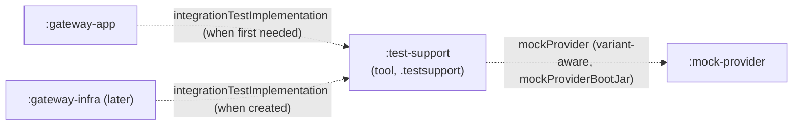
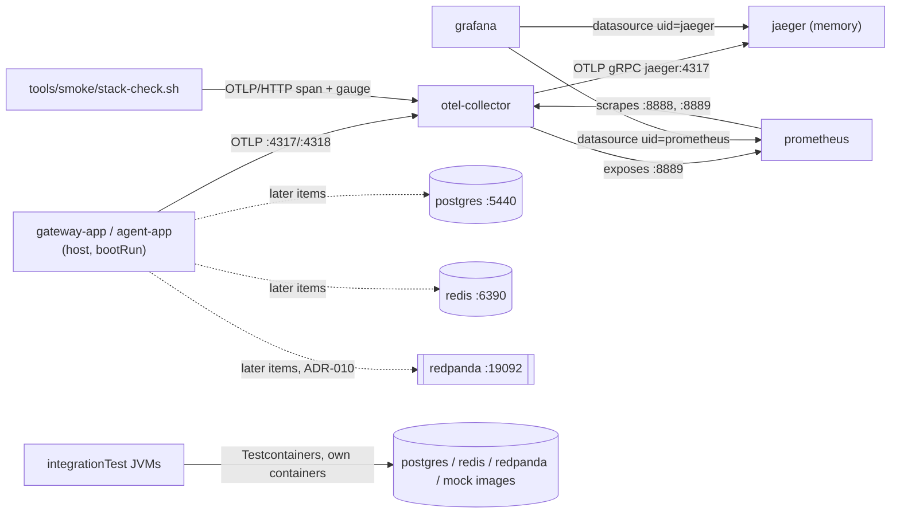

# FND-02: Local stack and Testcontainers fixtures

## 1. Context and goal

Every item after the foundation needs infrastructure the repository does not run yet: Postgres (GW-04 teams and keys, COST-02 ledger, AGT-03 runs), Redis (RL-01 limits, CACHE-01 exact cache), a Kafka-compatible broker (COST-02, if ADR-010 picks it), and a telemetry backend (OBS-01 traces, OBS-02 metrics and dashboards). `gateway-smoke` says a run is impossible until this stack exists, and CLAUDE.md already reserves its host ports.

FND-02 delivers two things. First, `deploy/compose.yaml`: Postgres, Redis, Redpanda, an OpenTelemetry collector, Jaeger, Prometheus and Grafana, wired so that OTLP sent to the collector shows up in Jaeger and Prometheus and both appear as Grafana datasources. Its ports default to the CLAUDE.md table and can be overridden per worktree with `COMPOSE_PROJECT_NAME`, so two checkouts can each run a stack. Second, shared, lazily started Testcontainers fixtures for Postgres, Redis, Redpanda and the `mock-provider` image, for every module's `integrationTest` suite (ADR-016). Each fixture is proven by one integration test, and a Docker-free test keeps their image versions equal to the compose file's.

It serves the VISION "Done for v1" line ("one command brings the stack up ... every call is visible in Jaeger and every team's cost in Grafana"), pillar 4 (accountable: traces and metrics have somewhere to go) and pillar 6 (resilient: a dependency can be stopped or paused on purpose). Users are the developers and agents who build the later items, and the platform team that "watches Grafana".

It must not decide anything those items own. Not the rate-limit algorithm or Redis eviction policy (RL-01, ADR-008), the vector store (CACHE-02, ADR-009), broker versus outbox (COST-02, ADR-010), the schema, Flyway or R2DBC versus JDBC (GW-04, ADR-006), or the app-side telemetry wiring (OBS-01, OBS-02). The stack provides the services so that those items can decide. Redpanda is provisional until ADR-010 is settled.

## 2. Scope

### In
- `deploy/compose.yaml` with seven services, pinned image tags, healthchecks where the image allows one, named volumes, memory limits, log rotation, loopback-only host ports from `LLMGW_*` variables with the CLAUDE.md defaults, and a top-level `name: llmgw` that `COMPOSE_PROJECT_NAME` overrides.
- `deploy/.env.example` (no secrets; every line commented out, plus a worktree example), `deploy/otel-collector/config.yaml`, `deploy/prometheus/prometheus.yml`, `deploy/grafana/provisioning/datasources/datasources.yaml`.
- `tools/smoke/stack-check.sh`: one script that checks a running stack (services, health, loopback ports, OTLP traces to Jaeger, OTLP metrics to Prometheus, Prometheus targets, Grafana datasources and, since the 2026-11-03 fix round, Grafana's Host enforcement). `gateway-smoke` and CI both run it.
- `.github/workflows/stack.yml`: a path-filtered workflow that brings the stack up on Linux and runs the check. `ci.yml` stays as it is.
- New module `test-support` (role `tool`, root package `io.github.pdroacordi.llmgateway.testsupport`) with `StackImages`, `SharedPostgres`, `SharedRedis`, `SharedRedpanda` and `SharedMockProvider`. Its tests: one Docker-free contract test against `deploy/compose.yaml`, and one integration test per fixture.
- Consumer-side wiring for the mock image in `llmgw.integration-test`: a `mockProvider` dependency scope. A module that declares `mockProvider(project(":mock-provider"))` gets the boot jar and Dockerfile paths as system properties in its `integrationTest` JVM (ADR-FND-03-002, consumer side).
- Architecture rules: a `testDependsOn` column in the module table, ARCH-9 extended to it, and new rule ARCH-11 (Testcontainers and `test-support` only in `integrationTest` sources), each with a violating fixture.
- Doc edits listed in step 5.

### Out
- Apps (`gateway-app`, `agent-app`) and `mock-provider` as compose services. They come later, under profiles (ADR-FND-02-005).
- Any app-side client, starter or property for Postgres, Redis, Kafka or OTLP: no `spring-boot-starter-data-redis`, no R2DBC or JDBC, no Micrometer registry, no OTel SDK. GW-04, RL-01, COST-02 and OBS-01 add them. Without a client nothing can prove `@ServiceConnection` yet; the first app item does (ADR-FND-02-007).
- Spring Boot Docker Compose support (`spring-boot-docker-compose`) (ADR-FND-02-009).
- Databases or schemas beyond the default `llmgw` database. Flyway and init scripts belong to GW-04 and AGT-03.
- Redis `maxmemory` and eviction policy (RL-01, CACHE-01). Topics and retention (COST-02). Grafana dashboards (OBS-02). A logs backend (OBS-03).
- Redpanda Console, schema registry and HTTP proxy ports, Jaeger's own OTLP ports, collector debug endpoints.
- BlockHound in `gateway-app` and the `RequestIdGenerator.next()` check that FND-04 handed to "FND-02 or GW-02". GW-02 takes it: that is where the gateway first runs a real streaming load on the event loop, and this row covers infrastructure only.
- Image digests and automated version bumps (Renovate or Dependabot).
- A Docker Hub login in CI (an account and a secret are the user's call; see section 5, Failure model).

## 3. Acceptance criteria

Checkable. All ticked before the row becomes `[x]`. Commands run from the repository root in Git Bash on Windows (Docker Desktop) unless the line says CI. "Deliberate violation" checks are made in the working tree, observed failing, and reverted.

**Compose file**
- [x] `docker compose -f deploy/compose.yaml config --quiet` exits 0. `docker compose -f deploy/compose.yaml config --services` lists exactly `postgres`, `redis`, `redpanda`, `otel-collector`, `jaeger`, `prometheus`, `grafana`.
- [x] `docker compose -f deploy/compose.yaml config` shows no `container_name`, no `latest` tag and no image without a tag. Its first line is `name: llmgw` when no `deploy/.env` exists.
- [x] Every image tag in `deploy/compose.yaml` is the one in section 5, Images (ADR-FND-02-001).
- [x] The collector config validates: `docker run --rm -v "$PWD/deploy/otel-collector/config.yaml:/etc/otelcol/config.yaml:ro" otel/opentelemetry-collector:0.164.0 validate --config=/etc/otelcol/config.yaml` exits 0 (Git Bash on Windows needs `MSYS_NO_PATHCONV=1` for the volume path). A bogus exporter type exits 1, so `validate` is not a no-op.
- [x] `deploy/.env.example` contains only commented lines and no value except the documented local-only Postgres password. `git check-ignore deploy/.env` prints `deploy/.env`, and `git check-ignore deploy/.env.example` prints nothing.

**Running stack**
- [x] From no running stack, `docker compose -f deploy/compose.yaml up -d --wait --wait-timeout 180` exits 0. `docker compose -f deploy/compose.yaml ps` shows all seven running, with `postgres`, `redis`, `redpanda`, `prometheus` and `grafana` `healthy`.
- [x] `bash tools/smoke/stack-check.sh` exits 0 and prints one `PASS` line per check in section 8, Smoke (12 after the fix round, on Grafana port 3301).
- [x] Every published port in `docker compose -f deploy/compose.yaml ps --format '{{.Service}} {{.Ports}}'` is bound to `127.0.0.1`. None is on `0.0.0.0` or `[::]`.
- [x] `docker inspect -f '{{.Name}} {{.HostConfig.Memory}}'` on each container shows the memory limit from section 5, Services (bytes). Grafana 536870912 after its limit was raised to 512m in the fix round.
- [x] Persistence: a scratch database `fnd02_check` created with `docker compose -f deploy/compose.yaml exec -T postgres createdb -U llmgw fnd02_check` still exists after `docker compose -f deploy/compose.yaml stop` and `up -d --wait`. It is then dropped with `dropdb`. Nothing is written to the `llmgw` database.
- [x] Worktree isolation: with a scratch env file (`COMPOSE_PROJECT_NAME=llmgw-check`, every `LLMGW_*_PORT` +100), passed as `--env-file` or as `deploy/.env` in a scratch copy, a second stack comes up beside the first. `stack-check.sh` passes for both, the second run with the same variables exported. `docker volume ls` shows `llmgw_postgres-data` and `llmgw-check_postgres-data`. The second stack is removed with `docker compose -p llmgw-check -f deploy/compose.yaml down`, then `docker volume rm` of the four `llmgw-check_*` volumes it created, named one by one and never a prune. The default stack is untouched (its `fnd02_check` absence and its uptime are unchanged).
- [x] Project name from `deploy/.env` (U1): with `deploy/.env` holding only `COMPOSE_PROJECT_NAME=llmgw-check`, `docker compose -f deploy/compose.yaml config | head -1` run from the repository root prints `name: llmgw-check`. If it does not, the predecided fallback in U1 is applied and recorded.

**Test fixtures**
- [x] `./gradlew projects` lists `test-support`. `Modules.kt` and the ADR-014 table carry `test-support | .testsupport | tool | FND-02`.
- [x] `./gradlew :test-support:test` (no Docker) passes `StackContractTest`. Deliberate violation: changing only the Redis tag in `deploy/compose.yaml` makes it fail, naming the service and both values. A `0.0.0.0` binding, a missing `LLMGW_*` variable or a default port that differs from the CLAUDE.md table each make it fail too. Each was made in the real file and reverted; the same cases, plus a wrong container port, a `network_mode` and a Redpanda external listener on another port (fix round), are permanent tests over in-memory compose text.
- [x] `./gradlew :test-support:integrationTest` passes:
  - `SharedPostgresTest`: JDBC `select 1` on the mapped port; `show server_version` starts with `18.6`; two concurrent first accesses from two threads return the same started container (same `containerId`).
  - `SharedRedisTest`: `PING` over a raw socket to the mapped port gets `+PONG`.
  - `SharedRedpandaTest`: Kafka `AdminClient.describeCluster` returns one node; a topic is created, and one record is produced and consumed back through `bootstrapServers`.
  - `SharedMockProviderTest`: `/actuator/health` gets 200 and `UP`; one chat completion gets 200; `reset()` succeeds.
- [x] `./gradlew :test-support:integrationTest --info` shows that the test JVM received `-DmockProvider.jar=` and `-DmockProvider.dockerfile=`. The `integrationTest` JVM of `gateway-app`, which declares no `mockProvider` dependency, receives neither. (`gateway-app` has no `integrationTest` sources yet, so its task is `NO-SOURCE`; its `--info` output has no `mockProvider` property and no `mock-provider:bootJar` dependency.)
- [x] `./gradlew :architecture-tests:test` passes with ARCH-9 (extended) and ARCH-11. `RuleFixturesTest` fails ARCH-9 on `arch-9-core-imports-test-support`, and ARCH-11 on `arch-11-testcontainers-in-unit-test` and `arch-11-test-support-in-main` (and, since the fix round, on `arch-11-testcontainers-in-core`).
- [x] Deliberate violation: `import org.testcontainers.containers.GenericContainer` in a `gateway-app/src/test` file fails ARCH-11 naming the file and import (reverted).

**Gates, CI, docs**
- [x] `.github/workflows/stack.yml` parses (`actionlint` if installed, otherwise a YAML parser). Its first CI result is recorded in the Log at the user's first push. It is not a gate for `[x]` (CLAUDE.md rule 4). (actionlint 1.7.7 and a YAML parse; the CI result is pending the first push.)
- [x] `verify-gates` green (coverage: core ≥ 80%, overall ≥ 70%; `test-support` is not in the merged report, ADR-FND-02-006).
- [x] Smoke: a `gateway-tester` run brings the stack up (or finds it up), runs `tools/smoke/stack-check.sh`, leaves the stack as found, and writes its report in `docs/knowledge/runs/`. Met by [runs/2026-11-03-smoke-local-stack](../knowledge/runs/2026-11-03-smoke-local-stack.md) (pass-with-findings; found down, left down without `-v`).
- [x] Eval: n/a (no threshold, classifier or routing policy).
- [x] Living docs updated (`docs-update`), including the new systems entry `docs/knowledge/systems/local-stack.md` and its CLAUDE.md row (step 5).

## 4. Contract

No HTTP API of ours changes. ADR-004 is unaffected: nothing here is on the OpenAI-compatible surface, and no `x-gateway-*` header or error envelope is involved.

The contract this item ships is the stack's address book. Later items, `gateway-smoke` and the apps' local profiles depend on it.

| Service | Host address (default) | Override variable | What answers there |
|---|---|---|---|
| postgres | `127.0.0.1:5440` | `LLMGW_POSTGRES_PORT` | Postgres 18.6. Database, user and password are all `llmgw` (password via `LLMGW_POSTGRES_PASSWORD`) |
| redis | `127.0.0.1:6390` | `LLMGW_REDIS_PORT` | Redis 8.10.3, no auth, no persistence |
| redpanda | `127.0.0.1:19092` | `LLMGW_KAFKA_PORT` | Kafka API, external listener, advertised as `127.0.0.1:<LLMGW_KAFKA_PORT>` |
| otel-collector | `127.0.0.1:4317` / `127.0.0.1:4318` | `LLMGW_OTLP_GRPC_PORT` / `LLMGW_OTLP_HTTP_PORT` | OTLP gRPC / OTLP HTTP (`/v1/traces`, `/v1/metrics`) |
| jaeger | `127.0.0.1:16686` | `LLMGW_JAEGER_UI_PORT` | Jaeger UI and its query API: lookup by ID (`/api/traces/<id>`) and the v3 API (`/api/v3/services`, `/api/v3/traces?query.service_name=...`). Jaeger 2.22.0 has no legacy search route (`/api/services`, `/api/traces?service=` are 404; [gotcha](../knowledge/gotchas/jaeger-2-22-legacy-search-api-404-breaks-grafana-health.md)). Revised 2026-11-03 from "`/api/services`, `/api/traces/<id>`" (U6). |
| prometheus | `127.0.0.1:9090` | `LLMGW_PROMETHEUS_PORT` | Prometheus UI and HTTP API |
| grafana | `127.0.0.1:3301` | `LLMGW_GRAFANA_PORT` | Grafana, anonymous Admin answering only `Host: 127.0.0.1` (opened as `http://127.0.0.1:<port>`), datasource UIDs `prometheus` and `jaeger`. Revised 2026-11-03 from `127.0.0.1:3001` and plain anonymous Admin (fix round: port held by dev servers, DNS rebinding). |

- Project name: `llmgw` (top-level `name:`), overridden by `COMPOSE_PROJECT_NAME`. Containers, the network and volumes are prefixed with it, so two projects share nothing.
- Inside the compose network, services reach each other by service name: `jaeger:4317`, `otel-collector:8888`, `prometheus:9090`.
- Ports 8080, 8081 and 8090 stay reserved for the apps and the mock, which run outside compose for now. In a worktree, change their ports with `SERVER_PORT` on `bootRun`.

## 5. Design

### Images (ADR-FND-02-001)

Checked 2026-11-03 on the vendors' release pages and registries (references). Tags are exact releases, not floating majors. There are no digests (ADR-FND-02-001 D).

| Service | Image | Released | Licence | Note |
|---|---|---|---|---|
| postgres | `postgres:18.6-trixie` | 18.6 is the current 18.x minor (postgresql.org versioning) | PostgreSQL | 19 is at RC 1 (2026-10-15), not GA. Docker Official Image. |
| redis | `redis:8.10.3-trixie` | 2026-11-01 (Hub) | RSALv2 / SSPLv1 / AGPLv3 (tri-licence, Redis 8+) | The Redis 8 Open Source image bundles the Query Engine, JSON and vector sets (Redis 8 GA post). |
| redpanda | `docker.redpanda.com/redpandadata/redpanda:v26.2.6` | 2026-10-23 | BSL 1.1 (source-available, Apache-2.0 after the change date) | Provisional, ADR-010. The registry Testcontainers' Redpanda module documents. |
| otel-collector | `otel/opentelemetry-collector:0.164.0` | 2026-10-26 | Apache-2.0 | Core distribution, `FROM scratch`. Its manifest has the OTLP receiver, `batch`, `memory_limiter`, the OTLP exporters, `prometheus` exporter, `transform`, `filter`, `health_check`. |
| jaeger | `jaegertracing/jaeger:2.22.0` | 2026-10-06 | Apache-2.0 | Jaeger v2 all-in-one (v1 is archived at 1.76). In-memory storage, 100 000 traces (bundled `all-in-one.yaml`). |
| prometheus | `prom/prometheus:v3.15.1-busybox` | 2026-10-21 | Apache-2.0 | `-busybox` for `wget` in the healthcheck. |
| grafana | `grafana/grafana:13.3.0` | 2026-10-27 | AGPLv3 (OSS edition) | Default variant (Alpine, Grafana Docker docs), which has `wget`. |

### Services (ADR-FND-02-002, ADR-FND-02-004)

Every service: no `container_name`, no `restart` policy (the default `no`), and logging `json-file` with `max-size: 10m`, `max-file: "3"` (one `x-logging` anchor). Every published port is `"127.0.0.1:${LLMGW_<X>_PORT:-<default>}:<container port>"`.

| Service | Container port | Healthcheck (interval 5 s, timeout 3 s, retries 30) | Volume | Memory limit | Other settings |
|---|---|---|---|---|---|
| postgres | 5432 | `pg_isready -h 127.0.0.1 -U llmgw -d llmgw` (TCP, so the entrypoint's socket-only init server does not count as ready) | `postgres-data:/var/lib/postgresql` (the 18+ image moved the volume there; PGDATA is `/var/lib/postgresql/18/docker`) | 512m | `POSTGRES_USER=llmgw`, `POSTGRES_DB=llmgw`, `POSTGRES_PASSWORD=${LLMGW_POSTGRES_PASSWORD:-llmgw}` |
| redis | 6379 | `redis-cli ping` piped to `grep -q PONG` | none | 512m | command `redis-server --save "" --appendonly no`: soft state by design. No `maxmemory` (RL-01 and CACHE-01 set it). |
| redpanda | 19092 (external). Internal 9092, admin 9644: not published | `rpk cluster health` (exit 0 when healthy, 10 when not) | `redpanda-data:/var/lib/redpanda/data` | 1536m | `redpanda start --mode dev-container --smp 1 --memory 1G --default-log-level=warn --kafka-addr internal://0.0.0.0:9092,external://0.0.0.0:19092 --advertise-kafka-addr internal://redpanda:9092,external://127.0.0.1:${LLMGW_KAFKA_PORT:-19092}`. The advertised external port must equal the host port. |
| otel-collector | 4317, 4318. Internal 8888 (self metrics), 8889 (exporter) | none: `scratch` image, no shell | none | 256m | `./otel-collector/config.yaml` mounted read-only at `/etc/otelcol/config.yaml` (the image's default `--config`). `depends_on: jaeger` (started). |
| jaeger | 16686. Internal 4317 | none: no shell in the image is documented | none (memory store) | 1g | `JAEGER_LISTEN_HOST=0.0.0.0` (the bundled config binds `localhost` by default; U2: the 2.22.0 image already sets it, ours is a deliberate duplicate) |
| prometheus | 9090 | `wget -qO- http://127.0.0.1:9090/-/ready` | `prometheus-data:/prometheus` | 512m | command `--config.file=/etc/prometheus/prometheus.yml --storage.tsdb.path=/prometheus --storage.tsdb.retention.time=7d --storage.tsdb.retention.size=1GB`; `./prometheus/prometheus.yml` mounted read-only. `depends_on: otel-collector` (started). |
| grafana | 3000 (host 3301) | `wget -qO- http://127.0.0.1:3000/api/health` | `grafana-data:/var/lib/grafana` | 512m | `GF_AUTH_ANONYMOUS_ENABLED=true`, `GF_AUTH_ANONYMOUS_ORG_ROLE=Admin`, `GF_AUTH_DISABLE_LOGIN_FORM=true`, `GF_ANALYTICS_REPORTING_ENABLED=false`, `GF_ANALYTICS_CHECK_FOR_UPDATES=false`, `GF_SERVER_DOMAIN=127.0.0.1`, `GF_SERVER_ENFORCE_DOMAIN=true`, `GF_SERVER_ROOT_URL=http://127.0.0.1:${LLMGW_GRAFANA_PORT:-3301}/`; `./grafana/provisioning` mounted read-only at `/etc/grafana/provisioning`. `depends_on: prometheus` (healthy), `jaeger` (started). Revised 2026-11-03 (fix round) from host 3001, 384m and no `GF_SERVER_*`: 3000 and 3001 are taken by Next.js dev servers, which on Docker Desktop does not fail `up` ([gotcha](../knowledge/gotchas/docker-desktop-publishes-ports-held-by-windows-processes.md)); Grafana sat at its 384m ceiling (smoke finding 3); the host is enforced against DNS rebinding ([bug](../knowledge/bugs/grafana-anonymous-admin-reachable-through-dns-rebinding.md)). |

Limits are ceilings, not reservations. The idle target is under 2.5 GB in total (section 9). No CPU limits: OPS-01 sets them for load runs.

### Telemetry configuration (ADR-FND-02-003)

`deploy/otel-collector/config.yaml`:

| Section | Setting |
|---|---|
| receivers | `otlp` with `grpc.endpoint: 0.0.0.0:4317` and `http.endpoint: 0.0.0.0:4318`. The collector defaults to `localhost`, which is unreachable through a published port. |
| processors | `memory_limiter` (`check_interval: 1s`, `limit_percentage: 80`, `spike_limit_percentage: 25`), then `batch` (defaults) |
| exporters | `otlp_grpc/jaeger`: `endpoint: jaeger:4317`, `tls.insecure: true` (U3). `prometheus`: `endpoint: 0.0.0.0:8889` |
| pipelines | `traces`: otlp → memory_limiter, batch → otlp_grpc/jaeger. `metrics`: otlp → memory_limiter, batch → prometheus. No `logs` pipeline (OBS-03). |
| telemetry | `metrics.readers: [pull.exporter.prometheus {host: 0.0.0.0, port: 8888}]` |
| extensions | none. `health_check` would only help a probe that cannot run in a `scratch` image; Prometheus' scrape of `:8888` and the OTLP round trip in `stack-check.sh` prove liveness. |

No `debug` exporter: at `detailed` verbosity it prints every span attribute into the container log (Observability, below).

`deploy/prometheus/prometheus.yml`: `global.scrape_interval: 15s`, `evaluation_interval: 15s`. Jobs `prometheus` → `localhost:9090`, `otel-collector` → `otel-collector:8888`, `otel-collector-exporter` → `otel-collector:8889`. No job for the apps: OBS-02 adds one if it chooses Micrometer's Prometheus registry over OTLP push.

`deploy/grafana/provisioning/datasources/datasources.yaml` (`apiVersion: 1`):
- `Prometheus`: `type: prometheus`, `uid: prometheus`, `url: http://prometheus:9090`, `access: proxy`, `isDefault: true`, `editable: false`.
- `Jaeger`: `type: jaeger`, `uid: jaeger`, `url: http://jaeger:16686`, `access: proxy`, `editable: false`.

The UIDs are part of the contract. OBS-02 dashboards reference them.

### Ports, names and worktrees (ADR-FND-02-002)

- `deploy/compose.yaml` starts with `name: llmgw`. Compose's precedence is `-p` > `COMPOSE_PROJECT_NAME` > top-level `name` > directory name, so a worktree sets `COMPOSE_PROJECT_NAME` and every container, network and volume gets its own prefix.
- With `-f deploy/compose.yaml`, the project directory is `deploy/`, and Compose reads `deploy/.env` for interpolation. Worktree overrides therefore live in `deploy/.env`, copied from `deploy/.env.example` and gitignored by the existing `.env` pattern.
- `deploy/.env.example` holds the eight `LLMGW_*_PORT` variables, `LLMGW_POSTGRES_PASSWORD` and `COMPOSE_PROJECT_NAME`, all commented out with their defaults. A second commented block shows a worktree: `COMPOSE_PROJECT_NAME=llmgw-wt2` and every port +100 (5540, 6490, 19192, 4417, 4418, 16786, 9190, 3401; Grafana's was 3101 before the 2026-11-03 move to 3301). It also has a one-line note that apps in a worktree use `SERVER_PORT`, and that tools read the same variables (`set -a; . deploy/.env; set +a`).
- The Postgres password is a fixed local credential, not a secret (CLAUDE.md rule 2). It protects throwaway data on a loopback-only port, and Testcontainers uses its own.

### Modules and ports

No port interface is added: the stack and the fixtures are not a capability of the gateway. Module changes:



**`test-support`** (ADR-FND-02-006). Applies `llmgw.kotlin-jvm` (its one convention plugin) plus Gradle's core `java-library` for `api`. It has no Spring and imports nothing of ours.

| Configuration | Dependency | Why |
|---|---|---|
| `api` | `platform(spring-boot-dependencies)` | Aligns Testcontainers (Boot 4.1.2 manages 2.0.5), the Postgres driver, `kafka-clients` and SnakeYAML with the versions the apps get. Under the catalog-≥-Boot rule it cannot lower anything. |
| `api` | `testcontainers-core`, `testcontainers-postgresql`, `testcontainers-redpanda` | Container types are part of the public API, so Spring tests can put `@ServiceConnection` on them. |
| `runtimeOnly` | `org.postgresql:postgresql` | `PostgreSQLContainer` checks readiness over JDBC and the module ships no driver (Testcontainers Postgres docs). |
| `testImplementation` | `org.yaml:snakeyaml` | `StackContractTest` parses `deploy/compose.yaml`. |
| `integrationTestImplementation` | `org.apache.kafka:kafka-clients` | `SharedRedpandaTest` only. |
| `mockProvider` | `project(":mock-provider")` | `SharedMockProvider` and its test. |

New catalog aliases, all versionless (from the Boot BOM): `testcontainers-postgresql`, `testcontainers-redpanda`, `postgresql`, `kafka-clients`, `snakeyaml`.

Public API, under `io.github.pdroacordi.llmgateway.testsupport` (KDoc one line each):

```kotlin
object StackImages {                       // mirrors deploy/compose.yaml; StackContractTest keeps them equal
    const val POSTGRES: String             // "postgres:18.6-trixie"
    const val REDIS: String                // "redis:8.10.3-trixie"
    const val REDPANDA: String             // "docker.redpanda.com/redpandadata/redpanda:v26.2.6"
}
object SharedPostgres { val container: PostgreSQLContainer }            // started on first access; db, user, password "llmgw"
object SharedRedis { val container: GenericContainer<*>; val uri: String }        // "redis://<host>:<mapped port>"
object SharedRedpanda { val container: RedpandaContainer; val bootstrapServers: String }
object SharedMockProvider { val container: GenericContainer<*>; val baseUrl: String; fun reset() }
```

- Each `container` is created and started once per test JVM, inside a synchronized `lazy`. Ryuk removes it when the JVM ends; nothing calls `stop()` (ADR-FND-02-007).
- Start timeouts: Postgres 60 s, Redis 30 s, Redpanda 90 s, mock 90 s. Redis waits for the log line `Ready to accept connections`. The others use their module's default wait strategy, and the mock waits for `/actuator/health` 200, as in `MockProviderImageTest`.
- Kotlin cannot infer `GenericContainer`'s self type, so `SharedRedis` and `SharedMockProvider` use a private subclass, as `MockProviderImageTest` does.
- `SharedMockProvider` builds its image with `ImageFromDockerfile` from the system properties `mockProvider.jar` and `mockProvider.dockerfile`. When either is missing it fails with: "declare mockProvider(project(":mock-provider")) in this module's build". `reset()` sends `POST /__mock/reset` with `java.net.http.HttpClient` and a 10 s timeout, and fails on a non-2xx status.
- State is shared across the test classes of one JVM. Isolation rules for consumers, written as KDoc on each object:
  - Postgres: create your own schema or database per test class.
  - Redis: prefix keys per test class, or `FLUSHDB` in `@BeforeEach`. Gradle runs a module's test classes serially in one JVM.
  - Redpanda: a unique topic name per test.
  - Mock: `reset()` in `@BeforeEach` (FND-03 guidance).

**`llmgw.integration-test` convention** (ADR-FND-02-010). It adds:
- a dependency scope `mockProvider`;
- a resolvable `mockProviderJar` that extends it and requests `Category` = `mock-provider-boot-jar`, the attribute `mock-provider`'s consumable `mockProviderBootJar` carries;
- on the `integrationTest` task, when that configuration is non-empty: the jar as an input (path sensitivity `NONE`), `mock-provider/Dockerfile` from the root project directory as an input, and a `CommandLineArgumentProvider` adding `-DmockProvider.jar=<abs>` and `-DmockProvider.dockerfile=<abs>`.

A module that declares no dependency gets no input and no property. The jar is built by the artifact's task dependency, never by referencing another project's task. The local-`val` capture follows the configuration-cache gotcha. `mock-provider`'s own build keeps passing `mockProvider.jar` itself, and its `MockProviderImageTest` stays as it is: the mock imports nothing of ours (systems entry, rule 6).

**Architecture rules** (ADR-017 proposed, ADR-FND-02-006):
- `Module` gains `testDependsOn: List<String> = emptyList()`. Set to `listOf("test-support")` for `gateway-providers`, `gateway-infra`, `gateway-app`, `agent-app` and `cli`. Empty for both core modules (core tests are plain JUnit, CLAUDE.md Testing), `mock-provider` (imports nothing of ours), `evals` (CACHE-03 may add it), `architecture-tests` and `test-support`.
- New table row: `Module("test-support", "$BASE_PACKAGE.testsupport", Role.TOOL)`.
- `ModuleFile` gains `sourceSet: String`: Konsist's `sourceSetName` in the production scope, and the path segment after `<module>/src/` in `RuleFixturesTest`, because every fixture's own source set is `fixtures`.
- ARCH-9: in an `integrationTest` source set, the allowed roots are the module's own root, `dependsOn` and `testDependsOn`. Everywhere else they are its own root and `dependsOn`, as today.
- ARCH-11 (new, `TestSupportRulesTest`): `org.testcontainers` may be imported or written inline only in `integrationTest` source sets and in `test-support`'s `main`. `io.github.pdroacordi.llmgateway.testsupport` may be referenced only from `integrationTest` source sets. The failure message names ARCH-11, the file, the import and "ADR-016, ADR-017". This makes ADR-016's "tests that need Docker live in `src/integrationTest`" a checked rule.
  - Revised 2026-11-03 (review, fix round): the `integrationTest` exemption does not apply to core modules, so `org.testcontainers` is forbidden in every source set of `gateway-core` and `agent-core` (core tests are plain JUnit, CLAUDE.md Testing); fixture `arch-11-testcontainers-in-core`. Konsist reads no `.kts`, so the build adds `checkTestSupportClasspath` (in `llmgw.kotlin-jvm`, wired into `check`): it fails when `:test-support` or group `org.testcontainers` resolves on a `main` or `test` classpath of any module but test-support.
- Fixtures under `architecture-tests/src/fixtures/kotlin/`:
  - `arch-9-core-imports-test-support/gateway-core/src/integrationTest/kotlin/...`
  - `arch-11-testcontainers-in-unit-test/gateway-app/src/test/kotlin/...`
  - `arch-11-test-support-in-main/gateway-app/src/main/kotlin/...`

**`StackContractTest`** (in `test-support/src/test`, Docker-free; ADR-FND-02-008). It reads `../deploy/compose.yaml`, declared as a test input through the root project directory so the test reruns when the file changes, and asserts:
1. The images of `postgres`, `redis` and `redpanda` equal `StackImages`.
2. Every service image has an explicit tag that is not `latest`.
3. No service has `container_name`.
4. Every `ports` entry has the form `127.0.0.1:${LLMGW_<X>_PORT:-<n>}:<m>`, with `<n>` equal to the CLAUDE.md default in a map kept in the test (postgres 5440, redis 6390, redpanda 19092, otel-collector 4317 and 4318, jaeger 16686, prometheus 9090, grafana 3301; 3001 before the 2026-11-03 fix round) and, since that round, `<m>` equal to the documented container port.
5. The redpanda command advertises `external://127.0.0.1:${LLMGW_KAFKA_PORT:-19092}`, and (fix round) its `--kafka-addr` external listener is the published container port.
6. (Fix round, 2026-11-03) No service sets `network_mode`.

Failure messages name the service and both values.

### Data

No Flyway table, no Redis key, no topic: those belong to GW-04, RL-01, CACHE-01 and COST-02.

| Fact | Source of truth |
|---|---|
| Image versions of the stack | `deploy/compose.yaml`; `StackImages` mirrors three of them, enforced by `StackContractTest` |
| Host ports | `deploy/compose.yaml` defaults, equal to the CLAUDE.md table (enforced by `StackContractTest`); a worktree's `deploy/.env` overrides them |
| Dev data | Named volumes `postgres-data`, `redpanda-data`, `prometheus-data`, `grafana-data`, prefixed with the project name. Redis and Jaeger keep nothing across restarts. |
| Test data | Testcontainers containers only, removed by Ryuk at JVM end. Integration tests never use the dev stack. |

Retention: Prometheus 7 days or 1 GB, whichever comes first. Jaeger holds 100 000 traces in memory. Redpanda's dev-container mode allows topic auto-creation; COST-02 decides topics explicitly.

### Flow



`docs/diagrams/container-overview.md` gets one bullet and one edge in step 5 (Grafana → Jaeger datasource).

### Failure model

The stack is development infrastructure. The gateway's fail-open or fail-closed behaviour when Redis, Postgres or the broker is down belongs to RL-01/RL-03, CACHE-01, GW-04 and COST-02. This item gives them ways to cause those conditions, and defines how the stack and the fixtures themselves fail.

| Event | Behaviour | Why |
|---|---|---|
| A host port is taken (another project) | By another container: `up` fails with Docker's "port is already allocated". By a Windows process on Docker Desktop: `up` succeeds and the host port keeps reaching that process (smoke finding 1, [gotcha](../knowledge/gotchas/docker-desktop-publishes-ports-held-by-windows-processes.md)); `scripts/preflight.sh` warns about held stack ports while the project is down, and `stack-check.sh` fails on the affected check. Fix: set the variable in `deploy/.env`. Revised 2026-11-03 from "`up` fails" alone. | Loud and local. No silent fallback to a random port, which would break every tool's defaults. |
| A service crashes | It stays down (no restart policy). `ps` and `stack-check.sh` show it. Preflight lists running services. | A dev stack that silently restarts hides crashes. One that revives after a reboot keeps forgotten worktree stacks eating memory. |
| Collector or Jaeger misconfigured | The container exits, and `up --wait` fails on it. | Neither has an in-image healthcheck, so `--wait` treats "running" as ready and the OTLP round trip in `stack-check.sh` is the real check. |
| Simulating a dependency that is down or slow (for RL-03, OPS-02, COST-02) | `docker compose -f deploy/compose.yaml stop redis` (down, connection refused); `pause redis` (hung: connections accepted by the proxy, no replies); `unpause` and `start` to recover. In tests: `container.dockerClient.pauseContainerCmd(id)` on a private container, never on a `Shared*` one. | Gives each later item a scripted path to its failure test without new tooling. |
| Docker daemon absent in `integrationTest` | Fails with Testcontainers' message, never skips (ADR-016). | Unchanged. |
| Image pull fails (network, registry rate limit) | The fixture's first access throws and the test class fails. CI fails. | Docker Hub's unauthenticated limits were reported hitting GitHub-hosted runners in October 2026 (community discussion 209949). The fix is a Docker Hub login with a repository secret, an account decision for the user. Fallback without an account: Google's `mirror.gcr.io` copies of the official images. |
| A fixture container dies mid-run | Later tests in that JVM fail on connection. Nothing restarts it. | A restarted singleton hides flakiness; a failing run surfaces it. |
| A Spring context closes while a `Shared*` container is in use | Must not stop the container (U12). | Boot stops container beans with the context; a singleton shared by contexts must not be a stoppable bean of one of them. |
| Ryuk disabled (`TESTCONTAINERS_RYUK_DISABLED=true`) | Singletons leak after the JVM ends. Do not disable it. | Nothing else stops the shared containers (ADR-FND-02-007). |
| `docker compose down -v` | Never on a stack you did not create (`gateway-smoke`, `gateway-tester`, `feature-loop`; denied in `.claude/settings.json`). The CI job removes its own ephemeral stack. | Volumes are the only dev data. |

No timeouts or retries in our code: no request path changes. Each fixture has the explicit start timeout above, and the mock `reset()` call has 10 s.

### Observability

- The stack is the observability backend the later items write to. OTLP enters only through the collector. Traces go to Jaeger. Metrics are exposed in Prometheus format by the collector's `prometheus` exporter (`:8889`) and scraped every 15 s. The collector's own telemetry (`:8888`, for example `otelcol_receiver_accepted_spans`, `otelcol_exporter_sent_spans`) is scraped too, so a drop in the pipeline is itself visible.
- No GenAI attributes or spans are defined here (OBS-01).
- Never recorded: the collector has no `debug` exporter and no logs pipeline. A `debug` exporter at `detailed` verbosity would copy every span attribute, including any prompt text an app mistakenly attached, into the container log, which `docker compose logs` and CI artifacts expose. Adding one is a reviewed change, never a convenience. `stack-check.sh` sends only synthetic data: service `llmgw-stack-check`, a random trace ID, one gauge.
- Grafana runs with anonymous Admin on a loopback-only port, with the host enforced (`GF_SERVER_ENFORCE_DOMAIN`, domain `127.0.0.1`): local convenience, not a pattern for OPS-03. Loopback keeps the LAN out but not a DNS-rebinding page in the developer's browser ([bug](../knowledge/bugs/grafana-anonymous-admin-reachable-through-dns-rebinding.md)); `stack-check.sh` check `grafana-host` proves the enforcement. Revised 2026-11-03 (review) from loopback alone.

### Configuration

| Name | Where | Default | Unit / note |
|---|---|---|---|
| `COMPOSE_PROJECT_NAME` | shell or `deploy/.env` | `llmgw` (top-level `name`) | lowercase letters, digits, `-`, `_` |
| `LLMGW_POSTGRES_PORT`, `LLMGW_REDIS_PORT`, `LLMGW_KAFKA_PORT`, `LLMGW_OTLP_GRPC_PORT`, `LLMGW_OTLP_HTTP_PORT`, `LLMGW_JAEGER_UI_PORT`, `LLMGW_PROMETHEUS_PORT`, `LLMGW_GRAFANA_PORT` | same | 5440, 6390, 19092, 4317, 4318, 16686, 9090, 3301 (Grafana 3001 before 2026-11-03) | TCP port on 127.0.0.1 |
| `LLMGW_POSTGRES_PASSWORD` | same | `llmgw` | local-only, not a secret |
| Prometheus retention | compose command | 7 d / 1 GB | |
| Prometheus scrape interval | `prometheus.yml` | 15 s | |
| Memory limits | compose `deploy.resources.limits.memory` | table above | bytes in `docker inspect` |
| `mockProvider.jar`, `mockProvider.dockerfile` | `integrationTest` JVM system properties, set by `llmgw.integration-test` | absent unless the module declares `mockProvider(...)` | absolute paths |
| Fixture start timeouts | `test-support` constants | Postgres 60, Redis 30, Redpanda 90, mock 90 | s |

## 6. Reuse

- ADR-016 (the `integrationTest` suite; this item ships the fixtures it promised), ADR-FND-03-002 (the mock image built from `mockProviderBootJar` and `mock-provider/Dockerfile`; this item adds the consumer side), ADR-014 (module creation checklist; a new `tool` module), ADR-FND-01-004 (one convention plugin per module, native BOM platforms, the catalog-≥-Boot rule), ADR-FND-01-007 (rules keyed by the module table).
- `mock-provider/src/integrationTest/.../MockProviderImageTest.kt`: the `ImageFromDockerfile` setup and the self-type subclass, mirrored in `SharedMockProvider`.
- Pattern [`patterns/architecture-rule-with-violating-fixture`](../knowledge/patterns/architecture-rule-with-violating-fixture.md): ARCH-11 and the ARCH-9 extension each get a fixture that must fail.
- Gotchas: [`gradle-configuration-cache-rejects-script-object-in-lambda`](../knowledge/gotchas/gradle-configuration-cache-rejects-script-object-in-lambda.md) (the argument provider captures a local), [`detekt-default-test-excludes-miss-integration-test`](../knowledge/gotchas/detekt-default-test-excludes-miss-integration-test.md) and [`kover-excludes-only-the-test-compilation-by-default`](../knowledge/gotchas/kover-excludes-only-the-test-compilation-by-default.md) (already handled for every module by the conventions), [`gradle-version-catalog-alias-prefix-needs-asprovider`](../knowledge/gotchas/gradle-version-catalog-alias-prefix-needs-asprovider.md) (new aliases avoid prefixes of existing ones), [`git-bash-grep-ignore-case-fixed-strings-aborts`](../knowledge/gotchas/git-bash-grep-ignore-case-fixed-strings-aborts.md) (`stack-check.sh` never uses `grep -iF` and checks grep's exit code), [`konsist-paths-and-module-names-use-platform-separator`](../knowledge/gotchas/konsist-paths-and-module-names-use-platform-separator.md) (the source-set segment is read from the normalized path).
- `scripts/preflight.sh` already runs `docker compose -f deploy/compose.yaml ps --services --filter status=running`. Run from the root, Compose resolves `deploy/.env`, so it reports the worktree's own project. Since the fix round it also warns, while that project is down, about each stack port another process listens on (smoke finding 1).

## 7. Execution plan

Steps of about half a day each; tick as they land. Run Gradle from Git Bash at the repository root; never two builds at once. Work on a stack you created; leave any stack you found as you found it.

- [x] **Step 1: compose and configuration.** Write `deploy/compose.yaml`, `deploy/.env.example` and the three config files per section 5. Run `config --quiet`, the collector `validate`, `docker compose pull`, then `up -d --wait`. Settle U1 to U5, U10 and U14 on Windows with the predecided fallbacks, and record each outcome in the Log.
- [x] **Step 2: stack check and CI.** Write `tools/smoke/stack-check.sh` (section 8, Smoke). Run the persistence, memory-limit, loopback and worktree-isolation checks of section 3, settling U1, U6, U7 and U9. Write `.github/workflows/stack.yml`: path filter `deploy/**`, `tools/smoke/stack-check.sh`, `.github/workflows/stack.yml`; `permissions: contents: read`; one job on `ubuntu-latest`, `timeout-minutes: 15`, steps `actions/checkout@v7` (`persist-credentials: false`), `config --quiet`, `up -d --wait --wait-timeout 180`, `bash tools/smoke/stack-check.sh`, then `docker compose logs --no-color` on failure and `docker compose down -v` with `if: always()`. That runner's stack is its own and ephemeral.
- [x] **Step 3: `test-support` and the three service fixtures.**
  - Write `StackContractTest` first (red with no `StackImages`), then `StackImages` (green), then the deliberate drift checks.
  - Module wiring: `settings.gradle.kts` include, `test-support/build.gradle.kts`, catalog aliases.
  - `SharedPostgres`, `SharedRedis`, `SharedRedpanda` and their integration tests.
  - No `kover(project(":test-support"))` line in the root build: no production code (ADR-FND-02-006).
- [x] **Step 4: mock fixture and rules.**
  - The `mockProvider` scope in `llmgw.integration-test`, `SharedMockProvider` and its test; `--info` check that only `test-support` gets the properties.
  - `Modules.kt` row and `testDependsOn`; `ModuleFile.sourceSet` (settles U8).
  - Fixtures first (red), then the ARCH-9 extension and ARCH-11 (green); the deliberate ARCH-11 violation.
  - `./gradlew build`.
- [x] **Step 5: docs, gates, smoke.** In `docs-update` order:
  - Create `docs/knowledge/systems/local-stack.md` from `systems/_template.md`: summary; contract rules 1 to 6 below; how it works (services, telemetry path, fixtures, consumer wiring); configuration (section 5 table); decisions (this spec's ADRs); gotchas found. Index it in `docs/knowledge/INDEX.md` (Systems). Contract rules:
    1. Every published port binds `127.0.0.1` and comes from an `LLMGW_*_PORT` variable whose default is the CLAUDE.md port (`StackContractTest`).
    2. An image tag changes in `deploy/compose.yaml` and `StackImages` together (`StackContractTest`).
    3. No `container_name`. The project name comes from `name:` or `COMPOSE_PROJECT_NAME`, so two projects never share a container, network or volume.
    4. Nothing runs `down -v` on a stack it did not create. Dev data lives only in named volumes.
    5. Integration tests never use the dev stack. Testcontainers and `org.testcontainers` live only in `integrationTest` sources and `test-support` (ARCH-11). A `Shared*` container is never stopped by a test or a Spring context.
    6. Grafana datasource UIDs `prometheus` and `jaeger` never change.
  - CLAUDE.md, Systems table: row `| Local stack and test fixtures | [local-stack](docs/knowledge/systems/local-stack.md) | Host ports bind 127.0.0.1 from LLMGW_*_PORT with the defaults below; an image tag changes in deploy/compose.yaml and StackImages together; integration tests never touch the dev stack. |`
  - CLAUDE.md, Architecture: "Built today" adds "`test-support` (FND-02, Testcontainers fixtures for `integrationTest` sources only)". The graph block gains `test-support                                         (Testcontainers fixtures; integrationTest only; imports nothing of ours; FND-02)`.
  - CLAUDE.md, Testing:
    - The compose line becomes `docker compose -f deploy/compose.yaml up -d --wait   # local stack; overrides in deploy/.env`. Add `bash tools/smoke/stack-check.sh   # stack health, OTLP to Jaeger and Prometheus, Grafana datasources`.
    - The Integration-tests bullet gains: "Shared, lazily started containers come from `test-support` (`SharedPostgres`, `SharedRedis`, `SharedRedpanda`, `SharedMockProvider`; images in `StackImages`, kept equal to `deploy/compose.yaml` by `StackContractTest`). A module adds `integrationTestImplementation(project(":test-support"))`, and `mockProvider(project(":mock-provider"))` for the mock image."
  - CLAUDE.md, Local ports: the intro becomes "Reserved so this stack can run beside other projects. `deploy/compose.yaml` binds each to 127.0.0.1 from an `LLMGW_*_PORT` variable with this default; a worktree sets `COMPOSE_PROJECT_NAME` and the ports in `deploy/.env` (copy `deploy/.env.example`)." The table is unchanged (confirmed).
  - CLAUDE.md, Project structure: add `test-support/   Testcontainers fixtures for integrationTest suites`. The `deploy/` line becomes `compose.yaml, OTel collector, Prometheus, Grafana provisioning; later Helm`.
  - `.claude/skills/gateway-smoke/SKILL.md`:
    - The intro drops "Until FND-02 (stack) lands, say the run is not possible and why."
    - Step 1 becomes "`docker compose -f deploy/compose.yaml ps`; start what is missing with `up -d --wait` and note that you started it; then `bash tools/smoke/stack-check.sh` (a FAIL is a finding: quote it)". The Trace line adds that `stack-check.sh` traces appear as service `llmgw-stack-check`.
  - `.claude/skills/preflight/SKILL.md` step 5: "(`COMPOSE_PROJECT_NAME`, documented by FND-02)" becomes "(`COMPOSE_PROJECT_NAME` and `LLMGW_*_PORT` in `deploy/.env`, from `deploy/.env.example`; systems entry `local-stack`)". Step 7 becomes `up -d --wait`.
  - `scripts/preflight.sh`: in a linked worktree (`git rev-parse --git-dir` differs from `--git-common-dir`) without `deploy/.env`, add the note (not a warning) "worktree without deploy/.env: compose commands here act on the shared `llmgw` stack". It still exits 0.
  - `docs/GLOSSARY.md` rows: Local stack (`deploy/compose.yaml`, the seven development services); Shared container (`SharedPostgres` and siblings: one Testcontainers container per test JVM, started on first use, removed by Ryuk); Stack check (`tools/smoke/stack-check.sh`).
  - `docs/diagrams/container-overview.md`: edge `grafana -.->|datasource| jaeger`. One bullet: "In development all infrastructure runs from `deploy/compose.yaml` on loopback ports (CLAUDE.md); the apps and the mock run on the host (FND-02)." Update the `Updated` line.
  - `docs/DECISIONS.md`: ADR-017 and the dated lines on ADR-010, ADR-014 and ADR-016 proposed in the hand-back.
  - `docs/roadmap.md` FND-02 row: status, spec link, systems link.
  - Then `verify-gates`, the `gateway-tester` run, and a Log entry with each unverified item's outcome.

**Files created:**

```
deploy/compose.yaml
deploy/.env.example
deploy/otel-collector/config.yaml
deploy/prometheus/prometheus.yml
deploy/grafana/provisioning/datasources/datasources.yaml
tools/smoke/stack-check.sh
.github/workflows/stack.yml
test-support/build.gradle.kts
test-support/src/main/kotlin/io/github/pdroacordi/llmgateway/testsupport/StackImages.kt
test-support/src/main/kotlin/io/github/pdroacordi/llmgateway/testsupport/SharedPostgres.kt
test-support/src/main/kotlin/io/github/pdroacordi/llmgateway/testsupport/SharedRedis.kt
test-support/src/main/kotlin/io/github/pdroacordi/llmgateway/testsupport/SharedRedpanda.kt
test-support/src/main/kotlin/io/github/pdroacordi/llmgateway/testsupport/SharedMockProvider.kt
test-support/src/test/kotlin/io/github/pdroacordi/llmgateway/testsupport/StackContractTest.kt
test-support/src/integrationTest/kotlin/io/github/pdroacordi/llmgateway/testsupport/SharedPostgresTest.kt
test-support/src/integrationTest/kotlin/io/github/pdroacordi/llmgateway/testsupport/SharedRedisTest.kt
test-support/src/integrationTest/kotlin/io/github/pdroacordi/llmgateway/testsupport/SharedRedpandaTest.kt
test-support/src/integrationTest/kotlin/io/github/pdroacordi/llmgateway/testsupport/SharedMockProviderTest.kt
architecture-tests/src/test/kotlin/io/github/pdroacordi/llmgateway/architecture/TestSupportRulesTest.kt   (ARCH-11)
architecture-tests/src/fixtures/kotlin/arch-9-core-imports-test-support/gateway-core/src/integrationTest/kotlin/...
architecture-tests/src/fixtures/kotlin/arch-11-testcontainers-in-unit-test/gateway-app/src/test/kotlin/...
architecture-tests/src/fixtures/kotlin/arch-11-test-support-in-main/gateway-app/src/main/kotlin/...
architecture-tests/src/fixtures/kotlin/arch-11-testcontainers-in-core/{gateway-core/src/integrationTest,agent-core/src/test}/kotlin/...   (fix round)
docs/knowledge/systems/local-stack.md
```

As built, the `arch-9-core-imports-test-support` and `arch-11-testcontainers-in-unit-test` fixtures also hold allowed cases (an `integrationTest` use in `gateway-app`, test-support's own `main`), and the knowledge entries listed in the closing Log entry were added.

**Files edited:** `settings.gradle.kts`, `gradle/libs.versions.toml`, `build-logic/src/main/kotlin/llmgw.integration-test.gradle.kts`, `build-logic/src/main/kotlin/llmgw.kotlin-jvm.gradle.kts` (`checkTestSupportClasspath`, fix round), `architecture-tests/.../Modules.kt`, `architecture-tests/.../ArchitectureRules.kt`, `architecture-tests/.../RuleFixturesTest.kt`, `architecture-tests/.../ModuleClassificationTest.kt` (the `Module` constructor change only), `scripts/preflight.sh`, `CLAUDE.md`, `.claude/skills/gateway-smoke/SKILL.md`, `.claude/skills/preflight/SKILL.md`, `docs/GLOSSARY.md`, `docs/diagrams/container-overview.md`, `docs/knowledge/INDEX.md`, `docs/DECISIONS.md`, `docs/roadmap.md`, this spec.

No change to: the root `build.gradle.kts`, `ci.yml`, `.gitignore` (its `.env`, `.env.*` and `!.env.example` patterns already cover `deploy/`), `mock-provider/**`, `.claude/settings.json` or `verify-gates`. Gate 1b already runs every `integrationTest` suite.

## 8. Tests

- **Core unit (TDD):** none in a core module (no core code). Written test-first instead:
  - `StackContractTest`: images equal to `StackImages`; tag present and not `latest`; no `container_name`; loopback `LLMGW_*` ports with the CLAUDE.md defaults; redpanda advertised address. Fix round: container ports, no `network_mode`, the Redpanda external listener.
  - The ARCH-9 and ARCH-11 fixture tests in `RuleFixturesTest`.
  - The source-set derivation of `ModuleFile` (production path, fixture path, Windows separators).
- **Architecture (Konsist, real modules):** ARCH-9 with `testDependsOn` and ARCH-11 over the production scope. `mock-provider`'s `integrationTest` (imports `org.testcontainers`) and `test-support`'s `main` must pass.
- **Integration (Testcontainers, `test-support/src/integrationTest`):** `SharedPostgresTest`, `SharedRedisTest`, `SharedRedpandaTest`, `SharedMockProviderTest` as listed in section 3. Each runs the real container on a mapped port, and none uses the dev stack. `mock-provider`'s `MockProviderImageTest` is unchanged and keeps proving the image itself.
- **Smoke scenarios (`gateway-smoke`): `tools/smoke/stack-check.sh`**
  - The script reads `deploy/.env` when present, then the `LLMGW_*` variables with their defaults. It uses `curl -fsS --max-time 5` and no `jq`, prints `PASS <check>` or `FAIL <check>: <evidence>` per line, runs every check, and exits 1 if any failed. It never starts or stops services and writes nothing to the repository.
  - Checks:
    1. `services`: `ps --services --status running` equals `config --services`, and (fix round) each of the two commands exits 0: a broken compose file makes both print the same error, which compared equal.
    2. `health`: postgres, redis, redpanda, prometheus and grafana report `healthy`.
    3. `loopback`: no published port on `0.0.0.0` or `[::]`.
    4. `postgres`: `exec -T postgres pg_isready -h 127.0.0.1 -U llmgw -d llmgw`, plus a host TCP connect to the Postgres port (U9).
    5. `redis`: `exec -T redis redis-cli ping` is `PONG`, plus a host TCP connect (U9).
    6. `redpanda`: `exec -T redpanda rpk cluster health` exits 0, and `rpk cluster info -X brokers=127.0.0.1:19092` inside the container lists `127.0.0.1:<LLMGW_KAFKA_PORT>`.
    7. `jaeger-ui`: `GET :<jaeger>/` 200.
    8. `traces`: a span is POSTed as OTLP/HTTP JSON (service `llmgw-stack-check`, a random 32-hex trace ID from `/dev/urandom`) to `:<otlp-http>/v1/traces` and gets 200. `GET :<jaeger>/api/traces/<id>` then returns it within 30 s (polled every 2 s).
    9. `metrics`: a gauge `stack.check.heartbeat` is POSTed to `/v1/metrics`. `GET :<prometheus>/api/v1/query?query={__name__=~"stack_check_heartbeat.*"}` returns a sample within 45 s (U7). As built, the gauge carries a random `run_id` label and the query matches it, so an earlier run's sample cannot pass.
    10. `targets`: `GET :<prometheus>/api/v1/targets` has the jobs `prometheus`, `otel-collector` and `otel-collector-exporter`, all `"health":"up"`.
    11. `grafana`: `GET :<grafana>/api/health` has `"database"` `ok`; `GET /api/datasources/uid/prometheus` and `/uid/jaeger` return 200; `GET /api/datasources/uid/prometheus/health` has `"status":"OK"`. Revised 2026-11-03 from "`/uid/prometheus/health` and `/uid/jaeger/health` have `"status":"OK"`": U6 failed (Grafana 13.3.0's Jaeger health check calls `/api/services`, which Jaeger 2.22.0 answers with 404, so the datasource health is 400 against a working Jaeger), and its predecided fallback applies: the Jaeger datasource is checked for existence only ([gotcha](../knowledge/gotchas/jaeger-2-22-legacy-search-api-404-breaks-grafana-health.md)).
    12. `grafana-host` (added 2026-11-03, review): `POST :<grafana>/api/datasources` with `Host: rebind.example`, as a DNS-rebinding page sends, gets no 2xx and creates no datasource (one it did create is deleted again) ([bug](../knowledge/bugs/grafana-anonymous-admin-reachable-through-dns-rebinding.md)).
  - Debugging: `BASH_XTRACEFD=7 bash -x tools/smoke/stack-check.sh 7>trace.log`, never plain `bash -x`, whose trace lands in the captured output and fails checks falsely ([gotcha](../knowledge/gotchas/bash-xtrace-pollutes-captured-stderr.md)).
  - `gateway-tester` runs it per the updated skill. It leaves one synthetic trace and one gauge in the stack, which is noted in the run report.
- **Eval (`ai-eval`):** n/a.

## 9. Success metrics

Measured in steps 2 to 4 and recorded in the Log; targets, not gates.

- `up -d --wait` with images already pulled: under 60 s on Docker Desktop and under 90 s on CI.
- Idle stack memory (sum of `docker stats --no-stream`) under 2.5 GB.
- `stack-check.sh` on a healthy stack: under 60 s, dominated by the metrics scrape wait.
- `./gradlew :test-support:integrationTest` with images cached: under 90 s. First access per fixture: Postgres under 5 s, Redis under 2 s, Redpanda under 15 s, mock under 20 s.
- `stack.yml` on CI: under 6 minutes, pulls included.

## 10. ADRs (local)

### ADR-FND-02-001: Images and pinned versions
- **Context:** The row asks for Postgres, Redis, Redpanda, an OTel collector, Jaeger, Prometheus and Grafana. Three of them overlap open decisions: ADR-009 (pgvector or Redis vector search), ADR-008 (Redis) and ADR-010 (a broker or an outbox). Some candidate images are not OSI-licensed. Versions were checked 2026-11-03 (section 5, Images).
- **Options considered:**
  - Postgres:
    - P1) Official `postgres:18.6-trixie`.
    - P2) `pgvector/pgvector:0.8.7-pg18-trixie`, built on the same Debian base with the extension available but not created. Its tag pins pgvector and the PG major only; the minor floats when the base is rebuilt.
    - P3) PostgreSQL 19 RC 1. Rejected: a pre-release.
    - P4) Alpine variants. Rejected: musl collation differs from Debian, and a later swap to the Debian-based pgvector image would not keep the data directory compatible.
  - Redis:
    - R1) `redis:8.10.3-trixie`: ADR-008 names Redis. Redis 8 Open Source bundles the Query Engine and vector sets, so ADR-009 option A is evaluable without another image. Tri-licensed, including the OSI-approved AGPLv3. Boot's service connection matches the `redis` image name.
    - R2) `valkey/valkey:9.1.3`: BSD-licensed and protocol-compatible. Vector search needs a separate module image, and Boot needs `@ServiceConnection(name = "redis")`.
    - R3) Redis Stack. Rejected: folded into Redis 8.
  - Broker:
    - K1) Redpanda v26.2.6: the row and ADR-010 option A name it. A single binary with a fast start, a Testcontainers module, and Boot `KafkaConnectionDetails` for `RedpandaContainer`. BSL 1.1: non-production use is granted, and production use is allowed except as a streaming service.
    - K2) `apache/kafka-native`: Apache-2.0, GraalVM native, fast start, Testcontainers `KafkaContainer`.
    - K3) No broker until COST-02. Rejected: COST-02 needs a broker to evaluate option A, and the row asks for one.
  - Collector:
    - C1) Core distribution 0.164.0: it holds every component this item and OBS-01 need (OTLP, `batch`, `memory_limiter`, OTLP exporters, `prometheus` exporter, `transform`, `filter`), with a smaller `scratch` image and attack surface.
    - C2) Contrib: adds the `spanmetrics` connector and the `redaction` processor. Boot's OTLP service connection matches the contrib image name, but only for Testcontainers or compose support, neither of which uses this service.
    - C3) No collector: apps export to Jaeger and are scraped by Prometheus. Rejected: the row names a collector, every app would need two endpoints, and sampling or filtering could not be centralised.
  - Jaeger:
    - J1) v2 2.22.0 all-in-one with in-memory storage.
    - J2) Jaeger v1. Rejected: archived at 1.76.
    - J3) Grafana Tempo. Rejected: the row names Jaeger; Tempo needs object or local block storage configuration.
  - Grafana:
    - G1) OSS `grafana/grafana:13.3.0`.
    - G2) `grafana/grafana-enterprise`, which the Grafana Docker docs recommend. Rejected: proprietary features this project does not use.
    - G3) A `-distroless` variant. Rejected: no shell for a healthcheck.
  - Prometheus:
    - M1) `v3.15.1-busybox` (`wget` for the healthcheck).
    - M2) The `-distroless` variant with a `promtool` healthcheck: kept as the fallback for U5.
  - Pinning:
    - D1) Exact release tags.
    - D2) Tag plus digest. Rejected for now: without Renovate or Dependabot, digests rot silently, and one plain string must serve both compose and `DockerImageName` in Testcontainers.
    - D3) Floating majors (`postgres:18`). Rejected: the stack would change under a test run.
- **Decision:** P1, R1, K1 (provisional for ADR-010), C1, J1, G1, M1, D1.
  - If CACHE-02 settles ADR-009 on pgvector, it swaps the Postgres image to `pgvector/pgvector:<ver>-pg18-trixie`. The Debian base and the PG major are the same, so the named volume stays readable (U13).
  - If COST-02 picks the outbox, it removes the `redpanda` service and `SharedRedpanda`.
  - If the user prefers OSI licences only, K2 and R2 are drop-in swaps (a licensing question, hand-back).
  - OBS-02 swaps C1 for contrib in one line if it needs `spanmetrics`.
- **Consequences:** The stack takes no position on ADR-008, ADR-009 or ADR-010 beyond making each option testable. Version bumps are deliberate edits in two places, enforced by ADR-FND-02-008. Buys: a reproducible stack, and a stack that changes only when someone edits it.
- **Date:** 2026-11-03

### ADR-FND-02-002: Ports, project name and worktree overrides
- **Context:** CLAUDE.md reserves host ports so this stack runs beside other projects (one is running on this machine now, on other ports). Worktrees need a second stack with its own data. Compose takes the project name from `-p`, then `COMPOSE_PROJECT_NAME`, then the top-level `name`, then the directory name. With `-f deploy/compose.yaml`, that directory is `deploy`, a name collision waiting to happen.
- **Options considered:**
  - A) Fixed ports, and one stack shared by every worktree. Rejected: two migrations or smoke runs on one stack corrupt each other (`feature-loop`).
  - B) Top-level `name: llmgw`, every host port `127.0.0.1:${LLMGW_<X>_PORT:-<CLAUDE.md default>}`, no `container_name`. Overrides go in `deploy/.env`, which Compose reads from the project directory; `deploy/.env.example` is committed.
  - C) B with random host ports (`127.0.0.1::5432`) and discovery through `docker compose port`. Rejected: every tool, skill and app profile would need a discovery step, and the CLAUDE.md table would mean nothing.
  - D) Ports on all interfaces (`5440:5432`). Rejected: a known password and unauthenticated Redis would be exposed to the LAN, and the Redis image ships with protected mode off.
  - E) A repository-root `.env`. Rejected: Compose reads `.env` from the project directory (`deploy/`) for interpolation, so a root file would be ignored, or read only for some variables, which is worse.
- **Decision:** B. Variables: `LLMGW_POSTGRES_PORT`, `LLMGW_REDIS_PORT`, `LLMGW_KAFKA_PORT`, `LLMGW_OTLP_GRPC_PORT`, `LLMGW_OTLP_HTTP_PORT`, `LLMGW_JAEGER_UI_PORT`, `LLMGW_PROMETHEUS_PORT`, `LLMGW_GRAFANA_PORT`, `LLMGW_POSTGRES_PASSWORD`. The suggested worktree scheme is every port +100. Redpanda advertises `127.0.0.1` rather than `localhost`, so a client that resolves `localhost` to `::1` first never meets a port bound only on IPv4 (U10).
- **Consequences:** Apps that later connect to these services read the same variables, with the same defaults, in their local profile. `StackContractTest` enforces the shape. Whether `deploy/.env` also sets the project name when Compose runs from the repository root is U1, with a fallback. Buys: two stacks per machine with zero shared state, and a port table that stays true.
- **Date:** 2026-11-03

### ADR-FND-02-003: Telemetry path in the stack
- **Context:** OBS-01 sends traces and OBS-02 metrics; how the apps emit them is theirs. The stack must accept OTLP, show traces in Jaeger and metrics in Prometheus, and give Grafana both datasources, without deciding app-side instrumentation.
- **Options considered:**
  - A) The collector is the only OTLP entry. Traces go to Jaeger over OTLP gRPC. Metrics are exposed by the collector's `prometheus` exporter and scraped. Prometheus also scrapes the collector's own telemetry. Grafana gets two provisioned datasources with fixed UIDs.
  - B) As A, but the collector pushes metrics to Prometheus' native OTLP receiver (`--web.enable-otlp-receiver`). Rejected for now: one more Prometheus feature flag and its translation settings, for no gain at this scale. The exporter route is the documented, beta-stability path.
  - C) A plus a Prometheus job scraping `host.docker.internal:8080/actuator/prometheus`. Rejected: it would show a target `down` until OBS-02 decides on Micrometer's Prometheus registry, which is noise in every stack check, and it pre-empts that choice.
  - D) A logs pipeline to a logs backend (Loki). Rejected: OBS-03's scope.
- **Decision:** A. No `debug` exporter (Observability). Grafana anonymous Admin on loopback only.
- **Consequences:** OBS-02 adds an app scrape job if it chooses scraping. Its dashboards reference the datasource UIDs `prometheus` and `jaeger`. Buys: one telemetry endpoint for every app, and a pipeline proven end to end by `stack-check.sh` before any app emits a span.
- **Date:** 2026-11-03
- **Revised (2026-11-03, review and fix round):**
  - "Grafana anonymous Admin on loopback only" becomes "Grafana anonymous Admin on loopback, with the host enforced": `GF_SERVER_DOMAIN=127.0.0.1`, `GF_SERVER_ENFORCE_DOMAIN=true`, `GF_SERVER_ROOT_URL=http://127.0.0.1:${LLMGW_GRAFANA_PORT:-3301}/`, proven by `stack-check.sh` check `grafana-host`. Why: Grafana serves any `Host` unless `enforce_domain` is on, so a DNS-rebinding page in the developer's browser could act as Admin ([bug](../knowledge/bugs/grafana-anonymous-admin-reachable-through-dns-rebinding.md), [gotcha](../knowledge/gotchas/grafana-serves-any-host-header-unless-enforce-domain.md)).
  - Grafana's Jaeger datasource can look up traces by ID but cannot search Jaeger 2.22.0, and its health check fails (U6). OBS-02 dashboards link to traces by ID or leave search to the Jaeger UI ([gotcha](../knowledge/gotchas/jaeger-2-22-legacy-search-api-404-breaks-grafana-health.md)).

### ADR-FND-02-004: Healthchecks, volumes, limits, restart and logs
- **Context:** `up --wait` and `stack-check.sh` need a readiness signal. The collector image is `FROM scratch`, and the Jaeger image's base is a build argument with no documented shell. Dev data must survive `stop` and `start`, and five unbounded containers can starve Docker Desktop.
- **Options considered:**
  - Healthchecks:
    - H1) An in-image command where the image has the tool (`pg_isready` over TCP, `redis-cli`, `rpk cluster health`, `wget`), and none for the collector and Jaeger, whose readiness `stack-check.sh` proves end to end.
    - H2) A sidecar prober container. Rejected: one more service to keep for two checks the smoke script already does better.
  - Persistence:
    - V1) Named volumes for Postgres, Redpanda, Prometheus and Grafana. Redis without persistence (`--save ""`, `--appendonly no`) and Jaeger in memory.
    - V2) Bind mounts under `deploy/`. Rejected: ownership problems on Windows, and data inside the working tree.
    - V3) Redis with persistence. Rejected: limits and cache are soft state by design, and a dev Redis that survives restarts hides RL-03's restart behaviour.
  - Limits:
    - L1) Memory limits per service (section 5), no CPU limits.
    - L2) None. Rejected: Jaeger's 100 000-trace memory store and Redpanda can grow past Docker Desktop's VM.
  - Restart policy:
    - S1) None.
    - S2) `unless-stopped`. Rejected: forgotten worktree stacks would revive at every Docker restart.
  - Logs:
    - O1) `json-file` rotation at 10 MB × 3.
    - O2) Docker's defaults, which are unbounded.
- **Decision:** H1, V1, L1, S1, O1.
- **Consequences:** `--wait` counts the collector and Jaeger as ready when running, so a broken pipeline is caught by `stack-check.sh`, not by `up`. The Postgres 18 volume path is `/var/lib/postgresql`; the pre-18 path `/var/lib/postgresql/data` is wrong for this image. Buys: a stack that cannot take the host down and data that lasts exactly as long as the developer wants.
- **Date:** 2026-11-03

### ADR-FND-02-005: Apps and the mock are not compose services yet
- **Context:** VISION's "one command brings the stack up" (OPS-04), FND-03's note that "FND-02 or OPS-01 adds" a mock service, and `gateway-smoke`'s rule that it owns the apps it starts, not the infrastructure.
- **Options considered:**
  - A) Infrastructure only now. Apps join later under a profile `apps` (OPS-03 builds their images), and the mock under a profile `mock` (OPS-01, which needs it containerised with fixed CPU for load numbers). Services without a profile always start, so `up -d` stays infrastructure-only.
  - B) The mock now, under profile `mock`, built from `mock-provider/Dockerfile` with the boot jar as context. Rejected: a compose build uses whatever jar is on disk, so a stale jar silently serves old behaviour; `bootRun` (today's smoke path) has no such trap. OPS-01 owns the containerised measurement setup.
  - C) Everything now. Rejected: there are no app images (OPS-03), and apps started by compose would blur who owns them during a smoke run.
- **Decision:** A.
- **Consequences:** `gateway-smoke` keeps starting the mock and the apps with `bootRun`. The profile names `apps` and `mock` are reserved in the systems entry. Buys: fewer moving parts now, and no stale-artifact trap.
- **Date:** 2026-11-03

### ADR-FND-02-006: Where the Testcontainers fixtures live
- **Context:** ADR-016 promises "Testcontainers base classes" for the `integrationTest` suites. Their consumers are `gateway-infra` (Postgres, Redis, the broker; not created yet), `gateway-app`, `gateway-providers` (the mock), `agent-app` (Postgres, AGT-03) and possibly `cli`. ARCH-9 checks every source set against `dependsOn`, ARCH-4 forbids `agent-*` from importing `.gateway`, and each module applies exactly one convention plugin. Cross-cutting part: [ADR-017, proposed](../DECISIONS.md).
- **Options considered:**
  - A) `java-test-fixtures` in `gateway-infra`. Rejected: `agent-app` may not import `.gateway` (ARCH-4, ADR-011), and it would create `gateway-infra` with only fixture code, ahead of GW-04.
  - B) `java-test-fixtures` per consumer module. Rejected: the same container code and image strings copied into four or five modules.
  - C) A new module `test-support` (role `tool`, root `.testsupport`, imports nothing of ours). Consumers use `integrationTestImplementation(project(":test-support"))`. The module table gains `testDependsOn`, which ARCH-9 honours only in `integrationTest` source sets, and ARCH-11 keeps Testcontainers and `.testsupport` out of `main` and `test`.
  - D) Containers declared per app in Spring `@TestConfiguration` classes only. Rejected: non-Spring adapter tests (`gateway-infra`) need them too.
- **Decision:** C. `test-support` applies `llmgw.kotlin-jvm` plus core `java-library` for `api`; a dedicated convention for one module is not worth it (FND-01 precedent). It has no production code: no root `kover(...)` line, so its classes do not count toward the 70% merged rule, which measures shipped code.
- **Consequences:** One module, one rule (ARCH-11), one table column. A module that wants fixtures adds one dependency line, and its `testDependsOn` must already list `test-support`. Buys: one place for container code, a boundary the build cannot cross by accident (fixtures never reach `main`), and ADR-016's Docker-only-in-`integrationTest` turned into a checked rule.
- **Date:** 2026-11-03

### ADR-FND-02-007: Container lifecycle in tests
- **Context:** Each module's `integrationTest` is one JVM, and several classes need the same service. Starts take seconds (Redpanda the most). Boot 4.1 stops container beans when their cached context closes, and warns that JUnit-extension containers can be stopped while a cached context still uses them.
- **Options considered:**
  - A) Abstract base classes with a static container (Testcontainers' "singleton containers" example). Rejected as the shape: a test that needs Postgres and Redis cannot extend two base classes.
  - B) `@Testcontainers` and `@Container` per class. Rejected: one start per class, and Boot's warning about cached contexts.
  - C) Kotlin `object`s with a synchronized `lazy` container, started on first access, never stopped by code, removed by Ryuk at JVM end. Composition instead of inheritance; the same lifecycle as A.
  - D) Testcontainers reuse (`withReuse(true)`). Rejected: it needs a per-user opt-in file, leaves state across runs, and is not for CI.
  - E) Spring `@Bean` containers with `@ServiceConnection` per app context. Rejected as the only mechanism: plain adapter tests need containers too, and each distinct context would start its own.
- **Decision:** C. Spring tests get connection details through Boot's `@ServiceConnection`; `@DynamicPropertySource` is reserved for properties Boot does not map. The first app item that connects to one of these services proves it with a `Shared*` container, in a way that does not let a context stop the singleton (U12: `@ImportTestcontainers` on fields, or a bean with an empty destroy method, whichever the run shows does not stop it).
- **Consequences:** Tests share state within a JVM and follow the isolation rules in section 5. Gradle forks one JVM per module, so modules never share a container. Buys: one start per service per module run, and no inheritance knot.
- **Date:** 2026-11-03

### ADR-FND-02-008: One source of truth for image versions
- **Context:** The same three images run in compose and in Testcontainers. Compose cannot read the Gradle catalog, and Kotlin cannot read compose without parsing it.
- **Options considered:**
  - A) `deploy/compose.yaml` is the truth. `StackImages` mirrors it, and a Docker-free unit test fails on any difference.
  - B) Kotlin reads `deploy/compose.yaml` at runtime to get the image. Rejected: YAML parsing inside every integration test JVM, a hidden file dependency in fixture code, and a malformed compose file would break unrelated modules' tests.
  - C) Images in the version catalog, passed to tests as system properties, with compose interpolating `${LLMGW_POSTGRES_IMAGE}` from a committed env file. Rejected: Compose reads one `.env` by default, which the worktree overrides already use; a second file would need `--env-file` on every command.
  - D) Testcontainers `ComposeContainer` on `deploy/compose.yaml`. Rejected: its fixed host ports collide with the running dev stack, and every test would start the whole stack.
- **Decision:** A. The same test also enforces the port and naming rules of ADR-FND-02-002.
- **Consequences:** A version bump edits two files; `./gradlew test` fails until both agree. Buys: drift caught without Docker, in the fast suite.
- **Date:** 2026-11-03

### ADR-FND-02-009: Spring Boot Docker Compose support for `bootRun`
- **Context:** Boot 4.1's `spring-boot-docker-compose` (`developmentOnly`) runs `docker compose up` at application start and `stop` at shutdown. If the services already run it only creates connection beans. It matches connection details by image name, or by the `org.springframework.boot.service-connection` label, using the mapped ports.
- **Options considered:**
  - A) Yes, now, with `lifecycle-management: none` so an app never starts or stops the shared stack. It would discover mapped ports, worktree overrides included.
  - B) No. Apps that connect to the stack read the `LLMGW_*` variables with the CLAUDE.md defaults in their local profile; a worktree exports `deploy/.env` before `bootRun`.
  - C) Yes, with the default `start-and-stop`. Rejected: an app would start or stop infrastructure that `gateway-smoke` and the preflight treat as the developer's.
- **Decision:** B. No app has a client for any stack service today, so A's discovery has nothing to serve. A would add a dependency whose behaviour differs between `bootRun`, tests (skipped by default) and the boot jar (excluded by default). The core collector image is not among its recognised names. B gives tools, skills and apps one mechanism.
- **Consequences:** GW-04, RL-01 and OBS-01 bind their local properties to `LLMGW_*`. If the first of them finds that cumbersome, it may adopt A with `lifecycle-management: none` as a dated revision of this ADR. Buys: no hidden stack lifecycle in an app.
- **Date:** 2026-11-03

### ADR-FND-02-010: Consumer wiring for the mock image
- **Context:** ADR-FND-03-002 left the consumer side (a resolvable configuration, the jar path as a system property) to GW-01. `SharedMockProvider` needs that wiring now to prove itself, and GW-01, GW-03, RTE-02 and OPS-01 will each need it.
- **Options considered:**
  - A) In `llmgw.integration-test`: a `mockProvider` dependency scope and a resolvable variant-aware configuration. The jar and the Dockerfile are passed only when the module declares the dependency.
  - B) Ten lines in each consumer's build file. Rejected: duplicated configuration-cache-sensitive code.
  - C) A second artifact (the Dockerfile) on `mockProviderBootJar`. Rejected: it edits the module FND-03 is still finishing, and a configuration named for the jar would carry two files.
- **Decision:** A. The Dockerfile path is the source file `mock-provider/Dockerfile` under the root project directory, declared as an input: a source read, not another project's task output.
- **Consequences:** GW-01's consumer step shrinks to one dependency line. Buys: the "share outputs between projects" rule kept in one place.
- **Date:** 2026-11-03

### ADR-FND-02-011: CI for the stack
- **Context:** `ci.yml`'s `build` job runs `./gradlew build`, which already includes every `integrationTest` suite (ADR-016), on `ubuntu-latest` with Docker. Compose files change rarely, and a broken one shows only when someone runs it.
- **Options considered:**
  - A) `ci.yml` unchanged, plus a path-filtered `stack.yml` that brings the stack up on Linux, runs `stack-check.sh`, prints logs on failure and removes its own stack.
  - B) A `stack` job inside `ci.yml` on every push. Rejected: about seven image pulls and two minutes per push for a file that rarely changes, plus Docker Hub pull-limit exposure on every run.
  - C) Nothing in CI. Rejected: the compose file would be checked only on Windows Docker Desktop, never on Linux.
- **Decision:** A.
- **Consequences:** The stack is proven on Linux whenever `deploy/**` or the check changes. A Docker Hub login, if pull limits bite, is the user's decision (an account and a secret). Buys: the same check locally and in CI, at no cost to unrelated pushes.
- **Date:** 2026-11-03

### ADR-FND-02-012: A systems entry for the stack
- **Context:** FND-01 decided that the build is not a system. The stack is different: later items depend on its ports, names, datasource UIDs, fixture lifecycle and image parity, and a careless edit (a `0.0.0.0` binding, a `container_name`, a `down -v`, a version bumped in one place) breaks other items silently.
- **Options considered:**
  - A) `docs/knowledge/systems/local-stack.md` with six contract rules and a CLAUDE.md row.
  - B) Only CLAUDE.md lines and this spec. Rejected: CLAUDE.md holds only global rules, and the spec is a history, not a current contract.
- **Decision:** A.
- **Consequences:** Anyone who changes `deploy/`, `test-support` or the mock consumer wiring updates the entry in the same change. Buys: the rules are found where every agent looks before touching a system.
- **Date:** 2026-11-03

## 11. Log

Append-only, newest at the bottom. Every session on this item ends with an entry.

### 2026-11-03: Spec written
- **Who:** gateway-architect
- **Done:** This spec. Public references fetched 2026-11-03: Compose project-name precedence, `.env` location and profiles; image tags on Docker Hub and the Redpanda registry; PostgreSQL versioning; Redis 8 licence and bundled features; Redpanda's BSL, `rpk` and the single-broker lab; collector releases, the core manifest and Dockerfile, the config and internal-telemetry docs, the OTLP and Prometheus exporters; the Jaeger v2 getting-started page, `all-in-one.yaml` and Dockerfile; Prometheus and Grafana releases and provisioning docs; Testcontainers 2.0 release notes and the Postgres, Redpanda and singleton pages; Boot 4.1 Testcontainers and Docker Compose support; Docker Hub rate-limit reports for GitHub runners.
- **Decisions:** ADR-FND-02-001 to -012. In short:
  - Images: `postgres:18.6-trixie`, `redis:8.10.3-trixie`, Redpanda v26.2.6 (provisional for ADR-010), the core collector 0.164.0, Jaeger 2.22.0, Prometheus v3.15.1-busybox, Grafana 13.3.0. Exact tags, no digests.
  - Ports and names: loopback ports from `LLMGW_*` variables; `name: llmgw` overridden by `COMPOSE_PROJECT_NAME` in `deploy/.env`.
  - Telemetry and runtime: collector-only OTLP entry, with traces to Jaeger and metrics through the `prometheus` exporter; Grafana datasources with UIDs `prometheus` and `jaeger`. Healthchecks where the image allows, named volumes, memory limits, no restart policy, rotated logs. Apps and the mock not in compose yet.
  - Test fixtures: module `test-support` with lazy singleton fixtures, ARCH-11 and `testDependsOn`; compose as the version truth with `StackContractTest`; no Spring Docker Compose support; the mock consumer wiring in `llmgw.integration-test`.
  - CI and docs: path-filtered `stack.yml`; a `local-stack` systems entry.
  - Proposed for `docs/DECISIONS.md` (hand-back): ADR-017 (the test-support module and ARCH-11), and dated lines on ADR-010, ADR-014 and ADR-016.
- **Unverified, settled during implementation** (each with its fallback):
  - U1: Compose honours `COMPOSE_PROJECT_NAME` from `deploy/.env` when run from the repository root with `-f` (the envvars page lists `.env` as "located in the working directory"). Fallback: `name: ${LLMGW_STACK_NAME:-llmgw}` interpolated from `deploy/.env` (interpolation reads the project directory), with docs and `.env.example` naming that variable. If that fails too, worktrees export `COMPOSE_PROJECT_NAME` in the shell, and preflight's worktree note says so.
  - U2: Jaeger 2.22.0's image needs `JAEGER_LISTEN_HOST=0.0.0.0` (the bundled config binds `localhost`). Harmless if already set by the image.
  - U3: The collector 0.164.0 exporter type is `otlp_grpc` (current README); fallback `otlp`.
  - U4: `docker compose` (not Swarm) applies `deploy.resources.limits.memory`. Fallback: `mem_limit`.
  - U5: `wget` in `prom/prometheus:v3.15.1-busybox` and `grafana/grafana:13.3.0`. Fallbacks: `promtool check ready` for Prometheus; `curl` or the `-ubuntu` variant for Grafana.
  - U6: Grafana's Jaeger datasource answers `/api/datasources/uid/jaeger/health`. Fallback: the check only asserts that the datasource exists, and the run report says so.
  - U7: The Prometheus name of the gauge `stack.check.heartbeat` after the exporter's translation. The query matches `stack_check_heartbeat.*`.
  - U8: Konsist's `sourceSetName` is `integrationTest` for `src/integrationTest/kotlin`.
  - U9: Git Bash supports `/dev/tcp` for the host TCP checks. Fallback: those two sub-checks are skipped with a `SKIP` line, and the in-container checks plus the Testcontainers tests cover reachability.
  - U10: A Kafka client on the Windows host reaches `127.0.0.1:19092` through Docker Desktop. `SharedRedpandaTest` covers the Testcontainers side; step 2 checks the compose side with a throwaway `rpk` container on the host network, or records it as unverified on Windows.
  - U11: Docker Hub anonymous pull limits on GitHub-hosted runners.
  - U12: A `Shared*` container used by a Spring context with `@ServiceConnection` is not stopped when the context closes (first app item).
  - U13: Swapping to the pgvector image keeps the Postgres 18 volume readable (CACHE-02).
  - U14: `pg_isready -h 127.0.0.1` stays not-ready during the entrypoint's init phase.
- **Next:** Step 1 (compose and configuration). The mock fixture (step 4) relies on FND-03's committed `mock-provider/Dockerfile` and `mockProviderBootJar`. While FND-03 is still `[~]`, do step 4 after it closes, or re-run `SharedMockProviderTest` once it does.

### 2026-11-03: Implementation (steps 1-5)
- **Who:** implementer (general-purpose subagent of feature-loop)
- **Done:** Every file of section 7, as written in ADR-FND-02-001 to -012 (FND-03 was closed first, so step 4 used the committed `mock-provider/Dockerfile` and `mockProviderBootJar`). Doc edits of step 5 applied (CLAUDE.md lines and systems row, both skills, glossary, diagram note, INDEX); the orchestrator wrote [ADR-017](../DECISIONS.md#adr-017) and the dated lines on ADR-010, ADR-014 and ADR-016. Beyond the spec: `gateway-smoke`'s Trace scenario searches through Jaeger's v3 API; CLAUDE.md says "ARCH-1 to ARCH-11"; the `metrics` check adds a random `run_id` label; `SharedRedis` runs with the compose file's `--save "" --appendonly no`. Gates green: `test` 434 (gateway-core 41, gateway-app 43, mock-provider 295, architecture-tests 44, test-support 11), `integrationTest` 13 (mock-provider 2, test-support 11), coverage merged 97.65%, `./gradlew build` exit 0; `stack-check.sh` 11 PASS on the default stack.
- **Test-first:** `StackContractTest` (red: no `StackImages`) and the ARCH-9 and ARCH-11 rules (red: 6 failures with stubs) were written first. The four `Shared*` integration tests were written after the fixtures.
- **Acceptance evidence:** compose `config --quiet` exit 0, seven services, first line `name: llmgw`; collector `validate` exit 0 (a bogus exporter type exits 1); `up -d --wait` exit 0, 7 running, 5 healthy; memory limits in bytes from `docker inspect`; persistence: `fnd02_check` survived `stop` and `up --wait`, then dropped, `llmgw` has 0 tables; worktree isolation: project `llmgw-check` (ports +100) through `deploy/.env` passed `stack-check.sh`, again through exported variables, beside the default stack; distinct `llmgw_*` and `llmgw-check_*` volumes; removed with `-p llmgw-check down` and `docker volume rm` one by one; the default stack's `StartedAt` unchanged. Real-file drift (Redis tag, `0.0.0.0`, no variable, port 6391) each failed `StackContractTest` naming both values, then reverted. `--info`: `-DmockProvider.jar=` and `-DmockProvider.dockerfile=` for test-support only. Deliberate `GenericContainer` import in `GatewayApplicationTest.kt` failed ARCH-11 naming file and import, reverted. `stack.yml` passes actionlint 1.7.7 and a YAML parse. A stopped Redis fails `services`, `health` and `redis` (exit 1).
- **Unverified points, settled:**
  - U1 holds: `deploy/.env` sets the project name when Compose runs from the repository root with `-f`; two projects ran side by side. No fallback.
  - U2: the 2.22.0 image already sets `JAEGER_LISTEN_HOST=0.0.0.0` (and binds `[::]`); ours is a harmless duplicate, kept so an image bump cannot drop it.
  - U3: `otlp_grpc` is valid in collector 0.164.0.
  - U4: `deploy.resources.limits.memory` is applied by plain `docker compose`.
  - U5: `wget` is present in both images (healthchecks healthy).
  - U6 **failed**: `GET /api/datasources/uid/jaeger/health` returns 400 `{"message":"request failed: 404 Not Found","status":"ERROR"}`, because Jaeger 2.22.0 has no `/api/services` route. Fallback applied: the `grafana` check asserts the Jaeger datasource exists, Prometheus' health is still asserted ([gotcha](../knowledge/gotchas/jaeger-2-22-legacy-search-api-404-breaks-grafana-health.md)). The section 3 and section 8 wording was revised at closing.
  - U7: the Prometheus name is `stack_check_heartbeat`.
  - U8: Konsist's `sourceSetName` is `integrationTest`; `TestSupportRulesTest` asserts it.
  - U9: Git Bash `/dev/tcp` works (host connect to Postgres, host Redis `PING` gets `+PONG`); no `SKIP` lines.
  - U10 holds: a Java Kafka client on the Windows host reached `127.0.0.1:19092` (describeCluster, produce, consume). Docker Desktop's host network is not the Windows host, so an `rpk` container could not prove it.
  - U11 unverified: needs the first push (Docker Hub limits on GitHub runners).
  - U12: belongs to the first app item that connects to a stack service.
  - U13: belongs to CACHE-02.
  - U14 holds: with an init script that sleeps, `pg_isready -h 127.0.0.1` exits 2 for the whole init while the socket form exits 0 ([gotcha](../knowledge/gotchas/postgres-18-pg-isready-socket-ready-during-init-server.md)).
- **Section 9 metrics:** `up -d --wait` 13-18 s (target 60 s); idle memory about 690 MiB (target 2.5 GB); `stack-check.sh` 11-21 s (target 60 s); `:test-support:integrationTest` 41 s (target 90 s), first access per class: mock 14.7 s with the image build, Postgres 1.3 s, Redis 0.4 s, Redpanda 7.6 s. CI timings wait for the first push.
- **Found:** Grafana sits at its 384m ceiling (page cache; about 255 MiB anonymous, no OOM).
- **Next:** review and smoke.

### 2026-11-03: Smoke
- **Who:** gateway-tester
- **Done:** [runs/2026-11-03-smoke-local-stack](../knowledge/runs/2026-11-03-smoke-local-stack.md), verdict pass-with-findings: 16 scenarios on Docker Desktop (stack found down, brought up, left down without `-v`). Grafana ran on 3101 because another project's Next.js dev server held 3001. Findings:
  1. Docker Desktop publishes `127.0.0.1:<port>` even when a Windows process holds it: `up --wait` reports healthy while the port serves the other program ([gotcha](../knowledge/gotchas/docker-desktop-publishes-ports-held-by-windows-processes.md)).
  2. Grafana cannot search Jaeger 2.22.0, only look up a trace by ID.
  3. Grafana at its 384m ceiling (anonymous memory 276 MiB, no OOM).
  4. Spec text out of step with U6 (section 8 check 11, the section 4 Jaeger row, no U6 settlement).
  5. `bash -x stack-check.sh` prints false FAILs ([gotcha](../knowledge/gotchas/bash-xtrace-pollutes-captured-stderr.md)).
- **Next:** fixes with the review findings.

### 2026-11-03: Review and fix round
- **Who:** gateway-reviewer; fixes by the implementer, decisions by the orchestrator
- **Review:** 1 medium and 7 low.
  1. Medium: Grafana's anonymous Admin was reachable through DNS rebinding: a `POST /api/datasources` with `Host` and `Origin` `rebind.example` got 200 ([bug](../knowledge/bugs/grafana-anonymous-admin-reachable-through-dns-rebinding.md), [gotcha](../knowledge/gotchas/grafana-serves-any-host-header-unless-enforce-domain.md)).
  2. Low: `StackContractTest` ignored container ports, `network_mode` and the Redpanda external listener.
  3. Low: ARCH-11 exempted core modules' `integrationTest`.
  4. Low: no classpath guard kept test-support off `main` and `test` classpaths (Konsist reads no `.kts`).
  5. Low: `stack-check.sh` `services` passed on a broken compose file (both commands printed the same error).
  6. Low: the systems entry overstated the `.claude/settings.json` deny rule for `down -v`.
  7. Low: spec Log and section 4 out of date.
  8. Low (recommendation): Grafana's memory limit.
- **Decisions (orchestrator, 2026-11-03):**
  - Grafana: `GF_SERVER_DOMAIN=127.0.0.1`, `GF_SERVER_ENFORCE_DOMAIN=true`, `GF_SERVER_ROOT_URL=http://127.0.0.1:${LLMGW_GRAFANA_PORT:-3301}/` (`deploy/compose.yaml:155-157`); new `stack-check.sh` check `grafana-host` (`tools/smoke/stack-check.sh:265-283`): a rebinding `POST` must not get 2xx. ADR-FND-02-003 revised the same day.
  - Grafana's default host port 3001 → 3301 (dev servers take 3000 and 3001; worktree example +100 → 3401): `deploy/compose.yaml:161`, `deploy/.env.example:15` and `:28`, `StackContractTest`, `stack-check.sh:37`, CLAUDE.md port table. Section 4 and section 5 revised.
  - `scripts/preflight.sh` warns about stack ports already in use when the `llmgw` project is not running (`:53` `stack_port`, `:67` `listeners_on`, `:83` `check_stack_ports`, run at `:113`); it also fixed a "running" list that held one space when nothing ran.
  - Grafana memory 384m → 512m (`deploy/compose.yaml:176`).
  - `StackContractTest` compares container ports, rejects `network_mode` and ties the Redpanda external listener to the published port.
  - ARCH-11 forbids `org.testcontainers` in every source set of core modules (fixture `arch-11-testcontainers-in-core`).
  - `checkTestSupportClasspath` in `llmgw.kotlin-jvm` (in `check`): test-support and Testcontainers only on `integrationTest` classpaths. ADR-017 got a dated line.
  - `stack-check.sh` `services` checks both exit codes.
  - The systems entry says the deny rule matches the common spelling only. Widening `.claude/settings.json` is configuration: left to the user.
  - New gotchas `docker-desktop-publishes-ports-held-by-windows-processes` and `bash-xtrace-pollutes-captured-stderr`; the Jaeger gotcha notes that Grafana cannot search Jaeger 2.22.0.
- **Proof, each red then green or reverted:** a throwaway Grafana without the `GF_SERVER_*` settings failed `grafana-host` (200, datasource created and deleted again), with them passed (301 to `127.0.0.1`, no datasource); `StackContractTest` red with 4 failures, then 14/14, plus real-file drift (external listener 19093, Postgres container port 5433); ARCH-11 core fixture red 1 of 45, then 45/45; deliberate `implementation(project(":test-support"))` and `testImplementation(libs.testcontainers.core)` in `gateway-app` failed `checkTestSupportClasspath`, reverted; an invalid compose line made the old script print `PASS services` and the new one `FAIL services: compose config --services exited 1`, file restored; the preflight warning with a listener on `0.0.0.0:3199` and `LLMGW_GRAFANA_PORT=3199` printed `port 3199 (LLMGW_GRAFANA_PORT) is already in use (pid 26200 on 0.0.0.0:3199)`. Nothing listened on 3001 during the fix round, so the warning was not observed against the Next.js server.
- **Tests:** `test` 434 → 438 (architecture-tests 45, test-support 14).
- **Next:** close the docs, commit.

### 2026-11-03: Closed
- **Who:** docs-update (feature-loop)
- **Done:** Gates rerun after the fix round: `./gradlew build` exit 0; `test` gateway-core 41, gateway-app 43, mock-provider 295, architecture-tests 45, test-support 14 (438), 0 failures; `integrationTest` mock-provider 2, test-support 11; Kover merged 97.65% (gateway-core 98.95%, gateway-app 93.96%, mock-provider 97.91%), test-support 95.9% (not merged, ADR-FND-02-006); ktlint and detekt clean; rule scans clean; `docs-check` exit 0. `stack-check.sh` 12/12 PASS on the real stack with Grafana on 3301 (`up -d --wait` 13 s); stack left down without `-v`, volumes kept. Acceptance criteria and plan steps ticked, none left open; section 4 (Jaeger and Grafana rows), section 5 (Grafana service row, worktree example, StackContractTest rules, ARCH-11, failure model, observability, configuration), section 8 (checks 1, 9, 11, 12) and the file list revised with dated notes; ADR-FND-02-003 revised. Bug entry's Fix and Prevention closed; line references in the systems entry, pattern, gotchas and run report checked; roadmap row `[x]`; INDEX.
- **Knowledge added for FND-02:** [systems/local-stack](../knowledge/systems/local-stack.md), [patterns/singleton-test-containers-mirroring-compose-images](../knowledge/patterns/singleton-test-containers-mirroring-compose-images.md), [bugs/grafana-anonymous-admin-reachable-through-dns-rebinding](../knowledge/bugs/grafana-anonymous-admin-reachable-through-dns-rebinding.md), gotchas [grafana-serves-any-host-header-unless-enforce-domain](../knowledge/gotchas/grafana-serves-any-host-header-unless-enforce-domain.md), [jaeger-2-22-legacy-search-api-404-breaks-grafana-health](../knowledge/gotchas/jaeger-2-22-legacy-search-api-404-breaks-grafana-health.md), [postgres-18-pg-isready-socket-ready-during-init-server](../knowledge/gotchas/postgres-18-pg-isready-socket-ready-during-init-server.md), [docker-desktop-publishes-ports-held-by-windows-processes](../knowledge/gotchas/docker-desktop-publishes-ports-held-by-windows-processes.md), [bash-xtrace-pollutes-captured-stderr](../knowledge/gotchas/bash-xtrace-pollutes-captured-stderr.md), and the [smoke run](../knowledge/runs/2026-11-03-smoke-local-stack.md).
- **User decision, 2026-11-03:** Redpanda and Redis 8 licences accepted for local and CI use: "Redpanda + Redis 8 (Recommended)" (recorded in [ADR-010](../DECISIONS.md#adr-010)).
- **Gate 6 (clean-room scan) skipped:** `.clean-room-denylist` is empty. The user chose "Seguir sem por ora" on 2026-11-03.
- **Eval n/a:** no threshold, classifier or routing policy.
- **Open for the user (not FND-02 criteria):** the `.claude/settings.json` deny rule matches only `docker compose -f deploy/compose.yaml down -v`, not `down --volumes`, `-p <name> ... down -v` or `-f` after `down`; widening it is configuration. The `stack.yml` CI result and U11 (Docker Hub pull limits; a login secret would be an account decision) wait for the first push.
- **Handed on:** U12 (a `Shared*` container under `@ServiceConnection` survives its context closing) to the first app item that connects to a stack service; U13 (pgvector image keeps the Postgres 18 volume readable) to CACHE-02; Jaeger search through Grafana to OBS-02 (dashboards link traces by ID); the BlockHound check of `RequestIdGenerator.next()` stays with GW-02 (section 2, Out).
- **Next:** commit FND-02 (`Roadmap: FND-02`), explicit paths.
