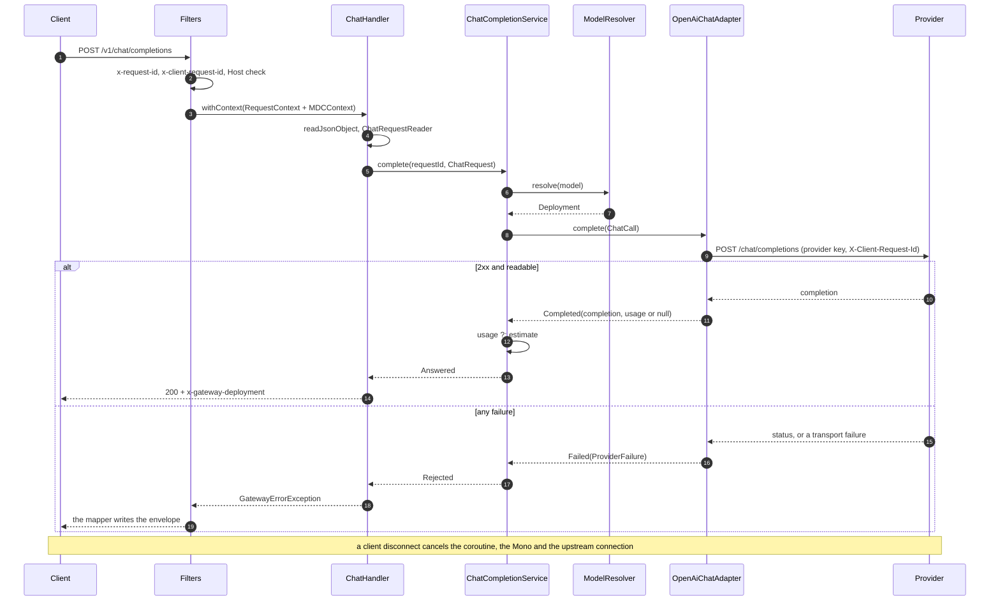

# GW-01: POST /v1/chat/completions (non-streaming) through ChatModelPort; OpenAI adapter

## 1. Context and goal

The gateway answers its first product call. A product team changes the base URL of an OpenAI SDK, sends a non-streaming chat completion, and gets a response the SDK parses as if it came from OpenAI, with the gateway's `x-request-id` on it. Everything else in the roadmap sits on this path: GW-02 streams it, GW-03 adds a second adapter behind the same port, GW-04 authenticates it, RTE-01 routes it, OBS-01 traces it, COST-02 bills it.

GW-01 builds the thinnest vertical slice that keeps the hexagon honest: the provider-neutral chat domain and `ChatModelPort` in `gateway-core`, the OpenAI adapter in a new module `gateway-providers`, the route in `gateway-app`, and the mapping of every upstream failure to an OpenAI error row. It creates the system `provider-adapters`.

It serves pillar 1 (drop-in: same path, body, status codes and SDK exception classes; unknown fields pass through, ADR-004) and prepares pillars 4 and 6: usage is reported and flagged when estimated, and failures are sealed values RTE-02 can act on. It is unauthenticated until GW-04, and it spends a provider key, so section 5 keeps it off the network by default (ADR-GW-01-007).

## 2. Scope

### In
- `gateway-core`: the neutral JSON type `JsonValue`, the chat domain (`ChatRequest`, `ChatCompletion`, `Usage`, `Deployment`, ...), `ChatModelPort`, `ModelResolver`, `ChatCompletionService`, `UsageEstimator`, the sealed `ProviderFailure` and eight new reply rows.
- New module `gateway-providers` (root `.gateway.providers`, role `adapter`, created as ADR-014 says): the OpenAI adapter on WebClient and Reactor Netty.
- `gateway-app`: the `coRouter` route, request reader, response writer, provider properties and wiring, the exposure guard and the loopback Host filter, the `local` profile.
- Translation of a request-side `DataBufferLimitException` to `ContentTooLarge` on functional routes ([bug](../knowledge/bugs/gateway-body-limit-on-functional-route-gives-500.md)).
- Production body limit, `x-gateway-deployment`, `x-gateway-usage-estimated`, the gateway request ID sent upstream as `X-Client-Request-Id`.
- Konsist: ARCH-1 extended (JSON libraries and provider SDKs in core), ARCH-12 (adapters referenced only from wiring).
- A contract test with the official `openai-java` SDK; smoke scenarios; `tools/smoke/chat-completions.sh`.
- Docs: systems entry `provider-adapters`, CLAUDE.md, glossary, diagram, `gateway-smoke`, cross-cutting [ADR-018](../DECISIONS.md#adr-018), two patterns.

### Out
- `stream: true` (GW-02): answered with 400 `unsupported_value` until then.
- Anthropic (GW-03), team auth (GW-04), `/v1/embeddings` (GW-05), `response_format`/tool-call tests and mock support (GW-06: both already pass through as extras, untested).
- Aliases, route tables, `GET /v1/models` (RTE-01, ADR-GW-01-006). Retries, fallback, breakers (RTE-02).
- Spans (OBS-01), metrics (OBS-02), structured logs (OBS-03). Cost, usage events, ledger (COST-*).
- Rate limits, cache, guardrails. `gateway-infra`: no infra code here, so the module is not created.
- Forwarding `OpenAI-Organization` and `OpenAI-Project`; an organization or project setting per deployment (RTE-01's `Deployment` credentials reference).

### What each later item changes

| Item | Change at this seam |
|---|---|
| GW-02 | Adds `fun stream(call: ChatCall): Flow<ChatChunk>` to `ChatModelPort`; `ChatHandler` branches on `stream`; the 400 goes; adds a first-byte and idle timeout (`HttpClient.responseTimeout` per request); SSE through [`raw-sse-frames-flushed-per-event`](../knowledge/patterns/raw-sse-frames-flushed-per-event.md). The route, the reader and `ProviderFailure` stay. |
| GW-03 | Second adapter; `Map<ProviderId, ChatModelPort>` selected by `Deployment.provider`; promotes the sampling members it must translate from `extras` to typed fields; declares which extras Anthropic accepts; normalises usage so `inputTokens` includes cached tokens, as OpenAI's `prompt_tokens` does. |
| GW-04 | Auth filter. Deletes `LoopbackHostWebFilter`, `ExposureGuard` and `llmgw.security.allow-unauthenticated-exposure`. `ChatCall` gains the team. `server.address` keeps its loopback default; OPS-03 sets `LLMGW_BIND_ADDRESS`. |
| GW-05 | Reuses `readJsonObject`, `JsonValue` and the failure classifier. |
| GW-06 | Tests the extras path with scripted tool calls; promotes a member only if the gateway must read it. |
| RTE-01 | Replaces `PassThroughModelResolver` (adds the team parameter); owns `GET /v1/models` and 403 `model_not_allowed`. |
| RTE-02 | Wraps the port call in `ChatCompletionService` with retries and fallback, deciding on `ProviderFailure`; `ProviderUnavailable` also means "chain exhausted". OpenAI requires `X-Client-Request-Id` unique per request, so each attempt needs its own value. |
| OBS-01 | Spans around the service and the adapter from data already on `ChatCall`, `ChatCompletion` and `Usage`; Micrometer context propagation. |
| COST-02, RL-02 | Read `Usage`, including `estimated`; RL-02 reuses `UsageEstimator` for the reservation. |
| CACHE-01 | The key covers `ChatRequest.extras`, which holds every parameter the gateway does not model. |
| GRD-02 | Scans `MessageContent.Text` and `ContentPart.Text`; must state what it does with text inside `extras` and `ContentPart.Opaque`. |

## 3. Acceptance criteria

All ticked before the row becomes `[x]`. A "deliberate violation" is made in the working tree, observed failing, and reverted before commit.

- [x] `./gradlew projects` lists `gateway-providers`; it applies only `llmgw.kotlin-jvm`; the root build has `kover(project(":gateway-providers"))`; `Modules.kt` is unchanged, because it already lists the module.
- [x] `gateway-core` still imports nothing outside the Kotlin stdlib, `kotlinx.coroutines` and `java.time` (ARCH-1 green, `checkCoreClasspath` green).
- [x] Against `mock-provider` over real HTTP, `POST /v1/chat/completions` with `{"model":"mock-chat","messages":[{"role":"user","content":"Hi"}]}` returns 200, `Content-Type: application/json`, a UUIDv7 `x-request-id`, `x-gateway-deployment: openai`, and a body STRICT-JSON-equal to the body the mock returns directly for the same request, after normalising `id` and `created` (`OpenAiShapeContractTest`).
- [x] The official SDK `com.openai:openai-java` with `baseUrl` on the gateway completes a chat and passes `validate()`; `withRawResponse().requestId()` equals the response's `x-request-id`; with `maxRetries(0)`, the failures below raise `BadRequestException`, `NotFoundException`, `RateLimitException` and `InternalServerException` (`OpenAiSdkContractTest`).
- [x] The mock's journal shows, for that request: header `x-client-request-id` equal to the gateway's `x-request-id`; `credential.fingerprint` equal to the first 8 hex digits of SHA-256 of the configured key, although the client sent `Authorization: Bearer client-key`; no `openai-organization` or `openai-project` although the client sent them; and a body in which an unknown member `{"x_future":{"a":[1,null]}}`, `"seed":9007199254740993` and `"temperature":0.7` are unchanged.
- [x] Every row of the section 4 upstream table gives that row's status, `type`, `code`, message and headers when the mock injects the condition, in the exact envelope with `x-request-id` (`UpstreamErrorMappingTest`, parameterized).
- [x] No provider `message`, provider key, `org-` value or prompt text appears in any gateway response or log line: the mock injects an error with `message: "canary-provider-message org-canary"`, the prompt carries `canary-prompt`, the key is `sk-canary-key`, the log level of `io.github.pdroacordi.llmgateway` is DEBUG, and all three are absent from the captured output and the response (`NoLeakIntegrationTest`).
- [x] `usage.omit` on the mock gives 200 with a `usage` object and `x-gateway-usage-estimated: true`; with provider usage that header is absent and `usage` equals the mock's.
- [x] `retry-after: 7` and `retry-after-ms: 7000` on an upstream 429 reach the client; `x-ratelimit-*`, `openai-*` and the upstream `x-request-id` do not.
- [x] Timeouts and faults: with `request-timeout: 500ms`, the mock's `hang` gives 504 `upstream_timeout` and the journal entry says `client_cancelled` within 2 s; a closed port gives 503 `provider_unavailable`; `malformed` and `disconnect` give 502 `upstream_error`; a response over `max-response-size` gives 502 `upstream_error`, not 500 and not 413.
- [x] A client that disconnects during a `hang` leaves a journal entry `client_cancelled` within 2 s (`ClientDisconnectIntegrationTest`).
- [x] Route errors: 400 `unsupported_value` with `param: "stream"` for `stream: true` and no upstream call (`lastSeq` unchanged); each validation row of section 4; 405 with `allow: POST`; 415 for a non-JSON or absent Content-Type; `Accept: text/event-stream` on a non-stream request still gives 200; 400 `invalid_body` for `{"a":`, without the body text in the response or the log.
- [x] A body over `spring.http.codecs.max-in-memory-size` on `/v1/chat/completions` gives 413 `request_too_large` and no ERROR line; `ExceptionTranslatorTest` "a DataBufferLimitException outside the request-body path is a bug, not a 413" is unchanged and passes.
- [x] A `coRouter` handler sees the filter's context: `RequestContext` from `currentCoroutineContext()` is the one in `x-request-id` (proved by the journal check above), and a log line written in the handler after the upstream call carries the ID through the correlation pattern (`ChatRouteContextIntegrationTest`).
- [x] BlockHound: `gateway-providers`' and `gateway-app`'s test JVMs run under it; 2000 real-socket requests at concurrency 32 through the route, and 200 through the real adapter to the mock, all return 200 from the first request on, with no allowance added to BlockHound.
- [x] Startup: a blank `OPENAI_API_KEY` stops the app with a message naming the variable; `server.address: 0.0.0.0` without `llmgw.security.allow-unauthenticated-exposure=true` stops the app; an invalid `request-timeout` with key `sk-canary-key` stops the app and the startup output does not contain the key.
- [x] Default binding: `application.yaml` binds `127.0.0.1`; a request with `Host: evil.example` gets 403 with the envelope and no upstream call; `Host: 127.0.0.1:<port>`, `localhost:<port>` and `[::1]:<port>` pass.
- [x] `./gradlew :architecture-tests:test` passes with ARCH-1 extended and ARCH-12, each failing on its fixture. Deliberate violation: an import of `.gateway.providers.openai.OpenAiChatAdapter` in `gateway-app/.../chat/ChatHandler.kt` fails ARCH-12 naming that file.
- [x] `verify-gates` green (coverage: core ≥ 80%, overall ≥ 70%)
- [x] Smoke scenarios in section 8 pass (`gateway-smoke`), report in `docs/knowledge/runs/`. Met by [runs/2026-11-03-smoke-chat-completions](../knowledge/runs/2026-11-03-smoke-chat-completions.md): pass-with-findings on the first build; on the final jars the script gave 63 PASS, 0 FAIL, 2 SKIP, and the two skips, scenarios 7 and 12, which stop or start a process, passed by hand (its Revision).
- [x] Eval: n/a (no threshold, classifier or routing policy; `UsageEstimator` is a fallback count, not a tuned classifier)
- [x] Living docs updated (`docs-update`), including the systems entry

## 4. Contract

### `POST /v1/chat/completions`

OpenAI-compatible (ADR-004). `Content-Type: application/json` is required (ADR-GW-01-008). `Accept` is ignored: OpenAI's reference documents no negotiation, and openai-python sends `Accept: application/json` by default. `Authorization` is accepted and ignored until GW-04, and is never forwarded.

Request members:

| Member | Handling |
|---|---|
| `model` | Required non-empty string. Typed. Passed to the provider verbatim until RTE-01. |
| `messages` | Required non-empty array of objects. Each needs a non-empty string `role`, any value (`system`, `developer`, `user`, `assistant`, `tool`, ...). `content` is a string, an array, `null` or absent. |
| `stream` | `false`, `null` or absent. `true` gives 400 until GW-02. Never sent upstream. |
| everything else, top level and inside messages and content parts | Kept verbatim in `extras` and sent to the provider unchanged, including members this gateway has never heard of. |

Response, 200, `Content-Type: application/json`, the provider's completion with no member added or removed:

```json
{"id":"chatcmpl-mock-000000000001","object":"chat.completion","created":1793750400,"model":"mock-chat",
 "choices":[{"index":0,"message":{"role":"assistant","content":"Hi there","refusal":null,"annotations":[]},"logprobs":null,"finish_reason":"stop"}],
 "usage":{"prompt_tokens":14,"completion_tokens":2,"total_tokens":16,"prompt_tokens_details":{"cached_tokens":0},"completion_tokens_details":{"reasoning_tokens":0}},
 "service_tier":"default","system_fingerprint":"fp_mock"}
```

(Wrapped here.) Member order is typed members first, then the provider's others in the order received, which reproduces the provider's order for the OpenAI shape. `id`, `created` and `model` are the provider's. `object` is always `chat.completion`. `total_tokens` is `prompt_tokens + completion_tokens`. When the provider omits `usage` the gateway still returns one, flagged by a header.

### Headers

| Header | Direction | Value | Notes |
|---|---|---|---|
| `x-request-id` | response | gateway UUIDv7 | FND-04. The provider's value is never relayed. |
| `x-client-request-id` | request and response | validated, echoed | FND-04. Not forwarded upstream. |
| `x-gateway-deployment` | response, 200 only | `Deployment.id`, today `openai` | Extension. Which deployment answered, so RTE-02's fallback becomes visible without a contract change. |
| `x-gateway-usage-estimated` | response, 200 only | `true`, only when estimated | Extension (ADR-GW-01-011). |
| `retry-after`, `retry-after-ms` | response, 429 and 503 | from the provider, normalised | Both when the provider sent either. openai-python reads `retry-after-ms` first and honours up to 120 s. |
| `x-should-retry` | response | `false` on `upstream_auth_failed` and `upstream_quota_exhausted` | openai-python obeys it over its status rules; a retry cannot help. |
| `X-Client-Request-Id` | upstream request | the gateway's request ID | OpenAI: ASCII, at most 512, unique per request. Ties a provider ticket to a gateway log, and the mock's journal to a response. |
| `Authorization: Bearer` | upstream request | the configured key | Never the client's. |

Not forwarded upstream: every other client header, `OpenAI-Organization` and `OpenAI-Project` included. Not relayed to the client: every other provider header. `openai-organization` would expose the operator's account, and `x-ratelimit-*` describe the gateway's key, not the client's limits (RL-01 defines those).

### Route errors

All in the envelope, with `x-request-id`. `type` is `invalid_request_error`. No new table rows: these use FND-04's `InvalidRequest`, `MethodNotAllowed`, `UnsupportedMediaType` and `ContentTooLarge`. Checked in this order, and the first failure answers.

| Condition | Status | `code` | `param` | `message` |
|---|---|---|---|---|
| Non-loopback `Host` while not exposed (a filter, so it runs first) | 403 | `null` | `null` | FND-04 `RejectedRequest(403)` |
| Method other than POST | 405 | `method_not_allowed` | `null` | FND-04, `allow: POST` |
| Content-Type absent or not JSON | 415 | `unsupported_media_type` | `null` | FND-04 |
| Body over the limit | 413 | `request_too_large` | `null` | FND-04 |
| Body empty, not JSON, not an object, or over a Jackson read constraint | 400 | `invalid_body` | `null` | FND-04 |
| `model` missing, not a string or blank | 400 | `invalid_request` | `model` | `'model' is required and must be a non-empty string.` |
| `messages` missing, not an array or empty | 400 | `invalid_request` | `messages` | `'messages' is required and must be a non-empty array.` |
| A message is not an object | 400 | `invalid_request` | `messages[i]` | `Each message must be a JSON object.` |
| `role` missing, not a string or blank | 400 | `invalid_request` | `messages[i].role` | `Each message needs a non-empty string 'role'.` |
| `content` not a string, array or null | 400 | `invalid_request` | `messages[i].content` | `'content' must be a string, an array or null.` |
| `stream` not a boolean or null | 400 | `invalid_request` | `stream` | `'stream' must be a boolean.` |
| `stream: true` | 400 | `unsupported_value` | `stream` | `Streaming is not available yet; send stream false or omit it.` |

`invalid_request` reuses the FND-04 code for "missing or mistyped value"; `param` is the discriminator. OpenAI's own codes for these cases have no public documentation, so none is copied. `unsupported_value` is a gateway value in a free-string field. Only member paths and indexes enter `param`, never request content.

### Upstream errors

The eight new rows of `toReply`, all `ProviderFailure` variants. Each 5xx message ends with the request ID, as FND-04 requires. `<id>` is the gateway's request ID.

| Upstream condition | Variant | Status | `type` | `code` | `param` | `message` | Headers |
|---|---|---|---|---|---|---|---|
| 404 with `error.code: model_not_found` | `ModelNotFound` | 404 | `invalid_request_error` | `model_not_found` | `model` | `The requested model does not exist or is not available.` | – |
| 400, 413, 422 | `RejectedByProvider(status, code, param)` | same | `invalid_request_error` | provider's, else `upstream_rejected_request` | provider's | `The provider rejected the request; see the code and param members.` | – |
| 401, 403 | `UpstreamAuthFailed` | 502 | `server_error` | `upstream_auth_failed` | `null` | `The gateway could not authenticate with the provider. Include the request ID <id> if you report it.` | `x-should-retry: false` |
| 429 with `error.code` or `error.type` in the quota set below | `UpstreamQuotaExhausted` | 503 | `server_error` | `upstream_quota_exhausted` | `null` | `The gateway's provider account has no quota left. Include the request ID <id> if you report it.` | `x-should-retry: false` |
| Any other 429 | `UpstreamRateLimited(retryAfter)` | 429 | `rate_limit_error` | `upstream_rate_limited` | `null` | `The provider is rate limiting the gateway; retry later.` | `retry-after`, `retry-after-ms` when known |
| 503; nothing was sent: connection refused or unreachable, unknown host, TLS handshake failure, pool acquire timeout or full queue | `ProviderUnavailable(retryAfter)` | 503 | `server_error` | `provider_unavailable` | `null` | `The provider cannot be reached or is overloaded. Include the request ID <id> if you report it.` | `retry-after`, `retry-after-ms` when known |
| 408, 504; `request-timeout` exceeded | `UpstreamTimeout` | 504 | `server_error` | `upstream_timeout` | `null` | `The provider did not answer in time. Include the request ID <id> if you report it.` | – |
| 404 without `model_not_found` (a wrong base URL); any other status outside 2xx; any other transport failure, such as a connection closed or reset after the request was written, a reply that is not HTTP or headers over 8 KB; response over the limit; 2xx body not a readable completion | `UpstreamError` | 502 | `server_error` | `upstream_error` | `null` | `The provider returned an error or an unreadable response. Include the request ID <id> if you report it.` | – |

- Quota set: `insufficient_quota`, `credit_balance_exhausted`, `organization_spend_limit_exceeded`, `project_spend_limit_exceeded`, `organization_usage_limit_exceeded` (OpenAI error-codes guide; `insufficient_quota` from FND-03's override note).
- `type` for 429 is `rate_limit_error`, the value OpenAI's rate-limit guide documents. FND-04 reserves `requests`/`tokens` for RL-01's team limit, a different condition.
- `code` and `param` from the provider are relayed only if they match `^[a-z0-9_.-]{1,64}$` and `^[A-Za-z0-9_.\[\]-]{1,128}$`; otherwise `null`, then the fallback code. Examples that pass: `context_length_exceeded`, `messages[0].content`.
- `retryAfter`: `retry-after-ms`, else `retry-after` as seconds, else as an HTTP-date against the injected clock. Unparsable or not positive is `null`. `retry-after` goes out as whole seconds rounded up, `retry-after-ms` as milliseconds.
- `provider_unavailable` means nothing was sent, so a fallback may repeat the call. Every other transport failure is `upstream_error`: a future fallback must not repeat a call the provider may have billed. (Decided by the orchestrator, 2026-11-03, after the GW-01 smoke.)
- A provider's `Content-Type` plays no part: the body is read as bytes, so a value that cannot be parsed changes nothing.
- `ProviderUnavailable` is reserved for RTE-02 in FND-04. GW-01 ships it first with the same row, because to a client "the only deployment is down" and "the chain is exhausted" are one condition.

### What stays OpenAI-compatible, what is an extension

- **Compatible:** path, request members, response body, status codes and the SDK exception classes they select, the envelope, `x-request-id`, `retry-after`.
- **Extensions:** `x-gateway-deployment`, `x-gateway-usage-estimated`, the `x-client-request-id` echo, gateway `code` values.
- **Narrower than OpenAI, by design:** `message` on a relayed 4xx is fixed text (ADR-GW-01-005); Content-Type is required; the body limit is 10 MB where OpenAI documents up to 512 MB per request for image inputs (a property raises it).
- **Narrower than OpenAI, what typed members change:**
  - Request: an absent `content` goes upstream as `"content":null`.
  - Response: an absent `content` or `finish_reason` comes back as `null`; a `finish_reason` that is not a string becomes `null`; an `index` that is not an integer becomes `0`.
  - Both ways: a number keeps its value, not its spelling (`1e5` becomes `1E+5`, `1e-5` becomes `0.00001`), and `-0.0` becomes `0.0`.
- **Narrower until a later item:** `stream: true` (GW-02), `GET /v1/models` (RTE-01, 404 `unknown_url` until then).

## 5. Design

### Modules and ports

| Module | Holds | Owns which library |
|---|---|---|
| `gateway-core` | Domain, port, service, estimator, reply table | none |
| `gateway-providers` | OpenAI adapter, `JsonTrees`, `ApiKey` | `spring-webflux` (WebClient only), `spring-context` (`ReactorClientHttpConnector` implements `SmartLifecycle`; nothing is wired here), `reactor-netty-http`, `jackson-databind` (tree only), `kotlinx-coroutines-reactor`, `slf4j-api` |
| `gateway-app` | Route, reader, writer, properties, wiring, guards | Spring Boot, Boot's `JsonMapper` |

**`gateway-core`.** Package `.gateway.core.json`:

```kotlin
sealed interface JsonValue {
    data object Null : JsonValue
    data class Bool(val value: Boolean) : JsonValue
    /** [literal] is the number as JSON text, so a value keeps its precision through the gateway. */
    data class Number(val literal: String) : JsonValue
    data class Text(val value: String) : JsonValue
    data class Array(val items: List<JsonValue>) : JsonValue
    /** Insertion-ordered. */
    data class Object(val members: Map<String, JsonValue>) : JsonValue {
        companion object { val EMPTY = Object(emptyMap()) }
    }
}
```

Package `.gateway.core.chat`:

```kotlin
@JvmInline value class ModelName(val value: String)        // init: not blank
@JvmInline value class Role(val value: String)             // init: not blank; not an enum, unknown roles pass
@JvmInline value class FinishReason(val value: String)     // "stop", "length", "tool_calls", "content_filter", ...
@JvmInline value class TokenCount(val value: Long)         // init: >= 0; operator plus
@JvmInline value class DeploymentId(val value: String)
@JvmInline value class ProviderId(val value: String)

data class Deployment(val id: DeploymentId, val provider: ProviderId, val model: ModelName)

/** Typed members are those the gateway reads; [extras] holds the rest, verbatim (ADR-018). */
data class ChatRequest(
    val model: ModelName,
    val messages: List<ChatMessage>,                        // init: not empty
    val extras: JsonValue.Object = JsonValue.Object.EMPTY,  // init: no key in RESERVED = model, messages, stream
)
data class ChatMessage(
    val role: Role,
    val content: MessageContent?,
    val extras: JsonValue.Object = JsonValue.Object.EMPTY,  // name, tool_calls, tool_call_id, ...
)
sealed interface MessageContent {
    data class Text(val text: String) : MessageContent
    data class Parts(val parts: List<ContentPart>) : MessageContent
}
sealed interface ContentPart {
    data class Text(val text: String, val extras: JsonValue.Object = JsonValue.Object.EMPTY) : ContentPart
    /** Anything but a `{"type":"text"}` part: an image, audio, a file. */
    data class Opaque(val part: JsonValue) : ContentPart
}

data class ChatCompletion(
    val id: String,
    val created: Long,                                      // epoch seconds
    val model: ModelName,
    val choices: List<ChatChoice>,
    val extras: JsonValue.Object = JsonValue.Object.EMPTY,  // service_tier, system_fingerprint, ...
)
data class ChatChoice(
    val index: Int,
    val message: AssistantMessage,
    val finishReason: FinishReason?,
    val extras: JsonValue.Object = JsonValue.Object.EMPTY,  // logprobs, ...
)
data class AssistantMessage(
    val content: String?,
    val extras: JsonValue.Object = JsonValue.Object.EMPTY,  // refusal, annotations, tool_calls, audio, ...
)

data class Usage(
    val inputTokens: TokenCount,
    val outputTokens: TokenCount,
    val cachedInputTokens: TokenCount? = null,              // a subset of inputTokens
    val estimated: Boolean = false,
    val extras: JsonValue.Object = JsonValue.Object.EMPTY,  // provider detail objects, in the OpenAI shape
) { val totalTokens: TokenCount get() = inputTokens + outputTokens }

/** One provider call. Grows by field (team in GW-04), so the port signature does not change. */
data class ChatCall(val requestId: RequestId, val deployment: Deployment, val request: ChatRequest)

sealed interface ProviderResult {
    data class Completed(val completion: ChatCompletion, val usage: Usage?) : ProviderResult   // usage null: omitted
    data class Failed(val failure: ProviderFailure) : ProviderResult
}

/** One port per capability; only adapters see a provider's types. GW-02 adds `stream`. */
interface ChatModelPort {
    /** Never throws for an expected failure. Cancellation of the caller cancels the upstream call. */
    suspend fun complete(call: ChatCall): ProviderResult
}

/** Pure, like routing (CLAUDE.md). RTE-01 replaces the implementation and adds the team. */
fun interface ModelResolver {
    fun resolve(requested: ModelName): Deployment
}
class PassThroughModelResolver(id: DeploymentId, provider: ProviderId) : ModelResolver

sealed interface ChatOutcome {
    data class Answered(val deployment: Deployment, val completion: ChatCompletion, val usage: Usage) : ChatOutcome
    data class Rejected(val error: GatewayError) : ChatOutcome
}
class ChatCompletionService(resolver: ModelResolver, port: ChatModelPort, estimator: UsageEstimator) {
    suspend fun complete(requestId: RequestId, request: ChatRequest): ChatOutcome
}
class UsageEstimator {
    fun estimate(request: ChatRequest, completion: ChatCompletion): Usage   // estimated = true
}
```

- `ChatRequest`, `ChatMessage`, `MessageContent.Text`, `ContentPart.Text`, `ContentPart.Opaque`, `ChatCompletion`, `ChatChoice`, `AssistantMessage`, `Usage` and `JsonValue.Text`, `Array` and `Object` override `toString` to print counts and models only. A data class's default `toString` would put prompt and completion text in any log line that names the object. A core test asserts a canary is absent from each.
- `UsageEstimator`: text length divided by 4, rounded up per text (OpenAI's rule of thumb: about 4 characters per token in English), plus 3 per message and 3 for the reply (OpenAI's token-counting cookbook, as in FND-03). `ContentPart.Opaque` counts 0, so images are under-counted; the flag says so.

Package `.gateway.core.error`, in `GatewayError.kt` (a sealed sub-hierarchy must share the package):

```kotlin
/** What a provider call can fail with. RTE-02 decides on these; toReply renders them. */
sealed interface ProviderFailure : GatewayError {
    data object ModelNotFound : ProviderFailure
    data class RejectedByProvider(val status: Int, val code: String?, val param: String?) : ProviderFailure
    data object UpstreamAuthFailed : ProviderFailure
    data class UpstreamRateLimited(val retryAfter: Duration?) : ProviderFailure
    data object UpstreamQuotaExhausted : ProviderFailure
    data class ProviderUnavailable(val retryAfter: Duration?) : ProviderFailure
    data object UpstreamTimeout : ProviderFailure
    data object UpstreamError : ProviderFailure
}
```

`RejectedByProvider.init` requires `status` in 400, 413, 422. `Duration` is `kotlin.time.Duration`. `ErrorTypes` gains `RATE_LIMIT = "rate_limit_error"`; `ErrorCodes` gains the new codes and `UNSUPPORTED_VALUE`. `GatewayError.InvalidRequest` gains no variant, only companion values for the route rows.

**`gateway-providers`.** Everything but the types below is `internal`, so an adapter's wire code cannot be imported at all.

```kotlin
// .gateway.providers
class ApiKey(private val value: String) {       // public String constructor: Boot binds it
    fun reveal(): String
    val isBlank: Boolean
    val isVisibleAscii: Boolean
    override fun toString(): String = "[redacted]"
}

// .gateway.providers.json
fun JsonMapper.exactTreeReader(): ObjectReader          // floats stay BigDecimal, one value only
fun ObjectReader.readTreeOrNull(body: ByteArray): JsonNode?
fun JsonNode.toJsonValue(): JsonValue
fun JsonValue.toJsonNode(nodes: JsonNodeFactory): JsonNode

// .gateway.providers.openai
data class OpenAiAdapterConfig(
    val baseUrl: URI, val apiKey: ApiKey, val connectTimeout: Duration, val requestTimeout: Duration,
    val maxResponseBytes: Int, val pool: PoolConfig,
)
class OpenAiChatAdapter(config: OpenAiAdapterConfig, mapper: JsonMapper, clock: Clock) : ChatModelPort, AutoCloseable {
    override suspend fun complete(call: ChatCall): ProviderResult
    /** Startup only; blocks. */
    fun warmUp()
    override fun close()                        // disposes the ConnectionProvider
}
```

Internal pieces, all pure but the first:

| Class | Role |
|---|---|
| `OpenAiChatAdapter` | Builds the WebClient once. `complete`: serialise, `POST {base}/chat/completions`, `exchangeToMono { it.toEntity<ByteArray>() }`, `.timeout(requestTimeout)`, `awaitSingle()`, then hand status, headers and bytes to the two functions below. |
| `OpenAiRequestWriter` | `ChatCall` → `ObjectNode`: `model` from `deployment.model`, `messages`, then extras. |
| `OpenAiResponseReader` | Bytes → `ProviderResult.Completed`, or `null` when unreadable. Requires an object with string `id`, integer `created`, string `model`, non-empty array `choices`, each with an object `message`. `usage` without integer `prompt_tokens` and `completion_tokens` counts as omitted: a paid answer is not thrown away for a bad count. |
| `OpenAiFailureClassifier` | `(status, headers, bytes, now)` → `ProviderFailure`: the section 4 table. Tolerates a non-JSON body, such as an HTML 502 from a proxy. |
| `RetryAfter` | Header parsing (section 4). |
| `OpenAiTransportFailures` | Exception → `ProviderFailure`, or rethrow (Failure model). |

**`gateway-app`:**

| Class | Package | Role |
|---|---|---|
| `ChatRoutes`, `ChatConfiguration` | `.gateway.app.chat` | `coRouter`: `POST("/v1/chat/completions", handler::complete)`, then a 405 catch-all as in `MockRoutes`. The `RouterFunction`, `ChatCompletionService`, `UsageEstimator` and handler beans. |
| `ChatHandler(service, mapper)` | `.gateway.app.chat` | Reads the context and body, calls the service, writes the reply or raises `GatewayErrorException`. |
| `ChatRequestReader` | `.gateway.app.chat` | `JsonNode` → `ChatRequest`, raising the section 4 `InvalidRequest`s. Pure. |
| `ChatResponseWriter` | `.gateway.app.chat` | `ChatCompletion` + `Usage` → `ObjectNode`. Pure. |
| `ServerRequest.readJsonObject(trees)` | `.gateway.app.web` | The only body read of a functional route: Content-Type check, `awaitBodyOrNull<ByteArray>()`, `DataBufferLimitException` → `ContentTooLarge`, `JacksonException` or non-object → `unreadableBody`. |
| `OpenAiProperties`, `ProviderConfiguration` | `.gateway.app.config` | `@ConfigurationProperties("llmgw.providers.openai")`; beans `ChatModelPort` (with `warmUp()`) and `ModelResolver`. The only `main` code that names `.gateway.providers.openai` (ARCH-12). |
| `SecurityProperties`, `ExposureGuard`, `LoopbackHostWebFilter`, `SecurityConfiguration` | `.gateway.app.security` | ADR-GW-01-007. All but the properties class go in GW-04. |
| `GatewayHeaders` | `.gateway.app.request` | Gains `DEPLOYMENT`, `USAGE_ESTIMATED`. |

Handler signature and flow:

```kotlin
suspend fun complete(request: ServerRequest): ServerResponse {
    val body = request.readJsonObject(trees)
    val chat = ChatRequestReader.read(body)
    val context = checkNotNull(currentCoroutineContext()[RequestContext])
    return when (val outcome = service.complete(context.requestId, chat)) {
        is ChatOutcome.Answered -> ok(outcome)            // the tree as bytes: JacksonJsonEncoder logs what it encodes
        is ChatOutcome.Rejected -> throw GatewayErrorException(outcome.error)
    }
}
```

`OpenAiErrorEnvelope`, the mapper, `EventLoopWarmup` and `ExceptionTranslator` do not change.

**Build.** `gateway-providers/build.gradle.kts`:

```kotlin
plugins { id("llmgw.kotlin-jvm") }

dependencies {
    implementation(platform(libs.spring.boot.dependencies))
    implementation(project(":gateway-core"))
    implementation(libs.spring.webflux)
    // ReactorClientHttpConnector implements SmartLifecycle; spring-webflux declares spring-context optional.
    implementation(libs.spring.context)
    implementation(libs.reactor.netty.http)
    implementation(libs.jackson.databind)
    implementation(libs.kotlinx.coroutines.reactor)
    implementation(libs.slf4j.api)
    testImplementation(libs.blockhound.junit.platform)
    testImplementation(libs.kotlinx.coroutines.test)
    "integrationTestImplementation"(project(":test-support"))
    "mockProvider"(project(":mock-provider"))
}

// BlockHound on JDK 25 (FND-01 U8); llmgw.spring-app does the same for app modules.
tasks.withType<Test>().configureEach { jvmArgs("-XX:+AllowRedefinitionToAddDeleteMethods") }
```

`gateway-app/build.gradle.kts` adds `implementation(project(":gateway-providers"))`, `"integrationTestImplementation"(project(":test-support"))`, `"integrationTestImplementation"(libs.openai.java)` and `"mockProvider"(project(":mock-provider"))`. The catalog gains versionless `spring-webflux`, `reactor-netty-http`, `jackson-databind` (`tools.jackson.core`) and `slf4j-api`, and `openai-java = "4.98.0"`. No `jackson-module-kotlin`, no `kotlin("plugin.serialization")`.

### Data

n/a: no Flyway table, Redis key or topic. Source of truth: the provider for completions and usage; `application.yaml` and the environment for the one deployment.

### Flow



### Failure model

| Event | Behaviour | Why |
|---|---|---|
| Provider slow | `request-timeout` (300 s) bounds the whole call through `Mono.timeout`, then 504. The subscription is cancelled, so the connection closes. | A non-stream completion sends nothing until it is done, so any shorter limit cuts long generations. Below openai-python's 600 s, so the client gets a 504 rather than its own timeout. |
| Provider down | Connect timeout 5 s (Reactor Netty's default is 30 s), TLS handshake 10 s (Reactor Netty default), DNS query 5 s (default), pool acquire 5 s (default 45 s): each gives 503 `provider_unavailable`. Fail-closed: there is no answer to give. | Fails fast enough for RTE-02 to fall back later. |
| Retries | None in the adapter or service. `disableRetry(true)` stays on the `HttpClient`, so Reactor Netty never repeats a call on its own (decided by the orchestrator, 2026-11-03). | RTE-02 owns them; CLAUDE.md allows them only before the first byte. openai-python retries 408, 409, 429 and ≥ 500 twice by default (openai-java also retries twice), which is why auth and quota failures carry `x-should-retry: false`. |
| Client disconnects | WebFlux cancels the request; the coroutine is cancelled; `awaitSingle` cancels the Mono; Reactor Netty closes the upstream connection. The provider may still bill the partial call; COST-02 owns that. | Upstream work stops, so a dead client does not hold a pool slot. |
| `CancellationException` | Never caught: the adapter catches named exception types only. | CLAUDE.md. |
| Waits | `Mono.timeout`, on Reactor's `parallel` scheduler. Never `withTimeout` or `delay`. | Under Spring's `Unconfined` start those continue on a thread BlockHound does not watch ([gotcha](../knowledge/gotchas/spring-coroutine-handlers-resume-on-default-executor-after-delay.md)). |
| Idempotency | None upstream: OpenAI documents no idempotency key for this endpoint and the gateway does not retry. The request ID is the future usage-event key. | |
| Response over `max-response-size` | 502 `upstream_error`. The adapter translates its own `DataBufferLimitException`, as FND-04 requires. | The client sent nothing wrong. |
| Provider 2xx, unreadable body | 502 `upstream_error`. The body is not logged: it may hold completion text. | |
| Provider usage missing or unreadable | Estimated and flagged; the call succeeds. | CLAUDE.md, Provider adapters. |
| Provider key absent | The app does not start. | ADR-GW-01-012. |
| Graceful shutdown | Boot's default, up to 30 s per phase; a longer in-flight call is cut. | Accepted until OPS-03. |
| Redis, Postgres, broker | n/a: GW-01 calls none. | |

`OpenAiTransportFailures`, in this order, applied to what `awaitSingle` throws:

1. `java.util.concurrent.TimeoutException` at the top level, from our `Mono.timeout`: `UpstreamTimeout`. Only the top level counts: a pool acquire timeout is also a `TimeoutException`, but WebClient wraps it.
2. `WebClientRequestException` whose cause chain says nothing was sent (`ConnectException`, `NoRouteToHostException`, `UnknownHostException`, `SSLHandshakeException`, `PoolAcquireTimeoutException`, `PoolAcquirePendingLimitException`): `ProviderUnavailable(null)`.
3. Any other `WebClientRequestException` (reset after the write, a premature close, a reply that is not HTTP, headers over the limit): `UpstreamError`.
4. `IOException` (`PrematureCloseException` included), `DataBufferLimitException`, `DecodingException`, `WebClientResponseException`: `UpstreamError`.
5. Anything else propagates and is a 500: a bug, by CLAUDE.md's rule.

### Observability

- **Logs.** The adapter logs after `awaitSingle`, inside the coroutine, so MDC carries `requestId`; a Reactor callback would not see it.
  - Failure: one WARN with deployment, upstream status, provider `error.code` and `error.type` (after the section 4 regex), provider `x-request-id`, duration ms, and the exception class name for a transport failure.
  - Success: one DEBUG with deployment, status, provider `x-request-id`, duration ms, tokens, `estimated`.
  - The mapper adds its usual line: ERROR for 5xx, DEBUG for 4xx.
  - Startup: one INFO with the base URL's scheme, host and path and the timeouts.
- **Spans:** none (OBS-01). Hand-off: `gen_ai.client.inference`, name `{gen_ai.operation.name} {gen_ai.request.model}`, kind CLIENT, with `gen_ai.operation.name=chat`, `gen_ai.provider.name` from `Deployment.provider`, `gen_ai.request.model`, `gen_ai.response.model`, `gen_ai.response.id`, `gen_ai.response.finish_reasons`, `gen_ai.usage.input_tokens`, `gen_ai.usage.output_tokens`, `error.type`. The convention is in Development status, and the content attributes are opt-in.
- **Metrics:** none (OBS-02).
- **Never recorded:** prompt or completion text, `extras`, the provider's `message`, provider or client keys, provider response bodies, exception messages from JSON parsing (Jackson can quote source bytes). Failures carry no `cause` into `GatewayErrorException`, so the mapper's stack trace holds none of this.

### Configuration

`gateway-app/src/main/resources/application.yaml`:

| Property | Default | Unit, range, note |
|---|---|---|
| `server.address` | `${LLMGW_BIND_ADDRESS:127.0.0.1}` | ADR-GW-01-007 |
| `spring.http.codecs.max-in-memory-size` | `10MB` | Request body limit, as in the mock |
| `llmgw.security.allow-unauthenticated-exposure` | `false` | Removed by GW-04 |
| `llmgw.providers.openai.base-url` | `https://api.openai.com/v1` | `http` or `https`, a host, no user info; `LLMGW_PROVIDERS_OPENAI_BASE_URL` |
| `llmgw.providers.openai.api-key` | `${OPENAI_API_KEY:}` | Required. From the environment only. |
| `llmgw.providers.openai.connect-timeout` | `5s` | > 0 |
| `llmgw.providers.openai.request-timeout` | `300s` | > 0, whole call |
| `llmgw.providers.openai.max-response-size` | `16MB` | 1 KB .. 256 MB. WebClient's default of 256 KB is too small for `n` > 1, logprobs or audio. |
| `llmgw.providers.openai.pool.max-connections` | `500` | Reactor Netty's default for its shared pool. A non-stream call holds one for its whole duration. |
| `llmgw.providers.openai.pool.pending-acquire-timeout` | `5s` | |
| `llmgw.providers.openai.pool.max-idle-time` | `30s` | Reactor Netty: at most the target server's; unset by default, which gives resets on connections the server closed. |
| `llmgw.providers.openai.pool.max-life-time` | `5m` | Picks up DNS changes. |

`pendingAcquireMaxCount` is twice `max-connections` (Reactor Netty's default for a custom pool); `evictInBackground` is 30 s.

`gateway-app/src/main/resources/application-local.yaml` (the profile `gateway-smoke` starts):

```yaml
llmgw:
  providers:
    openai:
      base-url: http://127.0.0.1:8090/v1
      # A fixed fake, so a real OPENAI_API_KEY in the shell never reaches the mock.
      api-key: mock-local-key
```

`gateway-app/src/test/resources/application.properties` and `gateway-app/src/integrationTest/resources/application.properties` hold `llmgw.providers.openai.api-key=test-key-not-real` and `llmgw.providers.openai.base-url=http://127.0.0.1:1/v1`, a closed port, so a test that reaches the real adapter by mistake fails instead of calling api.openai.com. Boot merges them with `application.yaml`, and a `.properties` file at one location wins over `.yaml`, so no main value is shadowed.

## 6. Reuse

- ADR-004, ADR-005, ADR-006, ADR-011 (the agent runtime calls exactly this route), ADR-014 (module creation), ADR-015 (rows, envelope), ADR-016 and ADR-017 (suites, `SharedMockProvider`).
- FND-04: `GatewayErrorException`, the mapper, `RequestContext`, `toReply`, `EventLoopWarmup`.
- FND-03: scenarios, journal, faults, `usage.omit`; `MockRoutes.notAllowed` and `Inbound.readJson` as the shape for `readJsonObject`; Jackson tree handling (ADR-FND-03-010).
- FND-02: the `mockProvider` scope in `llmgw.integration-test`.
- Patterns: [`one-error-funnel`](../knowledge/patterns/one-error-funnel.md), [`request-context-coroutine-element`](../knowledge/patterns/request-context-coroutine-element.md), [`architecture-rule-with-violating-fixture`](../knowledge/patterns/architecture-rule-with-violating-fixture.md), [`singleton-test-containers-mirroring-compose-images`](../knowledge/patterns/singleton-test-containers-mirroring-compose-images.md).
- Bugs and gotchas: [`gateway-body-limit-on-functional-route-gives-500`](../knowledge/bugs/gateway-body-limit-on-functional-route-gives-500.md) (fixed here), [`grafana-anonymous-admin-reachable-through-dns-rebinding`](../knowledge/bugs/grafana-anonymous-admin-reachable-through-dns-rebinding.md) (why the Host check exists), [`kotlin-reflect-first-use-in-annotated-handlers-blocks-the-event-loop`](../knowledge/gotchas/kotlin-reflect-first-use-in-annotated-handlers-blocks-the-event-loop.md), [`spring-coroutine-handlers-resume-on-default-executor-after-delay`](../knowledge/gotchas/spring-coroutine-handlers-resume-on-default-executor-after-delay.md), [`kotlinx-reactive-await-loads-context-injectors-on-first-use`](../knowledge/gotchas/kotlinx-reactive-await-loads-context-injectors-on-first-use.md), [`webflux-committed-error-reaches-netty-log-or-completes-normally`](../knowledge/gotchas/webflux-committed-error-reaches-netty-log-or-completes-normally.md) (does not apply: a non-stream reply is written once, after the outcome is known).
- New patterns written with this plan: [`typed-core-with-json-extras`](../knowledge/patterns/typed-core-with-json-extras.md), [`upstream-bytes-then-pure-classification`](../knowledge/patterns/upstream-bytes-then-pure-classification.md).

## 7. Execution plan

Steps of about half a day each; tick as they land. Core and every pure class are test-first.

- [x] **Step 1: core types and error rows (TDD).** `ErrorReplyTest` rows first, then `JsonValue`, `ProviderFailure`, the rows, the chat types, `TokenCountTest`, `ChatRequestTest` (invariants, `toString` canary). `./gradlew :gateway-core:test :gateway-core:koverVerify`.
- [x] **Step 2: core service (TDD).** `UsageEstimatorTest`, `PassThroughModelResolverTest`, `ChatCompletionServiceTest` with a fake port, then the classes.
- [x] **Step 3: module and rules.** `settings.gradle.kts`, catalog, `gateway-providers/build.gradle.kts`, root `kover(...)`. ARCH-1 and `checkCoreClasspath` extended, ARCH-12, fixtures, `RuleFixturesTest` cases. `./gradlew build` green; run the deliberate violation.
- [x] **Step 4: adapter pure parts (TDD).** `ApiKey`, `JsonTrees`, `OpenAiRequestWriter`, `OpenAiResponseReader`, `RetryAfter`, `OpenAiFailureClassifier`, with golden JSON copied from FND-03 section 4.
- [x] **Step 5: adapter transport.** `OpenAiChatAdapter`, `OpenAiTransportFailures`, `warmUp`, `close`; `OpenAiChatAdapterIntegrationTest`, `OpenAiTransportFailuresTest`, BlockHound proof. Record in the Log which exception each fault really raises.
- [x] **Step 6: the route.** `readJsonObject`, `ChatRequestReader`, `ChatResponseWriter`, `ChatHandler`, `ChatRoutes`, `ChatConfiguration`; `OpenAiProperties`, `ProviderConfiguration`, `application.yaml`, `application-local.yaml`, test `application.properties`; `ChatRouteTest` with a fake port; `ContentTooLargeIntegrationTest` functional case.
- [x] **Step 7: exposure guard.** `SecurityProperties`, `ExposureGuard`, `LoopbackHostWebFilter`, `SecurityConfiguration`, tests; `StartupFailureTest`.
- [x] **Step 8: end to end.** `gateway-app` `integrationTest` wiring and the suite of section 8, the SDK contract test, the BlockHound additions, `tools/smoke/chat-completions.sh`.
- [x] **Step 9: docs and gates.** The doc edits below, in `docs-update` order; `verify-gates`; `gateway-smoke`; Log with coverage and every unverified item's outcome.

**Files created:**

```
gateway-core/src/main/kotlin/io/github/pdroacordi/llmgateway/gateway/core/json/JsonValue.kt
gateway-core/src/main/kotlin/io/github/pdroacordi/llmgateway/gateway/core/chat/ChatRequest.kt            (ChatRequest, ChatMessage, MessageContent, ContentPart, Role, ModelName)
gateway-core/src/main/kotlin/io/github/pdroacordi/llmgateway/gateway/core/chat/ChatCompletion.kt         (ChatCompletion, ChatChoice, AssistantMessage, FinishReason)
gateway-core/src/main/kotlin/io/github/pdroacordi/llmgateway/gateway/core/chat/Usage.kt                  (Usage, TokenCount)
gateway-core/src/main/kotlin/io/github/pdroacordi/llmgateway/gateway/core/chat/Deployment.kt             (Deployment, DeploymentId, ProviderId)
gateway-core/src/main/kotlin/io/github/pdroacordi/llmgateway/gateway/core/chat/ChatModelPort.kt          (ChatModelPort, ChatCall, ProviderResult)
gateway-core/src/main/kotlin/io/github/pdroacordi/llmgateway/gateway/core/chat/ModelResolver.kt          (ModelResolver, PassThroughModelResolver)
gateway-core/src/main/kotlin/io/github/pdroacordi/llmgateway/gateway/core/chat/UsageEstimator.kt
gateway-core/src/main/kotlin/io/github/pdroacordi/llmgateway/gateway/core/chat/ChatCompletionService.kt  (ChatCompletionService, ChatOutcome)
gateway-core/src/test/kotlin/io/github/pdroacordi/llmgateway/gateway/core/chat/ChatRequestTest.kt
gateway-core/src/test/kotlin/io/github/pdroacordi/llmgateway/gateway/core/chat/TokenCountTest.kt
gateway-core/src/test/kotlin/io/github/pdroacordi/llmgateway/gateway/core/chat/UsageEstimatorTest.kt
gateway-core/src/test/kotlin/io/github/pdroacordi/llmgateway/gateway/core/chat/PassThroughModelResolverTest.kt
gateway-core/src/test/kotlin/io/github/pdroacordi/llmgateway/gateway/core/chat/ChatCompletionServiceTest.kt
gateway-providers/build.gradle.kts
gateway-providers/src/main/kotlin/io/github/pdroacordi/llmgateway/gateway/providers/ApiKey.kt
gateway-providers/src/main/kotlin/io/github/pdroacordi/llmgateway/gateway/providers/json/JsonTrees.kt
gateway-providers/src/main/kotlin/io/github/pdroacordi/llmgateway/gateway/providers/openai/OpenAiAdapterConfig.kt   (OpenAiAdapterConfig, PoolConfig)
gateway-providers/src/main/kotlin/io/github/pdroacordi/llmgateway/gateway/providers/openai/OpenAiChatAdapter.kt
gateway-providers/src/main/kotlin/io/github/pdroacordi/llmgateway/gateway/providers/openai/OpenAiRequestWriter.kt
gateway-providers/src/main/kotlin/io/github/pdroacordi/llmgateway/gateway/providers/openai/OpenAiResponseReader.kt
gateway-providers/src/main/kotlin/io/github/pdroacordi/llmgateway/gateway/providers/openai/OpenAiFailureClassifier.kt
gateway-providers/src/main/kotlin/io/github/pdroacordi/llmgateway/gateway/providers/openai/OpenAiTransportFailures.kt
gateway-providers/src/main/kotlin/io/github/pdroacordi/llmgateway/gateway/providers/openai/RetryAfter.kt
gateway-providers/src/test/kotlin/io/github/pdroacordi/llmgateway/gateway/providers/ApiKeyTest.kt
gateway-providers/src/test/kotlin/io/github/pdroacordi/llmgateway/gateway/providers/BlockHoundInstalledTest.kt
gateway-providers/src/test/kotlin/io/github/pdroacordi/llmgateway/gateway/providers/json/JsonTreesTest.kt
gateway-providers/src/test/kotlin/io/github/pdroacordi/llmgateway/gateway/providers/openai/OpenAiRequestWriterTest.kt
gateway-providers/src/test/kotlin/io/github/pdroacordi/llmgateway/gateway/providers/openai/OpenAiResponseReaderTest.kt
gateway-providers/src/test/kotlin/io/github/pdroacordi/llmgateway/gateway/providers/openai/OpenAiFailureClassifierTest.kt
gateway-providers/src/test/kotlin/io/github/pdroacordi/llmgateway/gateway/providers/openai/OpenAiTransportFailuresTest.kt
gateway-providers/src/test/kotlin/io/github/pdroacordi/llmgateway/gateway/providers/openai/RetryAfterTest.kt
gateway-providers/src/integrationTest/kotlin/io/github/pdroacordi/llmgateway/gateway/providers/openai/OpenAiChatAdapterIntegrationTest.kt
gateway-providers/src/integrationTest/kotlin/io/github/pdroacordi/llmgateway/gateway/providers/openai/RawProviderSocketIntegrationTest.kt
gateway-app/src/main/kotlin/io/github/pdroacordi/llmgateway/gateway/app/chat/ChatRoutes.kt
gateway-app/src/main/kotlin/io/github/pdroacordi/llmgateway/gateway/app/chat/ChatConfiguration.kt
gateway-app/src/main/kotlin/io/github/pdroacordi/llmgateway/gateway/app/chat/ChatHandler.kt
gateway-app/src/main/kotlin/io/github/pdroacordi/llmgateway/gateway/app/chat/ChatRequestReader.kt
gateway-app/src/main/kotlin/io/github/pdroacordi/llmgateway/gateway/app/chat/ChatResponseWriter.kt
gateway-app/src/main/kotlin/io/github/pdroacordi/llmgateway/gateway/app/web/RequestBodies.kt             (ServerRequest.readJsonObject)
gateway-app/src/main/kotlin/io/github/pdroacordi/llmgateway/gateway/app/config/OpenAiProperties.kt
gateway-app/src/main/kotlin/io/github/pdroacordi/llmgateway/gateway/app/config/ProviderConfiguration.kt
gateway-app/src/main/kotlin/io/github/pdroacordi/llmgateway/gateway/app/security/SecurityProperties.kt
gateway-app/src/main/kotlin/io/github/pdroacordi/llmgateway/gateway/app/security/ExposureGuard.kt
gateway-app/src/main/kotlin/io/github/pdroacordi/llmgateway/gateway/app/security/LoopbackHostWebFilter.kt
gateway-app/src/main/kotlin/io/github/pdroacordi/llmgateway/gateway/app/security/SecurityConfiguration.kt
gateway-app/src/main/resources/application-local.yaml
gateway-app/src/test/resources/application.properties
gateway-app/src/integrationTest/resources/application.properties
gateway-app/src/test/kotlin/io/github/pdroacordi/llmgateway/gateway/app/chat/ChatRequestReaderTest.kt
gateway-app/src/test/kotlin/io/github/pdroacordi/llmgateway/gateway/app/chat/ChatResponseWriterTest.kt
gateway-app/src/test/kotlin/io/github/pdroacordi/llmgateway/gateway/app/chat/ChatRouteTest.kt
gateway-app/src/test/kotlin/io/github/pdroacordi/llmgateway/gateway/app/chat/FakeChatModelPort.kt
gateway-app/src/test/kotlin/io/github/pdroacordi/llmgateway/gateway/app/config/OpenAiPropertiesTest.kt
gateway-app/src/test/kotlin/io/github/pdroacordi/llmgateway/gateway/app/config/StartupFailureTest.kt
gateway-app/src/test/kotlin/io/github/pdroacordi/llmgateway/gateway/app/security/ExposureGuardTest.kt
gateway-app/src/test/kotlin/io/github/pdroacordi/llmgateway/gateway/app/security/LoopbackHostWebFilterTest.kt
gateway-app/src/integrationTest/kotlin/io/github/pdroacordi/llmgateway/gateway/app/chat/MockBackedTest.kt    (shared @DynamicPropertySource and helpers)
gateway-app/src/integrationTest/kotlin/io/github/pdroacordi/llmgateway/gateway/app/chat/ChatCompletionsEndToEndTest.kt
gateway-app/src/integrationTest/kotlin/io/github/pdroacordi/llmgateway/gateway/app/chat/UpstreamErrorMappingTest.kt
gateway-app/src/integrationTest/kotlin/io/github/pdroacordi/llmgateway/gateway/app/chat/ClientDisconnectIntegrationTest.kt
gateway-app/src/integrationTest/kotlin/io/github/pdroacordi/llmgateway/gateway/app/chat/NoLeakIntegrationTest.kt
gateway-app/src/integrationTest/kotlin/io/github/pdroacordi/llmgateway/gateway/app/chat/ChatRouteContextIntegrationTest.kt
gateway-app/src/integrationTest/kotlin/io/github/pdroacordi/llmgateway/gateway/app/chat/OpenAiShapeContractTest.kt
gateway-app/src/integrationTest/kotlin/io/github/pdroacordi/llmgateway/gateway/app/chat/OpenAiSdkContractTest.kt
architecture-tests/src/fixtures/kotlin/arch-1-core-imports-json-library/gateway-core/src/main/kotlin/io/github/pdroacordi/llmgateway/gateway/core/chat/JacksonInCore.kt
architecture-tests/src/fixtures/kotlin/arch-12-adapter-outside-wiring/gateway-app/src/main/kotlin/io/github/pdroacordi/llmgateway/gateway/app/chat/LeakyHandler.kt
architecture-tests/src/fixtures/kotlin/arch-12-adapter-outside-wiring/gateway-app/src/main/kotlin/io/github/pdroacordi/llmgateway/gateway/app/chat/AliasedHandler.kt
architecture-tests/src/fixtures/kotlin/arch-12-adapter-outside-wiring/gateway-app/src/main/kotlin/io/github/pdroacordi/llmgateway/gateway/app/chat/AllowedJsonHelper.kt
architecture-tests/src/fixtures/kotlin/arch-12-adapter-outside-wiring/gateway-app/src/main/kotlin/io/github/pdroacordi/llmgateway/gateway/app/config/AdapterAlias.kt
architecture-tests/src/fixtures/kotlin/arch-12-adapter-outside-wiring/gateway-app/src/main/kotlin/io/github/pdroacordi/llmgateway/gateway/app/config/AllowedWiring.kt
docs/knowledge/systems/provider-adapters.md
tools/smoke/chat-completions.sh
```

**Files edited:**

- `settings.gradle.kts`, `build.gradle.kts`, `gradle/libs.versions.toml`, `gateway-app/build.gradle.kts`
- `build-logic/src/main/kotlin/llmgw.kotlin-core.gradle.kts` (`forbidden` gains `tools.jackson`, `com.fasterxml.jackson`, `org.jetbrains.kotlinx:kotlinx-serialization`, `com.openai`, `com.anthropic`)
- `gateway-core/.../error/GatewayError.kt`, `gateway-core/.../error/ErrorReply.kt`, `gateway-core/src/test/.../error/ErrorReplyTest.kt`
- `gateway-app/src/main/resources/application.yaml`, `gateway-app/.../request/GatewayHeaders.kt`
- `gateway-app/src/test/.../error/ContentTooLargeIntegrationTest.kt` (a functional-route case), `gateway-app/src/test/.../BlockHoundIntegrationTest.kt` (the route under load, with `FakeChatModelPort`)
- `architecture-tests/.../ArchitectureRules.kt`, `AdapterRulesTest.kt`, `RuleFixturesTest.kt`
- `mock-provider/src/main/resources/application.yaml` (`server.address: 127.0.0.1`), `mock-provider/Dockerfile` (`SERVER_ADDRESS=0.0.0.0`), `mock-provider/src/test/.../MockApplicationTest.kt`, `docs/knowledge/systems/mock-provider.md`: added by the fix round
- `CLAUDE.md`, `docs/GLOSSARY.md`, `docs/diagrams/sequence-chat-completion.md`, `.claude/skills/gateway-smoke/SKILL.md`, `docs/knowledge/INDEX.md` (systems line), `docs/knowledge/systems/request-context-and-errors.md`, `docs/knowledge/bugs/gateway-body-limit-on-functional-route-gives-500.md` (status and Fix, by whoever closes it), `docs/roadmap.md`, this spec

Already written with this plan: [ADR-018](../DECISIONS.md#adr-018), the two pattern entries and their INDEX lines, a revision of `request-context-coroutine-element`, roadmap Notes on GW-01, GW-04, RTE-01 and RTE-02.

**Rule changes:**

| ID | Change | Protects |
|---|---|---|
| ARCH-1 | `CORE_FORBIDDEN_PACKAGES` gains `tools.jackson`, `com.fasterxml.jackson`, `kotlinx.serialization`, `com.openai`, `com.anthropic`. Fixture `arch-1-core-imports-json-library`. | Core's JSON type stays its own; no provider SDK type enters a port signature. Neither library is on core's classpath today, so nothing fails yet; this keeps it so. |
| ARCH-12 (new) | In a `main` source set of an `app`-role module, a reference to the root package of an `adapter`-role module appears only under `<app root>.config`. `.gateway.providers.json` is exempt. Function `adaptersReferencedOnlyFromWiring`, test in `AdapterRulesTest`. | CLAUDE.md "Wire in the app module only" and "Provider types never cross the port". ARCH-9 allows `gateway-app` to import the module at all, so nothing else stops a handler from calling the adapter past the port. |

**Doc edits (step 9), in `docs-update` order:**

- `docs/knowledge/systems/provider-adapters.md`, from `_template.md`:
  - Summary: the OpenAI adapter behind `ChatModelPort`; how a call flows; what each dependency does when it fails.
  - Contract rules:
    1. Provider types never cross the port. A stream is translated chunk by chunk, never buffered whole. Usage comes from the provider; an estimate is used only when the provider omits it, and is flagged `estimated`. (ARCH-1, ARCH-12, `internal` visibility, `ChatCompletionServiceTest`; the stream clause is GW-02's.)
    2. Every outbound call has a connect timeout and a whole-call deadline. (`OpenAiChatAdapterIntegrationTest`.)
    3. An adapter never retries; retries and fallback are RTE-02's, before the first byte. (`OpenAiChatAdapterIntegrationTest`: one failed call, one journal entry.)
    4. A provider's `message` is never relayed or logged; only `code` and `param` that pass the regex are. (`OpenAiFailureClassifierTest`, `NoLeakIntegrationTest`.)
    5. The provider key is never logged or returned; the client's credential is never forwarded. (`ApiKeyTest`, `StartupFailureTest`, `NoLeakIntegrationTest`, the journal fingerprint.)
    6. Provider response headers reach the client only through `retry-after` and `retry-after-ms`. (`UpstreamErrorMappingTest`.)
    7. Members the gateway does not model pass through verbatim in both directions. (`OpenAiShapeContractTest`, `ChatCompletionsEndToEndTest`.)
    8. A cancelled caller cancels the upstream call; `CancellationException` is never caught. (`ClientDisconnectIntegrationTest`.)
  - How it works: section 5 Modules, the transport-failure order, `warmUp`, the pool.
  - Failure behaviour: section 5 Failure model, provider rows.
  - Configuration: section 5, `llmgw.providers.openai.*`.
  - Decisions: ADR-018, ADR-GW-01-001 to -012.
  - Gotchas: found during the build, plus `DataBufferLimitException` is the adapter's to translate, and `Mono.timeout` rather than `withTimeout`.
- `docs/knowledge/INDEX.md`, Systems: a `provider-adapters` line.
- `CLAUDE.md`:
  - Systems row: `| Provider adapters | [provider-adapters](docs/knowledge/systems/provider-adapters.md) | Provider types never cross the port. A stream is translated chunk by chunk, never buffered whole. Usage comes from the provider; an estimate is used only when the provider omits it, and is flagged `estimated`. |`
  - Architecture, "Built today": `gateway-core` (request IDs, the error model and the chat domain, FND-04, GW-01), add `gateway-providers` (the OpenAI adapter, GW-01).
  - Architecture, Non-blocking bullet: "BlockHound runs in every app module's test JVMs" gains "and in `gateway-providers`'".
  - Testing: "ARCH-1 to ARCH-11" becomes "ARCH-1 to ARCH-12", and a new line: "`gateway-app` needs `OPENAI_API_KEY` to start, or the `local` profile, which points at `mock-provider` with a fake key."
- `docs/knowledge/systems/request-context-and-errors.md`: configuration row `spring.http.codecs.max-in-memory-size` becomes `10MB`; the two functional-route gotcha lines become statements (`coRouter` handlers receive the context; `readJsonObject` translates the limit); the translator note gains "A functional route reads its body through `readJsonObject`."
- `docs/GLOSSARY.md`:
  - New rows: Chat call (`ChatCall`: one provider call with its request ID, deployment and request); Extras (`extras`, `JsonValue`: members the gateway does not model, carried verbatim); Model resolver (`ModelResolver`: maps the model a client sent to a deployment; pass-through until RTE-01); Provider failure (`ProviderFailure`: the sealed failures a provider call can end in, each one error row).
  - Row Usage: add "`estimated` when the provider omitted it".
- `docs/diagrams/sequence-chat-completion.md` (`diagram-update`): `Updated` line, and one bullet: "Built by GW-01: request ID, `ModelResolver` (pass-through to one deployment), `ChatModelPort.complete`, the reply. Auth, limits, guardrails, cache, usage events and streaming are later items."
- `.claude/skills/gateway-smoke/SKILL.md`, step 4: Completion line gains "`x-gateway-deployment` present; the gateway's `x-request-id` is in the mock's journal as `x-client-request-id`; no prompt text in the gateway log"; a new line: "Upstream errors: a scenario on the mock gives the mapped row (`tools/smoke/chat-completions.sh`)."
- `docs/roadmap.md`: the GW-01 row.

## 8. Tests

- **Core unit (TDD, plain JUnit, no Spring):**
  - `ErrorReplyTest`: one parameterized case per new row (status, type, code, param, exact message, headers); `retry-after` rounds up and `retry-after-ms` is exact; no header when `retryAfter` is null; 5xx messages carry the request ID; `RejectedByProvider` rejects a status outside 400, 413, 422.
  - `ChatRequestTest`: empty messages rejected; a reserved key in `extras` rejected; `toString` of every text-carrying type omits a canary.
  - `ChatCompletionServiceTest`: resolver result and request ID reach the port; provider usage is kept and not flagged; null usage is estimated and flagged; a failure comes back as `Rejected` with the same value; cancellation propagates.
  - `UsageEstimatorTest`, `PassThroughModelResolverTest`, `TokenCountTest`.
- **Adapter unit (`gateway-providers` `test`, no Docker, no socket; BlockHound installed):**
  - `JsonTreesTest`: round trip of null versus absent, `9007199254740993`, `0.7`, `1e-5`, nesting, member order.
  - `OpenAiRequestWriterTest`: `model` comes from the deployment; extras reach the top level, messages and parts unchanged; string, array and null content.
  - `OpenAiResponseReaderTest`: the FND-03 golden body; extras preserved; each missing required member gives `null`; usage absent or malformed gives `usage = null`, a valid `cached_tokens` is read.
  - `OpenAiFailureClassifierTest`: one case per upstream row; quota set; 404 with and without `model_not_found`; HTML body; `code` and `param` failing the regex become `null`; no result contains the provider's `message`.
  - `RetryAfterTest`: `-ms` wins; seconds; HTTP-date against a fixed clock; zero, negative and garbage give `null`.
  - `OpenAiTransportFailuresTest`: each case built directly; an unknown exception and a `CancellationException` rethrow.
  - `ApiKeyTest`, `BlockHoundInstalledTest`.
- **App (`gateway-app` `test`, no Docker, real Netty, `FakeChatModelPort` as a `@Primary` bean):**
  - `ChatRouteTest`: 200 body and headers; `x-gateway-usage-estimated`; every route-error row with the exact envelope; `Accept` ignored; each `ProviderFailure` reaches the client as its row.
  - `ChatRequestReaderTest`, `ChatResponseWriterTest` (pure).
  - `ContentTooLargeIntegrationTest`, new case: 2 KB to `/v1/chat/completions` at a 1 KB limit gives 413 and no ERROR line.
  - `OpenAiPropertiesTest`: binding to `ApiKey`, each validation, `toString` redacted.
  - `StartupFailureTest` (`SpringApplicationBuilder`, output captured): blank key; invalid value with a canary key absent from the output; non-loopback bind without the flag.
  - `ExposureGuardTest`, `LoopbackHostWebFilterTest`.
  - `BlockHoundIntegrationTest`: 2000 POSTs at concurrency 32.
- **Integration (`integrationTest`, `SharedMockProvider`, `reset()` in `@BeforeEach`):**
  - `gateway-providers`, `OpenAiChatAdapterIntegrationTest`, no Spring: success; headers and body in the journal; `usage.omit`; each injected status; `retry-after`; `hang` with a 500 ms deadline; closed port; `malformed`; `disconnect`; body over a small `maxResponseBytes`; cancelled caller gives `client_cancelled`; one journal entry per failed call (no retry); 200 calls under BlockHound, the first one included.
  - `gateway-app`, `@SpringBootTest(RANDOM_PORT)` with the base URL from `@DynamicPropertySource`: `ChatCompletionsEndToEndTest`, `UpstreamErrorMappingTest`, `ClientDisconnectIntegrationTest`, `NoLeakIntegrationTest`, `ChatRouteContextIntegrationTest`.
  - **Contract:**
    - `OpenAiShapeContractTest`: the same request to the mock directly and through the gateway, content mode `fixed`; STRICT JSON equality after normalising `id` and `created`. Also asserts every field the OpenAI reference lists as required on the object is present.
    - `OpenAiSdkContractTest`: `OpenAIOkHttpClient` with `baseUrl("http://127.0.0.1:$port/v1")`, `maxRetries(0)`, `responseValidation(true)`; success, `requestId()`, and the exception classes. It calls the gateway and the mock, never a provider, so it is not a `live` test.
- **Smoke scenarios (`gateway-smoke`, `tools/smoke/chat-completions.sh`):** `./gradlew :gateway-app:bootRun --args='--spring.profiles.active=local'` and `:mock-provider:bootRun`, over `127.0.0.1`.
  1. Health and bind: `/actuator/health` is UP; the gateway listens on `127.0.0.1:8080` only.
  2. Completion: 200, body matches the section 4 shape, `usage` present, `x-request-id` is UUIDv7, `x-gateway-deployment: openai`, `x-client-request-id` echoed.
  3. Correlation: `GET :8090/__mock/requests?header=x-client-request-id:<x-request-id>` returns exactly one entry, whose `credential.fingerprint` is that of `mock-local-key`, with a client `Authorization` sent.
  4. Pass-through: `x_future`, `seed`, `temperature` appear unchanged in that entry's `body`.
  5. Mapped errors: scenarios for 400, 401, 404, 429 with `retryAfterSeconds`, 429 with `insufficient_quota`, 500, 503, 504 each give the section 4 row and `x-request-id`.
  6. Faults: `hang` with `LLMGW_PROVIDERS_OPENAI_REQUEST_TIMEOUT=2s`, `malformed`, `disconnect`.
  7. Stopped mock: 503 `provider_unavailable`, then recovery after restart with no gateway restart.
  8. Estimate: `usage.omit` gives `x-gateway-usage-estimated: true`.
  9. No leak: a prompt with a canary and an injected error message with a canary, then `grep` the gateway's log for both, and for the key.
  10. Rejections: `stream: true` gives 400 with `lastSeq` unchanged; `curl -H 'Host: evil.example'` gives 403 with `lastSeq` unchanged; `text/plain` gives 415.
  11. Overhead, informational: median of 100 calls through the gateway minus direct to the mock at 0 ms latency, recorded, no threshold.
  12. A non-loopback start: `LLMGW_BIND_ADDRESS=0.0.0.0` without the flag exits non-zero, naming the property.
- **Eval (`ai-eval`):** n/a.

## 9. Success metrics

- 100% of the error responses in the suites are the four-member envelope with `x-request-id`; 0 responses or log lines contain a canary.
- `openai-java` parses every 200 with `responseValidation(true)`.
- 0 BlockHound findings and 0 allowances added.
- Added latency: not gated here. Per call the gateway parses one tree, converts it twice and serialises twice, and a 10 MB body parsed on an event loop is the worst case. Smoke scenario 11 gives the first number; OPS-01 measures it against the 15 ms p99 budget and decides whether large bodies move off the event loop.

## 10. ADRs (local)

The cross-cutting summary of -001 and -002 is [ADR-018](../DECISIONS.md#adr-018).

### ADR-GW-01-001: The chat domain, and how much of the OpenAI request is modelled
- **Context:** ADR-004: unknown fields are "tolerated and passed on where the provider supports them". CLAUDE.md: provider types never cross the port; core is plain Kotlin. The OpenAI reference lists 37 request members today. GW-03 must translate the request, GRD-02 must rewrite message text, CACHE-01 must hash every parameter, and RL-02 must estimate tokens.
- **Options considered:**
  - A) Model all 37 members in core. Rejected: every OpenAI release becomes a core change, a member not yet modelled is silently dropped, which breaks ADR-004, and most would never be read by the gateway.
  - B) Opaque body: core sees the raw JSON and reads `model` only. Rejected: GW-03 cannot translate it, GRD-02 cannot redact it, and core would hold a provider's shape as an unreadable blob instead of a domain.
  - C) Typed members for what the gateway itself reads, plus `extras: JsonValue.Object` at each level for the rest, in a neutral JSON type defined in core. A member moves from `extras` to a typed field when an item must read it, which is additive.
  - D) C with kotlinx.serialization's `JsonElement` as the extras type. Rejected: it puts a serialization library in core, against FND-04's "stdlib, coroutines and `java.time` only" (Options in -002).
- **Decision:** C. Typed now: `model`, `messages` (`role`, `content`, text parts), and on the way back `id`, `created`, `model`, `choices`, `usage`. `extras` carries gateway-API members, which ADR-004 makes the OpenAI shape, not an adapter's wire type: the port stays provider-neutral because the second adapter reads the typed fields and treats `extras` by its own allowlist. `stream` is not a `ChatRequest` field: it selects the port method.
- **Consequences:** A new OpenAI member works on day one with no change. Tool calls and `response_format` already pass through; GW-06 tests them. An adapter for a provider that cannot take a member must declare what it does (GW-03). The cache key must include `extras`. Each `toString` is overridden, so a logged object cannot carry prompt text. Buys: drop-in fidelity with a small core, and no per-release churn.
- **Date:** 2026-11-03

### ADR-GW-01-002: JSON library
- **Context:** FND-04 left the choice open; ADR-FND-03-010 used Jackson's tree in the mock so as not to pre-empt it. Boot 4.1.2 makes Jackson 3 "the preferred and default library" and `spring-boot-starter-webflux` brings it (3.1.7); Jackson 2 is deprecated. `tools.jackson.module:jackson-module-kotlin` is not on the classpath. Requirements: keep unknown members, null versus absent, big integers and member order; run on an event loop under BlockHound; keep the error envelope unchanged.
- **Options considered:**
  - A) Jackson 3 data binding to Kotlin DTOs with `jackson-module-kotlin` and `@JsonAnySetter`. Rejected: a second copy of the domain as DTOs; the module needs kotlin-reflect at runtime, which is the first-use stall the project already had on the event loop ([gotcha](../knowledge/gotchas/kotlin-reflect-first-use-in-annotated-handlers-blocks-the-event-loop.md)); any-setter does not cover nested unknowns without one DTO per level.
  - B) kotlinx.serialization with `@Serializable` DTOs and `JsonElement`. Compile-time serializers and no reflection, and `JsonPrimitive` keeps number text. Rejected: a second JSON stack beside Jackson, which actuator and the codecs still use; Spring configures it by default only when "other variants like Jackson are not" on the classpath, so the codec order needs care; a compiler plugin in the build; `OpenAiErrorEnvelope` would need an annotation and an `explicitNulls` setting to keep `"param":null`.
  - C) Jackson 3 tree model at both edges, converted to and from `JsonValue` by hand. No new dependency, no reflection on the hot path, exact control of presence, the same technique the mock proved under BlockHound.
- **Decision:** C, with Boot's `JsonMapper`. The four directions split cleanly: the edge reads requests and writes responses, the adapter writes requests and reads responses, so no parsing code is duplicated. Only `JsonTrees` is shared, in `.gateway.providers.json`, and ARCH-12 exempts it.
- **Consequences:** The envelope needs no change: `OpenAiErrorEnvelope` keeps going through the configured codecs and the exact-body test still guards it. Readers and writers are explicit, verbose code, unit-tested without Spring. A body is held twice while it converts; OPS-01 measures it. Jackson 3's default read constraints apply (depth 500, string 100 M characters, number 1000 digits), and exceeding one is a 400 `invalid_body`. Buys: fewer moving parts and a hot path with no reflection.
- **Date:** 2026-11-03

### ADR-GW-01-003: Handler style
- **Context:** GW-02 adds `stream: true` on the same POST, so one route answers JSON or SSE depending on the body. Annotated Kotlin handlers need `EventLoopWarmup` and call through kotlin-reflect on every invocation. `coRouter` needed two checks left open by FND-04: context propagation, and the body-limit bug.
- **Options considered:**
  - A) `@RestController` with a `suspend` function. Spring translates the body limit and negotiates content. Rejected: per-call reflection on the hottest route; a `produces` clause cannot express JSON or SSE by body; returning `Flow<String>` frames SSE twice (ADR-FND-03-007), so GW-02 would write to the exchange by hand anyway; `Accept` negotiation can turn a client's header into a 406, which OpenAI's reference does not list.
  - B) `coRouter`. A direct call with no reflection; `ServerResponse.body(inserter)` is how the mock already writes provider-exact SSE, so GW-02 reuses a proven path; no negotiation unless asked for. Costs: a 405 catch-all, an explicit Content-Type check, and the limit translation, all small and all already written once in the mock.
- **Decision:** B. Spring 7.0.x's `CoRouterFunctionDsl.CoroutineContextAwareHandlerFunction` reads `CoWebFilter.COROUTINE_CONTEXT_ATTRIBUTE` from the request, so handlers get `RequestContext` and MDC; `ChatRouteContextIntegrationTest` proves it at runtime.
  - **The body limit:** translated at the read, in `readJsonObject`, not in `ExceptionTranslator`. The bug entry offers both. A translator rule on a bare `DataBufferLimitException` cannot tell the request's limit from an adapter's, so a missed translation in an adapter would blame the client with a 413. At the read site the meaning is certain, `ExceptionTranslatorTest`'s "is a bug, not a 413" stays true, and the one reader covers every functional route.
- **Consequences:** `EventLoopWarmup` keeps its `ReactiveFlowKt` duty and warms only `ProbeController`'s handlers. A functional route that reads a body without `readJsonObject` would get a 500; `ContentTooLargeIntegrationTest` covers this route, and review covers the next. Buys: the latency budget (no per-call reflection) and one route shape for GW-02.
- **Date:** 2026-11-03

### ADR-GW-01-004: HTTP client for the adapter
- **Context:** Requirements: non-blocking, cancellable, with explicit timeouts, a pool, a response size limit, reuse for SSE in GW-02. Reactor Netty's defaults: connect 30 s, pool acquire 45 s, `responseTimeout` unset ("always a good practice to configure"), `maxIdleTime` and `maxLifeTime` unset. `responseTimeout` is "the maximum duration allowed between each network-level read operation", not a total. Spring's in-memory default is 256 KB.
- **Options considered:**
  - Library:
    - L1) `WebClient` on Reactor Netty. Already on the app's classpath, cancellation and Reactor interop for free, and `maxInMemorySize` for the limit.
    - L2) Raw Reactor Netty `HttpClient`. Less code in the path, but `aggregate()` has no limit, so that code is written by hand.
    - L3) The official `openai-java` SDK in the adapter. Rejected: its types would have to be wrapped entirely, it blocks or uses its own threads on OkHttp, and passing unknown members through a typed builder fights ADR-004.
    - L4) JDK `HttpClient`, Ktor. Rejected: a second client stack with no pool control or no reason.
  - Response reading:
    - R1) `retrieve()` with `onStatus`: exceptions carry bodies and status, and the failure path is exceptions.
    - R2) `exchangeToMono { toEntity<ByteArray>() }`: one path for every status, then a pure function of status, headers and bytes.
  - Timeouts:
    - T1) `responseTimeout` plus a read timeout. Rejected for this item: between reads is the wrong shape. A non-stream response sends nothing until done, and a body that dribbles is never cut.
    - T2) `withTimeout` in the coroutine. Rejected: its continuation lands on a thread BlockHound does not watch.
    - T3) `CONNECT_TIMEOUT_MILLIS` 5 s, pool acquire 5 s, and one whole-call `Mono.timeout`.
- **Decision:** L1, R2, T3. A dedicated named `ConnectionProvider` (`openai`) per adapter, so one provider's stall cannot exhaust another's pool. No retries. HTTP/1.1 only. `warmUp()` calls `HttpClient.warmup()` at startup: Reactor Netty's first request otherwise "absorbs the extra time needed to load resources" on an event loop. The app wires the adapter; the adapter owns WebClient, Reactor Netty and its pool; `close()` disposes them.
- **Consequences:** The adapter module depends on `spring-webflux` for WebClient alone, and ARCH-6 keeps wiring annotations out of it. Client and server use separate event-loop groups, so a response crosses threads once; OPS-01 can co-locate them if it shows. GW-02 sets `responseTimeout` per request as an idle timeout, which is the shape it fits. Buys: testability (the failure logic is pure), one timeout to reason about, and an honest 504.
- **Date:** 2026-11-03
- **Revision (2026-11-03):** `responseTimeout` is not used; see ADR-GW-02-006.

### ADR-GW-01-005: Upstream failure mapping
- **Context:** FND-04 reserves `ModelNotFound`, `UpstreamError`, `UpstreamTimeout` and asks whether a provider 4xx is relayed as-is. ADR-015: "Messages never carry request content". Public reports show a 429 message naming the account (`in organization org-...`) and a 401 message showing a masked key. That a 400 message can quote a request value has no public source fetched here; the decision does not depend on it, because the alternative would rest ADR-015 on a provider's wording. A 401 from the provider means the gateway's key is bad, not the client's. SDKs retry 408, 409, 429 and ≥ 500 unless `x-should-retry: false`.
- **Options considered:**
  - Provider 4xx body:
    - M1) Relay status and body as-is. The usual proxy behaviour, and the best developer experience. Rejected: it breaks ADR-015, an Accepted rule, and leaks the organization or a masked key.
    - M2) Relay `code` and `param` after a character check, with fixed text as the message. A client keeps every machine-readable discriminator (`context_length_exceeded`, `messages[0].content`) and the SDK exception class.
    - M3) A fixed error with no relayed detail. Rejected: the client cannot tell which member is wrong.
  - Provider 401 and 403:
    - A1) Relay 401. Rejected: an SDK raises `AuthenticationError` and the team rotates a key that is fine.
    - A2) 502 `upstream_auth_failed`, `x-should-retry: false`, ERROR in the log.
  - Failure type:
    - F1) A separate `ProviderFailure` with a mapping table to `GatewayError`. Rejected: two tables to keep in step.
    - F2) Adapters return `GatewayError` directly. Rejected: RTE-02 needs an exhaustive `when` over provider failures only.
    - F3) `sealed interface ProviderFailure : GatewayError`: one table, and a narrow type on the port.
  - Quota: Q1) relay 429 and `insufficient_quota`, which collides with COST-03's team budget row. Q2) 503 `upstream_quota_exhausted` with `x-should-retry: false`: the operator's account, not the client's limit.
  - Provider 503 and connection failures: 503 `provider_unavailable`, shipped now because the row is the same; provider 500 and other 5xx: 502 `upstream_error`, as reserved.
  - 2026-11-03, after the smoke: "connection failures" here means nothing was sent. A reset after the write is `upstream_error` (section 4).
- **Decision:** M2, A2, F3, Q2. The provider's `x-request-id` is logged, never returned: the client's handle is the gateway's ID, which the provider also receives, and teams should not see provider identifiers. `retry-after` and `retry-after-ms` pass through normalised. Nothing else passes.
- **Consequences:** A developer debugging a 400 sees `code` and `param`, not OpenAI's sentence; the operator finds the rest through the provider's request ID in the log. That is the one visible drop-in cost, recorded in section 4. A provider sentence is not logged either, because it can quote the prompt. Buys: a boundary kept (ADR-015) and failures RTE-02 can reason about.
- **Date:** 2026-11-03

### ADR-GW-01-006: Model resolution until RTE-01; `GET /v1/models`
- **Context:** RTE-01 needs GW-04, so one configured provider serves all traffic for a while. The glossary defines a deployment as provider, provider model, endpoint and credentials. The mock isolates tests by model name, so a test uses many names.
- **Options considered:**
  - A) A static alias map in configuration. Gives a gateway-side 404, but every client model must be listed, which breaks "change the base URL", and every test model must be listed; RTE-01 would delete it, with data to migrate.
  - B) Pass through: every model goes to the one deployment under the client's name, behind a `ModelResolver` seam. The provider's 404 becomes `ModelNotFound`.
  - C) B with an allowlist. Rejected: speculative until there are teams to limit, and RTE-01's `model_not_allowed` is that feature.
  - `/v1/models`: M1) proxy the provider's list: a new port method, and a list RTE-01 must replace with per-team aliases. M2) out, 404 `unknown_url`.
- **Decision:** B and M2. `PassThroughModelResolver` is the whole of it, with deployment ID `openai`. No roadmap row owned `/v1/models`, though ADR-004 and CLI-01 expect it, so RTE-01's Notes now carry it.
- **Consequences:** Clients keep their model names. Any model name can spend the key, bounded by the exposure guard until GW-04. Tools that list models first see a 404 until RTE-01. Buys: fewer moving parts, and a one-class replacement.
- **Date:** 2026-11-03

### ADR-GW-01-007: Security until GW-04
- **Context:** An endpoint with no auth spends a provider key. `gateway-app` currently binds all interfaces. The project already had one exposure of this shape: anonymous Grafana on loopback, reachable from a web page through DNS rebinding ([bug](../knowledge/bugs/grafana-anonymous-admin-reachable-through-dns-rebinding.md)). `server.address` is a standard Boot property.
- **Options considered:**
  - A) Document it. Rejected: one `bootRun` on a shared network spends the key.
  - B) Bind `127.0.0.1` by default. Stops the network, not a browser on the same machine.
  - C) Refuse to start "with a real key" without a flag. Rejected as the test: a key's realness cannot be detected reliably, and the risk is exposure, not the key's value.
  - D) An interim static bearer token. Rejected: a credential feature GW-04 would delete, with its own storage and comparison rules.
  - E) Spring Security. Rejected: GW-04 decides auth; it is a large dependency for a stopgap.
  - F) B, plus refusing to start on a non-loopback address without `llmgw.security.allow-unauthenticated-exposure=true`, plus rejecting a non-loopback `Host` while unexposed.
- **Decision:** F. `ExposureGuard` runs in a bean factory method, so it fails before the server binds. A loopback address is `127.0.0.0/8`, `::1` or `localhost`; absent and `0.0.0.0` are not. With the flag on, one WARN per start and no Host check. `LoopbackHostWebFilter` runs right after `RequestContextWebFilter`, so its 403 has an `x-request-id`; an absent `Host` passes, because a browser always sends one and mock exchanges in tests have none. Content-Type is required (ADR-GW-01-008), so a cross-site form or `no-cors` POST gets 415, and no CORS configuration exists, so a JSON preflight gets 405.
- **Consequences:** Removal is explicit: GW-04 deletes the guard, the filter, the flag and their tests, and keeps the loopback default of `server.address`; OPS-03 sets `LLMGW_BIND_ADDRESS`. Two small classes live for one roadmap section. Buys: a key cannot be spent from the network or a web page by accident.
- **Correction (2026-11-03):** "a JSON preflight gets 405" is wrong. Spring answers a CORS preflight before the route runs, and with no CORS configuration it gives 200 with no `Access-Control-*` header, so a browser does not send the POST (`ChatRouteTest`). An `OPTIONS` that is not a preflight gets 405.
- **Date:** 2026-11-03

### ADR-GW-01-008: Request limits and headers
- **Context:** FND-04 left the limit to GW-01 (Spring's default is 256 KB). OpenAI's reference states no message limit; it requires at least one, and the images guide allows 512 MB per request. The body is held in memory while it converts. openai-python sends `Accept: application/json`.
- **Options considered:**
  - Body: B1) 256 KB: too small for a long context. B2) 512 MB: one client can exhaust the heap. B3) 10 MB through the existing property, the mock's value.
  - Message count: C1) a cap: an invented limit OpenAI does not have. C2) none: the body limit already bounds it.
  - Content-Type: T1) tolerate absent, as the mock does. Rejected here: a body with no type is how a `no-cors` cross-site POST arrives. T2) require JSON.
  - `Accept`: ignored; OpenAI's reference documents no negotiation.
  - Headers: forward none from the client, relay only `retry-after` and `retry-after-ms`, add `x-gateway-deployment` and, when true, `x-gateway-usage-estimated`.
- **Decision:** B3, C2, T2, and the header set of section 4. `spring.http.codecs.max-in-memory-size` is also the limit for any later route, so a per-route limit is a later item's change.
- **Consequences:** Base64 images over 10 MB need the property raised (and heap sized for it). The FND-04 row 406 is never produced by this route. Buys: a bound on memory with no new mechanism.
- **Date:** 2026-11-03

### ADR-GW-01-009: Test strategy for the adapter
- **Context:** CLAUDE.md allows WireMock or `mock-provider`. ADR-016 keeps `test` Docker-free. `mock-provider` already produces every status and fault; FND-03 rejected WireMock for it, and WireMock brings Jetty and Jackson 2. BlockHound runs in app modules only so far.
- **Options considered:**
  - A) WireMock in `test`. Fast transport tests, a large dependency, and a second way to describe the same failures, which can drift from the mock.
  - B) An in-JVM Reactor Netty stub in `test`. No dependency, but it re-implements part of the mock.
  - C) No stub. The adapter's logic is pure and unit-tested with no socket (ADR-GW-01-004, R2), and everything that needs a socket uses `SharedMockProvider` in `integrationTest`.
  - SDK proof: S1) field checks only. S2) `openai-java` in `integrationTest`: a real parser and real exception classes, in the JVM, with no Python to install. S3) openai-python in a container: the most used SDK, more moving parts.
- **Decision:** C and S1 + S2. What the mock cannot produce (a 200 with a wrong shape) is a pure-reader test. `gateway-providers` gets BlockHound in its own build file, since it applies no `llmgw.spring-app`.
- **Consequences:** The TDD loop for classification needs no Docker; a transport change does. `openai-java` adds OkHttp and Jackson 2 to `gateway-app`'s `integrationTest` classpath only; Boot's platform aligns Jackson 2 at 2.21.7, above the SDK's 2.13.4 minimum, and `spring-boot-jackson2` is absent, so Jackson 3 stays the app's codec. The version moves with the catalog. Buys: one failure vocabulary, and a compatibility claim proved by a real client.
- **Date:** 2026-11-03

### ADR-GW-01-010: Keeping provider types out
- **Context:** ADR-FND-01-007 asks for an ADR when a family joins `CORE_FORBIDDEN_PACKAGES`. Leak paths: core importing an adapter (ARCH-2 stops it); core importing a JSON library or an SDK (not listed); the app calling the adapter past the port (ARCH-9 allows the import); wire code used outside the adapter. `gateway-providers` is already in `Modules.kt` with role `adapter`, `dependsOn` core and `testDependsOn` test-support, so no table change.
- **Options considered:**
  - A) Rely on review. Rejected: the same reasoning as ARCH-10.
  - B) `internal` visibility alone. Stops wire code at compile time, but the adapter class itself must be public for wiring.
  - C) `internal`, plus ARCH-1 and `checkCoreClasspath` extended, plus ARCH-12.
  - D) A rule that port signatures name only core types. Rejected: ARCH-1 already gives that, because core cannot name anything else.
- **Decision:** C. ARCH-12's exemption for `.gateway.providers.json` is by name: it holds no provider type.
- **Consequences:** The rule set becomes ARCH-1 to ARCH-12. ARCH-12 applies to `gateway-infra` for free. Buys: "provider types never cross the port" fails the build.
- **Date:** 2026-11-03

### ADR-GW-01-011: Usage estimate
- **Context:** CLAUDE.md: an estimate only when the provider omits usage, flagged `estimated`. COST-02 and RL-02 need a number every time. ADR-004: features with no OpenAI equivalent travel in headers. FND-03's `usage.omit` drives this path.
- **Options considered:**
  - Where: W1) each adapter. Rejected: every adapter must remember, and GW-02 and GW-03 repeat it. W2) `ChatCompletionService`, with the port reporting `usage: Usage?`.
  - Method: E1) a real tokenizer. Rejected: a dependency, and wrong for Anthropic. E2) characters / 4 plus the cookbook's per-message overhead.
  - Wire: S1) omit `usage`, as the provider did. Rejected: SDK users read `usage` on every non-stream response. S2) `usage.estimated: true` in the body: unknown to the shape. S3) return the estimate and `x-gateway-usage-estimated: true`.
- **Decision:** W2, E2, S3.
- **Consequences:** The body stays OpenAI-shaped; only a client reading the header can tell. Images count 0, so an estimate is a lower bound when they are present. Buys: one tested place and an always-present number for later items.
- **Date:** 2026-11-03

### ADR-GW-01-012: Provider key handling
- **Context:** CLAUDE.md rule 2 and "Configuration is `@ConfigurationProperties` data classes validated at startup". The usual validation in `init` is a trap for a class that holds a secret: a constructor failure is reported through Boot's binder, whose failure analysis may name the property it last bound and its value (a risk taken as real; no public source checked, see the Log). `@ConfigurationProperties` classes cannot live in an adapter (ARCH-6).
- **Options considered:**
  - Absent key: K1) start, and answer 503 per request. Rejected: a misconfiguration surfaces only on the first paid-for call, and health says UP. K2) refuse to start, naming `OPENAI_API_KEY`.
  - Validation: V1) `init` in the properties class, as `MockProperties` does. Rejected for the reason above. V2) a `toAdapterConfig()` called from the bean method, which throws `IllegalStateException` with property names only.
  - Type: `String` with a data class `toString` that prints it, or `ApiKey`, whose `toString` is `[redacted]`.
- **Decision:** K2, V2, `ApiKey`. `application.yaml` reads `${OPENAI_API_KEY:}`, so the value comes from the environment. `base-url` is rejected if it holds user info. The key is set per request; WebClient's request detail logging and Reactor Netty's wiretap stay off.
- **Consequences:** Every `@SpringBootTest` needs a key: `src/test/resources/application.properties` gives one. `gateway-smoke` uses the `local` profile. `StartupFailureTest` proves no canary in the output. GW-03 makes the check per enabled provider. Buys: a misconfiguration stops at deploy, and the key has one path out.
- **Date:** 2026-11-03

## 11. Log

Append-only, newest at the bottom. Every session on this item ends with an entry.

### 2026-11-03: Spec written
- **Who:** gateway-architect
- **Done:** This spec; cross-cutting [ADR-018](../DECISIONS.md#adr-018); patterns [`typed-core-with-json-extras`](../knowledge/patterns/typed-core-with-json-extras.md) and [`upstream-bytes-then-pure-classification`](../knowledge/patterns/upstream-bytes-then-pure-classification.md) with their INDEX lines; a revision of [`request-context-coroutine-element`](../knowledge/patterns/request-context-coroutine-element.md); roadmap Notes on GW-01, GW-04, RTE-01 and RTE-02.
- **Decisions:** ADR-GW-01-001 to -012.
- **Verified while planning:**
  - `CoRouterFunctionDsl` on the Spring 7.0.x branch reads `CoWebFilter.COROUTINE_CONTEXT_ATTRIBUTE` (source read; the runtime proof is `ChatRouteContextIntegrationTest`).
  - Boot 4.1.2's BOM: Jackson 3.1.7, Jackson 2 2.21.7, kotlinx-serialization 1.11.0, Netty 4.2.19, reactor-bom 2025.0.8. `jackson-module-kotlin` is not in the local Gradle cache, so nothing resolves it today.
  - `openai-java` 4.98.0 is the latest on Maven Central on 2026-11-03.
- **Unverified, settled during implementation:**
  - Which exception each body-read fault raises through WebClient 7.0.10 (the order in section 5, Failure model, is reasoned from documentation; step 5 records what really happens).
  - That `HttpClient.warmup()` covers every first-use path under BlockHound, the first DNS lookup and the first TLS context included. TLS is not exercised by any test: the mock is plain HTTP. If a path trips, warm it at startup; never add an allowance.
  - Whether Boot's binder reports a bound value when a constructor fails (ADR-GW-01-012). V2 is safe either way; `StartupFailureTest` proves it.
  - That Boot binds `ApiKey` through its public `String` constructor (`OpenAiPropertiesTest`).
  - That WebTestClient's `localhost` reaches a server bound to `127.0.0.1` on both platforms; otherwise set the base URL in the test.
  - That `spring-boot-jackson2` stays absent with `openai-java` on the `integrationTest` classpath, and which licence the `openai-java` 4.98.0 POM declares (confirm Apache-2.0 before pinning).
  - OpenAI's real error bodies. Those for 401 and 403 come from FND-04's public reports; the mock imitates them. TLS and real bodies stay unproven without a live call, which needs the user's go-ahead.
  - The rule of thumb's page answered 403 to the fetcher; the "about 4 characters per token" line comes from the search result for that page.
- **Next:** Step 1.

### 2026-11-03: Implementation (steps 1-9)
- **Who:** implementer (general-purpose subagent of feature-loop)
- **Done:** `gateway-core` chat domain, `JsonValue`, `ChatModelPort`, `ChatCompletionService`, `UsageEstimator`, `ProviderFailure` and its eight rows; module `gateway-providers` with the OpenAI adapter; the `coRouter` route, reader, writer, properties and wiring, `ExposureGuard`, `LoopbackHostWebFilter`, the `local` profile; ARCH-1 extended, ARCH-12; `OpenAiSdkContractTest` on `openai-java` 4.98.0; `tools/smoke/chat-completions.sh`; [systems/provider-adapters](../knowledge/systems/provider-adapters.md) and the doc edits of section 7.
- **Tests:** 837 `test` (gateway-core 108, gateway-providers 158, gateway-app 195, architecture-tests 52, mock-provider 310, test-support 14), 101 `integrationTest` (gateway-providers 26, gateway-app 62, mock-provider 2, test-support 11), 0 failures; `./gradlew build` green in `eclipse-temurin:25-jdk`.
- **Acceptance evidence:** each section 3 line maps to a section 8 test. Deliberate violation, observed and reverted: an import of `.gateway.providers.openai.OpenAiChatAdapter` in `ChatHandler.kt` failed `AdapterRulesTest` with `ARCH-12 (ADR-GW-01-010): gateway-app/src/main/kotlin/.../chat/ChatHandler.kt in gateway-app imports ...`. `RuleFixturesTest` was red on `arch-1-core-imports-json-library` and `arch-12-adapter-outside-wiring` before the rules changed. `ExceptionTranslatorTest` and `Modules.kt` are unchanged.
- **Which exception each fault raises** (WebClient 7.0.10, step 5): a closed port and a full pool raise `WebClientRequestException`, `hang` past the deadline a top-level `TimeoutException`, `disconnect` after the headers a bare `PrematureCloseException`, a response over the limit a bare `DataBufferLimitException`. The order in section 5, Failure model, holds, with the fix round's split of `WebClientRequestException`.
- **Unverified points of the spec, settled:**
  - `HttpClient.warmup()` is not enough under BlockHound. `warmUp()` also does a tree read and write on Boot's `JsonMapper` ([gotcha](../knowledge/gotchas/jackson-deserializer-cache-lock-parks-on-first-tree-read.md)) and `Class.forName` of `ReactiveFlowKt` ([gotcha](../knowledge/gotchas/kotlinx-reactive-await-loads-context-injectors-on-first-use.md)). No allowance was added.
  - Boot's binder printed no bound value when a value failed (`StartupFailureTest`); V2 stays, since it is safe either way.
  - Boot binds `ApiKey` through its public `String` constructor (`OpenAiPropertiesTest`).
  - `localhost` reaches a server bound to `127.0.0.1` on Windows and on Linux.
  - `spring-boot-jackson2` is absent with `openai-java` on the `integrationTest` classpath (`OpenAiSdkContractTest`, "Jackson 3 stays the app's codec"); the `openai-java` 4.98.0 POM declares Apache-2.0.
- **Not proven (no provider was called):** OpenAI's real error bodies, a real TLS handshake, `ByteBuf` release under a leak detector. The first two need a `live` call, which needs the user's go-ahead.
- **Next:** review and smoke, in parallel.

### 2026-11-03: Review, smoke and fix round
- **Who:** gateway-reviewer (3 medium, 10 low), gateway-tester (smoke), orchestrator (decisions); fixes by the implementer
- **Smoke:** [runs/2026-11-03-smoke-chat-completions](../knowledge/runs/2026-11-03-smoke-chat-completions.md), verdict pass-with-findings on the first build: script 61 and 63 PASS, 0 FAIL, 239 checks by hand, no acceptance criterion broken, 8 findings. Its Revision says what became of each.
- **Fixed, 13 reviewer findings and 2 smoke findings, test-first:**
  - Medium: a provider `Content-Type` that cannot be parsed gave a 500 ([bug](../knowledge/bugs/adapter-bad-provider-content-type-gives-500.md)); `NoLeakIntegrationTest` never put its canary key in play ([bug](../knowledge/bugs/noleak-test-canary-key-never-reaches-the-adapter.md)); the Jackson encoder logged completion text ([bug](../knowledge/bugs/completion-text-in-spring-encoder-debug-log.md); also smoke finding 5).
  - Low, with an entry: token counts that overflow a `Long` ([bug](../knowledge/bugs/usage-count-overflow-gives-500-on-a-paid-answer.md)), `JsonValue` and `Usage` `toString` ([bug](../knowledge/bugs/json-value-default-tostring-prints-prompt-text.md)), a malformed `Host` passing the filter ([bug](../knowledge/bugs/loopback-host-filter-passes-malformed-host-values.md)), a key with a newline passing startup ([bug](../knowledge/bugs/provider-key-with-newline-passes-startup-then-every-call-503.md)), a typealias past ARCH-12 ([bug](../knowledge/bugs/arch-12-misses-typealias-declared-in-config.md)).
  - Also in the round, recorded in this spec and the [systems entry](../knowledge/systems/provider-adapters.md): the correction to ADR-GW-01-007 on CORS preflights (`ChatRouteTest`), what typed members change (section 4, pinned by `ChatRequestReaderTest`, `OpenAiResponseReaderTest`, `ChatCompletionsEndToEndTest`), `gateway-app/src/integrationTest/resources/application.properties` with a closed provider port, and `PoolAcquirePendingLimitException` as nothing sent ("a full pool queue is ProviderUnavailable").
  - From the smoke: finding 1 (a reset after the write gave 503) and finding 8 (`mock-provider` listened on all interfaces). See the decisions below.
- **Decisions (orchestrator, 2026-11-03):**
  - 503 `provider_unavailable` only when nothing was sent: refused or unreachable, unknown host, pool acquire timeout or full queue, TLS handshake failure. Every other transport failure is 502 `upstream_error`, because a future fallback must not repeat a call the provider may have billed (section 4; `OpenAiTransportFailures`, `RawProviderSocketIntegrationTest`).
  - `disableRetry(true)` stays in `OpenAiChatAdapter`, so a call is never repeated. No red test is possible: JDK NIO reports "Connection reset", which Netty's retry condition does not match.
  - An absent `content` stays `null` upstream, listed in section 4 under "Narrower than OpenAI".
  - `mock-provider` binds loopback by default, because its journal keeps prompts; the image sets `SERVER_ADDRESS=0.0.0.0`.
- **Knowledge:** the 8 bug entries above; gotchas on Jackson's bare `NumberFormatException` and its cache lock, `getContentType()` on a bad header, `spring-context` under warnings as errors, the `integrationTest` resources, `@DynamicPropertySource` order and the Jackson encoder.
- **Tests:** 837 → 887 `test`, 101 → 114 `integrationTest`.
- **Next:** close the docs, commit.

### 2026-11-03: Closed
- **Who:** docs-update (feature-loop)
- **Done:** Gates rerun on the final tree, all exit 0 on Windows; `./gradlew build` in `eclipse-temurin:25-jdk` green (4m27s), with the same counts. `test`: gateway-core 116, gateway-providers 181, gateway-app 211, architecture-tests 54, mock-provider 311, test-support 14. `integrationTest`: gateway-providers 38, gateway-app 63, mock-provider 2, test-support 11. 0 failures, 0 skips. Kover: core 98.80%, providers 95.74%, app 97.70%, merged 97.90% (thresholds 80% core, 70% overall). Acceptance criteria and plan steps ticked, none left open. File list corrected; section 5 handler lines brought to the code; line references in the bug and gotcha entries refreshed; `Revision` on the smoke report; roadmap row `[x]`; INDEX.
- **Smoke on the final jars:** script 63 PASS, 0 FAIL, 2 SKIP, exit 0; scenarios 7 and 12 passed by hand; gateway overhead median about 2.7 to 3.1 ms (informational, one client).
- **Eval n/a:** no threshold, classifier or routing policy.
- **Section 9 metrics:** every error response in the suites is the four-member envelope with `x-request-id`, and no canary reached a response or the log (`UpstreamErrorMappingTest`, `ChatRouteTest`, `NoLeakIntegrationTest`); `openai-java` parses every 200 with `responseValidation(true)`; 0 BlockHound findings and 0 allowances. Added latency stays OPS-01's to judge against the 15 ms p99 budget.
- **Visible drop-in cost:** a relayed 4xx carries fixed message text with `code` and `param`, not OpenAI's sentence (ADR-015, ADR-GW-01-005).
- **Open for the user:** a `live` call to api.openai.com (paid) to prove real TLS and error bodies. Not done; no key used.
- **Handed on (not GW-01 criteria):** GW-02 must not write chunks through a Jackson encoder. GW-06 owns assistant turns with `tool_calls` and no `content`, which go up with `"content":null`. OBS-03 and COST-02: a client disconnect leaves no log line with the request ID (smoke finding 4). OPS-01: a 10 MB body of numbers cost 1215 ms on an event loop (smoke finding 7).
- **Next:** commit (`Roadmap: GW-01`), with `git update-index --chmod=+x tools/smoke/chat-completions.sh`.
