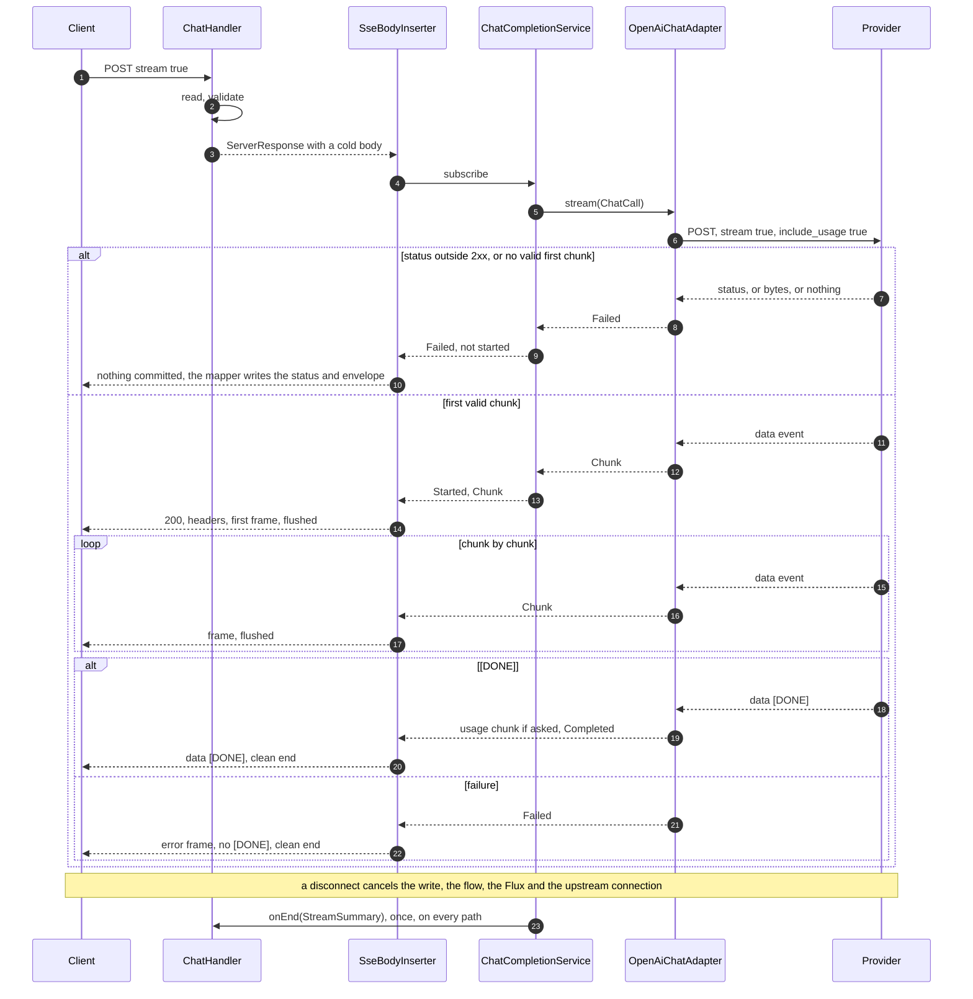

# GW-02: SSE streaming end to end; cancellation on client disconnect

## 1. Context and goal

A product team sets `stream: true` on `POST /v1/chat/completions` and its OpenAI SDK reads tokens as they are generated, through the gateway, with no change but the base URL. Streaming is how most interactive LLM traffic runs, and it is the shape every later control must fit: fallback only before the first byte (RTE-02), reservation and reconciliation (RL-02), a cost for a call whose usage is known only at the end (COST-02), a sliding-window guardrail (GRD-05), a replay from cache (CACHE-04), and `llmgw chat` (CLI-01).

GW-02 builds the OpenAI stream through `ChatModelPort`: a cold flow of sealed events, one SSE parser, per-chunk translation into the domain, one flushed frame per event, and a defined end for every way a stream can stop. When the client goes away, the provider call stops and the connection is released, and one log line with the request ID says so.

It serves pillar 1 (drop-in: SDK stream, `usage` chunk, in-band errors), pillar 2 (no buffering; a measured time-to-first-chunk overhead), pillar 4 (the gateway always learns usage, even when the client did not ask for it) and pillar 6 (a failure before the first byte stays a normal `ProviderFailure`, so RTE-02 can fall back).

## 2. Scope

### In
- `gateway-core`: `ChatChunk`, `ProviderStreamEvent`, `ChatStreamEvent`, `StreamSummary`, the pure `StreamTally`, `ChatModelPort.stream`, `ChatCompletionService.stream`, `StreamOptions` on `ChatRequest`.
- `gateway-providers`: a pure SSE parser (`.gateway.providers.sse`), `OpenAiChunkReader`, the `OpenAiStreamTranslator` state machine, `StreamDeadlines`, in-band error classification, `OpenAiChatAdapter.stream`.
- `gateway-app`: the `stream` branch of `ChatHandler`, the frame writer, the SSE error frame, a stall handler for clients that stop reading, one end-of-stream log line.
- The first-byte, idle and total stream deadlines, the event size limit, `stream_options` validation.
- Closing GW-01's open items: a log line with the ID on disconnect (smoke finding 4), `ByteBuf` release under a leak detector.
- Tests, smoke, docs (section 7).

### Out
- Anthropic streams (GW-03). `tool_calls` deltas pass through in `extras`, tested only with a pure reader case; scripted tool calls are GW-06.
- Guardrails on streams (GRD-05), reservation and reconcile (RL-02), cost (COST-02), spans (OBS-01), metrics (OBS-02), replay from cache (CACHE-04), fallback (RTE-02).
- A live provider call. Everything here runs against `mock-provider` or a raw socket.
- SSE keep-alive comments to clients; HTTP/2.

### What this changes from GW-01

| GW-01 said | GW-02 does |
|---|---|
| `fun stream(call: ChatCall): Flow<ChatChunk>` | `fun stream(call: ChatCall): Flow<ProviderStreamEvent>`: failure is a value, in the same flow (ADR-GW-02-001). |
| `HttpClient.responseTimeout` per request as an idle timeout (ADR-GW-01-004) | Not used. One `Flux.timeout` gives first-byte, idle and total (ADR-GW-02-006). This revises that consequence; step 10 appends the Revision to GW-01's ADR. |
| `stream` selects the port method | Kept. `ChatHandler` branches on it. |
| `stream: true` gives 400 `unsupported_value` | Gone. `GatewayError.InvalidRequest.streamingUnavailable` is deleted. The code constant stays: ADR-015 never reuses a shipped row for another meaning. |
| `x-gateway-usage-estimated` header | Unchanged on a non-stream reply, never sent on a stream (ADR-GW-02-005). |

### What each later item changes

| Item | Change at this seam |
|---|---|
| GW-03 | Second adapter emits the same `ProviderStreamEvent`s, reusing `.gateway.providers.sse`. Anthropic has `event:` names, which the parser already keeps. |
| RTE-02 | Wraps `port.stream` inside `ChatCompletionService.stream`: on `Failed` before `Started`, try the next deployment. `Started` carries the deployment that answered, so `x-gateway-deployment` stays right. After `Started`, never. |
| RL-02, COST-02 | Read `StreamSummary` in `onEnd`, which fires exactly once, for completed, failed and cancelled streams, with a `Usage` always present. A suspending consumer wraps its call in `withContext(NonCancellable)`. |
| GRD-05 | A transforming stage on `Flow<ChatStreamEvent>` between the service and the frames; reads `ChunkDelta.content`, ends a stream with `Failed`. |
| CACHE-04 | A cached response becomes a `Flow<ChatStreamEvent>`; `ChatStreamFrames` is unchanged. |
| OBS-01, OBS-02 | A span around the flow, from `StreamSummary`. Hand-off in section 5, Observability. |
| CLI-01 | Treats a stream with no `[DONE]` as failed. |

## 3. Acceptance criteria

All ticked before the row becomes `[x]`. A "deliberate violation" is made in the working tree, observed failing, and reverted before commit.

**Contract**
- [x] `stream: true` against the mock over real HTTP returns 200, `content-type: text/event-stream;charset=UTF-8`, `cache-control: no-cache`, `x-accel-buffering: no`, a UUIDv7 `x-request-id`, `x-gateway-deployment: openai`, chunked transfer, no `content-length`, no `x-gateway-usage-estimated`.
- [x] With `stream_options.include_usage: true` and content mode `fixed`, the event sequence is STRICT-JSON-equal, event by event, to the mock's direct stream after normalising `id` and `created`, ending in the usage chunk and `data: [DONE]` (`StreamShapeContractTest`).
- [x] Without `include_usage`: no event has a `usage` member, the chunk that carried `usage` is not sent, and the mock's journal still shows `stream_options.include_usage: true` upstream. Wording changed 2026-11-04: it read "no chunk has an empty `choices`", which contradicted section 5 and lost a chunk's extras (review finding 4). Only the chunk that carries `usage` is dropped; one with empty `choices` and no `usage` goes through (`StreamTallyTest`).
- [x] A client's other `stream_options` member (`include_obfuscation`) reaches the mock unchanged, and upstream `stream` is `true`.
- [x] Each frame on the wire is exactly `data: <compact JSON>\n\n`, and the last is `data: [DONE]\n\n` (raw socket).
- [x] The official SDK `openai-java`: `createStreaming` reads every chunk with `responseValidation(true)`; `ChatCompletionAccumulator` rebuilds the mock's text; the usage chunk is read; `stream_error` raises `SseException` (`OpenAiSdkStreamContractTest`).
- [x] `usage.omit` with `include_usage`: a last chunk with `choices: []`, a `usage` from the estimator and `"llmgw":{"usage_estimated":true}`; with provider usage, no `llmgw` member. `usage.omit` without `include_usage`: no usage chunk.
- [x] `stream_options` rows of section 4, each with the exact envelope and `lastSeq` unchanged. `Accept: application/json` on a stream still gives SSE.

**Commit point and failures**
- [x] Before the first frame, every upstream status of GW-01 section 4 gives that row's status, envelope and headers, with `content-type: application/json` and no `cache-control`, `x-accel-buffering` or `x-gateway-deployment` (`StreamUpstreamErrorMappingTest`, parameterized over GW-01's rows).
- [x] A closed port gives 503 `provider_unavailable`; `hang` with `first-byte-timeout: 500ms` gives 504 `upstream_timeout`, and the journal says `client_cancelled` within 2 s.
- [x] A 200 with an empty body, or one that is not SSE, gives 502 `upstream_error` before commit (`RawProviderStreamIntegrationTest`). Evidence note 2026-11-04: that test proves `UpstreamError` first at the adapter; the 502 over HTTP is the smoke's raw-socket block (its Revision), and `ChatStreamRouteTest` proves the status for any `Failed` first.
- [x] After the first frame, each of `disconnect`, `malformed`, `stream_error`, and `stall` with `idle-timeout: 500ms` gives status 200, the frames so far, then one `data: {"error":{...}}` frame with exactly the four members and the mapped `code`, no `[DONE]`, and a clean end of the chunked body: a raw socket reads `0\r\n\r\n` (`StreamFailureIntegrationTest`).
- [x] For each of those, the log has no `Error finishing response` line, no ERROR from `GatewayErrorWebExceptionHandler`, and one ERROR `Stream failed` line carrying the request ID.
- [x] A bug raised in the flow after the first frame gives an error frame with `internal_error`, one ERROR line with a stack trace and no query string.
- [x] `total-timeout: 1s` cuts a stream that never goes idle: `upstream_timeout` frame, journal `client_cancelled`. Evidence note 2026-11-04: met at 1 s by the smoke (frame at 1045 ms, largest gap 204 ms, `client_cancelled` in 2 ms). `StreamTotalDeadlineTest` runs at 3 s, because a 1 s total also caps the first byte of a cold JVM's first request (review finding 7).
- [x] An event over `max-event-size` gives `upstream_error`, before or after commit as it falls; a stream longer in total than `max-response-size` completes normally. Evidence note 2026-11-04: after commit and the long stream by `StreamSizeLimitTest`; before commit by the smoke, where a 1200-byte model name at a 1 KB limit gave a 502 envelope.
- [x] No provider `message`, key, prompt or completion text in a response or log line, with canaries in play, at `logging.level.web=TRACE` and DEBUG on our package (`StreamNoLeakIntegrationTest`).

**Not buffered, back-pressure**
- [x] At `perTokenMs: 200` with at least 5 pieces, the first and last content events reach a client at least 600 ms apart. Lower bound only.
- [x] A client that stops reading: the fake port's emissions stop growing, at under 4096 frames of 16 KB; when the client reads again, every frame arrives in order, none lost (`SlowClientStreamTest`; the adapter's half against a raw provider in `RawProviderStreamIntegrationTest`).
- [x] A client that stays stalled past `client-write-timeout`, on a stream longer than the queues hold: the connection closes, the flow is cancelled, and the end-of-stream line says `cancelled` (`StalledClientStreamTest`, which reads to EOF). Wording changed 2026-11-04: it said any stalled client. A stream that fits the queues ends first: the line says `completed`, meaning handed to Netty, while the connection still closes and the client loses the tail (smoke finding 3; orchestrator's decision, Log).
- [x] A client reading slowly but steadily is not cut by the stall handler, above one kernel step per timeout: 16 KB frames with a 1 s timeout, paced at 640 and 160 KB/s on a 16 KB `SO_SNDBUF`, every frame arrives (`StalledClientStreamTest`; 32 KB/s on Linux). Wording changed 2026-11-04: added by the fix round as "is not cut", which holds for the connection only. Above the stall limit `idle-timeout` can still end the stream with an `upstream_timeout` frame (smoke R1, section 5, Back-pressure), pinned by `StreamStarvedUpstreamTest`.

**Cancellation**
- [x] A raw-socket client that closes after the first frame (FIN and RST) leaves a journal entry `client_cancelled` with `piecesSent` below the total, within 2 s of the close.
- [x] That request has exactly one INFO `Stream cancelled` line with its request ID, and no ERROR line. This closes GW-01 smoke finding 4 for streams.
- [x] Closing at the moment the last frames arrive, 50 rounds: exactly one end-of-stream line per request ID, its outcome `completed` or `cancelled`, no ERROR line.
- [x] 500 streams cancelled mid-flight, with `ResourceLeakDetector` at `PARANOID`, GC forced: no `LEAK:` line in the output (`StreamBufferLeakIntegrationTest`). A deliberate violation that removes the release in the copy step makes this test fail.
- [x] The pool recovers: with `pool.max-connections: 2`, 20 cancelled streams in a row, then a stream succeeds with no 503.
- [x] A connection is reused after a completed stream: two sequential streams, one upstream connection (`RawProviderStreamIntegrationTest` counts accepts, at the adapter).
- [x] With `pool.max-life-time: 1s`, a 2 s stream is not cut (`OpenAiChatStreamIntegrationTest`, at the adapter; through the gateway by the smoke, a 2419 ms stream).

**Under BlockHound, no allowance added**
- [x] `gateway-app`: 2000 real-socket streams at concurrency 32 with the fake port, and 200 streams cancelled mid-flight, from the first request on.
- [x] `gateway-providers`: 200 streams through the real adapter to the mock, the first included, and 50 cancelled.
- [x] After a `stall` timeout and a provider-side abort, the code that follows runs on a Reactor thread, never `DefaultExecutor`.

**Parser and state machine**
- [x] `SseEventParserTest` and `OpenAiStreamTranslatorTest` cover every row of section 8; the same bytes give the same events at every split point.

**Gates**
- [x] `./gradlew :architecture-tests:test` passes with no rule changed.
- [x] `verify-gates` green (coverage: core ≥ 80%, overall ≥ 70%)
- [x] Smoke scenarios in section 8 pass (`gateway-smoke`), report in `docs/knowledge/runs/`. Met by [runs/2026-11-04-smoke-sse-streaming](../knowledge/runs/2026-11-04-smoke-sse-streaming.md): `fail` on the first build, on two findings outside the script; `pass-with-findings` on the fix build (its Revision): `HANG=1 streaming.sh` 68 of 68, `chat-completions.sh` 59 PASS, 3 SKIP (6, 7, 12, which need `HANG=1` or a process stop, and are not section 8 scenarios), 185 hand checks, scenario 12 included
- [x] Eval: n/a (no threshold, classifier or routing policy)
- [x] Living docs updated (`docs-update`), including the systems entry

## 4. Contract

### `POST /v1/chat/completions` with `stream: true`

OpenAI-compatible (ADR-004). Path, `Content-Type: application/json`, every request member and every route error are those of GW-01 section 4. The handler answers before any upstream work; the upstream call starts when the response body is subscribed.

Request members this item adds:

| Member | Handling |
|---|---|
| `stream` | `true` selects streaming. `false`, `null` or absent: GW-01. Anything else: GW-01's 400. Sent upstream as `true`. |
| `stream_options` | Object or `null`. Typed as `StreamOptions`; only with `stream: true`. |
| `stream_options.include_usage` | Boolean or `null`, read by the gateway. Always `true` upstream; decides what the client sees. |
| any other `stream_options` member (`include_obfuscation`, ...) | Kept verbatim in `StreamOptions.extras`, sent upstream unchanged. |

New route errors, checked after GW-01's `stream` rows, in this order. Both are `invalid_request_error`, 400, code `invalid_request`:

| Condition | `param` | `message` |
|---|---|---|
| `stream_options` not an object or null | `stream_options` | `'stream_options' must be an object.` |
| `include_usage` not a boolean or null | `stream_options.include_usage` | `'include_usage' must be a boolean.` |
| `stream_options` is an object and `stream` is not `true` | `stream_options` | `'stream_options' is only allowed when 'stream' is true.` |

The third mirrors OpenAI's behaviour, which its reference states as "Only set this when you set `stream: true`" and which public reports show as a 400 (ADR-GW-02-010).

### Response

```
HTTP/1.1 200 OK
content-type: text/event-stream;charset=UTF-8
cache-control: no-cache
x-accel-buffering: no
x-request-id: 019a4c1e-...
x-gateway-deployment: openai
transfer-encoding: chunked

data: {"id":"chatcmpl-mock-000000000001","object":"chat.completion.chunk","created":1793750400,"model":"mock-chat","choices":[{"index":0,"delta":{"content":"","role":"assistant"},"logprobs":null,"finish_reason":null}],"usage":null,"system_fingerprint":"fp_mock"}

data: {...,"choices":[{"index":0,"delta":{"content":"Hi"},...}],"usage":null,...}

data: {...,"choices":[{"index":0,"delta":{},"logprobs":null,"finish_reason":"stop"}],"usage":null,...}

data: {...,"choices":[],"usage":{"prompt_tokens":14,"completion_tokens":2,"total_tokens":16,...},...}

data: [DONE]

```

- Member order is typed members first, then the provider's others in the order received. JSON objects are unordered (RFC 8259) and SDKs read by name; only the bytes differ from the provider's.
- `object` is always `chat.completion.chunk`. `id`, `created`, `model` are the provider's.
- With `include_usage` true, every chunk has `usage`: `null` except the last. Otherwise no chunk has it, and the usage chunk is not sent.
- A member absent from the provider's chunk stays absent, and `null` stays `null` (`delta`'s `content`, `finish_reason`, `logprobs`, ...): typed fields hold only values of the expected type, and anything else stays in `extras`.
- A provider comment line, `event:`, `id:` or `retry:` field is not forwarded.
- Numbers keep their value, not their spelling, as in GW-01.

### Headers

| Header | When | Value | Notes |
|---|---|---|---|
| `content-type` | on commit | `text/event-stream;charset=UTF-8` | As the mock and the WHATWG format. |
| `cache-control` | on commit | `no-cache` | |
| `x-accel-buffering` | on commit | `no` | nginx honours it per response; clients ignore it. |
| `x-request-id`, `x-client-request-id` | every response | FND-04 | Set by the filter, before commit. |
| `x-gateway-deployment` | on commit, from `Started` | `Deployment.id` | The deployment that answered. |
| `x-gateway-usage-estimated` | never on a stream | | It cannot be known at commit. |
| `connection` | never set | | HTTP/1.1 persistent by default; a hop-by-hop matter for Netty. |
| `retry-after`, `retry-after-ms`, `x-should-retry` | before commit only | GW-01 | No header can follow commit. |
| `Accept` | upstream request | `text/event-stream` | The adapter's own. |

Client `Accept` is ignored, as in GW-01: no 406 on this route (ADR-GW-02-011).

### When the status is committed

At the first frame, and not before: after the provider answered 2xx **and** the gateway read its first valid chunk. Anything that fails earlier is an ordinary error response with its status.

| Stage | Failure gives |
|---|---|
| Connect, pool, TLS, DNS | GW-01 row, by status |
| Provider status outside 2xx | GW-01 row, by status |
| 2xx, then nothing or EOF | 502 `upstream_error`, or 504 at the first-byte deadline |
| 2xx, first event malformed | 502 `upstream_error` |
| 2xx, first event is an in-band error | The mapped row, by status |
| First valid chunk read | `Started`: headers set, frame written, **committed** |
| Anything later | SSE error frame |

### Failure after commit

```
data: {"error":{"message":"The provider did not answer in time. Include the request ID 019a4c1e-... if you report it.","type":"server_error","param":null,"code":"upstream_timeout"}}

```

- The frame carries exactly the ADR-015 envelope with the row's `message`, `type`, `param` and `code`; the row's status and headers cannot apply.
- No `event:` field, as in OpenAI's own stream: openai-python and openai-java both raise on a `data` event with an `error` member, and neither reads `event` on this route.
- No `[DONE]` follows, and the body ends cleanly. A client tells success from failure by `[DONE]`: a stream with no `[DONE]` did not complete.
- An abrupt close with no error frame and no terminating chunk happens only when the process stops or the client's connection is gone.

The provider's in-band `{"error":...}` is never relayed: it becomes a `ProviderFailure`, and only the `code` and `param` that pass GW-01's regexes survive.

| In-band `error` | `ProviderFailure` |
|---|---|
| `code` or `type` in GW-01's quota set | `UpstreamQuotaExhausted` |
| `code` is `model_not_found` | `ModelNotFound` |
| `type` is `rate_limit_error`, or `code` is `rate_limit_exceeded` | `UpstreamRateLimited(null)` |
| `type` is `invalid_request_error` | `RejectedByProvider(400, code, param)` |
| anything else | `UpstreamError` |

No row of the error table changes and none is added. OpenAI documents no in-band error shape for this endpoint; this table is the gateway's reading of the SDKs and of the error-code guide.

### What stays OpenAI-compatible, what is an extension

- **Compatible:** `stream`, `stream_options`, chunk shape, `usage` semantics, `[DONE]`, in-band `error`, statuses before commit.
- **Extensions:** `llmgw` on the usage chunk, only when usage is estimated; `x-gateway-deployment`. Unknown members are tolerated by both SDKs (`OpenAiSdkStreamContractTest` proves `openai-java`).
- **Narrower than OpenAI, by design:** an in-band `message` is the gateway's fixed text. A client always gets its first bytes only after the first valid chunk.
- **How a client learns cost later:** no trailer. `usage` arrives in the last chunk, and cost has two later routes: COST-03's query by request ID, which is in the headers, and a further member beside `llmgw`, which COST-02 decides (ADR-GW-02-005).

## 5. Design

### Modules and ports

| Module | Holds | Owns which library |
|---|---|---|
| `gateway-core` | Chunk and event types, `StreamTally`, port, service | `kotlinx.coroutines.flow`, already allowed |
| `gateway-providers` | SSE parser, chunk reader, translator, deadlines, adapter | Reactor and WebClient, inside the adapter only |
| `gateway-app` | Frames, inserter, error frame, stall handler, log line | `Flow.asFlux`, Netty's `IdleStateHandler` |

**`gateway-core`**, package `.gateway.core.chat`:

```kotlin
/** One streamed delta; [usage] is set on the chunk that reports it. No `toString` here prints text. */
data class ChatChunk(
    val id: String,
    val created: Long,                                      // epoch seconds
    val model: ModelName,
    val choices: List<ChunkChoice>,                         // empty on a usage chunk
    val usage: Usage? = null,
    val extras: JsonValue.Object = JsonValue.Object.EMPTY,  // service_tier, system_fingerprint, ...
)
data class ChunkChoice(
    val index: Int,
    val delta: ChunkDelta,
    val finishReason: FinishReason? = null,                 // null: absent or null, kept in extras
    val extras: JsonValue.Object = JsonValue.Object.EMPTY,  // logprobs, ...
)
data class ChunkDelta(
    val content: String? = null,                            // null: absent or null, kept in extras
    val extras: JsonValue.Object = JsonValue.Object.EMPTY,  // role, tool_calls, refusal, obfuscation, ...
)

/** What the client sent in `stream_options`; `include_usage` is always true upstream (ADR-GW-02-005). */
data class StreamOptions(val includeUsage: Boolean, val extras: JsonValue.Object = JsonValue.Object.EMPTY)

/** Zero or more [Chunk], then exactly one terminal event, then the flow completes. */
sealed interface ProviderStreamEvent {
    data class Chunk(val chunk: ChatChunk) : ProviderStreamEvent
    data object Completed : ProviderStreamEvent
    data class Failed(val failure: ProviderFailure) : ProviderStreamEvent
}

interface ChatModelPort {
    suspend fun complete(call: ChatCall): ProviderResult
    /**
     * Cold: the call starts on collection, and cancelling the collector cancels it. An expected failure is a
     * [ProviderStreamEvent.Failed], never an exception, at any point in the stream.
     */
    fun stream(call: ChatCall): Flow<ProviderStreamEvent>
}

sealed interface ChatStreamEvent {
    /** The first chunk is in hand: the last moment a status or header can change. */
    data class Started(val deployment: Deployment) : ChatStreamEvent
    data class Chunk(val chunk: ChatChunk) : ChatStreamEvent
    data class Completed(val usage: Usage) : ChatStreamEvent
    data class Failed(val failure: ProviderFailure) : ChatStreamEvent
}

sealed interface StreamOutcome {
    data object Completed : StreamOutcome
    data class Failed(val failure: ProviderFailure) : StreamOutcome
    data object Cancelled : StreamOutcome
    /** An exception left the flow: a bug, logged by whoever caught it. */
    data object Crashed : StreamOutcome
}

/** Reported exactly once per stream, whatever ended it. [usage] is estimated unless the provider reported it. */
data class StreamSummary(
    val deployment: Deployment,
    val outcome: StreamOutcome,
    val usage: Usage,
    val started: Boolean,
    val chunks: Int,
)

class ChatCompletionService(...) {
    suspend fun complete(requestId: RequestId, request: ChatRequest): ChatOutcome
    /** Cold. [onEnd] must not suspend: it can run in a cancelled coroutine. */
    fun stream(requestId: RequestId, request: ChatRequest, onEnd: (StreamSummary) -> Unit = {}): Flow<ChatStreamEvent>
}

class UsageEstimator {
    fun estimate(request: ChatRequest, completion: ChatCompletion): Usage
    /** [outputCharacters]: one count per choice; never the text. */
    fun estimate(request: ChatRequest, outputCharacters: Collection<Long>): Usage
}
```

`ChatRequest` gains `val streamOptions: StreamOptions? = null`, and `RESERVED` gains `stream_options`. `ChatChunk`, `ChunkChoice`, `ChunkDelta` and `StreamOptions` override `toString` with counts only (ADR-018).

`StreamTally(request, deployment, estimator)` is the pure state machine behind `stream`, with one method `on(ProviderStreamEvent): List<ChatStreamEvent>` and one `summary(cancelled: Boolean): StreamSummary`:

| State, event | Emits | Next |
|---|---|---|
| Waiting, a chunk that is forwarded | `Started`, `Chunk` | Open |
| Waiting, `Failed` | `Failed` | Ended |
| Waiting, `Completed` | `Failed(UpstreamError)`: a 200 with no chunk | Ended |
| Open, a chunk | `Chunk` | Open |
| Open, `Completed` | a usage chunk if the client asked and the provider sent none, then `Completed(usage)` | Ended |
| Open, `Failed` | `Failed` | Ended |
| Ended, any | nothing | Ended |

- Every chunk: adds `delta.content.length` to its choice's count, and keeps any `usage` it carries (the last wins).
- A chunk with empty `choices` and a `usage` is forwarded only when the client asked. Forwarded or not, its `usage` counts. A chunk with empty `choices` and no `usage` is an ordinary chunk: it goes through with its extras.
- Terminal beats cancelled: once `Ended` holds an outcome, a late cancellation does not change it, because the provider's answer is complete and its usage known. That settles the race between the last chunk and a disconnect.
- It never holds text: only counts, the provider's usage and the last chunk's `id`, `created` and `model` for a synthesised usage chunk.

The service:

```kotlin
fun stream(requestId, request, onEnd) = flow {
    val deployment = resolver.resolve(request.model)
    val tally = StreamTally(request, deployment, estimator)
    try {
        port.stream(ChatCall(requestId, deployment, request)).collect { event -> tally.on(event).forEach { emit(it) } }
        // Otherwise the response would be an empty 200: no event ever reaches the frames.
        check(tally.ended) { "The port ended a stream with no terminal event." }
    } finally {
        // Recorded, never caught: a cancellation propagates unchanged.
        onEnd(tally.summary(cancelled = !currentCoroutineContext().isActive))
    }
}
```

**`gateway-providers`.** All internal, but the adapter and its config.

| Class | Package | Role |
|---|---|---|
| `SseEvent(event: String?, data: ByteArray)`, `SseEventParser(maxEventBytes)` | `.sse` | Pure, bytes in, events out (ADR-GW-02-003). `feed(ByteArray): SseFeed`, with `SseFeed` holding the events and `overflowed`. GW-03 reuses it. `SseEvent.toString` prints sizes. |
| `OpenAiChunkReader(trees)` | `.openai` | `data` bytes to a sealed `ChunkRead`: `Read(chunk)`, `InBandError(fields)`, `Unreadable`. Requires an object with a string `id`, an integer `created`, a non-blank string `model`, an array `choices`, each an object with an object `delta`. |
| `OpenAiUsageReader` | `.openai` | The usage rule of `OpenAiResponseReader`, extracted so both readers share it. |
| `OpenAiStreamTranslator(reader, classifier, maxEventBytes)` | `.openai` | State machine, one per stream. `feed(bytes)`, `finish()` at EOF, `fail(failure)`; each returns `List<ProviderStreamEvent>`. Holds `terminal`. |
| `StreamDeadlines(config, clock, startedAt)` | `.openai` | Pure: the delay before the next item must arrive. |
| `OpenAiFailureClassifier.classifyInBand(fields)` | `.openai` | Section 4 table. |
| `OpenAiChatStream(client, endpoint, config, mapper, clock)` | `.openai` | The stream half of the adapter, which `OpenAiChatAdapter.stream` delegates to: the sketch below lives here. |
| `OpenAiRequestWriter.writeStream(call, nodes)` | `.openai` | `write`, then `stream: true`, then `stream_options`: the client's extras with `include_usage: true`. |

`OpenAiStreamTranslator`:

| State, input | Output | Next |
|---|---|---|
| Open, `data: [DONE]` (`startsWith`, as both SDKs do) | `Completed` | Draining |
| Open, chunk | `Chunk` | Open |
| Open, in-band error | `Failed(classifyInBand)` | Ended |
| Open, unreadable data | `Failed(UpstreamError)` | Ended |
| Open, event over the limit | `Failed(UpstreamError)` | Ended |
| Open, event with no data, comment | nothing | Open |
| Open, `finish()`, a `finish_reason` was seen | `Completed` | Ended |
| Open, `finish()`, none seen | `Failed(UpstreamError)`: a truncated stream | Ended |
| Open, `fail(f)` | `Failed(f)` | Ended |
| Draining or Ended, `fail(f)`, a terminal the collector never got | that terminal's whole feed, not `f`: `Flux.timeout` drops an item that loses to its timer | same |
| Draining or Ended, anything else | nothing | same |

Adapter, in `OpenAiChatStream`, which `OpenAiChatAdapter.stream` delegates to (shortened: no status, ID or log handling):

```kotlin
fun stream(call: ChatCall): Flow<ProviderStreamEvent> = flow {
    val translator = OpenAiStreamTranslator(reader, classifier, config.stream.maxEventBytes)
    val deadlines = StreamDeadlines(config.stream, clock, clock.millis())
    wire(call, translator, deadlines)
        .asFlow()
        .buffer(STREAM_BUFFER)
        .map { it.events }
        // The operator, not try/catch around collect: that would also catch what downstream throws, which breaks
        // Flow's exception transparency. classify rethrows anything unnamed, so a bug stays a bug.
        .catch { cause -> emit(translator.fail(OpenAiTransportFailures.classify(cause))) }
        .collect { events ->
            events.forEach { event ->
                if (event !is ProviderStreamEvent.Chunk) translator.delivered()
                emit(event)
            }
        }
}

private fun wire(...): Flux<Batch> =
    client.post().uri(endpoint)...bodyValue(body)
        .exchangeToFlux { response ->
            if (response.statusCode().is2xxSuccessful) {
                // Copied and released here: asFlow's channel drops what it holds on cancel, and a retained
                // buffer in it would leak (ADR-GW-02-008).
                response.body(BodyExtractors.toDataBuffers())
                    .bodyFailuresAsTransport()
                    .map(::copyAndRelease)
                    .map { Batch(translator.feed(it)) }
            } else {
                withoutContentType(response).toEntity(ByteArray::class.java).map { refused(it) }.flux()
            }
        }
        .concatWith(Flux.defer { Mono.just(Batch(translator.finish())) })
        .timeout(Mono.delay(deadlines.first()), Function { Mono.delay(deadlines.next(translator.draining)) })
        .takeUntil { translator.ended }
```

- `toDataBuffers()` reads no `Content-Type`, so the gotcha of a value Spring cannot parse does not apply to a 2xx. The refused path keeps `withoutContentType`.
- `bodyFailuresAsTransport` turns any error from a response's body into `UpstreamBodyFailure`, a stackless `IOException` keeping only the class name: nothing of ours runs above it, and Netty raises bad chunked framing as bare runtime exceptions ([bug](../knowledge/bugs/adapter-broken-chunked-framing-raised-as-a-bug.md)).
- A `Batch` with no events still resets the idle timer: any upstream byte proves the provider is alive.
- `takeUntil` cancels upstream on a failure. Draining goes on to EOF so the connection returns to the pool.
- The adapter logs after `asFlow`, inside the coroutine, so MDC holds the request ID: one WARN per failure with deployment, upstream status or exception class, provider `code` and `type`, provider `x-request-id`, duration ms, the fields of GW-01. A timeout after a delivered `Completed` is swallowed by `translator.fail`, which emits nothing; a terminal the collector never got comes back from it, so a stream always ends in one.
- `warmUp()` adds nothing new unless BlockHound says so. If it trips, warm the path at startup; never add an allowance.

`OpenAiAdapterConfig` gains `stream: StreamConfig(firstByteTimeout, idleTimeout, totalTimeout, maxEventBytes)`.

**`gateway-app`:**

| Class | Package | Role |
|---|---|---|
| `SseFrames` | `.web` | Pure. `data(json: ByteArray): ByteArray` gives `data: <json>\n\n`, rejecting a raw line break; `DONE`. |
| `SseBodyInserter(context, frames)`, `frames: (HttpHeaders) -> Flow<ByteArray>` | `.web` | `writeAndFlushWith`, one inner `Mono` per frame, and its own teardown of the flow. |
| `ClientStallHandler(timeout)` | `.web` | `IdleStateHandler` with `observeOutput`: closes a connection with bytes pending and no write progress. |
| `ChatChunkWriter` | `.chat` | Pure. `ChatChunk` to `ObjectNode`, given `includeUsage`. |
| `ChatStreamFrames` | `.chat` | Pure over a flow: `Flow<ChatStreamEvent>` to `Flow<ByteArray>`. |
| `ChatStreamLog(clock, requestId)` | `.chat` | `started()` at the first chunk, `end(summary)`: `StreamSummary` to one log line. |
| `StreamErrorFrames` | `.error` | `GatewayError` to the frame, through `toReply` and `OpenAiErrorEnvelope`, and the ERROR line for a bug. In `.error`, because an error body is written only there (contract 1). |
| `ServerStreamProperties`, `ServerStreamConfiguration` | `.config` | `llmgw.server.client-write-timeout` and the Netty customizer. |

`ChatHandler` and `ChatStreamFrames`:

```kotlin
suspend fun complete(request: ServerRequest): ServerResponse {
    val body = request.readJsonObject(trees)
    val chat = ChatRequestReader.read(body)
    val context = checkNotNull(currentCoroutineContext()[RequestContext]) { "no RequestContext on a chat request" }
    return if (ChatRequestReader.wantsStream(body)) stream(context, chat) else answer(context, chat)
}

private suspend fun stream(context: RequestContext, chat: ChatRequest): ServerResponse {
    val log = ChatStreamLog(clock, context.requestId)
    val events = service.stream(context.requestId, chat, log::end)
    // Without the Job, so asFlux's coroutine does not join a handler that returns before the body is written.
    val coroutine = currentCoroutineContext().minusKey(Job)
    val inserter = SseBodyInserter(coroutine) { headers -> ChatStreamFrames(..., headers, log).frames(events) }
    return ServerResponse.ok().body(inserter).awaitSingle()
}
```

`ChatStreamFrames` per event:

| Event | Effect |
|---|---|
| `Started(deployment)` | Sets the four commit headers on the response, which is still uncommitted. No frame. |
| `Chunk` | `SseFrames.data(mapper.writeValueAsBytes(ChatChunkWriter.write(...)))` |
| `Completed` | `SseFrames.DONE` |
| `Failed`, not started | `throw GatewayErrorException(failure)`: the first signal is an error, so `ChannelSendOperator` bypasses the write, nothing commits, and the mapper writes the envelope. |
| `Failed`, started | `StreamErrorFrames.frame(...)`, then the flow ends normally. Nothing is emitted after `[DONE]` or this frame; a later bug is logged only. |
| Any other exception, not started | Propagates to the mapper: 500, as any bug. |
| Any other exception, started | `.catch`: logs through `LoggableFailure`, emits the `internal_error` frame. `CancellationException` is never caught: `Flow.catch` passes it, and the block rethrows one. |

`ServerResponse.ok().body(inserter)` carries no header, so nothing stale survives an error (ADR-GW-02-001). The mapper is unchanged: its committed branch is now reachable only by what the flow cannot catch.

`SseBodyInserter.insert`:

```kotlin
val buffers = outputMessage.bufferFactory()
val finished = Sinks.empty<Void>()
val source = frames(outputMessage.headers).asFlux(context).takeUntilOther(finished.asMono())
return outputMessage
    .writeAndFlushWith(source.map { frame -> Mono.fromSupplier { buffers.wrap(frame) } })
    // Only a write can fail here once committed; the flow's own failures became frames
    // (docs/knowledge/gotchas/spring-disconnected-client-helper-matches-phrases-in-cause-chain.md).
    .onErrorResume({ outputMessage.isCommitted && DisconnectedClientHelper.isClientDisconnectedException(it) }) { Mono.empty() }
    // ChannelSendOperator keeps its source when the write fails at once, and the flow owns the upstream call.
    .doFinally { finished.tryEmitEmpty() }
```

### Data

n/a: no Flyway table, Redis key or topic. Source of truth: the provider for chunks and usage; the estimator's count only when the provider omits it. Nothing is stored: a stream lives in the pipeline of section 5, Back-pressure.

### Flow



### Failure model

**Deadlines** (ADR-GW-02-006). All come from `StreamDeadlines`, through one `Flux.timeout`, so all raise a top-level `TimeoutException`, which `OpenAiTransportFailures` maps to `UpstreamTimeout`.

| Deadline | Measures | Default | Before commit | After commit |
|---|---|---|---|---|
| `connect-timeout` | TCP connect | 5 s | 503 `provider_unavailable` | n/a |
| `pool.pending-acquire-timeout` | Pool wait | 5 s | 503 `provider_unavailable` | n/a |
| `stream.first-byte-timeout` | Subscribe to the first upstream body byte or error status | 120 s | 504 `upstream_timeout` | n/a |
| `stream.idle-timeout` | Between upstream buffers | 60 s | 504 `upstream_timeout` | `upstream_timeout` frame |
| `stream.total-timeout` | Whole stream | 30 m | 504 `upstream_timeout` | `upstream_timeout` frame |
| drain, a constant, 1 s | `[DONE]` to upstream EOF | 1 s | n/a | Silent: the client already has `[DONE]`; the connection closes instead of returning to the pool |
| `llmgw.server.client-write-timeout` | Bytes pending for the client, with no write progress | 30 s | Connection closed | Connection closed, `cancelled` |

`request-timeout` stays the non-stream deadline. `max-response-size` does not apply to a 2xx stream, only to an error body. Startup refuses `first-byte-timeout` or `idle-timeout` above `total-timeout`, and `client-write-timeout` at or above `idle-timeout`, so a stalled client is seen as a client.

**Events:**

| Event | Behaviour | Why |
|---|---|---|
| Provider slow to start | Nothing is sent; at `first-byte-timeout`, 504. The client's own proxies see no byte until then. | A byte would commit the status (ADR-GW-02-001). |
| Provider down | GW-01's rows. Fail-closed: there is no answer to give. | |
| Provider stops mid-stream (`stall`) | At `idle-timeout`: error frame, upstream cancelled. | Fail-closed; holds no pool slot past the deadline. |
| Provider closes without `[DONE]` | A `finish_reason` was seen: complete; the gateway writes `[DONE]`, usage is estimated if absent. None seen: `upstream_error`. | The answer is whole in the first case, truncated in the second. |
| Connection reset or premature close (`disconnect`) | `Failed(UpstreamError)`, error frame. | `IOException` rows of `OpenAiTransportFailures`. |
| Malformed event | Error frame, upstream cancelled. The rest is not read. | A skipped event silently corrupts the text. |
| Bad chunked framing (a bad chunk size, a chunk line over 4096 bytes) | `upstream_error`: 502 before commit, a frame after it, silent in the drain. | A provider fault, not a bug, whatever type Netty raises. |
| Upstream in-band error (`stream_error`) | Section 4 table. | The provider's `message` is never relayed. |
| Event over `max-event-size` | `upstream_error`. | Bounds memory per stream. |
| Retries | None, before or after commit. `disableRetry(true)` stays. RTE-02 retries before `Started` only. | CLAUDE.md. |
| Client disconnects | Cancels everything; section Cancellation below. The provider may still bill the partial call; `StreamSummary` holds what is known. | |
| Client stalls | Back-pressure, then `client-write-timeout`. | Section Back-pressure. |
| Client reads, too slowly to pull an upstream read within `idle-timeout` | `upstream_timeout` frame, behind the backlog; ERROR `Stream failed` and the adapter's WARN blame a healthy provider. | Section Back-pressure; GW-08. |
| A bug after commit | One ERROR, `internal_error` frame, clean end. | ADR-015. |
| What the flow cannot catch, after commit | The mapper's committed branch: ERROR, `CommittedResponseAbort`, Reactor Netty's line. | Unchanged from FND-04. This is the only path with a second line. |
| Graceful shutdown | Boot's default, up to 30 s per phase. A longer stream is cut, with no frame. Accepted until OPS-03. | |
| Redis, Postgres, broker | n/a: GW-02 calls none. | |
| Idempotency | None upstream: the gateway does not retry. The request ID stays the future usage-event key; `onEnd` fires once. | |

**Cancellation** (ADR-GW-02-008). Detection needs no code of ours. Mid-stream, `MonoSendMany` listens on `closeFuture`: at the close it cancels its source and completes the write `Mono` normally (measured; [gotcha](../knowledge/gotchas/reactor-netty-close-completes-the-write-mono-normally.md)). Before the first frame, on channel inactive, `onInboundClose` calls `terminate`, which cancels the chain. A first frame between the two fails at once, and `SseBodyInserter`'s own teardown ends the flow ([bug](../knowledge/bugs/first-frame-on-a-closing-channel-leaves-the-stream-flow-running.md)). Each way, that cancels `concatMap`, `asFlux`'s coroutine (documented: "the original flow is cancelled when the flux subscriber is disposed"), the service's `collect`, the adapter's `collect` and its `asFlow`, whose `finally` cancels the subscription, the `timeout`, and `FluxReceive`, which releases its queue and closes the connection. `finally` in the service calls `onEnd`, which logs one INFO line under MDC. `CancellationException` is caught nowhere.

Buffers: a retained `ByteBuf` exists only between `getBody()`'s `.map` and `copyAndRelease`, in one synchronous call chain with no queue between them. `asFlow`'s channel has no `onUndeliveredElement`, so anything pooled in it would leak on cancel; it holds `Batch`es of plain objects. On the server side, frames stay `ByteArray` until the inner `Mono` is subscribed, and `wrap` makes an unpooled buffer, so a cancelled queue holds nothing the GC cannot take.

**Back-pressure** (ADR-GW-02-009). Demand runs end to end, with no unbounded stage:

| Stage | Bound | Source |
|---|---|---|
| Netty and the kernel, to the client | Socket buffers | OS |
| `MonoSendMany` | 128 buffers unconfirmed, so about 64 frames (a frame plus its flush boundary), refilled at 64 | `MonoSend` |
| `sendGroups`' `concatMap` | 32 frames | `NettyOutbound` |
| `asFlux` | Suspends at zero demand | `ReactiveFlow.kt` |
| Adapter `asFlow().buffer(8)` | 8 upstream buffers | `ReactiveFlow.kt` |
| `FluxReceive` | Turns `autoRead` off with no demand; TCP then pushes back on the provider | `FluxReceive` |

Per stream that is about 100 frames plus 8 upstream reads, roughly 30 KB of frames at 300 bytes each, worst case about 100 frames of `max-event-size`. Figures are read from source; `SlowClientStreamTest` proves a plateau, not the number. Measured on Windows loopback: the flow stopped at `chunks=152` on 16 KB frames and 464 on ordinary frames (smoke finding 5), about 1.5 times the figure for 16 KB frames, because socket buffers add to it.

A client that stops reading has bytes pending and no write progress: at `client-write-timeout` the connection closes, the chain cancels, and the upstream slot frees. The cut comes 1 to 1.5 timeouts after the last progress, inside `idle-timeout` at the defaults. Queue time does not count.

A client that keeps reading slows the provider, down to two limits, one on the connection and one on the stream (corrected 2026-11-04, smoke R1 and R2; this paragraph said "nothing is dropped"). At the defaults, on 16 KB frames, Windows loopback:

| Reader | Result | Log | Limit |
|---|---|---|---|
| Above an edge between 11.8 and 19.7 KB/s | Every frame arrives | `Stream completed` | |
| From about 2 to 3 KB/s up to that edge | `upstream_timeout` frame after about 152 of 500 tokens, reaching the client behind the backlog: at 7.9 KB/s the server failed at 106 s, the client saw it at 305 s | ERROR `Stream failed` and the adapter's WARN, for a healthy provider | Stream: `Flux.timeout` cannot see demand, so `idle-timeout` fires when the client holds the next upstream read back |
| Below 2 to 3 KB/s | EOF, no frame, no zero chunk | INFO `Closing connection`, INFO `Stream cancelled` | Connection: `ClientStallHandler` sees progress only as the kernel takes bytes, so a reader must drain one kernel step per timeout (ADR-GW-02-009, Revisions) |

- The stream's edge depends on `idle-timeout`. Inferred, not measured: the demand refill of about 64 frames, 1 MB, must drain inside it, so the edge scales with frame size. At idle 2 s the bracket is 205 to 683 KB/s, and 146 KB/s got the frame; at idle 60 s and a 1 s write timeout 85.6 KB/s completed. Ordinary frames were not affected: the provider finished first.
- The connection's limit applies to ordinary frames too. A token stream has no backlog only for a client above the provider's rate: a 984 B/s client on a 13 KB/s stream had 40888 bytes pending when it was cut at 76.8 s, and 2.9 KB/s completed.
- Accepted for GW-02: that client costs a pool slot until the frame, its label is wrong, and RTE-02 must not count it against the provider. GW-08 is the fix: an idle timer that does not count time the client holds the stream.
- Every rate is a Windows loopback number; socket buffers set both limits, so expect others elsewhere ([gotcha](../knowledge/gotchas/client-stall-handler-moves-slow-readers-onto-idle-timeout.md)).

### Observability

- **Logs.** One line per stream from `ChatStreamLog`, in the coroutine, so MDC carries the ID. Fields: deployment, outcome, `code`, chunks, `ttftMs`, `durationMs`, input and output tokens, `estimated`.

| Outcome | Level | Message |
|---|---|---|
| `Completed` | DEBUG | `Stream completed` |
| `Cancelled` | INFO | `Stream cancelled` |
| `Failed`, started | ERROR | `Stream failed` |
| `Failed`, not started | none | The mapper already logs it. |
| `Crashed` | none | `StreamErrorFrames` or the mapper logged the stack trace. |

  - INFO for a cancel: a call the provider may bill must be findable from the log (GW-01 smoke finding 4).
  - The adapter's WARN keeps GW-01's fields, with no provider text.
  - `FluxReceive`'s WARN on a client RST carries no ID. It remains: silencing the logger would hide real errors, and the `Stream cancelled` line now gives the ID. It fires on every client RST on a stream, and a socket closed with unread bytes sends one (smoke finding 4).
  - `ClientStallHandler`'s INFO `Closing connection <id>: no write progress, <n> bytes pending` runs on the event loop and has no request ID. On a stream `Stream cancelled` follows and the two share no key; a non-stream cut leaves only that line (smoke R3, OBS-03).
- **No second line for expected failures.** The flow completes normally after the error frame, so neither the mapper nor `HttpServerOperations` logs anything, and there is no `CommittedResponseAbort`.
- **Spans:** none (OBS-01). Hand-off: `gen_ai.client.inference` with `gen_ai.request.stream=true` and `gen_ai.response.time_to_first_chunk` in seconds, plus GW-01's attributes, from `StreamSummary`. `error.type` from the outcome.
- **Metrics:** none (OBS-02). Hand-off: `gen_ai.client.inference.time_to_first_chunk` and `gen_ai.client.inference.time_per_output_chunk`, histograms in `s`, Development status.
- **Never recorded:** prompt or completion text, deltas, `extras`, the provider's `message`, frames, `data` bytes on a parse failure, Jackson's exception messages, keys. Spring's `StringDecoder` logs what it decodes, and `JacksonJsonEncoder` what it encodes; neither is on this path.

### Configuration

`gateway-app/src/main/resources/application.yaml`:

| Property | Default | Unit, range, note |
|---|---|---|
| `llmgw.providers.openai.stream.first-byte-timeout` | `120s` | > 0, ≤ total. No public figure for a reasoning model's first token: chosen generous; RTE-02 can tighten per route. |
| `llmgw.providers.openai.stream.idle-timeout` | `60s` | > 0, ≤ total. nginx's `proxy_read_timeout` default. |
| `llmgw.providers.openai.stream.total-timeout` | `30m` | > 0. About 90 000 tokens at 50 tokens/s, an assumed rate. |
| `llmgw.providers.openai.stream.max-event-size` | `1MB` | 1 KB to 16 MB. A chunk is usually under 1 KB; streamed audio and logprobs are larger. |
| `llmgw.server.client-write-timeout` | `30s` | > 0, < `idle-timeout`. How long a client's socket may take none of the bytes pending for it, on every response of this server (`ClientStallHandler`). |

The comment on `request-timeout` gains "non-stream only"; that on `pool.max-connections` becomes "A call holds one for its whole duration, and a stream for up to `total-timeout`". `max-connections` is therefore the ceiling on concurrent streams, 500 today. `STREAM_BUFFER` (8) and the drain (1 s) are constants.

## 6. Reuse

- ADR-004, ADR-006, ADR-015, ADR-018, and new [ADR-019](../DECISIONS.md#adr-019).
- GW-01: `ChatModelPort`, `ChatRequestReader`, `OpenAiFailureClassifier`, `OpenAiTransportFailures`, `RetryAfter`, the pool and `disableRetry`, `withoutContentType`, `ChatResponseWriter`'s usage writer, `FakeChatModelPort`, `MockBackedTest`, `OpenAiSdkContractTest`'s setup.
- FND-03: every fault, `include_usage`, `usage.omit`, `piecesSent`. No change to `mock-provider`: what it cannot produce (CRLF, comments, split UTF-8, an in-band error first, EOF without `[DONE]`) is a pure test or a raw socket, as in `RawProviderSocketIntegrationTest`.
- FND-04: the mapper, unchanged, `LoggableFailure`, `RequestContext`.
- Patterns: [`raw-sse-frames-flushed-per-event`](../knowledge/patterns/raw-sse-frames-flushed-per-event.md) (revised), [`upstream-bytes-then-pure-classification`](../knowledge/patterns/upstream-bytes-then-pure-classification.md), [`one-error-funnel`](../knowledge/patterns/one-error-funnel.md), [`request-context-coroutine-element`](../knowledge/patterns/request-context-coroutine-element.md), [`typed-core-with-json-extras`](../knowledge/patterns/typed-core-with-json-extras.md).
- Gotchas: [`webflux-committed-error-reaches-netty-log-or-completes-normally`](../knowledge/gotchas/webflux-committed-error-reaches-netty-log-or-completes-normally.md), [`spring-coroutine-handlers-resume-on-default-executor-after-delay`](../knowledge/gotchas/spring-coroutine-handlers-resume-on-default-executor-after-delay.md), [`spring-jackson-encoder-logs-the-value-at-debug`](../knowledge/gotchas/spring-jackson-encoder-logs-the-value-at-debug.md), [`jackson-deserializer-cache-lock-parks-on-first-tree-read`](../knowledge/gotchas/jackson-deserializer-cache-lock-parks-on-first-tree-read.md), [`spring-disconnected-client-helper-matches-phrases-in-cause-chain`](../knowledge/gotchas/spring-disconnected-client-helper-matches-phrases-in-cause-chain.md), [`spring-http-headers-content-type-throws-on-bad-header`](../knowledge/gotchas/spring-http-headers-content-type-throws-on-bad-header.md).
- New patterns written with this plan: [`cold-event-flow-commits-at-first-frame`](../knowledge/patterns/cold-event-flow-commits-at-first-frame.md), [`copy-and-release-pooled-buffers-before-a-flow`](../knowledge/patterns/copy-and-release-pooled-buffers-before-a-flow.md).

## 7. Execution plan

Steps of about half a day each; tick as they land. Core and every pure class are test-first.

- [x] **Step 1: core types (TDD).** `ChatChunk`, `StreamOptions`, event types, `StreamSummary`; `toString` canary cases; `UsageEstimator` by characters, proved equal to the non-stream estimate for the same text.
- [x] **Step 2: `StreamTally` and the service (TDD).** Every row of the state table, the race, `onEnd` exactly once on each outcome, with a fake port and `kotlinx-coroutines-test`.
- [x] **Step 3: SSE parser (TDD).** `SseEventParser`, section 8 table, every split point.
- [x] **Step 4: chunk reader and translator (TDD).** `OpenAiUsageReader` extracted with `OpenAiResponseReaderTest` green; `OpenAiChunkReader`; `classifyInBand`; `OpenAiStreamTranslator`; `StreamDeadlines`; `writeStream`.
- [x] **Step 5: adapter transport.** `OpenAiChatStream`, `OpenAiChatAdapter.stream`, config; `OpenAiChatStreamIntegrationTest`, `RawProviderStreamIntegrationTest`; record in the Log which exception each fault really raises mid-body.
- [x] **Step 6: frames and route.** `SseFrames`, `SseBodyInserter`, `ChatChunkWriter`, `StreamErrorFrames`, `ChatStreamFrames`, `ChatStreamLog`, `ChatHandler`, reader rows, properties and validation; delete `streamingUnavailable`; `FakeChatModelPort.stream`; `ChatStreamRouteTest`, proving the pre-commit error path first, since the design rests on it.
- [x] **Step 7: stalled clients and back-pressure.** `ServerStreamProperties`, `ServerStreamConfiguration`, `ClientStallHandler`; `SlowClientStreamTest`, `StalledClientStreamTest`.
- [x] **Step 8: end to end.** `gateway-app` `integrationTest` suite of section 8; the BlockHound additions; the leak test and its deliberate violation.
- [x] **Step 9: contract and smoke.** `StreamShapeContractTest`, `OpenAiSdkStreamContractTest`; `tools/smoke/streaming.sh`, `chat-completions.sh` scenario 10.
- [x] **Step 10: docs and gates.** The edits below, `verify-gates`, `gateway-smoke`, Log with each unverified item's outcome.

**Files created:**

```
gateway-core/src/main/kotlin/io/github/pdroacordi/llmgateway/gateway/core/chat/ChatChunk.kt            (ChatChunk, ChunkChoice, ChunkDelta)
gateway-core/src/main/kotlin/io/github/pdroacordi/llmgateway/gateway/core/chat/ChatStream.kt           (ProviderStreamEvent, ChatStreamEvent, StreamOutcome, StreamSummary)
gateway-core/src/main/kotlin/io/github/pdroacordi/llmgateway/gateway/core/chat/StreamTally.kt
gateway-core/src/test/kotlin/io/github/pdroacordi/llmgateway/gateway/core/chat/ChatChunkTest.kt
gateway-core/src/test/kotlin/io/github/pdroacordi/llmgateway/gateway/core/chat/StreamTallyTest.kt
gateway-core/src/test/kotlin/io/github/pdroacordi/llmgateway/gateway/core/chat/ChatCompletionServiceStreamTest.kt
gateway-providers/src/main/kotlin/io/github/pdroacordi/llmgateway/gateway/providers/sse/SseEventParser.kt   (SseEvent, SseFeed, SseEventParser)
gateway-providers/src/main/kotlin/io/github/pdroacordi/llmgateway/gateway/providers/openai/OpenAiChatStream.kt
gateway-providers/src/main/kotlin/io/github/pdroacordi/llmgateway/gateway/providers/openai/OpenAiChunkReader.kt
gateway-providers/src/main/kotlin/io/github/pdroacordi/llmgateway/gateway/providers/openai/OpenAiUsageReader.kt
gateway-providers/src/main/kotlin/io/github/pdroacordi/llmgateway/gateway/providers/openai/OpenAiStreamTranslator.kt
gateway-providers/src/main/kotlin/io/github/pdroacordi/llmgateway/gateway/providers/openai/StreamDeadlines.kt
gateway-providers/src/test/kotlin/io/github/pdroacordi/llmgateway/gateway/providers/sse/SseEventParserTest.kt
gateway-providers/src/test/kotlin/io/github/pdroacordi/llmgateway/gateway/providers/openai/OpenAiChunkReaderTest.kt
gateway-providers/src/test/kotlin/io/github/pdroacordi/llmgateway/gateway/providers/openai/OpenAiStreamTranslatorTest.kt
gateway-providers/src/test/kotlin/io/github/pdroacordi/llmgateway/gateway/providers/openai/StreamDeadlinesTest.kt
gateway-providers/src/integrationTest/kotlin/io/github/pdroacordi/llmgateway/gateway/providers/openai/OpenAiChatStreamIntegrationTest.kt
gateway-providers/src/integrationTest/kotlin/io/github/pdroacordi/llmgateway/gateway/providers/openai/RawProviderStreamIntegrationTest.kt
gateway-app/src/main/kotlin/io/github/pdroacordi/llmgateway/gateway/app/web/SseFrames.kt
gateway-app/src/main/kotlin/io/github/pdroacordi/llmgateway/gateway/app/web/SseBodyInserter.kt
gateway-app/src/main/kotlin/io/github/pdroacordi/llmgateway/gateway/app/web/ClientStallHandler.kt
gateway-app/src/main/kotlin/io/github/pdroacordi/llmgateway/gateway/app/chat/ChatChunkWriter.kt
gateway-app/src/main/kotlin/io/github/pdroacordi/llmgateway/gateway/app/chat/ChatStreamFrames.kt
gateway-app/src/main/kotlin/io/github/pdroacordi/llmgateway/gateway/app/chat/ChatStreamLog.kt
gateway-app/src/main/kotlin/io/github/pdroacordi/llmgateway/gateway/app/error/StreamErrorFrames.kt
gateway-app/src/main/kotlin/io/github/pdroacordi/llmgateway/gateway/app/config/ServerStreamProperties.kt
gateway-app/src/main/kotlin/io/github/pdroacordi/llmgateway/gateway/app/config/ServerStreamConfiguration.kt
gateway-app/src/test/kotlin/io/github/pdroacordi/llmgateway/gateway/app/web/SseFramesTest.kt
gateway-app/src/test/kotlin/io/github/pdroacordi/llmgateway/gateway/app/chat/ChatChunkWriterTest.kt
gateway-app/src/test/kotlin/io/github/pdroacordi/llmgateway/gateway/app/chat/ChatStreamFramesTest.kt
gateway-app/src/test/kotlin/io/github/pdroacordi/llmgateway/gateway/app/chat/ChatStreamRouteTest.kt
gateway-app/src/test/kotlin/io/github/pdroacordi/llmgateway/gateway/app/chat/SlowClientStreamTest.kt
gateway-app/src/test/kotlin/io/github/pdroacordi/llmgateway/gateway/app/chat/StalledClientStreamTest.kt
gateway-app/src/test/kotlin/io/github/pdroacordi/llmgateway/gateway/app/chat/ChatStreamClosingChannelTest.kt
gateway-app/src/test/kotlin/io/github/pdroacordi/llmgateway/gateway/app/error/StreamErrorFramesTest.kt
gateway-app/src/test/kotlin/io/github/pdroacordi/llmgateway/gateway/app/config/ServerStreamPropertiesTest.kt
gateway-app/src/integrationTest/kotlin/io/github/pdroacordi/llmgateway/gateway/app/chat/StreamEndToEndTest.kt
gateway-app/src/integrationTest/kotlin/io/github/pdroacordi/llmgateway/gateway/app/chat/StreamUpstreamErrorMappingTest.kt
gateway-app/src/integrationTest/kotlin/io/github/pdroacordi/llmgateway/gateway/app/chat/StreamFailureIntegrationTest.kt
gateway-app/src/integrationTest/kotlin/io/github/pdroacordi/llmgateway/gateway/app/chat/StreamDisconnectIntegrationTest.kt
gateway-app/src/integrationTest/kotlin/io/github/pdroacordi/llmgateway/gateway/app/chat/StreamStarvedUpstreamTest.kt
gateway-app/src/integrationTest/kotlin/io/github/pdroacordi/llmgateway/gateway/app/chat/StreamBufferLeakIntegrationTest.kt
gateway-app/src/integrationTest/kotlin/io/github/pdroacordi/llmgateway/gateway/app/chat/StreamNoLeakIntegrationTest.kt
gateway-app/src/integrationTest/kotlin/io/github/pdroacordi/llmgateway/gateway/app/chat/StreamShapeContractTest.kt
gateway-app/src/integrationTest/kotlin/io/github/pdroacordi/llmgateway/gateway/app/chat/OpenAiSdkStreamContractTest.kt
tools/smoke/streaming.sh
```

**Files edited:**

- `gateway-core/.../chat/ChatModelPort.kt`, `ChatRequest.kt`, `ChatCompletionService.kt`, `UsageEstimator.kt`; `gateway-core/.../error/GatewayError.kt` (three new `InvalidRequest` values, `streamingUnavailable` gone); tests `ChatRequestTest.kt`, `UsageEstimatorTest.kt`, `ChatCompletionServiceTest.kt` (its fake port gains `stream`), `error/ErrorReplyTest.kt:361`.
- `gateway-providers/.../openai/OpenAiChatAdapter.kt`, `OpenAiAdapterConfig.kt`, `OpenAiRequestWriter.kt`, `OpenAiResponseReader.kt`, `OpenAiFailureClassifier.kt`, `OpenAiTransportFailures.kt`; `.../json/JsonTrees.kt` (`extrasExcept`); tests `OpenAiRequestWriterTest.kt`, `OpenAiFailureClassifierTest.kt`, `OpenAiResponseReaderTest.kt`, `OpenAiChatAdapterIntegrationTest.kt` and `RawProviderSocketIntegrationTest.kt` (`StreamConfig`, framing rows).
- `gateway-app/.../chat/ChatHandler.kt`, `ChatRequestReader.kt`, `ChatResponseWriter.kt` (usage writer shared), `ChatConfiguration.kt` (the clock); `.../config/OpenAiProperties.kt`; `.../request/GatewayHeaders.kt`; `src/main/resources/application.yaml`; tests `chat/FakeChatModelPort.kt`, `ChatRequestReaderTest.kt`, `ChatRouteTest.kt`, `BlockHoundIntegrationTest.kt`, `config/OpenAiPropertiesTest.kt`, and in `integrationTest` `MockBackedTest.kt` (raw-stream helper), `UpstreamErrorMappingTest.kt` (helpers shared), `ChatCompletionsEndToEndTest.kt`.
- `tools/smoke/chat-completions.sh` (scenario 10: `stream: true` moves to `streaming.sh`).
- `gateway-providers/build.gradle.kts`, `gateway-app/build.gradle.kts`: nothing is expected to change; `netty-handler` arrives through `reactor-netty-http`. If `gateway-app` cannot see it at compile time, add it to the catalog with no version.

Not changed: `mock-provider`, `GatewayErrorWebExceptionHandler`, `ChatRoutes`, `ProviderConfiguration.kt`, `architecture-tests`, `CLAUDE.md`.

**Doc edits (step 10), in `docs-update` order:**

- `docs/knowledge/systems/provider-adapters.md`:
  - Summary: add the stream path, one sentence.
  - Contract 1: "the stream clause is GW-02's" becomes its tests (`OpenAiChatStreamIntegrationTest`, `SlowClientStreamTest`, `StreamEndToEndTest` timing).
  - Contract 2: "a connect timeout and a whole-call deadline" gains "; a stream has first-byte, idle and total deadlines".
  - New contract 9: "A failure before the first frame is a status; after it, an SSE error frame with the same envelope, no `[DONE]`, and a clean end." `StreamUpstreamErrorMappingTest`, `StreamFailureIntegrationTest`.
  - New contract 10: "The gateway always requests usage upstream; a client sees it only if it asked." `StreamShapeContractTest`.
  - New contract 11: "No pooled buffer crosses into a `Flow`." `StreamBufferLeakIntegrationTest`.
  - New contract 12: "A stream has exactly one end-of-stream report, whatever ended it." `StreamTallyTest`, `StreamDisconnectIntegrationTest`.
  - How it works: a **Streams** bullet (port, translator, deadlines, back-pressure figures).
  - Failure behaviour and Configuration: section 5 rows.
  - Decisions: ADR-019, ADR-GW-02-001 to -013.
  - Gotchas: remove "A client disconnect leaves no gateway log line with the request ID" for streams, keep it for non-stream; remove "`ByteBuf` release has not run under a leak detector"; add what the build finds.
  - `source_files`: the new files.
- `docs/knowledge/systems/request-context-and-errors.md`: Failure behaviour, "GW-02 must turn stream failures into an SSE error event ..." becomes "An expected stream failure and a bug in the flow become an SSE error frame (`StreamErrorFrames`), and the flow ends normally, with no mapper line and no Reactor Netty line; only what the flow cannot catch reaches the committed branch." Contract 1 stays: `StreamErrorFrames` is in `.error`. `source_files` gains it. The `GatewayErrorWebExceptionHandler.kt:48` comment stays true.
- `docs/knowledge/systems/mock-provider.md`: its Failure behaviour on `HttpServerOperations` concerns the mock's own process, so that stays. The GW-02 smoke added one note: `?limit=` gives the oldest entries.
- `docs/knowledge/INDEX.md`: `provider-adapters` line gains streaming.
- `docs/specs/GW-01-chat-completions.md`: a dated Revision under ADR-GW-01-004: "`responseTimeout` is not used; see ADR-GW-02-006." Section 4's `stream` rows stay as history.
- `docs/GLOSSARY.md`:
  - New rows: Chat chunk (`ChatChunk`: one streamed delta, translated from the provider's event); Commit point (the first frame of a stream: the last moment a status or header can change; `ChatStreamEvent.Started`); Stream event (`ProviderStreamEvent`, `ChatStreamEvent`: the sealed values of a stream, ending in one terminal event); Stream summary (`StreamSummary`: how a stream ended and its usage, reported once).
  - Row Fallback chain: "only before the first byte" gains "(before `Started`)".
  - Row TTFT: "from request receipt to the first streamed chunk sent" stands; identifier `ttftMs` in the end-of-stream line, until OBS-02's metric.
- `docs/diagrams/sequence-chat-completion.md` (`diagram-update`): `Updated` line; last bullet becomes: "Built by GW-01 and GW-02: request ID, `ModelResolver`, `ChatModelPort.complete` and `stream`, the reply, SSE with commit at the first frame. Auth, limits, guardrails, cache and usage events are later items." The stream bullet gains: "A stream is cold: the provider call starts when the body is subscribed, and a failure before the first chunk is still an error status."
- `.claude/skills/gateway-smoke/SKILL.md`, step 4, Stream line gains: "`x-gateway-deployment`, `x-accel-buffering: no`; without `include_usage` no `usage` member; a mid-stream fault ends with one `data: {"error":...}` frame, no `[DONE]`, a clean end; a client disconnect gives `client_cancelled` at the mock and one `Stream cancelled` line with the request ID (`tools/smoke/streaming.sh`)."
- `docs/roadmap.md`: the GW-02 row.

Already written with this plan: [ADR-019](../DECISIONS.md#adr-019), the two pattern entries and their INDEX lines, a Revision of `raw-sse-frames-flushed-per-event`, roadmap Notes on GW-02, GW-03, RTE-02, RL-02, COST-02, GRD-05 and CACHE-04.

## 8. Tests

- **Core unit (TDD, plain JUnit):**
  - `StreamTallyTest`: each state-table row; `Started` once, right before the first forwarded chunk; a usage chunk dropped or forwarded by `includeUsage`, counted either way; a provider's usage on a content chunk kept; a synthesised usage chunk flagged estimated, with the last chunk's `id`, `created`, `model`; two choices counted apart; `[DONE]` with no chunk is `UpstreamError`; events after `Ended` ignored; `summary` outcomes, including terminal beats cancelled; a canary in a delta is absent from every `toString`.
  - `ChatCompletionServiceStreamTest` (`runTest`, fake port): cold, no port call before collection; resolver result and request ID reach the port; `onEnd` once on completed, failed, cancelled and a thrown bug; a `CancellationException` propagates.
  - `UsageEstimatorTest`: the character estimate equals the non-stream estimate for the same text. `ChatRequestTest`: `stream_options` reserved. `ChatChunkTest`: `toString`.
- **Adapter unit (no socket):**
  - `SseEventParserTest`:

    | Case | Expected |
    |---|---|
    | LF, CRLF, bare CR, mixed | Same events |
    | CR at the end of a buffer, LF at the start of the next | One line break, as openai-python's `_skip_lf` |
    | Every split point of a stream with multi-byte text, and one byte at a time | Same events |
    | A 4-byte UTF-8 character across buffers | Bytes intact |
    | Leading BOM, BOM split across buffers | One BOM stripped |
    | `: comment`, `:` | Ignored |
    | `data:x`, `data: x`, `data:  x` | `x`, `x`, ` x` |
    | Two `data` lines | Joined with one LF |
    | `event: a`, `id:`, `retry:`, unknown field, line with no colon | `event` kept, others ignored |
    | Blank line with no data | No event |
    | EOF in mid-event | Not dispatched |
    | Line and event exactly at the limit, and one byte over | Passes; overflow |

  - `OpenAiChunkReaderTest`: golden chunks from FND-03 section 4; `usage` null, absent and an object; `content` string, null and absent stay as they came; `tool_calls` delta and `obfuscation` verbatim in `extras`; each missing required member is `Unreadable`; an `error` member is `InBandError` with no `message`; empty `choices`.
  - `OpenAiStreamTranslatorTest`: each state-table row; one chunk split over three feeds; nothing after a terminal.
  - `StreamDeadlinesTest`: first, idle, capped by what is left of the total, drain after `Completed`.
  - `OpenAiFailureClassifierTest`: in-band rows; `OpenAiRequestWriterTest`: `writeStream` keeps client extras, forces `include_usage`, and `write` stays as it was.
- **App (`test`, no Docker, real Netty, `FakeChatModelPort` with `streamAnswer: (ChatCall) -> Flow<ProviderStreamEvent>`):**
  - `ChatStreamFramesTest`: each event row; the exact bytes of a frame; `Failed` before and after `Started`.
  - `ChatChunkWriterTest`: `usage` member by `includeUsage`; `llmgw` only when estimated; presence preserved.
  - `StreamErrorFramesTest`: the JSON equals the mapper's envelope for every `ProviderFailure`; one case per row.
  - `SseFramesTest`: exact bytes; a raw line break rejected.
  - `ChatStreamRouteTest`: 200 headers; `Failed` first gives each status with no stream header left; a thrown bug first gives 500; `stream_options` rows; `Accept` ignored.
  - `SlowClientStreamTest`: a raw socket that reads nothing against an endless fake flow of 16 KB chunks, plateau and ceiling, then reads everything in order.
  - `StalledClientStreamTest`, its own class for a 1 s `client-write-timeout`: a client that stops reading is cut and the socket reaches EOF; a second request on a kept-alive connection shows the handler is still installed; paced readers get every frame; a slow provider with nothing pending is not a stall.
  - `ChatStreamClosingChannelTest`: a first frame held on a gate that a `closeFuture` listener releases gives one `Stream cancelled` line.
  - `BlockHoundIntegrationTest`: 2000 streams, 200 cancelled.
  - `ServerStreamPropertiesTest`, `OpenAiPropertiesTest`: bounds and cross-checks, in `StartupFailureTest` style.
- **Integration (`integrationTest`, `SharedMockProvider`):**
  - `gateway-providers`, `OpenAiChatStreamIntegrationTest`: success; journal headers and body; each fault; `hang` at `first-byte-timeout`; `stall` at `idle-timeout`; `total-timeout`; cancelled collector gives `client_cancelled`; one journal entry per failed call; 200 streams and 50 cancelled under BlockHound; `max-life-time`; pool recovery.
  - `gateway-providers`, `RawProviderStreamIntegrationTest`: CRLF framing, comments, split UTF-8, `event:` lines; an in-band error first; 200 with an empty body; 200 with an HTML body; 200 with a `Content-Type` Spring cannot parse; EOF after `finish_reason` without `[DONE]`; EOF without one; reset mid-body; connection reused after `[DONE]`; broken chunked framing first, mid-stream and in the drain; a collector that stops consuming stops the provider's writes and loses nothing.
  - `gateway-app`: `StreamEndToEndTest` (headers, frames, timing spread by lower bound, usage rows), `StreamUpstreamErrorMappingTest`, `StreamFailureIntegrationTest`, `StreamDisconnectIntegrationTest` (raw socket, FIN, RST, race loop), `StreamBufferLeakIntegrationTest`, `StreamNoLeakIntegrationTest`, `StreamStarvedUpstreamTest` (a live reader too slow to pull upstream reads gets `upstream_timeout`, and is not cut as a stalled client).
  - **Contract:** `StreamShapeContractTest`, `OpenAiSdkStreamContractTest` (`baseUrl` on the gateway, `maxRetries(0)`, `responseValidation(true)`; calls the gateway and the mock, never a provider, so not `live`).
- **Smoke scenarios (`gateway-smoke`, `tools/smoke/streaming.sh`):** both apps by `bootRun`, profile `local`, `MOCK_DEFAULTS_LATENCY_PER_TOKEN` unset, per-scenario latency through the mock's scenarios.
  1. Headers: `curl -N -D-`: 200, each section 4 header, UUIDv7.
  2. Frames: `data:` chunks, then `data: [DONE]`.
  3. Correlation: exactly one journal entry; `stream_options.include_usage` true upstream.
  4. Usage: with and without `include_usage`; `usage.omit` gives `llmgw`.
  5. Spread: `perTokenMs: 200`, 5 or more pieces, first and last at least 600 ms apart.
  6. Errors before commit: 400, 401, 429, 500, 503, 504 give their row, `application/json`.
  7. Faults after commit: `disconnect`, `malformed`, `stream_error`: error frame, no `[DONE]`, curl exit 0.
  8. `stall` and `hang` with the gateway started with `..._STREAM_IDLE_TIMEOUT=2s` and `..._STREAM_FIRST_BYTE_TIMEOUT=2s`, run under `HANG=1`.
  9. Disconnect: `curl --max-time 1` on a slow stream: `client_cancelled`, and one `Stream cancelled` line with the request ID when `GATEWAY_LOG` is set. By hand: an RST client and whether `FluxReceive`'s WARN appears.
  10. No leak: canary prompt, completion and in-band message, then `grep` the log.
  11. Rejections: the three `stream_options` rows, `lastSeq` unchanged.
  12. Slow client, by hand: a Python socket that stops reading; the stream resumes when it reads; heap stays flat; past `client-write-timeout` the connection closes.
  13. Time to first chunk, informational: median of 50 of `curl -w '%{time_starttransfer}'` through the gateway minus direct to the mock, 0 ms latency; recorded, no threshold.
- **Eval (`ai-eval`):** n/a: no threshold, classifier or routing policy. The estimator is a fallback count.

CI-safe timing: every test asserts lower bounds or `eventually` with a generous ceiling, never an upper bound on a duration ([FND-03 finding](../knowledge/patterns/raw-sse-frames-flushed-per-event.md)).

## 9. Success metrics

- `openai-java` reads 100% of streams with `responseValidation(true)`.
- 0 canaries in responses or logs; 0 `LEAK:` lines over 500 cancelled streams; 0 BlockHound findings, 0 allowances.
- Upstream cancelled within 2 s of a disconnect, in 100% of the suite's disconnects (GW-01 measured 16 to 19 ms).
- Every failed stream that reached a live client ends with exactly one error frame; every stream logs at most one end-of-stream line.
- Memory: the slow-client plateau stays under 4096 frames of 16 KB.
- Added time to first chunk: not gated here. Per chunk the gateway parses one tree, converts it twice and serialises once. Smoke scenario 13 gives the first number; OPS-01 measures it against the 15 ms p99 budget and may revisit ADR-GW-02-002.

## 10. ADRs (local)

The cross-cutting summary of -001, -002, -005 and -007 is [ADR-019](../DECISIONS.md#adr-019).

### ADR-GW-02-001: Port shape, and when the status is committed
- **Context:** CLAUDE.md: expected failures are sealed values, and fallback happens only before the first byte. A failure before any byte must stay a status, RTE-02 must see it as a `ProviderFailure`, and a failure after the first byte has no status. In a `coRouter` handler, `ServerResponse.body(inserter)` only captures the inserter; the handler returns before the body is written, so no coroutine scope of the handler spans the write. `AbstractServerHttpResponse.writeAndFlushWith` wraps its body in `ChannelSendOperator`, whose javadoc says it defers the write "until we know if the source publisher will begin publishing without an error", and "if the first emission is an error, the write function is bypassed". Headers stay mutable until the state is `COMMITTED`. `writeTo` copies a `ServerResponse`'s status and headers before it runs the inserter.
- **Options considered:**
  - A) `Flow<ChatChunk>`, failures as exceptions. Rejected: an expected failure becomes an exception on the main path, against CLAUDE.md, and an exception crossing `asFlux` picks up what Reactor adds. RTE-02 would catch to decide.
  - B) `suspend fun stream(call): Opened(flow) | Failed(failure)`. The types are the clearest: failure before the first byte is a plain return. Rejected: returning means the connection is already open with nobody collecting. Something must own it past the handler's return: a scope outliving the handler, which structured concurrency forbids, or a bridge that leaks when the flow is never collected (a client that goes away in that gap). A `use`-style bracket fails too: the handler returns before the write.
  - C) `Flow<ProviderStreamEvent>`, cold, a sealed terminal event, `Failed` at any position. One owner: the response subscription. The position of `Failed` tells the two cases apart, with no new type. The handler returns at once; the first signal decides commit through Spring's own barrier.
  - D) Send headers early with a comment line to improve perceived latency. Rejected: commits 200 before anything is known, which removes both the status and fallback.
- **Decision:** C. The status commits at the first frame, after a 2xx and the first valid chunk. `Started` marks it in the type system, so the moment is a named event, not an inference. Commit headers are set at `Started`, not on the `ServerResponse` builder: `doOnError` clears only content headers, so a builder's `cache-control` or `x-gateway-deployment` would survive onto an error. `Failed` before `Started` is raised as `GatewayErrorException`, reaching the one mapper.
- **Consequences:** A `Failed` first gives the same reply as a non-stream call, by construction. RTE-02's fallback is a loop inside a cold flow. A client sees no byte until the first chunk, so a proxy with a short read timeout can cut a slow first token. The design leans on `ChannelSendOperator`, a Spring internal: `ChatStreamRouteTest` pins it in step 6, first. Buys: a boundary kept (one mapper, one owner of the connection) and fewer moving parts (no scope, no bridge).
- **Date:** 2026-11-03

### ADR-GW-02-002: Translate each chunk, or forward bytes
- **Context:** CLAUDE.md: "A stream is translated chunk by chunk", "Provider types never cross the port". ADR-018 is Accepted: typed fields for what the gateway reads, `extras` for the rest. GW-03 must produce this shape from Anthropic events. The gateway must look in every event anyway: for `error`, for `usage`, for `delta.content` to estimate. GRD-05 must read and cut text. Chunks are small and frequent.
- **Options considered:**
  - A) Forward raw `data` bytes after a light read. Best fidelity (order, spelling), least CPU on the write. Rejected: the port would carry OpenAI wire bytes, so GW-03's adapter would render the client API's JSON and core's chunk would be an opaque blob, the shape ADR-GW-01-001 rejected. "Light" is not light: finding `error` and `usage` needs a full parse of a 300-byte object, so only conversion and serialising are saved. It also needs a second path as soon as GRD-05 rewrites a delta, and stripping `usage` per chunk means rewriting anyway.
  - B) Typed core, `ChatChunk` with `extras`, written back from the domain. One path, uniform with ADR-018, and GW-03, GRD-05 and CACHE-04 get what they need. Costs: a tree parse, two conversions and a serialise per chunk; typed members first in order; number spelling, as GW-01.
  - C) B plus the raw bytes on the chunk, forwarded when nothing changed. Rejected: two sources of truth for one chunk, a fast path that hides bugs in the slow one, and speculative with no number to justify it.
- **Decision:** B, with one rule beyond GW-01: a typed field holds only a value of the expected type, and anything else stays in `extras` verbatim, so presence and `null` survive. GW-01's response reader narrows absent to `null`; a delta cannot, because `{}` and `{"content":null}` are both real, and SDK accumulators read them.
- **Consequences:** Member order differs from the provider's, harmless under RFC 8259; tests compare by name. `tool_calls` deltas pass through in `extras` untouched. CPU per chunk runs on the client event loop. No figure exists yet; OPS-01 decides whether C or a streaming parser is earned. Buys: a boundary kept and one code path.
- **Date:** 2026-11-03

### ADR-GW-02-003: SSE parser
- **Context:** WHATWG: lines end in CRLF, LF or a bare CR; one leading BOM is stripped; comments start with a colon; one space after the field colon is removed; `data` lines join with LF; an event incomplete at EOF is dropped. Spring's `ServerSentEventHttpMessageReader` uses `StringDecoder`, whose default delimiters are `\r\n` and `\n`, not a bare CR, and `AbstractCharSequenceDecoder` logs `"Decoded " + value` at DEBUG, cut, and in full at TRACE. Its limit counts characters. The reader also reads `Content-Type`, the known gotcha.
- **Options considered:**
  - Implementation: P1) `bodyToFlow<ServerSentEvent<String>>`: least code. Rejected: it logs completion text under `logging.level.web=debug`, the bug GW-01 already paid for on the encoder side, and it misses a bare CR. P2) A line decoder from Netty in the pipeline. Rejected: below WebClient, and no reuse in a pure test. P3) Our own parser over `DataBuffer` bytes.
  - Unit: S1) Decode to `String` per buffer. Rejected: a multi-byte character split across buffers corrupts. S2) Bytes throughout: CR and LF never occur inside a UTF-8 sequence, so lines split safely, and Jackson reads the `data` bytes directly.
  - Location: C1) `gateway-core`. Rejected: a wire format, not domain. C2) `.gateway.providers.openai`: GW-03 could not share it cleanly. C3) `.gateway.providers.sse`, internal.
- **Decision:** P3, S2, C3. `event` is kept for GW-03; `id` and `retry` are ignored, since the gateway never reconnects to a provider. The limit counts bytes per event, and a single line over it stops accumulation at once. `SseEvent.data` is bytes, and `toString` prints a size.
- **Consequences:** About 100 lines of pure code with a full table of tests, exhaustive over split points. No Spring type in the path, so `toDataBuffers()` is enough. Buys: testability, and completion text stays out of logs by construction.
- **Date:** 2026-11-03

### ADR-GW-02-004: Writing frames
- **Context:** The pattern [`raw-sse-frames-flushed-per-event`](../knowledge/patterns/raw-sse-frames-flushed-per-event.md), proved in the mock at 200 to 202 ms between events. `writeAndFlushWith` flushes "after each `Publisher<DataBuffer>`"; `ReactorServerHttpResponse` maps it to `sendGroups`. The gotcha: `JacksonJsonEncoder` logs what it encodes.
- **Options considered:**
  - A) `ServerSentEvent` through codecs. Rejected: no space after the colon, and the encoder logs the value.
  - B) `Flow<String>` with `text/event-stream`. Rejected: Spring frames it a second time.
  - C) The pattern, `Flow<String>`, as in the mock. Works, and costs a decode and encode of every frame.
  - D) The pattern with `Flow<ByteArray>`: `writeValueAsBytes` once, prefix and suffix added.
- **Decision:** D, through `ServerResponse.body(inserter)` from the `coRouter` handler. `Mono.fromSupplier` wraps late, so a cancelled queue holds arrays, not buffers. `asFlux` receives the handler's context minus its `Job`, so `RequestContext` and MDC hold in the flow.
- **Consequences:** One flush and one TCP segment per event, right for token streams. No encoder, so `logging.level.web=TRACE` shows sizes only. `SseBodyInserter` is a separate copy from the mock's: ARCH-9 forbids sharing. Buys: the latency budget, and logs safe by construction.
- **Date:** 2026-11-03

### ADR-GW-02-005: Usage on a stream
- **Context:** OpenAI: with `include_usage`, "an additional chunk will be streamed before the `data: [DONE]` message" with empty `choices`, "all other chunks will also include a `usage` field, but with a null value", and "you may not receive the final usage chunk". Without it, no usage at all. CLAUDE.md: usage comes from the provider, an estimate only when omitted, flagged. COST-02 and RL-02 need a number on every stream. A header cannot follow commit. HTTP trailers exist, and `HttpServerOperations` can write them, but RFC 9110 lets a recipient discard them, and SDKs do not read them.
- **Options considered:**
  - Request: R1) Forward the client's choice. Rejected: when a client does not ask, the gateway has only an estimate for a call the provider could have counted, against CLAUDE.md. R2) Always request it; strip it for a client that did not ask, so that client sees OpenAI's exact shape.
  - Read: T1) Leave `stream_options` in `extras` and read it there. Rejected: ADR-018 says a member moves to a typed field when an item must read it. T2) `StreamOptions`, with the rest in its own `extras`.
  - Flag: F1) A trailer. Rejected: above. F2) An SSE comment `: x-gateway-usage-estimated`. Safe, since every parser drops it; invisible to an SDK user, so it flags nothing. F3) `usage.estimated` inside `usage`. Rejected by ADR-GW-01-011, as it changes a typed object. F4) An extension member beside `usage` on the usage chunk: `"x_gateway":{"usage_estimated":true}`. ADR-004 names optional extension fields; both SDKs tolerate unknown members.
  - When the provider omits it and the client asked: O1) Send nothing, as OpenAI warns may happen. Rejected: the client asked, and the gateway has a number. O2) Synthesise the chunk from the estimator, flagged.
- **Decision:** R2, T2, F4, O2. The estimate uses counts only: `StreamTally` adds `delta.content.length` per choice and never holds text. A failed or cancelled stream produces no chunk; its usage goes to `StreamSummary`.
- **Consequences:** A client that did not ask sees nothing different from OpenAI. An SDK reaches `x_gateway` through additional properties. `tool_calls` arguments are not counted, so an estimate is a lower bound there, like images. Cost has the same shape later: a member beside `x_gateway`, or COST-03's query by request ID. An upstream that refuses `stream_options` (public reports show some OpenAI-compatible servers do) is a 4xx row: GW-07's and GW-03's to handle. Buys: an always-present number for later items, with the wire unchanged for clients.
- **Date:** 2026-11-03

### ADR-GW-02-006: Deadlines
- **Context:** CLAUDE.md: every outbound call has an explicit timeout. GW-01's `Mono.timeout` bounds a whole call; a stream's useful bounds differ. `responseTimeout` is "the maximum duration allowed between each network-level read operation". The gotcha rules out `withTimeout`. Netty's `autoRead` off stops reads under back-pressure, so any read-based timer also runs while a client is slow.
- **Options considered:**
  - Mechanism: M1) `responseTimeout` per request, as ADR-GW-01-004 expected. One value, so no first-byte figure separate from idle, no total, and a new exception type. Rejected. M2) `withTimeout` per emit. Rejected: the gotcha. M3) `Flux.timeout(firstTimeout, nextTimeoutFactory)`: first and per-item in one operator, on a `parallel` timer BlockHound watches, with the top-level `TimeoutException` the classifier already knows; the factory sees each item, so it can cap by what is left of the total and switch to the drain after `Completed`.
  - Total: B1) None: a dribbling provider holds a pool slot for ever, against CLAUDE.md. B2) A separate operator. Rejected: M3 already expresses it as `min(idle, left)`. 
  - After `[DONE]`: D1) Cancel at once: simple, but cancelling mid-body closes the connection, so the next stream pays a new TLS handshake. D2) Read to EOF with no bound. Rejected: a provider that never closes holds the response open. D3) Read to EOF for at most 1 s, after `[DONE]` is already flushed.
- **Decision:** M3, B2's bound inside it, D3. First-byte 120 s, idle 60 s, total 30 m, configurable; the drain is a constant. Before commit each is a 504; after, an `upstream_timeout` frame. The defaults have no public source: they are this project's judgment, stated in section 5.
- **Consequences:** Revises ADR-GW-01-004's expectation. One pure function holds the policy, tested with no timer. One scheduled task per upstream read, small beside the read. `Flux.timeout` is blind to demand: ADR-GW-02-009 covers that. Buys: one timeout mechanism and testability.
- **Date:** 2026-11-03

### ADR-GW-02-007: Failure after commit
- **Context:** ADR-015: after commit the error "becomes an SSE error event carrying the same envelope". openai-python raises when a `data` event's `error` member is set; openai-java throws `SseException`; both stop on `[DONE]`. The mock sends the error and ends without `[DONE]`. What OpenAI itself sends after an in-band error has no public document: FND-03 left it open, and a search found only third-party gateways, which end the stream after the error and say a missing `[DONE]` means failure. The gotcha: an error after commit logs a Reactor Netty ERROR line, and FND-03's smoke saw it carry no request ID.
- **Options considered:**
  - Ending: E1) Error frame, then `[DONE]`. Rejected: `[DONE]` is the one success signal; a line-matching client would read a failed stream as complete. E2) Error frame, no `[DONE]`, abort the connection. Signals failure twice, and a truncated chunked body reads as a transport fault; it costs the mapper's line and Reactor Netty's line. E3) Error frame, no `[DONE]`, clean end.
  - Frame: V1) `event: error`. Rejected: not OpenAI's chat shape; SDKs read `data`. V2) A plain `data` event.
  - Malformed event: K1) Skip and go on. Rejected: silently corrupts the text. K2) End.
  - Provider's error: relay or map. Mapped: ADR-GW-01-005 applies to in-band text as to any.
  - A bug: B1) Let it reach the mapper, which aborts. B2) Catch in the flow after commit, emit `internal_error`, as ADR-015 requires of every error.
- **Decision:** E3, V2, K2, mapped, B2. The answer to "does the gateway add a second line without an ID": no. The flow completes normally, so neither the mapper's committed branch nor `HttpServerOperations` sees an error. One ERROR line with the ID, plus the adapter's WARN of detail, as in GW-01. `CommittedResponseAbort` stays for what the flow cannot catch, and only that path has Reactor Netty's line, whose stand-in names the request ID.
- **Consequences:** A proxy sees a normal end, so access logs show 200 for a failed stream; the end-of-stream line is the record. OBS-02 counts failures from `StreamSummary`, not status. A client that ignores `error` and `[DONE]` sees a short answer: that client ignores OpenAI's contract too. Unproven against OpenAI itself; a live run can check it. Buys: a clean log and one signal per fact.
- **Date:** 2026-11-03

### ADR-GW-02-008: Cancellation, buffer ownership and the race
- **Context:** GW-01's smoke: a disconnect left no line with the ID. `getBody()` retains each `ByteBuf` and wraps it, and the consumer must release it. `exchangeToFlux` has no cancel hook. `asFlow` holds elements in a channel created with no `onUndeliveredElement`, and its `finally` only cancels the subscription, so a buffer in the channel at cancel is never released. Netty's `FluxReceive` releases what it still queues. A disconnect can land at any point: before `Started`, mid-stream, or as the last chunk is written.
- **Options considered:**
  - Ownership: O1) Pass `DataBuffer`s through the Flow and release at the end. Rejected: leaks at every cancel, in a place no `try` covers. O2) `doOnDiscard` on the Flux. Rejected: `asFlow`'s channel is not a Reactor queue, so the hook never runs for it. O3) Copy to `ByteArray` and release in the same synchronous step, before any queue. One copy of a small buffer per read; nothing pooled ever crosses.
  - Detection: D1) Poll or a heartbeat. Rejected. D2) Reactor Netty's channel-inactive path. Already proved at 16 to 19 ms.
  - Log: L1) Leave it to OBS-03. Rejected: a billable call cannot be found, and `onEnd` costs one line. L2) `finally` in the service, through `onEnd`, once.
  - Race: R1) Whatever `isActive` says. Rejected: a stream with a known provider usage would be recorded as cancelled, depending on timing. R2) A terminal event wins: seen `Completed` or `Failed`, the outcome stands.
- **Decision:** O3, D2, L2, R2. `onEnd` takes no suspending work; RL-02 wraps its own in `NonCancellable`. Cancellation is detected by `!isActive` in `finally`, never by catching it.
- **Consequences:** A client gone after `Completed` reads as `completed`, with true usage, which is what billing needs. The leak test settles the release claim that GW-01 left unproven, with a deliberate violation. Non-stream calls keep GW-01's silence on disconnect: the same line for them is OBS-03's. Buys: no leak by construction, and one record per stream.
- **Date:** 2026-11-03

### ADR-GW-02-009: Back-pressure and stalled clients
- **Context:** From source: `sendGroups` is `concatMap(..., 32)`; `MonoSendMany` holds at most 128 unconfirmed items and refills at 64, on write completion, and does not stop on an unwritable channel; `asFlux` suspends at zero demand; `FluxReceive` turns `autoRead` off with no demand. Nothing in WebFlux or Reactor Netty bounds how long a write may wait, so a client that stops reading holds its connection, and its upstream slot, indefinitely. Netty's `WriteTimeoutHandler` "raises a `WriteTimeoutException` when a write operation cannot finish in a certain period of time".
- **Options considered:**
  - Slow client: S1) Buffer without bound. Rejected: one client exhausts the heap. S2) Drop chunks. Rejected: corrupts the answer. S3) Propagate demand to the provider over TCP.
  - Buffer: A) `asFlow`'s default 64. B) 8: smallest that keeps reads batched; bounds the adapter's share at 8 reads.
  - Stalled client: T1) Rely on `idle-timeout`, which fires once demand runs out. Rejected: the error frame then queues behind the stalled write for ever, and the server connection stays. T2) `Mono.timeout` on the whole write. Rejected: a total, not a stall. T3) `WriteTimeoutHandler` on the server pipeline, through a `NettyServerCustomizer`: a stall is what it measures, and closing the channel runs the normal cancel path. T4) The same, added per stream through the native response. Tighter, reaches further into Reactor Netty.
- **Decision:** S3, B, T3, at 30 s, below `idle-timeout` by a startup check, so a stall reads as a client problem. It covers every response of this server: a single non-stream write that needs over 30 s to leave is cut too, which needs a body far beyond typical chat sizes on a slow link.
- **Consequences:** Per stream about 100 frames plus 8 reads held at most. No test can make a TCP window deterministic, so `SlowClientStreamTest` asserts a plateau and a ceiling. Corner accepted in section 5: a client slow enough to starve reads for `idle-timeout` gets a wrong label. `doOnConnection` behaviour on a kept-alive connection is unverified; the fallback is `doOnChannelInit`. Buys: a memory bound, and a bound on what a client can pin.
- **Date:** 2026-11-03
- **Revision (2026-11-04):** T3's handler measured the queue, not a stall: `WriteTimeoutHandler` times each write from `write()`, so a frame behind a backlog timed out for a client still reading ([bug](../knowledge/bugs/client-write-timeout-cuts-a-slow-client-that-is-still-reading.md), smoke finding 2). Orchestrator's decision: `ClientStallHandler`, an `IdleStateHandler` with `observeOutput`, closes only when bytes are pending and no write progressed for `client-write-timeout`. Same property and startup check. A stall is cut 1 to 1.5 timeouts after its last progress. Progress is seen only as the kernel takes bytes, so a reader is safe down to one kernel step per timeout, not literally at any rate: at a 1 s timeout on Windows 160 KB/s held and 80 KB/s was cut; on Linux a bounded `SO_SNDBUF` kept 32 KB/s. The WARN of the old handler is gone: the handler logs one INFO with the connection ID.
- **Revision (2026-11-04, after the rerun):** the limit above holds for the connection only, and its figures are now measured: at a 1 s timeout on Windows, with idle 60 s, 85.6 KB/s held and 70.8 KB/s was cut; at the 30 s default the edge is 2 to 3 KB/s. "160 KB/s held" depends on `idle-timeout`: at idle 2 s, 146 KB/s got an `upstream_timeout` frame. Above the stall limit a slow reader can still lose the stream to `idle-timeout`, at the defaults below an edge between 11.8 and 19.7 KB/s on 16 KB frames (smoke R1; [gotcha](../knowledge/gotchas/client-stall-handler-moves-slow-readers-onto-idle-timeout.md)). The corner accepted here is that wide, and GW-08 is its follow-up. No production `SO_SNDBUF`: a bounded one would lower the stall limit at a throughput cost (orchestrator's decision, Log).

### ADR-GW-02-010: Stream headers and `stream_options` validation
- **Context:** OpenAI's reference: `stream_options`, "Only set this when you set `stream: true`"; it does not state the failure. Public reports show a 400: "The 'stream_options' parameter is only allowed when 'stream' is enabled." nginx honours `X-Accel-Buffering` per response. HTTP/1.1 is persistent by default.
- **Options considered:**
  - Validation: V1) Pass to the provider. Today's path; one round trip to reject, and each provider differs (GW-03's has no such member). V2) 400 at the gateway, with our own message.
  - Headers: `x-accel-buffering: no`, yes or left to operators. `connection: keep-alive` or nothing. `cache-control: no-cache`, as the mock and OpenAI's framing, or `no-store`.
- **Decision:** V2; `x-accel-buffering: no`, because one header removes the commonest cause of "streaming is buffered behind a proxy"; no `connection`; `no-cache`. `stream_options: null` counts as absent.
- **Consequences:** A non-OpenAI client that sends `stream_options` with `stream: false` gets a 400 it may not get elsewhere, the same as from OpenAI. No upstream call for a request that cannot pass. Buys: one behaviour across adapters.
- **Date:** 2026-11-03

### ADR-GW-02-011: Limits and `Accept`
- **Context:** A stream's total size is unbounded by nature. One event must be bounded, or a provider without newlines fills the heap. `max-response-size` is a whole-body limit. ADR-GW-01-008 ignores `Accept`; openai-python sends `Accept: application/json` by default.
- **Options considered:**
  - Event limit: reuse `max-response-size` (16 MB): too large per event, multiplied by the pipeline. A new `max-event-size`, 1 MB. No limit: rejected.
  - Total: `max-response-size` applied to streams. Rejected: cuts long answers, and `total-timeout` bounds it already.
  - `Accept`: honour it, 406 when `text/event-stream` is absent. Rejected: breaks the SDK default, and OpenAI documents no negotiation. Ignore it.
- **Decision:** `max-event-size` 1 MB, 1 KB to 16 MB; over it, `upstream_error`. No total size. `Accept` ignored both ways. The body decides the shape.
- **Consequences:** A provider sending larger events needs the property raised; it fails loudly. Worst case per stream is about 100 events of this size. Buys: a memory bound with one property.
- **Date:** 2026-11-03

### ADR-GW-02-012: Test strategy
- **Context:** FND-03's finding: timing tests assert lower bounds only, or a loaded runner fails them. What a mock cannot produce needs a pure test or a raw socket. A leak shows only under a detector. ADR-GW-01-009 uses no in-JVM stub for the adapter.
- **Options considered:**
  - Back-pressure: B1) Against the mock with a large body. Rejected: loopback socket buffers can absorb a whole answer, so the test passes either way. B2) A fake port with an endless flow, in `test`: a plateau is decisive and needs no Docker.
  - Leaks: L1) Allocator metrics before and after. Depends on the allocator; Netty 4.2 changed the default. L2) `ResourceLeakDetector` at `PARANOID`, GC, search the output for `LEAK:`, proved by a deliberate violation.
  - "Not buffered": spread by lower bound, as `LatencyIntegrationTest`.
  - Upstream oddities: mock extended, or a raw socket as `RawProviderSocketIntegrationTest`. Raw socket: FND-03's mock stays provider-exact.
- **Decision:** B2, L2, spread by lower bound, raw socket. The mock is unchanged.
- **Consequences:** The leak test depends on GC timing, so it can miss a leak, never invent one: it repeats 500 times. Buys: suites that do not flake.
- **Date:** 2026-11-03

### ADR-GW-02-013: Architecture rules
- **Context:** Which invariants here could silently break? ARCH-1 keeps Reactor out of core, and `Flow` is allowed. ARCH-12 keeps adapters out of handlers: `ChatChunkWriter` needs only `.gateway.providers.json`, already exempt, and `.sse` is internal. ARCH-10 confines the handler types; `DisconnectedClientHelper` is not among them.
- **Options considered:**
  - A) A rule against `ServerSentEvent` in gateway modules. Rejected: the invariant is "no text in logs", which `StreamNoLeakIntegrationTest` proves directly at TRACE; a name rule would not stop `Flow<String>` double-framing or a JSON encoder.
  - B) A rule that frames are built only in `.web`. Rejected: no leak path it would close.
  - C) No change.
- **Decision:** C. The `.gateway.providers.json` exemption is sufficient. `StreamErrorFrames` lives in `.error` by the systems contract, enforced by review and by `StreamErrorFramesTest`'s equality with the mapper's body.
- **Consequences:** Rule set stays ARCH-1 to ARCH-12. Buys: fewer moving parts.
- **Date:** 2026-11-03

## 11. Log

Append-only, newest at the bottom. Every session on this item ends with an entry.

### 2026-11-03: Spec written
- **Who:** gateway-architect
- **Done:** This spec; cross-cutting [ADR-019](../DECISIONS.md#adr-019); patterns [`cold-event-flow-commits-at-first-frame`](../knowledge/patterns/cold-event-flow-commits-at-first-frame.md) and [`copy-and-release-pooled-buffers-before-a-flow`](../knowledge/patterns/copy-and-release-pooled-buffers-before-a-flow.md) with their INDEX lines; a Revision of [`raw-sse-frames-flushed-per-event`](../knowledge/patterns/raw-sse-frames-flushed-per-event.md); roadmap Notes on GW-02, GW-03, RTE-02, RL-02, COST-02, GRD-05 and CACHE-04.
- **Decisions:** ADR-GW-02-001 to -013.
- **Read from source, on the current branches, not run:** `ChannelSendOperator`'s first-signal rule; `AbstractServerHttpResponse` states; `writeTo` order; `sendGroups` prefetch 32; `MonoSend` `MAX_SIZE` 128 and refill 64; `FluxReceive` release and `autoRead`; `ChannelOperations.terminate` cancelling the outbound subscription; `asFlow` having no `onUndeliveredElement`; `AbstractCharSequenceDecoder` logging decoded text; `DisconnectedClientHelper` naming `AbortedException` and excluding `WebClientException`. Reactor Netty's `main` branch was read; the project runs 1.3.8, so a constant may differ.
- **Unverified, settled during implementation:**
  - That the pre-commit error path works end to end through `coRouter`, `ChannelSendOperator` and the mapper, with `Started` setting headers on the uncommitted response. Everything rests on it: step 6 tests it first. If it fails, the fallback is to await the first event in the handler and start the rest through `ServerResponse`, and the ADR needs revising.
  - That `asFlux(context)` keeps MDC in the `finally` of a cancelled flow, so the `Stream cancelled` line has the ID.
  - Which exception each mid-body fault raises through `toDataBuffers()`, and whether a client RST reaches the inserter as an error or as a cancel.
  - `Flux.timeout`'s signature and its default `parallel` scheduler: the Javadoc page was too long for the fetcher, so this comes from memory of the API. The BlockHound criterion on the code after a `stall` timeout proves the thread.
  - That the 1 s drain returns a connection to the pool (`RawProviderStreamIntegrationTest`).
  - That a stream outlives `pool.max-life-time` (a criterion tests it).
  - `NettyServerCustomizer`'s package in Boot 4.1.2 (assumed beside `NettyReactiveWebServerFactory`) and whether `doOnConnection` installs the handler on every request of a kept-alive connection; fallback `doOnChannelInit`. Whether `WriteTimeoutHandler` adds a log line of its own.
  - That `openai-java` 4.98.0 keeps `x_gateway` as an additional property under `responseValidation(true)`, and has `ChatCompletionAccumulator` as its README says. openai-python is read, not run.
  - Whether `FluxReceive`'s WARN on an RST fires on a stream on this Reactor Netty version; the version read logs resets at DEBUG, and the GW-01 smoke saw a WARN on Windows.
- **Unproven without a paid `live` call:** what OpenAI really sends after an in-band error and its exact shape, its keep-alives, whether it closes promptly after `[DONE]`, whether `Accept: text/event-stream` changes anything, TLS. A question for the user, not a blocker.
- **No public source, this project's judgment:** the deadline defaults, the in-band classification table, `x_gateway` as a name, the commit design itself, built on Spring's documented operator.
- **Next:** Step 1.

### 2026-11-03: Implementation (steps 1-9)
- **Who:** implementer (general-purpose subagent of feature-loop)
- **Done:** `gateway-core` chunk and event types, `StreamTally`, `ChatModelPort.stream`, `ChatCompletionService.stream`; `gateway-providers` `.sse` parser, `OpenAiChunkReader`, `OpenAiUsageReader`, `OpenAiStreamTranslator`, `StreamDeadlines`, `OpenAiChatStream`; `gateway-app` frames, inserter, `ChatChunkWriter`, `ChatStreamFrames`, `ChatStreamLog`, `StreamErrorFrames`, `ServerStreamProperties`, `ServerStreamConfiguration`; the section 8 tests; `tools/smoke/streaming.sh`; the doc edits of section 7, but for the roadmap and this Log.
- **Tests:** 1109 `test` (gateway-core 157, gateway-providers 276, gateway-app 297, architecture-tests 54, mock-provider 311, test-support 14), 214 `integrationTest` (gateway-providers 73, gateway-app 128, mock-provider 2, test-support 11), 0 failures; `./gradlew build` in `eclipse-temurin:25-jdk` green (5m01s). Core, parser, reader, translator, deadlines, classifier and writer went red first, by compile failure; app and integration tests were written after the code they exercise.
- **Deliberate violation, observed and reverted:** with the release removed from `copyAndRelease`, `StreamBufferLeakIntegrationTest` failed on `LEAK: ByteBuf.release() was not called`; restored, it is green with 0 `LEAK:` lines.
- **Which exception each fault raises mid-body** (`toDataBuffers()`, step 5): `disconnect` or a close before the terminating chunk, `PrematureCloseException`; a reset, a bare `SocketException`; all three deadlines, a top-level `TimeoutException`; a closed port, `WebClientRequestException`.
- **Unverified points of the spec, settled:**
  - The pre-commit error path worked on the first probe, through `coRouter`, `ChannelSendOperator` and the mapper, so the fallback was not needed. `ChatStreamRouteTest` pins it. Headers set in the flow survive a first-signal error ([gotcha](../knowledge/gotchas/spring-headers-set-in-a-write-flow-survive-a-first-signal-error.md)), which is why they are set at `Started`.
  - `asFlux(context)` keeps `RequestContext` and MDC in the `finally` of a cancelled flow, on FIN and on RST (`StreamDisconnectIntegrationTest`).
  - A client RST reaches the inserter as neither `doOnError` nor `doOnCancel` in these runs; the flow's cancellation is the signal. The review corrected this: the write `Mono` completes normally ([gotcha](../knowledge/gotchas/reactor-netty-close-completes-the-write-mono-normally.md)).
  - `Flux.timeout`'s per-item form takes publishers only, with no `Duration` overload, and runs on `parallel`; section 5's sketch is corrected ([gotcha](../knowledge/gotchas/reactor-flux-timeout-takes-publishers-and-ignores-demand.md)). The code after a timeout or an abort runs on a non-blocking thread (`OpenAiChatStreamIntegrationTest`).
  - The 1 s drain returns the connection to the pool on a normal EOF (1 accept); a provider that holds the body open costs the drain and a new connection (2 accepts).
  - A stream outlives `pool.max-life-time`.
  - `NettyServerCustomizer` is in `org.springframework.boot.reactor.netty`. `doOnConnection` holds on a second request of a kept-alive connection, so `doOnChannelInit` was not needed. `WriteTimeoutHandler` logs nothing itself: `FluxReceive` logs a WARN with no request ID.
  - `openai-java` 4.98.0 keeps `x_gateway` under `responseValidation(true)`, read through `_allProperties()`, and has `ChatCompletionAccumulator` ([gotcha](../knowledge/gotchas/openai-java-additional-properties-deprecated-under-warnings-as-errors.md)). openai-python stays read, not run.
  - `FluxReceive`'s WARN fires on a client abort on this Reactor Netty version, on Windows. The constants read from `main` hold on 1.3.8: 128, refill 64, prefetch 32.
- **Decided beyond the spec:** the stream code lives in `OpenAiChatStream`, because of detekt `TooManyFunctions`; `check(tally.ended)` makes a port with no terminal event a bug, not an empty 200; the drain is fixed from its first call, so dribbling cannot restart it; `max-event-size` counts an event's raw lines without line breaks; a bug between `Started` and the first frame gives a 200 with an `internal_error` frame.
- **Next:** review and smoke, in parallel.

### 2026-11-04: Review
- **Who:** gateway-reviewer. Read the code and ran standalone probes against the built classes, on Windows.
- **Verdict:** no critical or high finding; 2 medium, 7 low.
  - Medium: broken chunked framing leaves the adapter as a bug ([bug](../knowledge/bugs/adapter-broken-chunked-framing-raised-as-a-bug.md)); a first frame on a closing channel never cancels the flow ([bug](../knowledge/bugs/first-frame-on-a-closing-channel-leaves-the-stream-flow-running.md)).
  - Low: `client-write-timeout` cuts a client still reading ([bug](../knowledge/bugs/client-write-timeout-cuts-a-slow-client-that-is-still-reading.md)); this spec contradicted itself on empty `choices`; a deadline can drop a batch that carried a terminal event (read, not reproduced); `StalledClientStreamTest` did not prove the socket closes; flake risks on a 2-vCPU runner (`stall` and `total-timeout` contexts, `.block()` with no limit); the adapter's half of back-pressure was untested; docs that disagreed with the code.
- **Knowledge:** the three bugs above; gotchas on `ChannelSendOperator` keeping its source, headers surviving a first-signal error, a close completing the write `Mono`, `Flux.timeout`, `WriteTimeoutHandler`'s clock, bad chunked framing, and `_additionalProperties()`.
- **Next:** fix round, after the smoke.

### 2026-11-04: First smoke and fix round
- **Who:** gateway-tester (smoke), orchestrator (decisions), implementer (fixes)
- **Smoke:** [runs/2026-11-04-smoke-sse-streaming](../knowledge/runs/2026-11-04-smoke-sse-streaming.md), verdict `fail` on the first build. All 13 section 8 scenarios passed at default settings, and both scripts exited 0 with 0 FAIL. Two findings outside the scripts failed it: `"include_usage": null` with `stream: true` gave a 500 against section 4, and `client-write-timeout` cut clients still reading, against "nothing is dropped".
- **Fixed, 10 items, test-first where a test could go red (`red-unit.log`, `red-it.log`, every red a run-time failure):**
  1. `include_usage: null` reads as absent (`ChatRequestReaderTest`, `ChatStreamRouteTest`; [gotcha](../knowledge/gotchas/jackson-3-value-accessors-throw-on-a-null-node.md)). A sweep of every `*Value()` call found no other.
  2. `bodyFailuresAsTransport` on the stream, non-stream and refused reads; `ChatStreamFrames` adds nothing after a terminal frame.
  3. `SseBodyInserter` ends the flow itself, `takeUntilOther` on a sink that `doFinally` fires (`ChatStreamClosingChannelTest`).
  4. `ClientStallHandler` replaces `WriteTimeoutHandler` (`StalledClientStreamTest`; `StreamStarvedUpstreamTest` pins what `idle-timeout` still does).
  5. `StreamTally` drops only the chunk that carries `usage`.
  6. `OpenAiStreamTranslator` hands back a terminal the collector never got, with the rest of its feed.
  7. `StalledClientStreamTest` reads to EOF.
  8. `stall` has its own context, `StreamTotalDeadlineTest` runs at 3 s, every `.block()` in those suites has a 2-minute limit.
  9. `RawProviderStreamIntegrationTest` proves the adapter's half of back-pressure, with idle at 60 s.
  10. Docs: the ADR-GW-02-009 Revision, the section 5 tables, the systems entries, the three patterns.
- **Decisions (orchestrator, 2026-11-04):**
  - The write timeout's mechanism is replaced: `ClientStallHandler` measures a real stall, not how long a queue takes to drain. Same property, same startup check.
  - When the client did not ask, only the usage-bearing chunk is dropped.
  - A stalled client whose stream fits the queues is logged `completed`, meaning handed to Netty. The provider did finish, so usage is right.
  - `x_gateway` keeps its name, pending the user (public naming, CLAUDE.md rule 5).
  - No production `SO_SNDBUF`. A bounded one would lower the stall limit at a throughput cost; it stays a test fixture.
- **Tests:** 1109 → 1134 `test`, 214 → 225 `integrationTest`, 0 failures. The implementer's run on the final jars: `HANG=1 streaming.sh` 68 PASS, `chat-completions.sh` 55 PASS.
- **Next:** rerun the smoke, because its verdict was `fail`.

### 2026-11-04: Smoke rerun
- **Who:** gateway-tester
- **Verdict:** `pass-with-findings` on the fix build (the report's Revision). `HANG=1 streaming.sh` 68 of 68, `chat-completions.sh` 59 PASS, 3 SKIP, 185 hand checks, all passed. Findings 1 and 2 are fixed, and the stall limit is measured: at a 1 s timeout 85.6 KB/s held and 70.8 KB/s was cut; at 30 s the edge is 2 to 3 KB/s. A stopped client is cut 1 to 1.5 timeouts after its last progress. What the mock cannot send passed over a raw socket. 30 memory rounds, 600 stalled clients: a plateau, which answers the first run's unattributed drift.
- **New findings:**
  - R1, medium, documentation: the stall limit is not the only limit on a slow reader. Corrected in section 5, ADR-GW-02-009, [systems/provider-adapters](../knowledge/systems/provider-adapters.md) and [a gotcha](../knowledge/gotchas/client-stall-handler-moves-slow-readers-onto-idle-timeout.md); the follow-up is GW-08.
  - R2, low: "a token stream has no backlog to speak of" holds only above the provider's rate. Corrected in the same places.
  - R3, info: `Closing connection` has no request ID, and a non-stream cut leaves only that line. OBS-03's.
  - R4, info: a provider that closes a pooled connection without `Connection: close` costs that client a 502 ([gotcha](../knowledge/gotchas/pooled-connection-closed-without-connection-close-costs-a-502.md)).
  - R5, info: harness errors, corrected.
- **Next:** close the docs.

### 2026-11-04: Closed
- **Who:** docs-update (feature-loop)
- **Gates:** rerun on the final tree, all exit 0 on Windows; `./gradlew build` in `eclipse-temurin:25-jdk` green (4m57s), with the same counts. `test`: gateway-core 158, gateway-providers 287, gateway-app 310 (1 Linux-only skipped on Windows, run on Linux), architecture-tests 54, mock-provider 311, test-support 14. `integrationTest`: gateway-providers 83, gateway-app 129, mock-provider 2, test-support 11. 0 failures. Kover: core 98.87%, providers 97.44%, app 98.16%, overall 98.13% (thresholds 80% core, 70% overall). `HANG=1 streaming.sh` 68 of 68; `chat-completions.sh` 59 PASS, 3 SKIP.
- **Done:** Acceptance criteria and plan steps ticked, none left open. Section 5 brought to the code (the adapter sketch, the translator table, the service's `check`, the Back-pressure limits); file lists corrected, `ProviderConfiguration.kt` being unchanged; section 8 test list completed; `path:line` references refreshed in the entries touched; roadmap row `[x]`, follow-up GW-08; INDEX.
- **Criteria with wording changed, each with a dated note in section 3:**
  - "Without `include_usage`": "no chunk has an empty `choices`" became "the chunk that carried `usage` is not sent" (review finding 4, in the fix round).
  - "A client that stays stalled": now only on a stream longer than the queues hold, because a shorter one says `completed` (smoke finding 3).
  - "A client reading slowly but steadily": added by the fix round, then narrowed to the stall handler and to rates above one kernel step per timeout, because "is not cut" holds for the connection only (smoke R1).
- **Evidence notes, wording unchanged:** empty or non-SSE 200 (the 502 over HTTP is the smoke's), `total-timeout: 1s` (the smoke's; the test runs at 3 s), an event over `max-event-size` before commit (the smoke's), connection reuse and `max-life-time` (at the adapter).
- **Eval n/a:** no threshold, classifier or routing policy.
- **Section 9 metrics:** `openai-java` reads every stream with `responseValidation(true)`; 0 canaries in responses or logs; 0 `LEAK:` lines over 500 cancelled streams; 0 BlockHound findings and 0 allowances; upstream cancelled in 2 to 32 ms in the smoke; every failed stream that reached a live client ended in one error frame, and every stream logged at most one end line, though 3.0 and 4.0 KB/s clients hit the run's 470 s limit before they read theirs; the plateau is `chunks=152`, under 4096. Added time to first chunk, median 0.82 to 1.15 ms at INFO, one client: OPS-01's to judge.
- **Open for the user:** `x_gateway` as a public name (`ChatChunkWriter.EXTENSION_MEMBER`, `EXTENSION` in `streaming.sh`, the docs); a `live` call to api.openai.com (paid) to prove TLS, real in-band errors, keep-alives and what follows `[DONE]`. Neither was done, and no key was used.
- **Handed on (not GW-02 criteria):** GW-08, the slow reader on `idle-timeout`. RTE-02: an `upstream_timeout` after commit may be the client's doing, and R4's 502 must not be repeated. OBS-03: `Closing connection` and `FluxReceive`'s WARN have no request ID, and a non-stream disconnect leaves no line with it. OPS-01: worst-case memory at `max-event-size`, about 150 MB per stream if the frame count holds, and every rate on Linux. OPS-03: graceful shutdown during a stream. CLI-01: a stream with no `[DONE]` failed. Reactor Netty's defaults stay: an HTTP/1.0 client gets chunked, and a half-close cancels.
- **Stale in source, not edited here:** the KDoc at `ClientStallHandler.kt:12` says a client reading "at any rate is left alone", against the limits in section 5.
- **Next:** commit (`Roadmap: GW-02`), with `git update-index --chmod=+x tools/smoke/streaming.sh`.
- **2026-11-04, CI run 41813666901:** 5 `StalledClientStreamTest` tests read another class's `Stream cancelled` through the class-level capture; the gateway behaved correctly. Counts and absences now read only the test's own output ([gotcha](../knowledge/gotchas/output-capture-all-includes-the-class-level-capture.md)).

### 2026-11-04: extension member renamed
- **Who:** orchestrator.
- **Done:** `x_gateway` became `llmgw` (`ChatChunkWriter.EXTENSION_MEMBER`, `EXTENSION` in `streaming.sh`, the contract sections, roadmap, systems entry, ADR-019).
- **Decisions:** user, 2026-11-04: "llmgw (Recommended)". Earlier mentions in the ADR options and in this Log keep the old name as history.
- **Next:** none.
