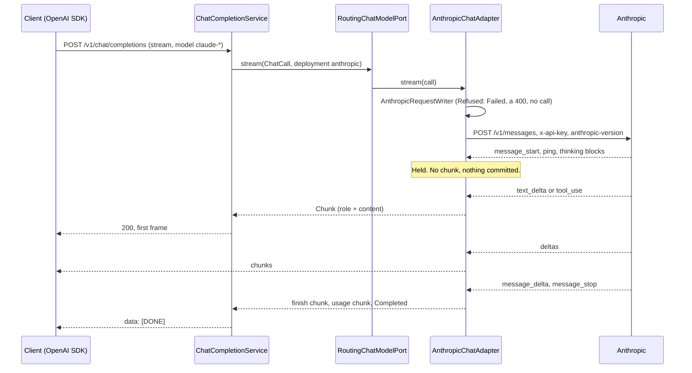

# GW-03: Anthropic adapter: messages, tool calls and stream translation

## 1. Context and goal

A product team on an OpenAI SDK sets `model` to a Claude model and changes nothing else. It gets an OpenAI-shaped completion or stream, with tool calls in OpenAI's shape in both directions, and the same error rows, usage and `x-request-id` as on the OpenAI path. ADR-004 fixes the surface and names this item: adapters translate other providers "to and from the OpenAI shape, including streams and tool calls".

This is the first adapter whose wire shape differs from the gateway's API. GW-01 and GW-02 could forward `extras` untouched; this adapter cannot, so it must say what it does with every member (ADR-018). It is also the second adapter behind `ChatModelPort`, so provider-neutral logic now in `.openai` moves to a shared package first, and the app stops assuming one port.

It serves pillar 1 (drop-in), pillar 6 (a second provider, and an error before content keeps a real status, so RTE-02 keeps its fallback window) and pillar 4 (usage normalised so `inputTokens` means the same on both providers). AGT-02 depends on it: agents run tool loops through this path, and most current Claude models think by default, so a tool loop has to work with thinking on (ADR-GW-03-011).

## 2. Scope

### In
- **Extraction** of neutral logic from `.gateway.providers.openai` to `.gateway.providers.upstream`, proved by unchanged OpenAI suites.
- `gateway-core`: `RoutingChatModelPort`, `PrefixModelResolver`, `ProviderFailure.UnsupportedByProvider` and its row, the extension member name.
- `gateway-providers`: `.gateway.providers.anthropic`, translating messages, `system`, tools, `tool_choice`, `tool_calls` and role `tool` in both directions, on both `complete` and `stream`.
- `gateway-app`: `AnthropicProperties`, per-provider `enabled`, prefix-based selection, a lowest-idle check in `ServerStreamConfiguration`, the `local` profile.
- `mock-provider`: scripted tool calls on both shapes, scripted stop reasons, thinking blocks, Anthropic `error.details`, a tool-conversation check (ADR-FND-03-011).
- Konsist ARCH-13: `.openai` and `.anthropic` do not name each other.
- `tools/smoke/anthropic.sh`, the systems entries, CLAUDE.md, the glossary.

### Out
- **GW-06:** the OpenAI-side end-to-end proof of tool pass-through, `response_format` on both adapters, tool output in the estimator (ADR-GW-03-009).
- Client-set `thinking`, `output_config` and `reasoning_effort`: 400 here (section 4). Server tools, `custom` tools, images, audio and files: 400 here; non-text input is a follow-up, as the row names messages, tools and streams only.
- The Anthropic Messages API as an inbound format (ADR-004, 2026-11-03: new scope).
- Aliases, per-team routes, `GET /v1/models` (RTE-01). Retries, fallback, breakers (RTE-02).
- Spans, metrics, cost (OBS-*, COST-*). `gateway-infra`.
- **A paid live check.** Not in this run; section 8 lists what only one can prove. It needs the user's go-ahead and an Anthropic key.

### What each later item changes

| Item | Change at this seam |
|---|---|
| GW-06 | Adds its end-to-end tests on the mock's scripted tool calls; decides `response_format` per adapter, removing its reject row here; counts tool output in `UsageEstimator`. |
| RTE-01 | Replaces `PrefixModelResolver`; `model-prefixes` goes with it. |
| RTE-02 | May fall back on `UnsupportedByProvider`: nothing was sent. Must not fall back on a `content_filter` finish, which is a 200. |
| COST-01, COST-02 | `inputTokens` includes cached and cache-write tokens; `cachedInputTokens` is reads only; writes are in `usage.cache_creation_input_tokens`, priced apart by Anthropic. |
| AGT-02 | Echoes `llmgw` on assistant messages in its tool loop (ADR-GW-03-011). |
| GRD-02 | `llmgw.thinking_blocks` holds opaque signatures, and text only if a later item lets clients ask for it. |

## 3. Acceptance criteria

All ticked before the row becomes `[x]`. A "deliberate violation" is made in the working tree, observed failing, and reverted before commit.

**Extraction**
- [x] After step 1, no `src/test` or `src/integrationTest` file under `gateway-providers` or `gateway-app` differs from `main` except in `package` lines, imports and the class names of moved tests; no assertion changed; every OpenAI suite is green.
- [x] ARCH-13 fails on its fixture, and a deliberate import of `.openai` in `.anthropic` fails naming that file.

**Selection and startup**
- [x] With default configuration and `OPENAI_API_KEY` set, the app starts with no Anthropic setting and no `ANTHROPIC_API_KEY`, and `claude-x` reaches the OpenAI upstream as today (journal route `openai.chat`).
- [x] With Anthropic enabled, `claude-x` and `mock-claude` give `x-gateway-deployment: anthropic` and journal route `anthropic.messages`; `mock-chat` stays on OpenAI.
- [x] Startup stops, naming properties only, when: an enabled provider has a blank or non-ASCII key (`ANTHROPIC_API_KEY` named); no provider is enabled; `default-provider` is not enabled; `version` is not a date; `default-max-tokens` is not positive; `client-write-timeout` is not below the lowest `idle-timeout` of the enabled providers; a provider's `enabled` and its adapter's presence disagree, as with `enabled=1`, which binds true and fails the bean condition. A disabled provider's bad values stop nothing.
- [x] `close()` runs on each enabled adapter at context shutdown (`ProviderLifecycleTest`).

**Non-stream**
- [x] `{"model":"mock-claude","messages":[{"role":"user","content":"Hi"}]}` gives 200 and a body `openai-java` parses and passes `validate()`, with `object: chat.completion`, `id` from the mock, `created` from the injected clock.
- [x] The journal shows `x-api-key` by fingerprint of the configured key, `anthropic-version: 2023-06-01`, `max_tokens: 4096`, no `Authorization`, and `x-client-request-id` equal to the gateway's `x-request-id`.
- [x] Every row of the section 4 member table gives its stated result: a parameterized test, plus a test that every member of the OpenAI reference has a row.
- [x] A rejected member gives 400 with its `code` and `param`, and `lastSeq` is unchanged: no upstream call.
- [x] `temperature` and `top_p` absent from the request are absent from the journal body; sent, they are there with the same value and precision, though the literal may normalise (`0.20` stays, `1e2` reaches the wire as `1E+2`); an injected provider 400 for them gives 400 `upstream_rejected_request`.

**Tools**
- [x] A two-turn tool conversation round-trips through the gateway on `complete` and `stream`: the reply has OpenAI `tool_calls`; the second request's journal body has an assistant message with `tool_use`, then a user message whose first blocks are `tool_result` with matching `tool_use_id`. The mock's conversation check accepts it.
- [x] Parallel calls: two `tool` messages then a `user` message become one user message, both `tool_result` blocks first.
- [x] On a stream, tool indexes are 0, 1 when Anthropic's block indexes are 1, 2; arguments concatenate to the scripted JSON; empty `partial_json` makes no chunk; a tool with no input ends with `arguments` `{}`.
- [x] `openai-java`'s stream accumulator reads the same `tool_calls` as the non-stream reply for one scenario (`AnthropicSdkContractTest`).

**Thinking**
- [x] A reply with `thinking` and `redacted_thinking` blocks exposes no thinking in `content`, carries them in `message.llmgw.thinking_blocks`, and on a stream in the finish chunk's `delta.llmgw.thinking_blocks`, in order and byte-equal.
- [x] An assistant message echoing them reaches the journal with those blocks first, unchanged but for members outside the allow-list (ADR-GW-03-023), before text and `tool_use`.
- [x] `llmgw` on a message or at the top level never reaches the OpenAI upstream (journal body).
- [x] A thinking-only prefix commits nothing: an in-band error after it gives the mapped status, not a frame.

**Stream**
- [x] The first frame is held until the first content or tool delta: `overloaded_error` in-band straight after `message_start`, with `ping` and `content_block_start` before it, gives 503 `provider_unavailable`, not 200.
- [x] Every chunk has the OpenAI member set (`id`, `object`, `created`, `model`, `choices[index, delta, logprobs, finish_reason]`), one `id` and one `created`; the first delta has `role`.
- [x] Unknown event types, `ping` in every position and unknown delta types change nothing in the output.
- [x] `stream_options.include_usage` true gives one final chunk with empty `choices`; absent gives none; the gateway ends with `[DONE]` in both cases.
- [x] `message_stop` then a held-open body costs at most the 1 s drain. A close after `message_delta` with no `message_stop` completes; a close before it gives `upstream_error`.
- [x] `event: error` after commit gives one frame with the mapped envelope, no `[DONE]`, a clean end, and no provider message.
- [x] A client disconnect on a stream and on a `hang` leaves a journal entry `client_cancelled` within 2 s.
- [x] First-byte, idle and total deadlines each give `upstream_timeout`; no pooled buffer leaks at `PARANOID`.

**Usage and errors**
- [x] Mock usage with input 10, cache read 20, creation 30, output 5 gives `prompt_tokens` 60, `completion_tokens` 5, `total_tokens` 65, `prompt_tokens_details.cached_tokens` 20, `usage.cache_creation_input_tokens` 30, identical on `complete` and `stream`.
- [x] `usage.omit` gives `x-gateway-usage-estimated: true`, and on a stream the `llmgw` flag.
- [x] Every row of the section 4 status and in-band tables holds against the mock (`AnthropicUpstreamErrorMappingTest`, `AnthropicStreamUpstreamErrorMappingTest`).
- [x] `error.message` from the mock, the key, a tool argument and the prompt are absent from the responses and the captured log at DEBUG (`NoLeakIntegrationTest`, extended).
- [x] BlockHound: 2000 real-socket requests at concurrency 32 through the Anthropic route, mixed `complete` and `stream`, from the first request, with no allowance added.

**Mock**
- [x] Existing golden files are byte-identical after the `CompletionPlan` refactor; new golden files cover tool calls on both shapes and thinking.
- [x] FND-03's statement about content parts is true of the code, or corrected.

**Gates**
- [x] `verify-gates` green (coverage: core ≥ 80%, overall ≥ 70%)
- [x] Smoke scenarios in section 8 pass (`gateway-smoke`), report in `docs/knowledge/runs/`
- [x] Eval: n/a (no threshold, classifier or routing policy; `model-prefixes` is a stopgap rule, not a policy under evaluation)
- [x] Living docs updated (`docs-update`), including the systems entries, and the section 11 follow-ups applied

## 4. Contract

`POST /v1/chat/completions` does not change. Which adapter answers is the only new fact, seen in `x-gateway-deployment`. Everything in GW-01 and GW-02 section 4 holds unless stated here.

### Upstream call

`POST {base-url}/messages`, base URL `https://api.anthropic.com/v1`.

| Header | Value |
|---|---|
| `x-api-key` | The configured key. Never the client's. |
| `anthropic-version` | `llmgw.providers.anthropic.version`, default `2023-06-01` (ADR-GW-03-002) |
| `content-type` | `application/json` |
| `accept` | `application/json`, or `text/event-stream` on a stream |
| `X-Client-Request-Id` | The gateway's request ID. Anthropic documents no such header; it ties the mock's journal to a response, as on OpenAI. |

No other client header goes upstream. No provider header reaches the client except through `retry-after` and `retry-after-ms`. The provider's `request-id` goes to the log only, not `x-request-id`.

### Request members

The policy is data (`AnthropicMemberPolicy`, ADR-GW-03-005), and any member set to `null` counts as absent, inside `llmgw` too: `{"thinking_blocks":null}` holds nothing, as `{}` does, so the extension is absent. Results:

- **Translate / Forward:** reaches Anthropic.
- **Ignore:** dropped, as it cannot change the output.
- **Reject:** 400 `UnsupportedByProvider`, with no upstream call.

| OpenAI member | Rule | Result |
|---|---|---|
| `model` | Translate | `deployment.model` |
| `messages` | Translate | See below |
| `stream` | Translate | `stream: true` on the stream path |
| `stream_options` | Ignore upstream | `include_usage` is read by `StreamTally`; Anthropic always reports usage. Other members are transport options. |
| `temperature`, `top_p`, `top_k` | Forward when sent | Same name, same value and precision. The literal may normalise: `1e2` reaches the wire as `1E+2`, on both adapters. Never defaulted, never clamped; a provider 400 is relayed (ADR-GW-03-002). |
| `max_completion_tokens`, `max_tokens` | Translate | `max_tokens`; `max_completion_tokens` wins if both are sent; absent, `default-max-tokens` (ADR-GW-03-006). |
| `stop` | Translate | `stop_sequences`, a string becoming a one-item array. Other types: reject, `unsupported_value`. |
| `tools` | Translate | See below |
| `tool_choice` | Translate | See below |
| `parallel_tool_calls` | Translate | `false` sets `disable_parallel_tool_use: true`; `true` is the default. Only with `tools`. Other types, with or without `tools`: reject, `unsupported_value`. |
| `safety_identifier`, `user` | Translate | `metadata.user_id` = lowercase hex SHA-256 of the value; `safety_identifier` wins (ADR-GW-03-014). |
| `cache_control` | Forward | Top-level prompt caching, Anthropic's member, verbatim. |
| `metadata`, `store`, `prompt_cache_key`, `prompt_cache_options`, `prompt_cache_retention` | Ignore | Dashboard and cache hints. |
| `service_tier` | Ignore `auto`, `default`; else reject | `unsupported_value`. OpenAI's other tiers promise a price or latency Anthropic's values do not name. |
| `n` | Ignore `1`; else reject | `unsupported_value`. The Messages API has one completion. |
| `logprobs` | Ignore `false`; else reject | `unsupported_value` |
| `frequency_penalty`, `presence_penalty` | Ignore `0`; else reject | `unsupported_value`, numeric comparison so `0.0` passes |
| `modalities` | Ignore `["text"]`; else reject | `unsupported_value` |
| `top_logprobs`, `seed`, `logit_bias`, `response_format`, `audio`, `prediction`, `moderation`, `reasoning_effort`, `verbosity`, `web_search_options`, `functions`, `function_call` | Reject | `unsupported_parameter`. `response_format` until GW-06. |
| anything else, `thinking` and `output_config` included | Reject | `unsupported_parameter` |

`param` is the member path, passed only if it matches GW-01's `^[A-Za-z0-9_.\[\]-]{1,128}$`, otherwise `null`: an unknown member's name comes from the client.

New row of `toReply`:

| Condition | Variant | Status | `type` | `code` | `param` | `message` |
|---|---|---|---|---|---|---|
| A member the selected provider cannot honour | `UnsupportedByProvider(code, param)` | 400 | `invalid_request_error` | `unsupported_parameter`, `unsupported_value` or `invalid_request` | the member path | `The selected model's provider does not support this request; see the code and param members.` |

### Messages

Applied in order; `i` and `j` in `param` index the client's arrays.

| OpenAI | Anthropic |
|---|---|
| Roles `system`, `developer` | Hoisted, in order, to `system`: one `Text` gives a string; otherwise an array of text blocks, keeping a part's `cache_control`. Empty text is skipped: `text` has `minLength: 1`. |
| Role `user`, text | `{"role":"user","content":"..."}` |
| Role `user`, parts | Text parts to text blocks, keeping `cache_control`. A non-text part: reject, `unsupported_parameter`, `messages[i].content[j]`. |
| Role `assistant` | Content blocks: `llmgw.thinking_blocks` first, each cut to its type's allow-list (ADR-GW-03-023), then text if not empty, then one `tool_use` per `tool_calls` item. A message of plain text and no blocks stays a string. |
| `tool_calls[j]` | `{"type":"tool_use","id":<id>,"name":<function.name>,"input":<arguments parsed>}`. Empty `arguments` is `{}`. Not a JSON object: reject, `invalid_request`, `messages[i].tool_calls[j].function.arguments`. Numbers keep their value and precision; the literal may normalise (`{"a":1e2}` gives `"input":{"a":1E+2}`). |
| Role `tool` | `{"type":"tool_result","tool_use_id":<tool_call_id>,"content":<text>}`. No `tool_call_id`: reject, `invalid_request`. Non-text parts: reject. |
| A run of `tool` messages and the `user` message after it | One user message with every `tool_result` first, then the other blocks (ADR-GW-03-015). |
| `name` on any message | Ignored. |
| Role `function`, or another role | Reject, `unsupported_value`, `messages[i].role`. |
| Other member on a message or part | Reject, `unsupported_parameter`, its path. |
| Nothing left in `messages` after hoisting | Reject, `invalid_request`, `messages` (ADR-GW-03-015). |

An assistant message as the last message goes upstream as is. Prefill is a provider 400 on 4.6 and later, relayed.

### Tools

| OpenAI | Anthropic |
|---|---|
| `{"type":"function","function":{name,description,parameters,strict}}` | `{name,description,input_schema:<parameters>,strict}`; no `parameters` gives `{"type":"object","properties":{}}`. `cache_control` beside `function` is kept. |
| Another tool type, or another member of `function` | Reject, `unsupported_parameter`, `tools[i]...` |
| `tool_choice: "auto"`, `"none"` | `{"type":"auto"}`, `{"type":"none"}` |
| `tool_choice: "required"` | `{"type":"any"}` |
| `tool_choice: {"type":"function","function":{"name":N}}` | `{"type":"tool","name":N}` |
| `allowed_tools`, `custom`, anything else | Reject, `unsupported_value`, `tool_choice` |

Forced choices go upstream on every model; models that refuse them answer 400, relayed (ADR-GW-03-016). `parallel_tool_calls: false` with no `tool_choice` gives `{"type":"auto","disable_parallel_tool_use":true}`; with `none`, nothing is added.

### Reply

| Anthropic | OpenAI |
|---|---|
| `id`, `model` | `id`, `model`, unchanged |
| none | `created` from the injected clock, epoch seconds; `object` from the writer |
| `text` blocks | Concatenated into `message.content` |
| `tool_use` blocks | `message.tool_calls[j]`: `{"id","type":"function","function":{"name","arguments":<input as compact JSON>}}` |
| `thinking`, `redacted_thinking` blocks | `message.llmgw.thinking_blocks`, verbatim, in order (ADR-GW-03-011) |
| Any other block type | Skipped, with a DEBUG line naming the type |
| No text | `content` is `null` with tool calls, otherwise `""` |
| none | `message.refusal: null`, `choices[0].logprobs: null`, so strict SDK shapes hold |
| `stop_sequence`, `stop_details`, `container`, `diagnostics` | Not relayed |

`finish_reason` (ADR-GW-03-010):

| `stop_reason` | `finish_reason` |
|---|---|
| `end_turn`, `stop_sequence` | `stop` |
| `max_tokens`, `model_context_window_exceeded`, `pause_turn` | `length` |
| `tool_use` | `tool_calls` |
| `refusal` | `content_filter` |
| unknown | `stop`, with a WARN naming the value if it passes the code regex |
| absent or null | `stop` (ADR-GW-03-021) |

### Usage (ADR-GW-03-008)

| Gateway | From |
|---|---|
| `inputTokens`, `prompt_tokens` | `input_tokens + cache_read_input_tokens + cache_creation_input_tokens`, a null counted as 0 |
| `outputTokens`, `completion_tokens` | `output_tokens` |
| `cachedInputTokens`, `prompt_tokens_details.cached_tokens` | `cache_read_input_tokens` |
| `completion_tokens_details.reasoning_tokens` | `output_tokens_details.thinking_tokens`, else 0 |
| `usage.cache_creation_input_tokens` (extension) | `cache_creation_input_tokens` |

`input_tokens` or `output_tokens` missing, unreadable, or a sum over `Long`: omitted usage, so estimated and flagged. An unreadable `cache_*` count is omitted usage too; an absent or null one is 0 (ADR-GW-03-022). On a stream the last non-null value of a count decides, and `output_tokens` counts only from `message_delta`. The detail objects go in `Usage.extras`, whose KDoc already says they hold the OpenAI shape, so `ChatResponseWriter` does not change and nothing is written twice.

### Stream

| Event | Translator |
|---|---|
| `message_start` | Holds `id`, `model`, input and cache counts, never `output_tokens`, a placeholder here; takes `created` from the clock. **No chunk.** |
| `ping`, `content_block_start` of text, unknown event, unknown delta type | Nothing. A byte still resets the idle deadline. |
| `content_block_delta` `text_delta` | A chunk with `delta.content`; empty text gives none. |
| `content_block_start` `tool_use` | Assigns the next tool index from 0. A chunk `{"tool_calls":[{"index":k,"id":..,"type":"function","function":{"name":..,"arguments":""}}]}`. |
| `content_block_delta` `input_json_delta` | Non-empty `partial_json`: a chunk `{"tool_calls":[{"index":k,"function":{"arguments":..}}]}`. Empty: nothing. |
| `content_block_stop` of `tool_use` | If no argument bytes went out: a chunk with `arguments` `{}`, since `""` does not parse. |
| Thinking blocks and their deltas | Assembled and held; no chunk (ADR-GW-03-011). |
| `message_delta` | Keeps `stop_reason`; last value wins per usage count, as they are cumulative. The first non-null `stop_reason` gives the finish chunk: empty delta, `finish_reason`, and any held thinking blocks. |
| `message_stop` | The finish chunk with `stop` if no `stop_reason` came (ADR-GW-03-021), then the usage chunk with empty `choices`, then `Completed`. State goes to draining, as after `[DONE]`. |
| `event: error` | `Failed`, by the in-band table. |
| An event before `message_start` that needs it, or unreadable JSON in a known event | `Failed(UpstreamError)` |

The first chunk of a stream carries `role: assistant` in its delta, and `content: null` if it is a tool chunk. Each `choices[]` item carries `logprobs: null`, and `finish_reason: null` until the last. `StreamTally`, `ChatChunkWriter`, `ChatStreamFrames` and `[DONE]` do not change: Anthropic sends no `[DONE]`, and the gateway writes its own on `Completed`.

End of body with no `message_stop`: complete if a `stop_reason` was seen, emitting the usage chunk first if the counts are known; otherwise `UpstreamError`.

### Upstream errors by status

`error.type` is read through the shared `ProviderErrorFields`; `error.details.error_code` fills `code`. `error.message` is never read (ADR-GW-01-005). `timeout_error` is checked first, because the docs say it can arrive with other statuses.

| Upstream | Variant | Client sees |
|---|---|---|
| `error.type: timeout_error`, any status | `UpstreamTimeout` | 504 `upstream_timeout` |
| 400 | `RejectedByProvider(400, null, null)` | 400 `upstream_rejected_request` |
| 401, 403 | `UpstreamAuthFailed` | 502 `upstream_auth_failed` |
| 402 | `UpstreamQuotaExhausted` | 503 `upstream_quota_exhausted` |
| 404 with `error.type: not_found_error` | `ModelNotFound` | 404 `model_not_found` |
| 404 otherwise | `UpstreamError` | 502 `upstream_error` |
| 408, 504 | `UpstreamTimeout` | 504 `upstream_timeout` |
| 413, 422 | `RejectedByProvider(status, null, null)` | same status, `upstream_rejected_request` |
| 429 with `error_code: enforced_spend_limit_reached` | `UpstreamQuotaExhausted` | 503 `upstream_quota_exhausted` |
| 429 otherwise | `UpstreamRateLimited(retryAfter)` | 429 `upstream_rate_limited` |
| 503, 529 | `ProviderUnavailable(retryAfter)` | 503 `provider_unavailable` |
| 409, 500, any other status; 2xx not a readable message | `UpstreamError` | 502 `upstream_error` |

### In-band errors by type

There is no status, so `error.type` decides. Before the first chunk the row's status applies; after it, a frame with the same envelope (ADR-019).

| `error.type` | Variant |
|---|---|
| `overloaded_error` | `ProviderUnavailable(null)` |
| `rate_limit_error` with `enforced_spend_limit_reached` | `UpstreamQuotaExhausted` |
| `rate_limit_error` | `UpstreamRateLimited(null)` |
| `billing_error` | `UpstreamQuotaExhausted` |
| `authentication_error`, `permission_error` | `UpstreamAuthFailed` |
| `invalid_request_error` | `RejectedByProvider(400, null, null)` |
| `request_too_large` | `RejectedByProvider(413, null, null)` |
| `not_found_error` | `ModelNotFound` |
| `timeout_error` | `UpstreamTimeout` |
| `api_error`, `conflict_error`, anything else | `UpstreamError` |

### What stays OpenAI-compatible, what is an extension

- **Compatible:** path, members, body shapes, stream framing, finish reasons, status codes and the SDK exceptions they select.
- **Extensions:** `llmgw.thinking_blocks` on assistant messages and finish deltas; `usage.cache_creation_input_tokens`; `top_k` and `cache_control` accepted on the way in; the new `unsupported_parameter` code. All are ignorable by an SDK.
- **Narrower than OpenAI, on this adapter only:** every Reject row, `n` above all; a first chunk that carries content rather than an empty role chunk; `created` is the gateway's clock; `refusal` stays `null`; a client whose SDK drops unknown members cannot replay thinking.

## 5. Design

### Modules and ports

| Module | Holds | Owns which library |
|---|---|---|
| `gateway-core` | `RoutingChatModelPort`, `PrefixModelResolver`, `UnsupportedByProvider`, `ChatExtensions` | none |
| `gateway-providers` `.upstream` | Moved neutral logic | WebClient, Reactor Netty |
| `gateway-providers` `.anthropic` | The adapter | Jackson tree model; no Anthropic SDK (ADR-GW-03-001) |
| `gateway-app` | `AnthropicProperties`, `ProviderSelectionProperties`, wiring | Boot |
| `mock-provider` | Parts, scripted tools | as today |

**Core**, package `.gateway.core.chat`:

```kotlin
/** Selects the adapter by deployment; a provider with no adapter is a model that is not available. */
class RoutingChatModelPort(
    private val ports: Map<ProviderId, ChatModelPort>,
) : ChatModelPort {
    override suspend fun complete(call: ChatCall): ProviderResult
    override fun stream(call: ChatCall): Flow<ProviderStreamEvent>
}

data class ModelPrefix(val prefix: String, val provider: ProviderId)

/** First matching prefix, else [default]; the deployment is named after its provider. RTE-01 replaces this. */
class PrefixModelResolver(
    private val prefixes: List<ModelPrefix>,
    private val default: ProviderId,
) : ModelResolver

object ChatExtensions { const val MEMBER = "llmgw" }   // ChatChunkWriter.EXTENSION_MEMBER becomes this
```

`PrefixModelResolver` replaces `PassThroughModelResolver`, which it generalises: no prefixes gives the old behaviour. `ChatCompletionService`'s constructor is unchanged.

In `.gateway.core.error`:

```kotlin
/** Nothing was sent: this provider cannot honour the request. [param] holds no request content. */
data class UnsupportedByProvider(val code: String, val param: String?) : ProviderFailure
```

**`.gateway.providers.upstream`** (ADR-GW-03-018). Moves, renames in brackets:

| From `.openai` | To `.upstream` |
|---|---|
| `PoolConfig`, `StreamConfig` | same |
| `StreamDeadlines`, `RetryAfter` | same |
| `OpenAiTransportFailures` | `TransportFailures` |
| `UpstreamBodyFailure`, `bodyFailuresAsTransport`, `withoutContentType` | same |
| `ProviderErrorFields` | same; `of` takes an optional node for `code`, so Anthropic passes `error.details.error_code` through the same regex |
| Pool, `HttpClient` and `WebClient` construction, `warmUp` body | `UpstreamClient(name, connectTimeout, maxResponseBytes, pool)`, with `close()` |
| `exchange` catch list | `UpstreamClient.exchange` |
| `wire`, `copyAndRelease`, `Batch`, `UpstreamReply` and the collector | `SseStreamCall` |
| `OpenAiStreamTranslator`'s OPEN, DRAINING, ENDED, `undelivered`, `fail`, `delivered` | `StreamLifecycle` over a `StreamDecoder` |

```kotlin
internal sealed interface Decoded {
    val events: List<ProviderStreamEvent>
    data class Open(override val events: List<ProviderStreamEvent>) : Decoded
    data class Draining(override val events: List<ProviderStreamEvent>) : Decoded
    data class Ended(override val events: List<ProviderStreamEvent>) : Decoded
}

/** One instance per stream; the provider's part of a stream, with no threads or timers in it. */
internal interface StreamDecoder {
    fun decode(event: SseEvent): Decoded
    /** The body ended in the open state. */
    fun atEnd(): List<ProviderStreamEvent>
    /** The in-band error's fields, for the adapter's log line. */
    val errorFields: ProviderErrorFields?
}
```

`OpenAiStreamTranslator` keeps its name, constructor and public members and delegates to a `StreamLifecycle` over a new `OpenAiStreamDecoder`, so `OpenAiStreamTranslatorTest` does not change. `[DONE]` stays in that decoder. `.gateway.providers.sse` and `.json` do not change.

**`.gateway.providers.anthropic`**:

| Class | Role | Pure |
|---|---|---|
| `AnthropicChatAdapter` | `ChatModelPort`, `AutoCloseable`, `warmUp()` | no |
| `AnthropicAdapterConfig` | `baseUrl`, `apiKey`, `version`, `defaultMaxTokens`, timeouts, `PoolConfig`, `StreamConfig` | yes |
| `AnthropicMemberPolicy` | The member table as `Map<String, MemberRule>` | yes |
| `AnthropicRequestWriter` | `ChatCall` to body, or a refusal | yes |
| `AnthropicResponseReader` | Body to `ProviderResult.Completed` | yes |
| `AnthropicUsageReader` | The usage table | yes |
| `AnthropicStreamDecoder` | The event table | yes |
| `AnthropicFailureClassifier` | Status and in-band tables | yes |

```kotlin
internal sealed interface MemberRule {
    data object Translated : MemberRule             // the writer owns it
    data object Forward : MemberRule
    data object Ignore : MemberRule
    data class IgnoreWhen(val neutral: List<JsonValue>, val code: String) : MemberRule
    data class Reject(val code: String) : MemberRule
}

internal sealed interface WrittenRequest {
    data class Body(val tree: ObjectNode) : WrittenRequest
    data class Refused(val failure: ProviderFailure.UnsupportedByProvider) : WrittenRequest
}
```

A `Refused` request becomes `ProviderResult.Failed`, or a single `ProviderStreamEvent.Failed` on a stream, so it is a status before commit, with no socket touched.

**App.** `ProviderConfiguration` is still the one place naming adapters (ARCH-12, which already covers `.anthropic` by root package):

```kotlin
@Bean @Fallback @ConditionalOnProperty("llmgw.providers.openai.enabled", havingValue = "true")
fun openAiChatAdapter(...): OpenAiChatAdapter

@Bean @Fallback @ConditionalOnProperty("llmgw.providers.anthropic.enabled", havingValue = "true")
fun anthropicChatAdapter(...): AnthropicChatAdapter

@Bean
fun chatModelPort(openai: ObjectProvider<OpenAiChatAdapter>, anthropic: ObjectProvider<AnthropicChatAdapter>, ...): ChatModelPort

@Bean
fun modelResolver(selection: ProviderSelectionProperties, anthropic: AnthropicProperties): ModelResolver
```

Each adapter bean has its concrete type, so Spring's inferred `close()` runs; `@Fallback` leaves the router as the one `ChatModelPort` to inject (ADR-GW-03-020). `chatModelPort` stops the start when a provider's `enabled` disagrees with its adapter's presence. `model-prefixes` loads only for an enabled provider, so `claude-x` on an OpenAI-only start behaves as it does today. `ChatHandler`, `ChatRequestReader`, `ChatChunkWriter` (but for the constant) and `ChatResponseWriter` do not change.

`OpenAiRequestWriter` drops `llmgw` from the request's and each message's extras: the member is the gateway's, and OpenAI does not know it (ADR-020).

### Data

n/a: no table, Redis key or topic. The source of truth for a thinking block is the client's conversation history; the gateway keeps nothing between requests (ADR-GW-03-011). Selection is configuration until RTE-01.

### Flow



`docs/diagrams/` gains the Anthropic branch in the docs step.

### Failure model

Fail-closed throughout, as on OpenAI: there is no answer to give. Retries: none, here or in Reactor Netty (`disableRetry`), which is why ADR-GW-03-001 rejects the SDK. Idempotency: n/a until RTE-02.

| Dependency or event | Behaviour | Why |
|---|---|---|
| Provider slow, non-stream | `request-timeout` 300 s, then 504 | GW-01 |
| Provider silent on a stream | `first-byte-timeout` 120 s, `idle-timeout` 60 s, `total-timeout` 30 m | ADR-GW-02-006. Pings reset the idle deadline, so a live provider is not cut. |
| Long thinking before content | Pings and thinking events keep the upstream alive; the client sees no byte, and no status, until the first delta | Bought by holding the first chunk. The first-byte deadline counts upstream bytes, not the client's. |
| Provider down | Connect 5 s, TLS 10 s, DNS 5 s, pool 5 s, then 503 | Shared `TransportFailures` |
| 2xx, then nothing readable | 502 before commit | ADR-019 |
| `event: error` after a 200, before content | The row's status: real 4xx and 5xx, and fallback stays open | ADR-GW-03-007 |
| `event: error` after content | Frame, no `[DONE]`, clean end | ADR-019 |
| Malformed known event, event over `max-event-size` | `upstream_error` | No skip: it would corrupt text |
| Unknown event or delta | Ignored | Versioning policy: new event types and enum values may appear |
| Client disconnects | Cancels the upstream; `StreamSummary` holds the estimate, since Anthropic reports output only at the end | COST-02 owns billing a partial call, as on OpenAI |
| Held thinking blocks over `max-event-size`, open blocks counted | All dropped on the append that passes the limit, one WARN, later deltas ignored, the answer proceeds | A paid answer outranks a replay aid |
| Provider key revoked | 502 `upstream_auth_failed`, `x-should-retry: false` | GW-01 |
| Own spend limit reached | 400 `upstream_rejected_request`, indistinguishable by machine | ADR-GW-03-013 |
| Redis, Postgres, broker | n/a: this path calls none | |

### Observability

OBS-01 is not built, so no span or metric is added. Logs follow GW-01 and GW-02 with the same keys:

- `Provider call answered`, `Provider call failed` and `Provider stream failed` with `deployment`, `status`, `code`, `type`, `providerRequestId` (from `request-id`), `durationMs`, token counts.
- One DEBUG per skipped block type.
- One WARN per unknown `stop_reason`.

**Never recorded:** prompt text, tool arguments and results, thinking text, signatures, the `user` value or its hash, provider `message`, the key. Types added here override `toString` or use extras, which print sizes. OBS-01 reads `Deployment.provider` for the provider attribute and `Usage` for tokens, with no change here.

### Configuration

`application.yaml`, bound to `AnthropicProperties`; `toAdapterConfig()` validates from the bean method, as in ADR-GW-01-012. Shared bounds move to one helper, used by both property classes.

| Property | Default | Note |
|---|---|---|
| `llmgw.providers.default-provider` | `openai` | Must be enabled |
| `llmgw.providers.openai.enabled` | `true` | New |
| `llmgw.providers.anthropic.enabled` | `false` | `true` in the `local` profile |
| `llmgw.providers.anthropic.model-prefixes` | `claude-`, `mock-claude` | Case-sensitive; removed by RTE-01 |
| `llmgw.providers.anthropic.base-url` | `https://api.anthropic.com/v1` | As OpenAI's |
| `llmgw.providers.anthropic.api-key` | `${ANTHROPIC_API_KEY:}` | Required when enabled |
| `llmgw.providers.anthropic.version` | `2023-06-01` | `YYYY-MM-DD` |
| `llmgw.providers.anthropic.default-max-tokens` | `4096` | tokens, > 0; this project's judgment |
| `llmgw.providers.anthropic.connect-timeout`, `request-timeout`, `max-response-size`, `pool.*`, `stream.*` | As OpenAI's | Own values, own pool: one provider's stall cannot exhaust the other's |

`llmgw.server.client-write-timeout` stays below the lowest `stream.idle-timeout` across enabled providers. `application-local.yaml` adds Anthropic with `base-url: http://127.0.0.1:8090/v1` and `api-key: mock-local-key`. Both test `application.properties` keep Anthropic off; `MockBackedTest` gains an opt-in. `.env.example` gains `ANTHROPIC_API_KEY`, commented.

## 6. Reuse

- [patterns/upstream-bytes-then-pure-classification](../knowledge/patterns/upstream-bytes-then-pure-classification.md): the shape of `complete`.
- [patterns/cold-event-flow-commits-at-first-frame](../knowledge/patterns/cold-event-flow-commits-at-first-frame.md): the shape of `stream`.
- [patterns/copy-and-release-pooled-buffers-before-a-flow](../knowledge/patterns/copy-and-release-pooled-buffers-before-a-flow.md): through `SseStreamCall`.
- [patterns/typed-core-with-json-extras](../knowledge/patterns/typed-core-with-json-extras.md), as revised on 2026-11-04.
- [patterns/member-policy-table-for-a-foreign-provider](../knowledge/patterns/member-policy-table-for-a-foreign-provider.md): new with this plan.
- [patterns/one-error-funnel](../knowledge/patterns/one-error-funnel.md): one new row.
- `.gateway.providers.sse.SseEventParser`, which keeps `event:` names for this item (ADR-GW-02-003). `.gateway.providers.json`. `ApiKey`. `StreamTally`, `ChatChunkWriter`, `ChatStreamFrames`, unchanged.
- Gotchas to respect: Jackson's first-use lock (`warmUp()` runs for each enabled adapter, so an Anthropic-only start is covered), `Flux.timeout` takes publishers, `jackson-3-value-accessors-throw-on-a-null-node` for every `stop_reason` and cache count that can be `null`, `kotlinx-reactive-await-loads-context-injectors-on-first-use`. `MessageDigest.getInstance("SHA-256")` for `user` is warmed in `warmUp()`.
- ADR-004, ADR-018, ADR-019, [ADR-020](../DECISIONS.md#adr-020), ADR-GW-01-004, -005, -012, ADR-GW-02-003, -005, -006, -007, -008, -010, ADR-FND-03-011.

## 7. Execution plan

Extraction comes first and lands alone: every later step depends on it, and its proof is that the OpenAI suites do not change.

- [x] **Step 1: extraction.** `.upstream`, `StreamLifecycle`, `StreamDecoder`, `UpstreamClient`, `SseStreamCall`; moved tests; ARCH-13 and its fixture. `gradlew test integrationTest :architecture-tests:test` green, and the diff of test sources is only packages, imports and moved class names.
- [x] **Step 2: core and OpenAI touch-ups.** `UnsupportedByProvider` and its row, `RoutingChatModelPort`, `PrefixModelResolver`, `ChatExtensions`, `OpenAiRequestWriter` dropping `llmgw`. TDD.
- [x] **Step 3: mock, refactor only.** `CompletionPlan` to parts, `Piece` in `Reply.Stream`. Golden files byte-identical.
- [x] **Step 4: mock, features.** `toolCalls`, `finish`, `thinking` in `ScenarioJson` and its writer; both renderers; the tool-conversation check; `error.details`; new golden files; FND-03 and `systems/mock-provider` updated.
- [x] **Step 5: request side.** `AnthropicMemberPolicy`, `AnthropicRequestWriter`, TDD against section 4.
- [x] **Step 6: reply side.** `AnthropicResponseReader`, `AnthropicUsageReader`, `AnthropicFailureClassifier`, TDD.
- [x] **Step 7: stream.** `AnthropicStreamDecoder`, TDD with the documented event sequences as fixtures.
- [x] **Step 8: adapter.** `AnthropicChatAdapter`, integration tests against the mock and raw sockets.
- [x] **Step 9: wiring.** Properties, `enabled`, selection, lowest-idle check, `local` profile, startup and lifecycle tests.
- [x] **Step 10: end to end.** `gateway-app` integration suites, SDK contract, no-leak, BlockHound, buffer leak.
- [x] **Step 11: smoke and docs.** `tools/smoke/anthropic.sh`, `gateway-smoke`, `docs-update`, section 11 follow-ups.

### The mock step in detail (ADR-GW-03-019)

Scenario `content` gains three strict, optional members, each inherited like its siblings, `[]` clearing an inherited list:

```json
{"content":{"mode":"fixed","text":"Checking.",
  "toolCalls":[{"id":"toolu_1","name":"get_weather","input":{"city":"Paris"},"chunkChars":8}],
  "finish":"refusal",
  "thinking":[{"signature":"sig-1"},{"redacted":"opaque-1"}]}}
```

| Member | Bounds, checked at `PUT` | Default |
|---|---|---|
| `toolCalls` | At most 64 | none |
| `toolCalls[].id` | `^[a-zA-Z0-9_-]{1,64}$` | `toolu_mock_<seq>_<i>` on Anthropic, `call_mock_<seq>_<i>` on OpenAI |
| `toolCalls[].name` | `^[a-zA-Z0-9_-]{1,128}$`, required | |
| `toolCalls[].input` | JSON object, required; kept as compact text, since `generation` is pure. Written by the mock's plain mapper, so number literals normalise (`1.10` becomes `1.1`) | |
| `toolCalls[].chunkChars` | 1..4096 | 8 |
| `finish` | `stop_sequence`, `refusal`, `pause_turn`, `context_window` | From the plan |
| `thinking` | At most 16, each `signature` or `redacted`, non-empty | none |

- `generation`: `CompletionPlan(parts: List<PlanPart>, finish, usage)` with `PlanPart.Thinking`, `Text(pieces)`, `ToolCall(id, name, inputJson, pieces)`. `text` and the piece count are derived. `completion_tokens` counts text and argument pieces. `Finish` gains `TOOL_CALLS`, `STOP_SEQUENCE`, `REFUSAL`, `PAUSE_TURN`, `CONTEXT_WINDOW`; tool calls imply `TOOL_CALLS` unless the cap dropped one (`LENGTH`, ADR-GW-03-024) or `finish` is set.
- `Reply.Stream.pieces` becomes `List<Piece>`, a `Piece` holding one or more frames, each flushed alone, so `afterPieces` and `perTokenMs` keep their meaning and rule 5 of the mock's contract holds.
- `AnthropicRenderer`: blocks in part order, `tool_use` with `input: {}` at start, one empty `input_json_delta` as documented, then the pieces; a thinking block as start, an empty `thinking_delta`, `signature_delta`, stop, which is the documented `display: "omitted"` sequence.
- `OpenAiRenderer`, the decision of ADR-FND-03-011: `tool_calls` on the message with `content: null` when there is no text; on a stream, a first delta with `id`, `type`, `name`, `arguments: ""`, then argument deltas by `index`; finish `tool_calls`, and `content_filter` or `length` for scripted finishes. `thinking` is ignored. Parallel calls on both.
- `AnthropicRequests`: a user message directly after an assistant message with `tool_use` must start with `tool_result` blocks covering every `tool_use` ID, else 400 `invalid_request_error` as the handling guide says. Requests with no such assistant message are unaffected. This is what lets a translated conversation fail a test instead of being ignored. Tests also assert journal bodies.
- `AnthropicRenderer.errorRoot`: `code` on an injected error renders as `error.details.error_code`. Anthropic defaults stay `null`, so existing bodies do not change.

## 8. Tests

- **Core unit (TDD):** `RoutingChatModelPortTest` (selection, unknown provider on both methods, cancellation passes through); `PrefixModelResolverTest`; `ErrorReplyTest` for the new row; `StreamTallyTest` gains a held-first-chunk case and an empty answer whose first chunk is the finish chunk.
- **`gateway-providers` unit:**
  - `AnthropicMemberPolicyTest`: a parameterized row per table line, and every member of a checked-in list from the OpenAI reference has a rule.
  - `AnthropicRequestWriterTest`: every Messages and Tools row, number literals, `user` hashing, parameter order irrelevant to the outcome.
  - `AnthropicResponseReaderTest`, `AnthropicUsageReaderTest`: null caches, a sum over `Long`, malformed usage as omitted.
  - `AnthropicFailureClassifierTest`: both tables, a non-JSON body, an unsafe `error_code`.
  - `AnthropicStreamDecoderTest`: the documented text, tool and thinking sequences; `ping` at every position; unknown events; split frames through `SseEventParser`; reordered `message_delta`.
  - `StreamLifecycleTest`: new, on a fake decoder, for the terminal-event race. `OpenAiStreamTranslatorTest` stays as the proof of the OpenAI path. `OpenAiRequestWriterTest`: `llmgw` dropped, added in step 2.
- **Integration (Testcontainers, mock provider):**
  - `gateway-providers`: `AnthropicChatAdapterIntegrationTest` (a failed call, one journal entry; `hang` with a 500 ms deadline; journal headers), `AnthropicChatStreamIntegrationTest` (three deadlines, drain, pool return), `RawAnthropicStreamIntegrationTest` (raw socket: bad chunking, a reset, a provider that never sends `message_stop`).
  - `gateway-app`: `AnthropicChatEndToEndTest`, `AnthropicToolConversationIntegrationTest`, `AnthropicThinkingRoundTripTest`, `AnthropicUpstreamErrorMappingTest`, `AnthropicStreamUpstreamErrorMappingTest`, `AnthropicStreamFailureIntegrationTest`, `AnthropicStreamDisconnectIntegrationTest`, `AnthropicSdkContractTest` (`openai-java`, tools, streams, `validate()`, exception classes), `ProviderSelectionTest`, `ProviderLifecycleTest`; `StartupFailureTest`, `NoLeakIntegrationTest`, `BlockHoundIntegrationTest` and `StreamBufferLeakIntegrationTest` extended.
- **`mock-provider`:** golden files as `OpenAiRendererTest`, `AnthropicRendererTest`; `CompletionPlannerTest` for parts and token counts; `ScenarioJsonTest` for each bound and unknown member; `AnthropicRequestsTest` for the conversation check, both ways; stream integration tests for tool frames and fault timing.
- **`architecture-tests`:** ARCH-13 with a violating fixture; ARCH-12 fixture gains an `.anthropic` case.
- **Smoke scenarios (`gateway-smoke`, `tools/smoke/anthropic.sh`, `local` profile):**
  1. Text, non-stream and stream, through `curl -N`: frames arrive one by one.
  2. Tool call, then the result sent back, on both forms; journal body read.
  3. Parallel tools with interleaved text.
  4. Each Reject row sample: 400, `lastSeq` unchanged.
  5. Every status and in-band row, as in `chat-completions.sh`.
  6. Thinking prefix, then error: status, not frame.
  7. Thinking replay by echoing `llmgw`.
  8. Disconnect mid-stream: `client_cancelled`.
  9. OpenAI-only start: no key needed, `claude-x` goes to OpenAI.
  10. `HANG=1`: the three deadlines.
  11. Regression: `chat-completions.sh` and `streaming.sh` still pass.
- **Eval (`ai-eval`):** n/a: no threshold, classifier or routing policy.

**Paid live check: out of this run.** Tests never call a real provider. Nothing here needs one to go green, but only a live call settles the following, so the row's notes must say they are unproven:

| # | Unproven against the real API | What it decides |
|---|---|---|
| L1 | A tool result whose assistant turn omits all thinking blocks, on a default-thinking model | Whether a client that drops `llmgw` gets a 400 or a degraded answer (ADR-GW-03-011) |
| L2 | Replay of a reply with a thinking block after text or a tool call | Whether thinking-first placement is enough |
| L3 | The real body of a 404 for an unknown model | The 404 row |
| L4 | Framing, TLS and real `event: error` bodies | As on OpenAI's first live run |

## 9. Success metrics

- Added latency: p50 within 1 ms of the OpenAI path for a 4 KB request against the mock; the GW-01 smoke measured about 2.7 ms added on that path.
- First frame: the mock's `ttft` plus at most 5 ms on a text stream; frames spread by `perTokenMs`, not batched.
- 0 translated-conversation rejections by the mock's check across the suites. 0 leaks at `PARANOID`. 0 BlockHound reports.
- 0 provider messages in responses or logs. Usage equal on `complete` and `stream` for every scenario.

## 10. ADRs (local)

Cross-cutting: [ADR-020](../DECISIONS.md#adr-020). Decisions 001 to 009 were taken by the orchestrator on 2026-11-04 and are recorded here with their alternatives; 021, 022 and 023 are the user's, from the review of the same day; the rest are this plan's.

### ADR-GW-03-001: Raw WebClient, no Anthropic SDK
- **Context:** The adapter could use the official Java SDK. CLAUDE.md: provider types never cross the port; an adapter never retries. The errors page: the SDK "automatically retries transient failures ... twice by default". Its streaming accumulates on its own client stack. GW-01 weighed the same for OpenAI (ADR-GW-01-004).
- **Options considered:**
  - A) Official SDK with `maxRetries(0)`. Rejected: a second HTTP stack beside Reactor Netty, so `TransportFailures`, deadlines, the pool, BlockHound guarantees and buffer rules would all be redone, and a stream would be blocking or foreign to `Flow`.
  - B) WebClient and pure translators, sharing `.upstream`.
- **Decision:** B.
- **Consequences:** The event and block types are ours to track; the versioning policy promises additions only, and unknowns are tolerated. Buys: one transport, one failure table, no retry to disable, no blocking on an event loop.
- **Date:** 2026-11-04

### ADR-GW-03-002: `anthropic-version` pinned in configuration; sampling forwarded only when sent
- **Context:** Version `2026-10-21` removes `temperature`, `top_p` and `top_k`: "A request that sends any of them returns a 400 error on every model". `2023-06-01` keeps them, with no sunset date found. Claude 4.7 and later reject non-default sampling on either version. OpenAI clients often send `temperature`. Data over branches: a per-model table in code would rot with every release.
- **Options considered:**
  - Version: V1) Hardcode the latest. Rejected: every client sending `temperature` gets a 400 on every model. V2) A property defaulting to `2023-06-01`.
  - Sampling: S1) A per-model table that strips or rejects. Rejected: code that restates a provider's model list. S2) Strip always. Rejected: silent, and wrong for older models. S3) Forward when sent, and relay the provider's 400.
- **Decision:** V2, S3. No default is ever sent.
- **Consequences:** A request with `temperature: 0.2` to Opus 5.5 gets 400 `upstream_rejected_request` at the cost of one round trip. `message` is fixed text, so the client sees no reason beyond the code; the WARN has the status. A sunset of `2023-06-01` is a one-line change. Buys: fewer moving parts, and the provider stays the authority on its models.
- **Date:** 2026-11-04

### ADR-GW-03-003: Selection by a routing port and a prefix resolver
- **Context:** The app holds one port bean and a resolver hardcoded to `openai`. GW-01 expected `Map<ProviderId, ChatModelPort>`. RTE-01 is blocked on GW-04, so a rule is needed until then.
- **Options considered:**
  - Where the map lives: M1) In `ChatCompletionService`. Rejected: changes its constructor, and RTE-02 is about to rework that class. M2) A `ChatModelPort` that delegates, in core.
  - Bean shape: B1) Adapters as `ChatModelPort` beans. Rejected: the return type hides `AutoCloseable` from reading, and injection by type becomes ambiguous. B2) Concrete adapter beans, a `@Primary` router.
  - Rule: R1) `when` on a prefix in code. Rejected: data over branches. R2) Prefixes in configuration, on the provider. R3) Build the table RTE-01 owns now. Rejected: speculative, and it needs teams.
- **Decision:** M2, B2, R2. A provider with no adapter gives `ModelNotFound`. The `@Primary` of B2 was replaced by ADR-GW-03-020.
- **Consequences:** The service, `StreamTally` and handlers do not change. A new prefix needs no code. `PassThroughModelResolver` is deleted, so RTE-01's row names a class that is gone (section 11). Buys: the boundary kept, and a pure, testable selection.
- **Date:** 2026-11-04

### ADR-GW-03-004: Per-provider `enabled`, Anthropic off by default
- **Context:** ADR-GW-01-012 refuses to start with no key and says GW-03 makes the check per enabled provider. An existing deployment has no Anthropic key. `client-write-timeout` must stay below `idle-timeout`, and each provider now has its own.
- **Options considered:**
  - A) Enabled when a key is present. Rejected: a typo in a variable name silently disables a provider, the exact shape ADR-GW-01-012 rejected.
  - B) Anthropic on by default. Rejected: every OpenAI-only start breaks.
  - C) An explicit flag, Anthropic off, on in `local`.
- **Decision:** C. At least one provider must be enabled; `default-provider` must be one of them. `ServerStreamProperties.validate` takes the lowest `idle-timeout` of the enabled providers.
- **Consequences:** Today's start keeps working unchanged. A disabled provider's properties bind but are not validated. Buys: misconfiguration stops at deploy.
- **Date:** 2026-11-04

### ADR-GW-03-005: Every member has a rule; what cannot be honoured is a 400
- **Context:** ADR-018: an adapter "declares what it does" with a member it cannot take. ADR-004: unknown fields pass on "where the provider supports them". Prior art, read at source: LiteLLM "raises an exception" by default, and drops with `drop_params=True`. Portkey's `transformUsingProviderConfig` loops over the provider's config, so an unmapped member is dropped with no error. Clients often send default values (`n: 1`, `logprobs: false`, `frequency_penalty: 0`) they did not choose.
- **Options considered:**
  - Unsupported member: U1) Drop silently, as Portkey. Rejected: `seed` or `response_format` dropped gives a client an answer it believes has a property it lacks; the failure appears far from its cause. U2) Forward and let the provider refuse. Rejected: Anthropic's 400 names nothing through our fixed text, and a future same-named member could mean something else. U3) A 400 from the gateway, naming the member, as LiteLLM's default.
  - Default values: D1) Reject on presence. Rejected: fails clients over values that change nothing. D2) A value equal to OpenAI's documented default counts as absent.
  - Unknown member: K1) Forward, so a new Anthropic member needs no code. Rejected: extras are OpenAI-shaped, and forwarding unknowns can leak gateway members. K2) Reject.
  - Output-neutral members (`metadata`, `store`, cache hints): ignored, since nothing about the answer changes.
  - Representation: a `when` per member, or a table. Table: data over branches, and a test can prove full coverage.
  - Failure type: reuse `RejectedByProvider`. Rejected: its message says the provider refused, and RTE-02 must know nothing was sent. A new variant (ADR-020).
- **Decision:** U3, D2, K2, table, `UnsupportedByProvider`. Row by row in section 4. `n` above 1, `logprobs`, `response_format`, penalties above 0 and `seed` are rejected. `response_format` is rejected in every form until GW-06, `{"type":"text"}` included, so GW-06 starts from one rule.
- **Consequences:** Stricter than Portkey and equal to LiteLLM's default, with no `drop_params` switch; adding one per team is a small later change. A new OpenAI member is a 400 here until it gets a row: visible, not silent. Buys: no silent change of meaning, and no paid call for a request that cannot pass.
- **Date:** 2026-11-04

### ADR-GW-03-006: `max_tokens`
- **Context:** Required by Anthropic; optional on OpenAI. `max_tokens` is deprecated by OpenAI in favour of `max_completion_tokens`, and clients send either.
- **Options considered:**
  - A) 400 when absent. Rejected: fails an unchanged client, against pillar 1.
  - B) Each model's maximum. Rejected: a per-model table.
  - C) Client value, else a configured default.
- **Decision:** C, default 4096, `max_completion_tokens` winning. 4096 has no public source: it is this project's judgment, large enough for most chat replies and small enough not to surprise a budget.
- **Consequences:** A client relying on OpenAI's open cap gets `finish_reason: length` at 4096, which is visible, and thinking tokens count toward it, so a default-thinking model reaches it sooner. RL-02 reads the same value when it reserves.
- **Date:** 2026-11-04

### ADR-GW-03-007: No chunk at `message_start`
- **Context:** ADR-019: the commit point is the first frame. Anthropic sends `message_start` immediately and can then send `event: error`, with no content. OpenAI's stream begins with a role chunk. CLAUDE.md: fallback only before the first byte.
- **Options considered:**
  - A) Emit a role chunk at `message_start`, as an OpenAI stream looks. Rejected: commits a 200 before anything is known, so an `overloaded_error` becomes a frame and RTE-02 loses the fallback, on the most common Anthropic failure.
  - B) Hold until the first content or tool delta, and put `role` on that chunk; `id` and `model` held from `message_start`.
- **Decision:** B. The finish chunk is the first chunk if there is no content.
- **Consequences:** Time to first frame includes `message_start` to first delta, and thinking time. `AnthropicSdkContractTest` proves `openai-java` needs no separate role chunk; other SDKs are unchecked. Buys: real statuses, and the fallback window.
- **Date:** 2026-11-04

### ADR-GW-03-008: Usage normalisation
- **Context:** `input_tokens` excludes cached tokens: "Total input tokens ... is the summation of `input_tokens`, `cache_creation_input_tokens`, and `cache_read_input_tokens`". OpenAI's `prompt_tokens` includes them. Usage's KDoc: `cachedInputTokens` is a subset of `inputTokens`. `message_delta` usage is cumulative; input and cache counts arrive at `message_start`. `ChatResponseWriter.usage` never writes `cachedInputTokens`.
- **Options considered:**
  - Input: I1) `input_tokens` as is. Rejected: costs and limits would mean different things per provider. I2) The sum.
  - Detail: W1) Teach the writer to render the typed field. Rejected: `OpenAiUsageReader` already leaves `prompt_tokens_details` in extras, so the member would be written twice or need a merge rule. W2) The reader fills `Usage.extras` in the OpenAI shape, as the KDoc says.
  - Stream: C1) Two usage events. Rejected: `StreamTally` keeps one. C2) One combined chunk with empty `choices` at `message_stop`, after the finish chunk, as OpenAI.
  - Creation tokens: dropped, or kept. Kept as an extension: Anthropic prices writes differently, and COST-01 will need the count.
- **Decision:** I2, W2, C2, kept. `cachedInputTokens` is reads only.
- **Consequences:** `ChatResponseWriter` and `StreamTally` do not change. A cancelled stream has only the estimate, though input is known at `message_start`, as on OpenAI; COST-02 may change that. Buys: one meaning of `inputTokens` for RL-02 and COST-01.
- **Date:** 2026-11-04

### ADR-GW-03-009: Scope split with GW-06
- **Context:** Both rows and ADR-FND-03-011 claim the mock's scripted tool calls. GW-03 cannot be proved without them; GW-06 is about pass-through and JSON mode.
- **Options considered:**
  - A) Anthropic-shape mock tools here, OpenAI-shape in GW-06. Rejected: `CompletionPlan` is refactored once, and `Finish` and the plan serve both shapes.
  - B) All tool translation and both mock shapes here; GW-06 keeps the OpenAI end-to-end proof, `response_format` and tool output in the estimator.
- **Decision:** B.
- **Consequences:** GW-06 gets smaller. Its roadmap note is stale and is replaced by the wording in section 11. Buys: one refactor, and no half-tested mock shape.
- **Date:** 2026-11-04

### ADR-GW-03-010: Stop reasons
- **Context:** Documented: `pause_turn` comes when "the server-side sampling loop reaches its iteration limit while running server tools"; "a response that leaves a client `tool_use` block waiting on you never has a `stop_reason` of `pause_turn`". `refusal` is "a normal HTTP 200 response, not an error". `model_context_window_exceeded`: "Treat the response as truncated." LiteLLM's table: `refusal` to `content_filter`; `pause_turn` and `model_context_window_exceeded` to `length`; unknown to `stop`. Other gateways differ on the last two. OpenAI's enum is `stop`, `length`, `tool_calls`, `content_filter`, `function_call`, and a strict SDK can fail on another value.
- **Options considered:**
  - `pause_turn`: P1) `stop`. Rejected: says complete when it is not. P2) An error. Rejected: throws a paid partial answer away. P3) `length`: "incomplete, continue if you want". This adapter rejects server tools, so the value should not occur at all.
  - `refusal`: R1) `stop`. Rejected: a refusal read as an answer. R2) An error row. Rejected: the docs call it a normal response, and a client should still get the content. R3) `content_filter`, and `message.refusal` from `stop_details.explanation`. Half rejected: the docs say the explanation is "not guaranteed to be stable", and relaying provider prose is what ADR-GW-01-005 avoids. R4) `content_filter`, `refusal` left `null`.
  - `model_context_window_exceeded`: `length`, as the docs treat it as truncation.
  - Unknown: pass it verbatim, or `stop`. `stop` with a WARN: `FinishReason` is free, but a strict SDK is not.
- **Decision:** P3, R4, `length`, `stop`.
- **Consequences:** `stop_details.category` is lost; a follow-up can add it under `llmgw` if a client needs it. A client that checks `finish_reason` handles all of them with no new code.
- **Date:** 2026-11-04

### ADR-GW-03-011: Thinking blocks on replies and in tool loops
- **Context:** Thinking does not wait to be requested. With no `thinking` field, the thinking page's table gives Opus 5.5, Sonnet 5.5, Haiku 5.5, Fable, Mythos, Opus 5 and Sonnet 5 adaptive thinking; on Opus 5.5, Sonnet 5.5, Fable and Mythos `{"type":"disabled"}` is a 400. `display` defaults to `omitted` on Claude 5 and later, so a block is an empty `thinking` plus a `signature`. Rules: "**Required:** within a tool-use turn, pass thinking blocks back"; "**Allowed:** outside tool use, omit prior turns' thinking"; blocks cannot be rearranged, edited "or partially drop[ped]". What total omission does on these models is not documented: the docs say mid-turn conflicts "degrade gracefully", while LiteLLM's reasoning page, read only as a search excerpt, reports a 400 for clients that drop blocks. OpenAI's shape has no such member. AGT-02 needs tool loops on these models.
- **Options considered:**
  - A) Drop blocks on replies. Simplest. Rejected: breaks a documented requirement on the default model of most deployments, in the flow AGT-02 exists for, and in a way only a live call can measure.
  - B) Send `thinking: {"type":"disabled"}`. Rejected: a 400 on Opus 5.5, Sonnet 5.5 and Fable; working around that needs a per-model table.
  - C) Keep blocks server-side, keyed by `tool_use` ID. Rejected: state on the hot path, a Redis dependency with no failure story, a hit that must never cross teams, and GW-04 is not built.
  - D) Encode blocks into the tool call `id`, the one member every client echoes. Rejected: signatures are opaque and of no stated length, `tool_use.id` has a pattern (`^[a-zA-Z0-9_-]+$`), and it is a covert channel in a public field.
  - E) Return blocks in an extension member, accept them back, and forward them verbatim. Public prior art: LiteLLM's `thinking_blocks`. A client that drops unknown members loses them.
  - Placement on replay: P1) Record each block's position. Rejected: needs text split points and is unjustified by the documented shapes. P2) Blocks first, in order: the docs' examples place thinking before text and `tool_use`, and a note before a tool call is a `text` block after it.
  - On a stream: S1) A chunk per block. Rejected: it would be the first frame and break ADR-GW-03-007. S2) Hold, and attach to the finish chunk. Held data is signatures, not answer text, so "never buffered whole" holds.
  - Client-set `thinking`: allow, or reject. Rejected for now by ADR-GW-03-005's table: with `display: "summarized"` the held blocks would be text, and the shape needs its own decision.
- **Decision:** E, P2, S2. `message.llmgw.thinking_blocks` on replies, `delta.llmgw.thinking_blocks` on the finish chunk, accepted on assistant messages and forwarded before other blocks, verbatim within the allow-list of ADR-GW-03-023. Thinking never enters `content`. No adapter forwards `llmgw` to a provider except as this translation (ADR-020).
- **Consequences:** A client that echoes the assistant message whole, as AGT-02 will, works with thinking on. A client that rebuilds it from typed fields sends no blocks; what happens then is L1 in section 8: a 400 is relayed as `upstream_rejected_request`. Reasons to revisit: L1 or L2 going badly. Outside tool loops nothing is needed. Buys: correct tool loops with no state, and no model table.
- **Date:** 2026-11-04

### ADR-GW-03-012: Tool indexes and arguments on a stream
- **Context:** Anthropic's `index` counts all content blocks, so a tool after text is index 1; OpenAI's `tool_calls[].index` counts tool calls from 0, and clients use it as an array slot. The streaming example opens with `partial_json: ""`. A tool with no parameters may send nothing more; `content_block_start` carries `input: {}`.
- **Options considered:**
  - Index: I1) Pass the block index. Rejected: a client gets a sparse array or a hole at 0. I2) Renumber by a per-stream counter, mapping block index to tool index.
  - Empty deltas: forward, or skip. Skip: an empty chunk says nothing.
  - No input: leave `arguments` empty. Rejected: `json.loads("")` raises in the common client loop. Send `{}` at `content_block_stop`, as the non-stream path gives.
  - Chunking: reassemble, or one chunk per delta. Per delta: CLAUDE.md, chunk by chunk.
- **Decision:** I2, skip, `{}`, per delta.
- **Consequences:** Non-stream and stream agree. The decoder holds one map and a flag per tool. `partial_json` is not validated: a truncated call at `max_tokens` is the client's to handle, as OpenAI warns of its own arguments.
- **Date:** 2026-11-04

### ADR-GW-03-013: Error rows
- **Context:** Anthropic has statuses OpenAI's table does not: 402, 409, 529. It has no `error.code`; `type` is the discriminator. The docs add three traps. `timeout_error` can come "with other status codes, such as a 500". A tier spend-cap 429 "has no `retry-after` header and keeps failing", marked by `error.details.error_code: enforced_spend_limit_reached`. A spend limit the operator set returns **400 `invalid_request_error`**, marked only by its message. A 404 is `not_found_error` for a model and for a bad path alike.
- **Options considered:**
  - 529: M1) 502 `upstream_error`. Rejected: an overload is transient, and RTE-02 must see that it may repeat. M2) `ProviderUnavailable`: the 503 row, as OpenAI's overload status already is.
  - 402, spend cap: as `UpstreamQuotaExhausted`, with `x-should-retry: false`. As a 429, a retrying client would loop until the first of the month.
  - 404: N1) Always `UpstreamError`. Rejected: a typo in `model` becomes a retriable 502 that the client cannot explain. N2) `ModelNotFound` when the body is Anthropic's error shape; a proxy's HTML 404 stays `UpstreamError`.
  - Own spend-limit 400: S1) Match the message prefix. Rejected: ADR-GW-01-005 never reads `message`, and the docs warn wording can change. S2) Relay as `RejectedByProvider`.
  - 409: `conflict_error`, with no client remedy on `/v1/messages`: `UpstreamError`. `RejectedByProvider` allows only 400, 413 and 422 anyway.
  - In-band: read `error.type`, as there is no status. The table mirrors the status table row for row.
  - Sharing with `OpenAiFailureClassifier`: common rows could be factored. Rejected: 404, 429 and 5xx all differ, and two short tables are clearer than one parameterised one.
- **Decision:** M2, quota, N2, S2, `UpstreamError`, in-band by type, two classifiers.
- **Consequences:** A wrong base URL on the real host reads as `model_not_found` (L3); the WARN shows status and type. An operator's own spend limit reaches clients as a 400 they cannot fix, seen only in the WARN; if the API gains a code for it, it joins the quota row. An in-band `ProviderUnavailable` before commit means the provider took the request, unlike a transport 503: GW-01's "nothing was sent" reading holds for transport only, which RTE-02 must know (section 11).
- **Date:** 2026-11-04

### ADR-GW-03-014: `user` to `metadata.user_id`
- **Context:** Anthropic: "Should be a UUID, hash, or other opaque identifier ... **Do not** include names, email addresses, phone numbers, or other identifying information." Up to 512 characters. OpenAI's `user` is deprecated in favour of `safety_identifier`, and nothing stops a client putting an email in it. It exists so a provider can act on abuse by one end user.
- **Options considered:**
  - A) Forward verbatim. Rejected: the gateway would pass PII where the provider asks it not to, and cannot tell.
  - B) Drop. Safe, but the provider loses its per-user signal, so abuse falls on the whole key.
  - C) SHA-256, lowercase hex, 64 characters. Stable, opaque, within the limit, and an operator can compute it to read a provider's report.
- **Decision:** C, `safety_identifier` winning over `user`. Unsalted.
- **Consequences:** A low-entropy value is guessable by dictionary; a salt would stop an operator matching reports, and the provider already has the prompts. GW-04 could add the team to the input. The digest is warmed at startup. Buys: following the provider's rule with no client change.
- **Date:** 2026-11-04

### ADR-GW-03-015: Conversation shape
- **Context:** Anthropic has one `system` and no system role; "consecutive same-role turns are merged"; `tool_result` blocks must come first in the user message after the `tool_use` turn; at least one message is required. OpenAI allows `system` anywhere and one `tool` message per call, possibly before a `user` message.
- **Options considered:**
  - Mid-conversation system messages: H1) Reject. Rejected: common in agent frameworks. H2) Hoist in order, losing position.
  - Tool messages: T1) One user message each, leaning on the API's merge. Rejected: a following text message could land ahead of a result, and the outcome rests on behaviour the adapter cannot test. T2) Merge the run and the following `user` message, `tool_result` first.
  - Only system messages: O1) Send `messages: []`, relay the 400. Rejected: the empty array is the gateway's own artefact, and the client's message is gone. O2) Insert a placeholder user turn. Rejected: changes the prompt invisibly. O3) 400 from the gateway, `param: messages`.
  - Non-text content: translate `image_url` now, or reject. Reject: the row does not ask, the mock ignores images, so it could not be proved; a follow-up.
- **Decision:** H2, T2, O3, reject.
- **Consequences:** The prompt's meaning can shift where a framework relies on a late system message's position. The mock's conversation check proves T2. Buys: a valid conversation by construction.
- **Date:** 2026-11-04

### ADR-GW-03-016: Forced `tool_choice` is left to the provider
- **Context:** Opus 5.5, Sonnet 5.5, Fable 5.1 and Mythos 5.1 answer 400 to `any` and `tool`. Other models accept them. An OpenAI client sends `"required"` freely.
- **Options considered:**
  - A) A per-model list, rejecting early. Rejected: the same table ADR-GW-03-002 refuses.
  - B) Downgrade to `auto`. Rejected: silently drops a guarantee the client relies on, the fault ADR-GW-03-005 rejects.
  - C) Translate, forward, relay the 400.
- **Decision:** C.
- **Consequences:** One round trip to learn it; `upstream_rejected_request` with no reason in `message`. Fable-class clients must use `auto`. Buys: no model knowledge in code.
- **Date:** 2026-11-04

### ADR-GW-03-017: The adapter reads `extras`; no member is promoted
- **Context:** GW-01's table says GW-03 "promotes the sampling members it must translate from `extras` to typed fields", and ADR-018 says a member moves "when an item must read it". The same ADR says extras "are the gateway API's members, which ADR-004 makes the OpenAI shape; they are not an adapter's wire type". This adapter must read about a dozen members, including nested tool structures. No core policy reads any of them.
- **Options considered:**
  - A) Promote everything read. Tool types in core, typed fields on `ChatRequest`, `ChatMessage`, `AssistantMessage`, `ChunkDelta`; a value of the wrong type stays in extras, so each member has three states; `OpenAiRequestWriter` must re-emit all of it verbatim. Rejected: a large change to the proven OpenAI path, with no reader in core, in the item that must leave it unchanged.
  - B) Promote only sampling, as GW-01 guessed. Rejected: two rules for one kind of member, and `temperature` is only forwarded, not interpreted.
  - C) Read extras in the adapter through `JsonValue`; promote when core itself needs a member. RL-02 reading `max_tokens` would be the first.
- **Decision:** C, recorded as a [Revision of ADR-018](../DECISIONS.md#adr-018) and of the pattern.
- **Consequences:** `ChatRequestReader`, `OpenAiRequestWriter` (but for `llmgw`), CACHE-01's key and every OpenAI suite are untouched. The adapter knows OpenAI's shape, which is what translating to it means. Buys: a small blast radius, and core staying domain-only.
- **Date:** 2026-11-04

### ADR-GW-03-018: Extraction to `.gateway.providers.upstream`
- **Context:** Much of `.openai` is provider-neutral. Copying it would duplicate the code where GW-01 and GW-02 paid for their bugs: transport classification, buffer release and the terminal-event race.
- **Options considered:**
  - A) Copy into `.anthropic`. Rejected: every later fix is made twice.
  - B) Have `.anthropic` import `.openai`. Rejected: a provider depending on a provider.
  - C) Extract first, as a change with no behaviour, then build.
  - D) A generic `AbstractChatAdapter`. Rejected: inheritance for what composition does; `complete` differs only in a writer, reader and classifier.
- **Decision:** C, composition, with ARCH-13 forbidding `.openai` and `.anthropic` from naming each other. `.upstream` needs no ARCH-12 exemption: only `.config` names `PoolConfig`.
- **Consequences:** Step 1 is a pure move proved by unchanged assertions. Buys: one transport, and a boundary a rule keeps.
- **Date:** 2026-11-04

### ADR-GW-03-019: The mock's plan becomes parts
- **Context:** FND-03 and ADR-FND-03-011 say `CompletionPlan` "holds a list of content parts"; the code holds `pieces: List<String>`. Scripted tool calls are therefore a refactor, not an added type. The mock ignores `tool_use` input, so a wrong translation would pass.
- **Options considered:**
  - A) Fixed tool frames in a scenario, as raw strings. Rejected: tests would script the wire, and no shape is checked.
  - B) Parts, rendered per provider, with the plan pure.
  - Validation: journal assertions alone, or also a check in the mock. Both: a journal assertion tests one case, a check tests every conversation any test sends.
  - Scope: tools only, or `finish` and `thinking` too. Both: each is a few lines, and the stop-reason table and the thinking path should meet a socket.
- **Decision:** B, both, both. Details in section 7.
- **Consequences:** The mock stays deterministic, and it stays a fake: it validates only what the handling guide states. The refactor lands alone, with byte-identical golden files. FND-03 is corrected by a dated revision. Buys: testability.
- **Date:** 2026-11-04

### ADR-GW-03-020: `@Fallback` adapters and a plain router bean
- **Context:** ADR-GW-03-003 chose a `@Primary` router over concrete adapter beans. Both adapters are `ChatModelPort`s, and `FakeChatModelPort.Wiring` is itself `@Primary`, so a Spring-context test sees two primary candidates and fails with `NoUniqueBeanDefinitionException`.
- **Options considered:**
  - A) Keep `@Primary` on the router and replace it in each test's wiring. Rejected: every Spring-context test pays for a production choice.
  - B) Adapter beans that do not expose `ChatModelPort`. Rejected: needs a holder type, and the concrete bean is what keeps the inferred `close()`.
  - C) `@Fallback` on the adapters, no qualifier on the router.
- **Decision:** C.
- **Consequences:** The router is the one regular candidate by type, and a test's `@Primary` wins over it. `ObjectProvider<OpenAiChatAdapter>` still finds an adapter, as it is the only candidate of its concrete type. Buys: tests unchanged, and no marker on the router.
- **Date:** 2026-11-04

### ADR-GW-03-021: `message_stop` with no `stop_reason` finishes with `stop`
- **Context:** The non-stream reader reads a missing `stop_reason` as `end_turn`. The stream failed the same message with `UpstreamError`, throwing away a paid answer's usage. A `message_stop` says the message ended, unlike a close with no `message_stop`.
- **Options considered:**
  - A) `UpstreamError`. Rejected: the two paths disagree on one message, and the answer loses its usage.
  - B) Finish as the non-stream path does.
- **Decision:** B. In the user's words, 2026-11-04: "behave as the non-stream path does ... and finish with `stop`, not `UpstreamError`, so a finished answer keeps its usage".
- **Consequences:** The finish chunk goes out at `message_stop`, with any held thinking blocks, then the usage chunk if the counts are known. A close with neither a `stop_reason` nor a `message_stop` stays `UpstreamError`. A truncated answer whose provider omits the reason reads as `stop`.
- **Date:** 2026-11-04

### ADR-GW-03-022: An unreadable `cache_*` count is omitted usage
- **Context:** `inputTokens` sums input and cache counts (ADR-GW-03-008). Reading an unreadable cache count as 0 reports a low figure as provider usage, unflagged, and COST-01 would bill it.
- **Options considered:**
  - A) Treat it as 0, as a null is. Rejected: a wrong count that looks real.
  - B) Treat it as omitted, as an unreadable input or output count is.
- **Decision:** B, on both paths. In the user's words, 2026-11-04: "usage counts as omitted (same rule as unreadable input or output counts)"; "Absent or null cache fields stay 0."
- **Consequences:** On a stream a count's last non-null value decides: unreadable omits usage until a readable value follows, for input and output as well. One bad count costs the whole report, so the estimate stands in for it, flagged. Buys: `estimated` stays true whenever a figure is not the provider's.
- **Date:** 2026-11-04

### ADR-GW-03-023: An allow-list of members on echoed thinking blocks
- **Context:** `llmgw.thinking_blocks` comes from the client and reaches Anthropic. A type check stops a `tool_use` block, but any member beside `type` went through, such as `cache_control`, so the extension could write what the member table rejects (ADR-GW-03-005).
- **Options considered:**
  - A) Forward verbatim. Rejected: a way around the member table.
  - B) Refuse a block with an unknown member. Rejected: a member added to a reply by a later API version would turn replays into 400s.
  - C) Drop what is not on a per-type list.
- **Decision:** C: `thinking` keeps `type`, `thinking`, `signature`; `redacted_thinking` keeps `type`, `data`. Anything else is dropped before the upstream write. The user's decision, 2026-11-04.
- **Consequences:** A block the gateway returned replays unchanged, as long as Anthropic adds no member to these types; a new member that replay needs takes a change to the list. Replies still carry blocks verbatim, so a client may see a member that is not sent back. Buys: the extension holds thinking and nothing else.
- **Date:** 2026-11-04

### ADR-GW-03-024: The mock drops a tool call its cap would cut
- **Context:** A token cap in the mock can land inside a scripted tool call. The non-stream shape holds `input` as a JSON object, so half a call cannot be rendered; the stream could send half of its arguments. The mock's contract says the same request gets the same content and usage.
- **Options considered:**
  - A) Cut the arguments on a stream only. Rejected: the two forms would disagree on one request.
  - B) Drop the call that does not fit, and those after it, with finish `LENGTH`.
- **Decision:** B. A scripted `finish` still wins.
- **Consequences:** The stream and non-stream forms agree, and every call the mock sends has whole arguments. So the mock cannot produce truncated `partial_json`; only `AnthropicStreamDecoderTest` covers that path. Buys: determinism across forms.
- **Date:** 2026-11-04

## 11. Log

### 2026-11-04: Plan
- **Who:** gateway-architect
- **Done:** This spec; [ADR-020](../DECISIONS.md#adr-020); a Revision of ADR-018 and of [patterns/typed-core-with-json-extras](../knowledge/patterns/typed-core-with-json-extras.md); a Revision of ADR-FND-03-011; the pattern [member-policy-table-for-a-foreign-provider](../knowledge/patterns/member-policy-table-for-a-foreign-provider.md).
- **Checked against live sources on 2026-11-04:** the Messages reference, stop reasons, errors, rate limits, streaming, versioning and the thinking pages; the OpenAI chat reference; LiteLLM's `drop_params` and `map_finish_reason`; Portkey's transform source. LiteLLM's reasoning page was seen only as a search excerpt. The prompt-caching and tool-handling pages rest on the orchestrator's reading the same day.
- **Found beyond the brief, with evidence:**
  - Thinking is on by default on most current models, so dropping blocks is not safe in tool loops (ADR-GW-03-011).
  - An operator's own spend limit is a 400, marked only by its message (ADR-GW-03-013).
  - `timeout_error` can arrive on a 500 (ADR-GW-03-013).
  - GW-01's promotion of sampling members is replaced (ADR-GW-03-017).
- **No public source:** the 4096 default; the `llmgw.thinking_blocks` shape, beyond LiteLLM's analogue; the choice to hash `user`.
- **Follow-ups for `docs-update`, not applied here:**
  - GW-06 roadmap note, in place of the current one: "Proves tool calling end to end on the OpenAI path, on the scripted tool calls GW-03 added to `mock-provider`. Decides `response_format` on both adapters. Counts tool output in `UsageEstimator`."
  - RTE-01 note: replaces `PrefixModelResolver`, not `PassThroughModelResolver`.
  - RTE-02 note: an in-band `ProviderUnavailable` means the provider took the request; `UnsupportedByProvider` means nothing was sent.
  - AGT-02 note: echo `llmgw` on assistant messages.
  - CLAUDE.md: built modules, ARCH-1 to ARCH-13, `OPENAI_API_KEY` sentence, systems row for provider adapters.
  - `systems/provider-adapters` and `systems/mock-provider`; FND-03 section 5, Generation; the glossary.
- **Next:** Step 1.

### 2026-11-04: Built and closed
- **Who:** feature-loop, then docs-update.
- **Done:** Steps 1 to 11. `.upstream` extraction; `RoutingChatModelPort`, `PrefixModelResolver`, `ChatExtensions`, `UnsupportedByProvider`; `.anthropic`; mock parts, scripted tool calls, stop reasons, thinking and the conversation check; per-provider `enabled`; ARCH-13; `tools/smoke/anthropic.sh`. Review bugs fixed: [anthropic-stream-keeps-message-start-output-tokens](../knowledge/bugs/anthropic-stream-keeps-message-start-output-tokens.md), [provider-enabled-true-spellings-disagree-with-the-bean-condition](../knowledge/bugs/provider-enabled-true-spellings-disagree-with-the-bean-condition.md), [held-thinking-block-grows-past-its-limit-until-it-stops](../knowledge/bugs/held-thinking-block-grows-past-its-limit-until-it-stops.md).
- **Smoke:** [run](../knowledge/runs/2026-11-04-smoke-anthropic-adapter.md), pass-with-findings. Findings closed here:
  - 1, exponent-form numbers: a spec correction with no code change. The value and precision are kept; the literal may normalise (`1e2` reaches the wire as `1E+2`), on both adapters, in the shared `BigDecimal` tree (`JsonTrees.kt`). The wording of section 3 and of the Request members, Messages and mock tables changed.
  - 2, a non-boolean `parallel_tool_calls`: 400 `unsupported_value`, `param: parallel_tool_calls`, with or without `tools` (`AnthropicToolWriter.write`). Red: `ClassCastException`, a `Body` where a `Refused` was expected. Green: 54 of 54 in `AnthropicRequestWriterTest`.
  - 3, `llmgw.thinking_blocks: null`: absent (`AssistantBlockWriter.thinking`). An extension with no member left after nulls holds nothing, so `llmgw: {}` is absent too, and was a 400 before; `{"thinking_blocks":null,"other":1}` stays a 400. Red and green in the same runs as 2.
  - Findings 2 and 3 are proved by unit tests on the writer. The smoke was not rerun over HTTP after them: this closing round did not start the apps.
- **Gates, on the final tree, exit 0:** `./gradlew test integrationTest :architecture-tests:test ktlintCheck detektMain detektTest detektIntegrationTest --console=plain`; `koverVerify`, line coverage gateway-core 98.9%, overall 97.9%; the rule scans (two `log.debug` hits name a block type, no text); `./gradlew build`. `test`: gateway-core 168, gateway-providers 550, gateway-app 357 (2 skipped), architecture-tests 57, mock-provider 358, test-support 14. `integrationTest`: gateway-providers 136, gateway-app 246, mock-provider 2, test-support 11.
- **Deliberate violation:** an import of `.openai.OpenAiChatAdapter` in `HeldThinking.kt` failed `:architecture-tests:test` on ARCH-13 naming that file, then was reverted, and the suite passed.
- **Evidence notes:** the extraction criterion was read from the final tree, as no step-1 commit exists. Against `main`, the three moved tests differ in names only, and the other test sources differ by later steps' additions and two renames (`ChatChunkWriter.EXTENSION_MEMBER`, `OpenAiProperties.Pool`), with no assertion changed. Existing golden files are unmodified in `git status`.
- **Paid live check:** no section 3 criterion needs it, so none stays open for it. L1 to L4 of section 8 stay unproven: GW-11 asks the user whether to go ahead, and with which key.
- **Section 11 follow-ups:** the GW-06, RTE-01, RTE-02 and AGT-02 rows updated in place, as those rows exist. New rows: GW-09 (non-text input, section 2 and ADR-GW-03-015), GW-10 (`stop_details.category`, ADR-GW-03-010). Systems entries, CLAUDE.md, FND-03 Generation and the glossary updated.
- **Diagrams:** `sequence-chat-completion` and `container-overview` updated; `sequence-anthropic-stream` added. Their Mermaid syntax was not machine-checked: fetching `mermaid-cli` through `npx` was refused in this session, and it is not installed.
- **Stale in source, not edited here:** the comment in `AssistantBlockWriter.input` says a number "keeps its literal", and a test name in `AnthropicChatEndToEndTest` says the same; past the two fixes this round touched docs only.
