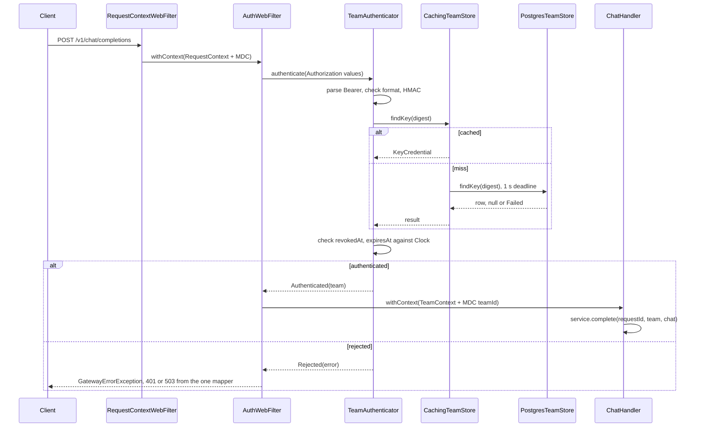

# GW-04: Teams and API keys: admin API, HMAC-hashed keys, auth filter

## 1. Context and goal

Today `/v1/chat/completions` accepts anyone who reaches it, and only a loopback bind and a `Host` check stand between the network and the provider key (ADR-GW-01-007). A team has no identity, so nothing can be limited, cached, guarded or billed per team.

After this item a platform operator creates teams and keys through `/admin/v1`, and a product team calls `/v1/chat/completions` with `Authorization: Bearer llmgw_...`, the header every OpenAI SDK already sends. Every request under `/v1` resolves to exactly one team before any other stage, and `ChatCall` carries it.

It serves pillar 4 (every call has a team) and is the base of pillar 3 (fair: RL-01 keys limits by team). RL-01, CACHE-01, GRD-01, COST-01, RTE-01 and AGT-01 all need it. It is also the first item with a database: it creates `gateway-infra`, settles R2DBC or JDBC (ADR-006) and deletes GW-01's stopgap.

## 2. Scope

### In
- **Module `gateway-infra`** (ADR-014), with the Postgres store, the Caffeine decorator and the Flyway migration `V1`.
- **Core:** `TeamId`, `TeamStorePort`, `KeyHasher`, `TeamAuthenticator`, `OperatorAuthenticator`, `TeamAdminService`, the new error rows, the in-memory fake and its contract test.
- **Edge:** one `AuthWebFilter` at `HIGHEST_PRECEDENCE + 1`; `TeamContext` and MDC `teamId`; the team on `ChatCall` and `ChatCompletionService`.
- **Admin API under `/admin/v1`:** create and list teams; create, list and revoke keys.
- **Startup:** the HMAC secret and the admin key are required and validated.
- **Removal** of GW-01's stopgap (section 7, deletion list).
- **Test migration:** every test and smoke script that calls `/v1` sends a key; `./gradlew test` stays Docker-free.
- **Docs:** `systems/auth-and-teams`, `er-teams-and-keys` diagram.

### Out
- Rotation of the HMAC secret. The `secret_version` column exists; the work is a new roadmap row.
- Team disable or deletion, key update, key regeneration, RBAC, several operators, `PermissionDenied` (403 `model_not_allowed` stays reserved for RTE-01).
- Last-used tracking (ADR-GW-04-014).
- Rate limiting of failed authentication. Unauthenticated traffic has no team, so RL-01 does not cover it; section 5 states the residual risk.
- CORS (none exists; ADR-GW-04-003). Spans and metrics (OBS-01, OBS-02). The `llmgw` admin commands (CLI-03).

## 3. Acceptance criteria

Each is checked by a test in section 8 unless it says otherwise.

- [x] `POST /v1/chat/completions` with a valid team key gives 200, streaming and non-streaming, on both adapters, and `ChatCall.team` is the key's team.
- [x] No `Authorization`, a non-Bearer scheme or an empty token gives 401 `missing_api_key` with `WWW-Authenticate: Bearer`.
- [x] An unknown, revoked, expired or malformed key, or two `Authorization` lines, gives one 401 `invalid_api_key` with `WWW-Authenticate: Bearer error="invalid_token"`; the bodies differ only in the request ID, and no provider is called.
- [x] An unauthenticated request under `/v1` to an unknown path, with a wrong method, or as a CORS preflight gets 401; with a key the same requests keep 404, 405 and 200 with no `Access-Control-*` header.
- [x] A percent-encoded or `;`-parameter form of a protected path (`/v%31/chat/completions`, `/v1;a=b/chat/completions`) gets 401 with no key.
- [x] A test enumerates every route in the context and fails on a path outside `/v1/**`, `/admin/**` or the exact open list.
- [x] `/actuator/health` answers 200 with no key, and stays UP with Postgres down.
- [x] The five admin routes behave as in section 4; a team key on `/admin` and the admin key on `/v1` each give 401 `invalid_api_key`.
- [x] A created key's plain value appears in the create response only: never in a list, a table, a log line at DEBUG with the `web` group on, or a response other than that one.
- [x] The table holds a 32-byte digest and a hint, never the plain value (a test reads the row).
- [x] With Postgres down or hung, a request with an unexpired cached key gets 200, and an uncached key gets 503 `team_store_unavailable` within 1.5 s, never 401.
- [x] A revoked key is refused at once on the replica that revoked it, and within `llmgw.auth.cache.ttl` on any other.
- [x] A cached key past `expires_at` is refused with no store call.
- [x] A blank or short `llmgw.auth.hmac-secret` or `llmgw.auth.admin-key` stops the start, naming the property and variable and never the value; `local` starts with no such variable set.
- [x] Either secret equal to its published `local` value with a `server.address` that is not loopback stops the start, naming only the properties.
- [x] A hung Postgres stops the start at Flyway within `connectTimeout` and `socketTimeout`.
- [x] `.gateway.app.security`, `ExposureGuard`, `LoopbackHostWebFilter`, `SecurityProperties` and the flag are gone (deletion list); `server.address` keeps its loopback default.
- [x] `RequestContext`, `TeamContext` and MDC `requestId` and `teamId` reach a `coRouter` handler and a `suspend` controller through both `CoWebFilter`s, after a dispatcher hop too.
- [x] The cold first request of a real Postgres lookup passes under BlockHound, on Linux.
- [x] `./gradlew test` passes with no Docker daemon.
- [x] `verify-gates` green (coverage: core ≥ 80%, overall ≥ 70%)
- [x] Smoke scenarios in section 8 pass (`gateway-smoke`), report in `docs/knowledge/runs/`
- [x] Eval: n/a, no threshold or classifier (section 8)
- [x] Living docs updated (`docs-update`), including the systems entry

## 4. Contract

### Authentication

| Path | Credential | Result |
|---|---|---|
| `/v1/**` | a team key | `TeamContext` set, chain continues |
| `/admin/**` | the admin key | chain continues, no team |
| any other, `/actuator/health` included | none | chain continues; an unknown path is the existing 404 |

The only credential header is `Authorization`. `x-api-key`, `api-key` and an `access_token` query parameter are never read and never forwarded.

| `Authorization` on the request | Outcome |
|---|---|
| absent | `missing_api_key` |
| one line, scheme other than `Bearer` (compared ignoring case) | `missing_api_key` |
| `Bearer` with an empty token | `missing_api_key` |
| more than one line | `invalid_api_key`; never pick one (ADR-GW-04-017) |
| `Bearer <token>`, token not `^llmgw_[A-Za-z0-9_-]{43}$` | `invalid_api_key`, no digest, no store call |
| well-formed, unknown, revoked, or `now >= expires_at` | `invalid_api_key` |

A control character in the header value never reaches the filter: Reactor Netty answers an empty 400 first ([gotcha](../knowledge/gotchas/reactor-netty-rejects-control-chars-in-header-values-before-webflux.md)).

### Team key format

`llmgw_` + 43 characters of unpadded base64url = 49 characters, encoding 32 bytes from a CSPRNG. No checksum (ADR-GW-04-002).

### Error rows

New rows for `toReply`; ADR-015 applies, so they never change once shipped. `Retry` is the SDK behaviour selected by status.

| Condition | Variant | Status | `type` | `code` | `param` | `message` | Headers |
|---|---|---|---|---|---|---|---|
| Missing credential | `Unauthenticated.MissingKey` | 401 | `invalid_request_error` | `missing_api_key` | – | `Missing API key. Send it as Authorization: Bearer <key>.` | `www-authenticate: Bearer` |
| Bad credential | `Unauthenticated.InvalidKey` | 401 | `invalid_request_error` | `invalid_api_key` | – | `The API key is invalid.` | `www-authenticate: Bearer error="invalid_token"` |
| Store down, slow or pool exhausted | `TeamStoreFailure.Unavailable` | 503 | `server_error` | `team_store_unavailable` | – | `The gateway cannot reach its team store. Include the request ID <id> if you report it.` | – |
| Team in the path does not exist | `TeamStoreFailure.TeamNotFound` | 404 | `invalid_request_error` | `team_not_found` | – | `No such team.` | – |
| Key in the path does not exist under this team | `TeamStoreFailure.KeyNotFound` | 404 | `invalid_request_error` | `key_not_found` | – | `No such key.` | – |
| Team name in use | `TeamStoreFailure.TeamNameTaken` | 409 | `invalid_request_error` | `team_name_taken` | `name` | `A team with this name exists.` | – |
| Key name in use by an unrevoked key of this team | `TeamStoreFailure.KeyNameTaken` | 409 | `invalid_request_error` | `key_name_taken` | `name` | `This team has an active key with this name.` | – |

Validation failures use the existing `InvalidRequest` with `code: invalid_request` and the member in `param`. No message quotes a value.

FND-04's reserved 401 row keeps its `type` and both codes. Third-party reports show OpenAI itself answering a missing key with `code: null` and a wrong key with `invalid_api_key`; no OpenAI page states it. The gateway keeps `missing_api_key` because a client can branch on it, and `code` is a free string (FND-04 section 4). SDKs choose their exception by status, so this costs nothing.

### Admin API

All routes need `Authorization: Bearer <admin key>`. JSON in and out; timestamps are RFC 3339 in UTC. `Cache-Control: no-store` on every `/admin/v1` response, since one of them carries a key.

| Route | Body | Success | Errors |
|---|---|---|---|
| `POST /admin/v1/teams` | `{"name"}` | 201 team | 400, 409 `team_name_taken` |
| `GET /admin/v1/teams?limit&after` | – | 200 list of teams | 400 |
| `POST /admin/v1/teams/{teamId}/keys` | `{"name","expires_at"?}` | 201 key with `key` | 400, 404 `team_not_found`, 409 `key_name_taken` |
| `GET /admin/v1/teams/{teamId}/keys?limit&after` | – | 200 list of keys | 400, 404 `team_not_found` |
| `POST /admin/v1/teams/{teamId}/keys/{keyId}/revoke` | none | 200 key | 404 `key_not_found` |

Revoke is idempotent: a second call answers 200 with the first `revoked_at`.

```json
{"id":"0194e4b8-7c3a-7f10-9a51-3c0f5e6a1b22","name":"payments","created_at":"2026-11-04T12:00:00Z"}
```

```json
{
  "id":"0194e4b9-1d20-7a44-8e02-77b1c9d0aa31",
  "team_id":"0194e4b8-7c3a-7f10-9a51-3c0f5e6a1b22",
  "name":"ci",
  "key":"llmgw_<43 characters, only in the 201>",
  "key_hint":"llmgw_Ab3d",
  "created_at":"2026-11-04T12:01:00Z",
  "expires_at":null,
  "revoked_at":null
}
```

`key_hint` is `llmgw_` plus the first 4 secret characters, 24 of 256 bits. No response ever carries a digest.

List shape, in OpenAI's convention:

```json
{"object":"list","data":[...],"first_id":"...","last_id":"...","has_more":false}
```

Ascending by `id`, which for UUIDv7 is creation order; revoked keys are listed. `first_id` and `last_id` are `null` on an empty page.

**Validation:**

| Input | Rule | Failure |
|---|---|---|
| `name` (team or key) | `^[a-z0-9][a-z0-9._-]{0,63}$` | 400, `param: name` |
| `expires_at` | absent, `null`, or RFC 3339 strictly after now | 400, `param: expires_at` |
| any other body member | refused, because a typo of `expires_at` would create an unbounded key | 400, `param: null` |
| `limit` | integer 1 to 100, default 20 | 400, `param: limit` |
| `after` | a UUID | 400, `param: after` |
| `{teamId}`, `{keyId}` not a UUID | cannot exist | 404 of that resource |

### What stays OpenAI-compatible

- **Compatible:** `Authorization: Bearer`, 401 and the SDK's authentication exception; `/v1` request and response shapes unchanged; the list shape of the admin API. An SDK changes only `base_url` and `api_key`.
- **Extensions:** `missing_api_key` where OpenAI leaves `null`; `WWW-Authenticate`, which RFC 6750 requires of a Bearer resource server.
- **Not OpenAI's:** everything under `/admin/v1`.
- **Behaviour change:** an unauthenticated request under `/v1` to an unknown path or wrong method was 404 or 405 and is now 401, and a preflight was 200 and is now 401.

## 5. Design

### Modules and ports

| Module | Package | Holds |
|---|---|---|
| `gateway-core` | `.gateway.core.team` | `TeamId`, `TeamKeyId`, `Team`, `TeamKey`, `NewTeamKey`, `RevokedKey`, `KeyCredential`, `ResourceName`, `TeamKeySecret`, `KeyDigest`, `KeyHasher`, `BearerCredential`, `TeamAuthenticator`, `OperatorAuthenticator`, `TeamAdminService`, `TeamStorePort`, `StoreResult`, `Page`, `PageRequest` |
| `gateway-core` | `.gateway.core.request` | `UuidV7Generator`, extracted from `RequestIdGenerator`, which delegates to it |
| `gateway-core` | `.gateway.core.error` | `Unauthenticated`, `TeamStoreFailure`, their rows |
| `gateway-core` `testFixtures` | `.gateway.core.team` | `InMemoryTeamStore`, `TeamStoreContract`, `TestKeys` |
| `gateway-infra` | `.gateway.infra.postgres` | `PostgresTeamStore`, the only user of `DatabaseClient` |
| `gateway-infra` | `.gateway.infra.cache` | `CachingTeamStore`, the only user of Caffeine |
| `gateway-infra` | resources | `db/migration/gateway/V1__teams_and_keys.sql` |
| `gateway-app` | `.gateway.app.auth` | `AuthWebFilter`, `TeamContext`, `AuthConfiguration`, `AuthProperties`, `ConfiguredSecret`, `PublishedSecrets` |
| `gateway-app` | `.gateway.app.admin` | `AdminRoutes`, `AdminHandler`, `AdminRequestReader`, `AdminResponseWriter` |
| `gateway-app` | `.gateway.app.config` | `TeamStoreConfiguration`, `TeamStoreWarmup`: the only classes naming infra types (ARCH-12) |
| `gateway-app` `testFixtures` | `.gateway.app` | `isolatedGateway()`, `OwnReactorResources`: how a test starts a context it will close |

`gateway-infra` applies `llmgw.kotlin-jvm`, like `gateway-providers`, with `implementation(platform(libs.spring.boot.dependencies))`, and copies `gateway-providers/build.gradle.kts:15,21-24` for BlockHound. It carries no Spring wiring (ARCH-6). `Modules.kt` already lists it, so ARCH-1 to ARCH-12 apply from its first file.

Library ownership: `spring-r2dbc` and `r2dbc-postgresql` in `gateway-infra`; `spring-boot-starter-r2dbc`, `spring-boot-starter-flyway` and `flyway-database-postgresql` in `gateway-app`; Caffeine in `gateway-infra`. Core adds only `javax.crypto` from the JDK, which ARCH-1 does not forbid.

```kotlin
// gateway-core, .gateway.core.team
@JvmInline value class TeamId(val value: Uuid)
@JvmInline value class TeamKeyId(val value: Uuid)

/** Lowercase hex of the 32-byte HMAC. */
@JvmInline value class KeyDigest(val hex: String) {
    override fun toString(): String = "[digest]"
}

/** A team key in plain form; only [reveal] shows it. Not `ApiKey`, which is the provider credential. */
class TeamKeySecret(private val value: String) {
    fun reveal(): String = value
    override fun toString(): String = "[redacted]"
}

data class KeyCredential(val team: TeamId, val key: TeamKeyId, val expiresAt: Instant?, val revokedAt: Instant?)
data class NewTeamKey(val key: TeamKey, val digest: KeyDigest, val secretVersion: Short)
data class RevokedKey(val key: TeamKey, val digest: KeyDigest)

sealed interface StoreResult<out T> {
    data class Ok<T>(val value: T) : StoreResult<T>
    data class Failed(val error: GatewayError) : StoreResult<Nothing>
}

/** Never throws for an expected failure; a `Failed` holds a [TeamStoreFailure]. */
interface TeamStorePort {
    /** Hot path. `Ok(null)` is an unknown digest; a revoked or expired row is returned, and core judges it. */
    suspend fun findKey(digest: KeyDigest): StoreResult<KeyCredential?>
    suspend fun createTeam(team: Team): StoreResult<Team>
    suspend fun listTeams(page: PageRequest): StoreResult<Page<Team>>
    suspend fun createKey(key: NewTeamKey): StoreResult<TeamKey>
    suspend fun listKeys(team: TeamId, page: PageRequest): StoreResult<Page<TeamKey>>
    /** Idempotent: a revoked key keeps its first `revokedAt`. */
    suspend fun revokeKey(team: TeamId, key: TeamKeyId, at: Instant): StoreResult<RevokedKey>
}

class KeyHasher(secret: ByteArray, val version: Short = 1) {
    fun digest(token: String): KeyDigest
}

sealed interface Authentication {
    data class Authenticated(val team: TeamId, val key: TeamKeyId) : Authentication
    data class Rejected(val error: GatewayError) : Authentication
}

class TeamAuthenticator(hasher: KeyHasher, store: TeamStorePort, clock: Clock) {
    /** [authorization] is every value of the header. */
    suspend fun authenticate(authorization: List<String>): Authentication
}

class OperatorAuthenticator(hasher: KeyHasher, adminKey: String) {
    /** Null when accepted. Compares digests with `MessageDigest.isEqual`, so the length leaks nothing. */
    fun check(authorization: List<String>): GatewayError?
}

class TeamAdminService(store: TeamStorePort, hasher: KeyHasher, ids: UuidV7Generator, secrets: Random, clock: Clock) {
    suspend fun createTeam(name: ResourceName): StoreResult<Team>
    suspend fun listTeams(page: PageRequest): StoreResult<Page<Team>>
    /** The only place a plain key exists after it is generated. */
    suspend fun createKey(team: TeamId, name: ResourceName, expiresAt: Instant?): StoreResult<CreatedKey>
    suspend fun listKeys(team: TeamId, page: PageRequest): StoreResult<Page<TeamKey>>
    suspend fun revokeKey(team: TeamId, key: TeamKeyId): StoreResult<TeamKey>
}
```

```kotlin
// gateway-core, .gateway.core.chat
data class ChatCall(val requestId: RequestId, val team: TeamId, val deployment: Deployment, val request: ChatRequest)

suspend fun complete(requestId: RequestId, team: TeamId, request: ChatRequest): ChatOutcome
fun stream(requestId: RequestId, team: TeamId, request: ChatRequest, onEnd: (StreamSummary) -> Unit = {}): Flow<ChatStreamEvent>
```

```kotlin
// gateway-app, .gateway.app.auth
/** Exists only on an authenticated `/v1` request, so its presence is the proof (ADR-GW-04-009). */
class TeamContext(val team: TeamId) : AbstractCoroutineContextElement(Key) {
    companion object Key : CoroutineContext.Key<TeamContext>
}

class AuthWebFilter(teams: TeamAuthenticator, operator: OperatorAuthenticator) : CoWebFilter(), Ordered
```

`AuthWebFilter` uses `PathPattern`s for `/v1/**` and `/admin/**` against `exchange.request.path.pathWithinApplication()`, the same matcher the router uses. A `startsWith` on the raw path would be a bypass: `PathContainer` decodes segments and drops `;` parameters for matching, so `/v%31/chat/completions` reaches the handler while failing a raw prefix.

`ChatHandler` reads `checkNotNull(currentCoroutineContext()[TeamContext])`. A `/v1` route the filter somehow missed is then a 500, never an anonymous call. The team is not forwarded to a provider; adapters ignore `ChatCall.team`.

`KeyHasher` keeps one initialised `Mac` as a prototype and calls `clone()` per digest. `Mac` is not thread-safe, and `Mac.getInstance` per call would run provider lookup on an event loop. Secrets are drawn from a dedicated DRBG at strength 256, seeded at startup, because the default instantiation is 128 bits (`DrbgParameters`) and would cap a 256-bit key at 128.

### Data

Postgres is the source of truth for teams and keys. Caffeine holds copies. No Redis, no broker.

`gateway-infra/src/main/resources/db/migration/gateway/V1__teams_and_keys.sql`:

```sql
CREATE TABLE teams (
    id         uuid        PRIMARY KEY,
    name       text        NOT NULL,
    created_at timestamptz NOT NULL,
    CONSTRAINT teams_name_key UNIQUE (name)
);

CREATE TABLE team_keys (
    id             uuid        PRIMARY KEY,
    team_id        uuid        NOT NULL REFERENCES teams (id),
    name           text        NOT NULL,
    digest         bytea       NOT NULL,
    secret_version smallint    NOT NULL,
    hint           text        NOT NULL,
    created_at     timestamptz NOT NULL,
    expires_at     timestamptz,
    revoked_at     timestamptz,
    CONSTRAINT team_keys_digest_key UNIQUE (digest),
    CONSTRAINT team_keys_digest_length CHECK (octet_length(digest) = 32)
);

CREATE UNIQUE INDEX team_keys_team_name_active ON team_keys (team_id, name) WHERE revoked_at IS NULL;
CREATE INDEX team_keys_team_id_id ON team_keys (team_id, id);
```

| Index | Serves |
|---|---|
| `team_keys_digest_key` | the hot-path lookup |
| `team_keys_team_name_active` | key name uniqueness among unrevoked keys |
| `team_keys_team_id_id` | keyset listing of a team's keys |
| `teams_pkey` | keyset listing of teams |

`id`, timestamps and `digest` come from core; the database generates nothing, so a test can fix them and core owns time.

Every write is one statement, so no transaction exists and no read-then-write race:

| Operation | Statement |
|---|---|
| `findKey` | `SELECT id, team_id, expires_at, revoked_at FROM team_keys WHERE digest = $1` |
| `createTeam` | `INSERT ... ON CONFLICT (name) DO NOTHING RETURNING ...`; no row is `TeamNameTaken` |
| `createKey` | `INSERT ... ON CONFLICT (team_id, name) WHERE revoked_at IS NULL DO NOTHING RETURNING ...`; no row is `KeyNameTaken`; SQLSTATE 23503 is `TeamNotFound` |
| `revokeKey` | `UPDATE team_keys SET revoked_at = COALESCE(revoked_at, $1) WHERE id = $2 AND team_id = $3 RETURNING ...`; no row is `KeyNotFound` |
| `list*` | `WHERE id > $after ORDER BY id LIMIT $limit + 1`; the extra row sets `has_more` |

`listKeys` on an empty page checks that the team exists, so an unknown team is a 404 and not an empty list.

Caffeine, two caches in `CachingTeamStore`, both keyed by `KeyDigest`:

| Cache | Value | TTL | Size | Invalidated by |
|---|---|---|---|---|
| positive | `KeyCredential`, revoked rows included | `cache.ttl`, 30 s after write | 10 000 | `revokeKey` on this replica |
| negative | unknown digest | `cache.negative-ttl`, 5 s after write | 10 000 | `createKey` on this replica |

`Failed` is never cached. Expiry and revocation are judged in `TeamAuthenticator` on every request, hit or miss, with the injected `Clock`, so the cache needs no clock of its own and a hit past `expires_at` is refused. `CachingTeamStore` overrides `findKey`, `createKey` and `revokeKey` and delegates the rest with `TeamStorePort by delegate`.

A sync `Cache` is used, with no single-flight: concurrent misses on one digest cost one indexed read each, at most once per TTL per key.

### Flow



A filter exception reaches `GatewayErrorWebExceptionHandler` as `RequestContextWebFilter`'s does, so 401 and 503 carry `x-request-id`. The body is never read before auth, so a rejected request costs no buffering.

The two filters nest because `CoWebFilterChain.filter` stores the current context minus `Job` in `COROUTINE_CONTEXT_ATTRIBUTE`, and the next `CoWebFilter` starts `mono(context)` from it (Spring 7.0.x `CoWebFilter.kt`). The source says it works; acceptance needs the runtime proof.

After a store miss the continuation resumes on the driver's `reactor-tcp-nio` thread, not the server's. It is a Netty event loop, so the same no-blocking rule holds, and it happens only on a miss.

### Failure model

**Timeouts.** One deadline per store operation, `llmgw.auth.store-timeout` (1 s), by `Mono.timeout` in `PostgresTeamStore`, around acquire and query together; not `withTimeoutOrNull`, whose timer would resume the request on `DefaultExecutor`. Inside it: `max-acquire-time` 500 ms, `max-validation-time` 250 ms. `max-create-connection-time` 2 s bounds a background connect; the request does not wait for it past its own deadline.

**Retries.** None in the gateway. A 503 from the store is retried by SDKs. r2dbc-pool's `acquire-retry` keeps its default of 1, inside `max-acquire-time`.

**Cancellation.** A client disconnect cancels the filter's coroutine, which cancels the query subscription; the connection returns to the pool and nothing is cached. `CancellationException` is rethrown, never mapped to `Unavailable`.

**Idempotency.** Team and key names are the natural guard: a retried create is a 409. A lost 201 for a key loses the plain value, so the operator revokes that key and creates another. Revoke is idempotent. Nothing here writes a usage event.

| Dependency | State | Behaviour | Why |
|---|---|---|---|
| Postgres | down or refused at runtime | **Fail closed**: cached keys pass until their TTL ends, any other key gets 503 `team_store_unavailable`; admin routes get 503 | An unverified key must not spend a provider key. Never 401: a client would drop a good key. |
| Postgres | slow or hung | Same, after at most `store-timeout` | Bounded, so waiting requests cannot pile up. |
| Postgres | pool exhausted | Same, after `max-acquire-time` | |
| Postgres | down at startup | The start fails at Flyway | A replica that cannot confirm its schema must not take traffic. |
| Postgres | schema or SQL bug | 500 `internal_error` | Grammar and mapping errors are bugs, not outages; only connection, pool and timeout failures are `Unavailable`. |
| Caffeine | n/a | In-process, cannot be down | |
| Provider, Redis, broker | n/a | Not called during auth | Provider behaviour after auth is unchanged. |

The driver's message is not logged: the adapter logs the exception class and SQLSTATE at WARN, and the mapper logs the 503 at ERROR with the request ID.

**Revocation lag.** A revoke is at once on the replica that served it and at most `cache.ttl` (30 s) on the others. A lookup in flight during a revoke on the same replica can re-cache the old row, inside the same bound. Accepted (ADR-GW-04-006).

**Residual risks, accepted for this item.**
- A flood of well-formed random tokens misses both caches and reaches the pool; it can make uncached keys 503, while cached keys keep working. The format check and `max-size` bound the damage. Per-source limiting belongs at the edge proxy (OPS-03).
- `local` holds a public admin key, and DNS rebinding can reach a loopback service, so a web page could call the admin API of a `local` gateway. It reaches only the mock: `local` holds no real provider key. Past loopback the start refuses these values (ADR-GW-04-019).

### Observability

OBS-01 and OBS-02 are not built, so this item adds no span and no metric.

- **Logs:** MDC `teamId` from `AuthWebFilter`, shown by `logging.pattern.correlation: "[%X{requestId:-}] [%X{teamId:-}] "`. `[]` means no team yet. Existing tests match `[$requestId]`, which still holds.
- **Admin audit:** one INFO line per team create, key create and key revoke, with IDs only.
- **Rejections:** 401 stays at DEBUG with status and code, as every 4xx does (systems entry, contract 6).
- **For OBS-01 to pick up:** the team ID as a span attribute; **for OBS-02:** cache hit rate and store latency.
- **Never recorded:** a plain key, a digest, `Authorization`, the HMAC secret, the admin key. The create response is written as bytes, because `JacksonJsonEncoder` logs the value it encodes at DEBUG, and Boot's `web` group turns that on ([gotcha](../knowledge/gotchas/spring-jackson-encoder-logs-the-value-at-debug.md)).

### Configuration

`application.yaml`:

| Property | Default | Note |
|---|---|---|
| `llmgw.auth.hmac-secret` | `${LLMGW_KEY_HMAC_SECRET:}` | Required. 32 to 512 visible ASCII characters, used as bytes. `openssl rand -base64 32`. |
| `llmgw.auth.admin-key` | `${LLMGW_ADMIN_KEY:}` | Required. Same bounds; must differ from the HMAC secret. |
| `llmgw.auth.store-timeout` | `1s` | Positive, at most 10 s. |
| `llmgw.auth.warmup-timeout` | `10s` | The startup warm-up, all attempts together. Positive, at most 2 m. |
| `llmgw.auth.cache.ttl` | `30s` | Revocation lag across replicas. Positive, at most 5 m. |
| `llmgw.auth.cache.max-size` | `10000` | Entries, positive. |
| `llmgw.auth.cache.negative-ttl` | `5s` | Positive, at most 1 m. |
| `llmgw.auth.cache.negative-max-size` | `10000` | Entries, positive. |
| `spring.r2dbc.url` | `r2dbc:postgresql://${LLMGW_POSTGRES_HOST:127.0.0.1}:${LLMGW_POSTGRES_PORT:5440}/${LLMGW_POSTGRES_DB:llmgw}` | |
| `spring.r2dbc.username` | `${LLMGW_POSTGRES_USER:llmgw}` | |
| `spring.r2dbc.password` | `${LLMGW_POSTGRES_PASSWORD:}` | |
| `spring.r2dbc.pool.initial-size` | `2` | |
| `spring.r2dbc.pool.min-idle` | `2` | Spares a first request the connect. |
| `spring.r2dbc.pool.max-size` | `10` | ADR-GW-04-015. |
| `spring.r2dbc.pool.max-acquire-time` | `500ms` | The default is no limit. |
| `spring.r2dbc.pool.max-create-connection-time` | `2s` | The default is no limit. |
| `spring.r2dbc.pool.max-validation-time` | `250ms` | The default is no limit. |
| `spring.r2dbc.pool.validation-depth` | `remote` | A hung peer passes `local`. Costs one round trip, on misses only. |
| `spring.r2dbc.pool.max-idle-time` | `10m` | |
| `spring.r2dbc.pool.max-life-time` | `30m` | |
| `spring.flyway.url` | `jdbc:postgresql://` + the same three variables, `?connectTimeout=5&socketTimeout=${LLMGW_FLYWAY_SOCKET_TIMEOUT:60}` | Seconds; pgjdbc's defaults set no limit. `socketTimeout` also bounds each migration statement. |
| `spring.flyway.user`, `spring.flyway.password` | as above | |
| `spring.flyway.locations` | `classpath:db/migration/gateway` | |
| `management.health.r2dbc.enabled` | `false` | The health endpoint must stay UP while cached keys serve (ADR-GW-04-005). Name not confirmed in the reference: spike S3. |
| `server.address` | `${LLMGW_BIND_ADDRESS:127.0.0.1}` | Unchanged; the comment no longer says "until GW-04". |

`application-local.yaml` adds `spring.r2dbc.password` and `spring.flyway.password` as `${LLMGW_POSTGRES_PASSWORD:llmgw}`, and fixed fakes for `llmgw.auth.hmac-secret` and `llmgw.auth.admin-key`, each at least 32 characters and saying they are not secrets (ADR-GW-04-016).

Both test `application.properties` add: fake `llmgw.auth.*` values, `spring.flyway.enabled=false`, and `spring.r2dbc.url=r2dbc:postgresql://127.0.0.1:1/unused`, a closed port, so a test cannot touch the dev stack.

## 6. Reuse

- [`patterns/request-context-coroutine-element`](../knowledge/patterns/request-context-coroutine-element.md): `TeamContext` joins the same shape, with a nested `MDCContext`.
- [`patterns/one-error-funnel`](../knowledge/patterns/one-error-funnel.md): the filter raises `GatewayErrorException`; rows go in `toReply`.
- [`patterns/singleton-test-containers-mirroring-compose-images`](../knowledge/patterns/singleton-test-containers-mirroring-compose-images.md): `SharedPostgres`.
- [`patterns/port-fake-proved-by-a-shared-contract-test`](../knowledge/patterns/port-fake-proved-by-a-shared-contract-test.md): new with this spec.
- `ProviderFailure : GatewayError` is the shape of `TeamStoreFailure`; `ApiKey` is the shape of `TeamKeySecret` and `ConfiguredSecret`; `ProviderChecks` is the shape of the startup checks.
- `ChatRoutes`' 405 catch-all and `readJsonObject` for the admin routes.
- `EventLoopWarmup` is the precedent for `TeamStoreWarmup`.
- Gotchas that apply: [drbg-seeds-lazily](../knowledge/gotchas/jdk-drbg-seeds-lazily-on-first-nextbytes.md), [integration-test-suite-has-no-test-resources](../knowledge/gotchas/integration-test-suite-has-no-test-resources.md), [dynamic-property-source-superclass-registers-last](../knowledge/gotchas/dynamic-property-source-superclass-registers-last.md), [conditional-on-property-and-the-binder-read-true-differently](../knowledge/gotchas/conditional-on-property-and-the-binder-read-true-differently.md), [kover-excludes-only-the-test-compilation-by-default](../knowledge/gotchas/kover-excludes-only-the-test-compilation-by-default.md), [output-capture-all-includes-the-class-level-capture](../knowledge/gotchas/output-capture-all-includes-the-class-level-capture.md), [jackson-deserializer-cache-lock-parks-on-first-tree-read](../knowledge/gotchas/jackson-deserializer-cache-lock-parks-on-first-tree-read.md) (a contended lock trips BlockHound only under concurrency).
- ADRs: ADR-004, -005, -006, -011, -014, -015, -016, -017; ADR-GW-01-007, -010, -012; ADR-FND-02-007, -009.

## 7. Execution plan

- [x] **Step 1: R2DBC and Flyway spike.** Create `gateway-infra`: `settings.gradle.kts`, one convention plugin, `kover(project(...))`, BlockHound lines, catalog aliases. Boot 4.1.2 is not run with this stack yet, so prove each and write the results in the Log:
  - **S1:** the starters resolve under the BOM (r2dbc-postgresql 1.1.3, r2dbc-pool 1.0.2, Flyway 12.4.0, Caffeine 3.2.4), with no version in the catalog.
  - **S2:** with a `ConnectionFactory` there is no `DataSource` bean, and `spring.flyway.url` migrates a real database.
  - **S3:** with `spring.flyway.enabled=false` and the closed-port URL, a context starts with no connection attempt and `/actuator/health` is UP; confirm `management.health.r2dbc.enabled` is the property. If the pool connects eagerly, that is a finding for ADR-GW-04-010.
  - **S4:** a cold query over a new connection, SCRAM included, passes BlockHound **on Linux**: on Windows a `/dev/urandom` read cannot trip it ([gotcha](../knowledge/gotchas/jdk-drbg-seeds-lazily-on-first-nextbytes.md)). r2dbc-postgresql#275 is closed, fixed in 0.8.3; other paths are unknown.
  - **S5:** a cancelled query returns its connection (`ConnectionPool.getMetrics()`).
  - **S6:** a `SmartInitializingSingleton` runs after Flyway. Boot's list of beans that wait for migrations has no `ConnectionFactory`.
  - **Exit:** all pass, or a blocking call that is a real wait on each new connection, or a day spent, triggers the fallback in ADR-GW-04-001. A blocking call that is a one-off class load gets a warm-up; a named BlockHound allowance needs a sentence in the Log saying why it cannot wait.
- [x] **Step 2: core types and rows.** TDD: `UuidV7Generator`, `TeamId`, `ResourceName`, `TeamKeySecret`, `KeyDigest`, `KeyHasher`, `BearerCredential`; `Unauthenticated`, `TeamStoreFailure`, `toReply` rows, `ErrorReplyTest` cases.
- [x] **Step 3: core services and the fake.** `TeamStorePort`, `TeamAuthenticator`, `OperatorAuthenticator`, `TeamAdminService`; `java-test-fixtures` on `gateway-core` with `InMemoryTeamStore`, `TeamStoreContract`, `TestKeys`; exclude `testFixtures` from Kover; confirm ktlint, detekt and the ARCH rules cover the new source set.
- [x] **Step 4: Postgres adapter.** `V1`, `PostgresTeamStore`, `TeamStoreContract` on real Postgres, `SharedPostgres.database(name)`, failure tests on a private paused container.
- [x] **Step 5: cache decorator.** `CachingTeamStore` with a fake ticker; a concurrent-write test under BlockHound (the eviction lock can be contended on a write).
- [x] **Step 6: wiring and startup.** `AuthProperties`, `ConfiguredSecret`, startup checks, `AuthConfiguration`, `TeamStoreConfiguration`, `TeamStoreWarmup`, the DRBG bean, YAML, both test `application.properties`, and `InMemoryTeamStoreWiring` in both test source sets. Everything stays green because no filter exists yet.
- [x] **Step 7: filter, team on the call, deletion, test migration.** One change, or the suites are red in between: `AuthWebFilter`, `TeamContext`, `ChatCall` and `ChatCompletionService` (2 main sites, 11 test files), `ChatHandler`; the deletion list; `MockBackedTest` (`chat`, `rawStream`, `rawRequest`), the 7 classes in `src/test`, `UpstreamErrorMappingTest:229`, `StreamUpstreamErrorMappingTest:64`, the SDK contract tests; the unauthenticated 404, 405 and preflight cases. May take a full day.
- [x] **Step 8: nested filter proof and scope.** `TeamContextPropagationTest`, `AuthScopeTest`, `AuthWebFilterTest`.
- [x] **Step 9: admin API.** `AdminRoutes`, handler, reader, writer, `AdminRouteTest`.
- [x] **Step 10: real store through the app.** `PostgresBackedTest` and its suites; `NoLeakIntegrationTest` with a team key; BlockHound with the real store.
- [x] **Step 11: smoke.** `tools/smoke/team-key.sh`; `chat-completions.sh`, `streaming.sh`, `anthropic.sh`, `live-openai.sh` source it; new `tools/smoke/auth.sh`. `live-openai.sh` is edited, and not run without the user's go-ahead.
- [x] **Step 12: docs.** See below.

**Deletion list.**

| What | Where |
|---|---|
| `ExposureGuard.kt`, `LoopbackHostWebFilter.kt`, `SecurityConfiguration.kt`, `SecurityProperties.kt`: the whole package | `gateway-app/src/main/kotlin/.../gateway/app/security/` |
| `ExposureGuardTest.kt`, `LoopbackHostWebFilterTest.kt`, `LoopbackHostSocketTest.kt`: the whole package | `gateway-app/src/test/kotlin/.../gateway/app/security/` |
| The `a non-loopback bind without the flag ...` case and its `mark` setup if nothing else uses it | `StartupFailureTest.kt:75-81` |
| `llmgw.security.allow-unauthenticated-exposure` and the `security:` key | `application.yaml:29-31` |
| The "until GW-04" wording of the comment | `application.yaml:19` |
| Scenario 12 (non-loopback start) | `tools/smoke/chat-completions.sh`, header and scenario |
| The property row and the Host-check sentence | `docs/knowledge/systems/provider-adapters.md` |

`gotchas/reactor-netty-refuses-an-unparsable-host-before-webflux` stays: it is a library fact. Its `source_files` lose the deleted test.

**Step 12 doc tasks.**
- `docs/knowledge/systems/auth-and-teams.md`, linked in the CLAUDE.md systems table.
- `docs/diagrams/er-teams-and-keys.md` through `diagram-update`: `teams`, `team_keys`, `flyway_schema_history` left out. Add its row to `docs/diagrams/README.md`.
- `sequence-chat-completion` and `container-overview`: auth built, Postgres connected.
- CLAUDE.md: the module-graph "built today" line with `gateway-infra`; the `OPENAI_API_KEY` line, which now also needs the two secrets and Postgres; `ADR-014` table note for `gateway-infra`.
- `systems/request-context-and-errors`: the second filter, MDC `teamId`, new rows. `systems/local-stack`: first consumer of Postgres.
- `docs/GLOSSARY.md`: team key, admin key, key digest. `.env.example`: the two variables.
- `gateway-tester` writes the run report.

## 8. Tests

**Core unit (TDD), `gateway-core`:**
- `UuidV7GeneratorTest`; `RequestIdGeneratorTest` unchanged and green.
- `KeyHasherTest`: an RFC 4231 HMAC-SHA-256 vector; concurrent digests from many threads agree; `toString` of `KeyDigest` and `TeamKeySecret` hides the value.
- `BearerCredentialTest`: every row of the `Authorization` table.
- `TeamAuthenticatorTest` with `InMemoryTeamStore` and a fixed `Clock`: each outcome; `now == expires_at` is expired; a malformed token makes no store call; `Failed` is `TeamStoreFailure.Unavailable`, never a 401.
- `OperatorAuthenticatorTest`: wrong length, wrong value, right value, team key refused.
- `TeamAdminServiceTest`: key shape against the regex, hint, digest equals `KeyHasher` of the value, past `expires_at`, `secretVersion`.
- `ResourceNameTest`: bounds and character classes.
- `ErrorReplyTest`: one case per new row, `www-authenticate` on both 401s.
- `ChatCompletionServiceTest`: `ChatCall.team` on `complete` and `stream`.
- `InMemoryTeamStoreTest : TeamStoreContract`.

**`gateway-infra`, `src/test`:** `PostgresTeamStoreDeadlineTest`, a connection that never comes: under `Unconfined` the timed-out call resumes on a `parallel` thread. `CachingTeamStoreTest`, with a fake delegate that counts and a fake ticker: hit, TTL end, size bound, negative hit, negative TTL shorter than positive, `Failed` not cached, a hit served while the delegate is down, invalidation on revoke and on create, a concurrent-write case under BlockHound.

**Integration (Testcontainers), `gateway-infra`, `src/integrationTest`:**
- `PostgresTeamStoreIntegrationTest : TeamStoreContract`, on its own database from `SharedPostgres.database(...)`, migrated by Flyway.
- `V1MigrationIntegrationTest`: tables, the four indexes, the digest length check; a re-run is a no-op.
- `PostgresTeamStoreFailureIntegrationTest`, on a private container: stopped gives `Unavailable`; paused gives `Unavailable` within the deadline; an exhausted pool gives `Unavailable` within `max-acquire-time`; a bad SQL statement is an exception, not `Unavailable`; a cancelled call frees its connection; a query held past the deadline resumes on a `parallel` thread and frees its connection; recovery after unpause.
- `PostgresColdStartBlockHoundTest`: first lookup on a fresh pool, on an event-loop thread.

**`gateway-app`, `src/test`** (fake store, no Docker):
- `AuthWebFilterTest`: every row of the scope and credential tables, with the mock exchange.
- `AuthRouteTest`: over a socket, acceptance rows; bodies of unknown, revoked and expired compared byte for byte after removing the ID; no provider call on 401; `x-request-id` on 401 and 503; `/v%31/...` and `;` forms; doubled and trailing slashes under `/v1` and `/admin`; a leading `//` reaches no route; two `Authorization` lines; cached key during an outage through `InMemoryTeamStore.available = false` behind a real `CachingTeamStore`.
- `AuthScopeTest`: walks every `RouterFunction` with a `RouterFunctions.Visitor`, and every `RequestMappingHandlerMapping` pattern, and fails on a path outside the scope; actuator's paths are the exact open list.
- `TeamContextPropagationTest`: a test-only `coRouter` route and a `suspend` controller under `/v1/test-probe`, brought in by `@Import`; both see `RequestContext`, `TeamContext` and MDC, before and after a hop to `Dispatchers.Default`; the log line carries both IDs; probes on `/admin` and an open path see no team, a valid team key on the open path included.
- `TeamStoreWarmupTest`: the store has seen one lookup when `WebServerInitializedEvent` fires; a failed attempt is retried; an outage or a hang ends at the deadline without stopping the start.
- `ConnectionPoolWiringTest`: the `ConnectionFactory` is a `ConnectionPool` that gives up at `max-acquire-time` against a peer that never answers.
- `StartedContextIsolationTest`: a context closing through `isolatedGateway()` leaves `HttpResources` in place.
- `PublishedSecretsTest`: the published values equal `application-local.yaml`; loopback spellings pass; any other address, or none, is refused.
- `AdminRouteTest`: every route, status, validation row, `Cache-Control`, no digest in any body, plain key only in the 201, `has_more` paging across pages, list of a revoked key, idempotent revoke.
- `ChatRouteTest`: `the client's Authorization does not reach the port` (`:153`) stays, with the seeded key; the 405 cases send a key; the preflight case becomes 401, still with no `Access-Control-*`.
- `ErrorEnvelopeIntegrationTest`, `RequestContextIntegrationTest`: `/v1/does-not-exist` sends a key; add the 401 cases.
- `BlockHoundIntegrationTest`: the existing requests send a key; `KeyHasher.digest` on the event loop.
- `StartupFailureTest`: blank, short and non-ASCII `hmac-secret` and `admin-key`, equal values, `ttl` of `0s`, each naming the property; a canary value in neither the exception nor the output. A bad neighbour property (`cache.ttl=not-a-duration`) must not print the secret. A published secret past loopback, in `local` too. A hung Postgres, a socket that accepts and never answers, stops the start.
- `GatewayApplicationTest`: UP unchanged, as the S3 proof.

**`gateway-app`, `src/integrationTest`:**
- `MockBackedTest` family: unchanged assertions, keyed requests. `ChatCompletionsEndToEndTest:54` stays: the journal fingerprint is the provider key's, not the team key's.
- `OpenAiSdkContractTest`, `OpenAiSdkStreamContractTest`: `TestKeys.TEAM_KEY` replaces `client-key`; a new case proves a wrong key raises the SDK's authentication exception.
- `PostgresBackedTest`: a base class with its own database through `@DynamicPropertySource`, `llmgw.test.team-store=postgres`, Flyway on.
  - `TeamKeysEndToEndTest`: admin create, chat, revoke, 401; a row read proves the digest and hint.
  - `RevocationLagTest`: two contexts on one database, short TTL, the key cached on both: refused at once on one, still 200 on the other, then refused within the TTL; a provider call still works after the other closes.
  - `StoreOutageIntegrationTest`: a private container, paused: cached 200, uncached 503, health UP.
  - `TeamStoreBlockHoundIntegrationTest`: concurrent cold keys under BlockHound.
- `NoLeakIntegrationTest`: a team key and the admin key as canaries, `web` at DEBUG, across create, chat, 401 and 5xx; neither in the log.

**`test-support`:** `SharedPostgres.database(name)` creates once and returns coordinates; a repeat is a no-op.

**`architecture-tests`:** no new rule. `RuleFixturesTest` stays green; `gateway-infra` is scanned.

**Smoke scenarios (`gateway-smoke`).** `gateway-app` on `local`, `mock-provider`, compose Postgres. Helper `tools/smoke/team-key.sh`, sourced by all five scripts: creates a uniquely named team and key through the admin API, never SQL, and writes `Authorization` to a `0600` temp file used as `curl -H @file`, so no key sits in `argv` ([bug](../knowledge/bugs/live-openai-puts-the-key-in-grep-argv.md)). Each script's private `post` uses it. `live-openai.sh` generates throwaway `LLMGW_KEY_HMAC_SECRET` and `LLMGW_ADMIN_KEY` for the gateway it starts, and needs compose Postgres.

`tools/smoke/auth.sh`:

1. No key: 401 `missing_api_key`, `WWW-Authenticate`, `x-request-id`; the mock counted no call.
2. Wrong, malformed and `Basic` credentials; `/v%31/chat/completions` with no key.
3. Create team and key; a repeated name is 409; the list shows `key_hint`, no `key`, no digest.
4. Chat with the key: 200; the mock's journal fingerprint is `mock-local-key`'s.
5. Stream with the key: frames and `[DONE]`.
6. Revoke: the next call is 401, body equal to an unknown key's bar the ID.
7. A key with `expires_at` 2 s ahead: 200, then 401, while it is cached.
8. Admin key on `/v1`, team key on `/admin`: 401.
9. `PG_FAULT=1`, `docker compose pause postgres`: cached 200, uncached 503 within 1.5 s, health UP, `unpause`, recovery. Restores the stack as found.
10. `GATEWAY_LOG` set: no `llmgw_` token beyond a hint, with `LOGGING_LEVEL_WEB=debug`.
11. Median added latency, cached key against the GW-03 baseline of 0.90 ms.
12. Manual: a key survives a gateway restart.
13. Manual: two gateways, `LLMGW_AUTH_CACHE_TTL=3s`: revoke on one, the other refuses within 3 s.

**Eval (`ai-eval`):** n/a. No threshold, classifier or routing policy; the cache TTL is a security bound, not a quality threshold.

## 9. Success metrics

| Metric | Target | Measured by |
|---|---|---|
| Added latency, cached key, p50 | under 0.1 ms over the 0.90 ms baseline | smoke 11 |
| Added latency, cache miss on local Postgres, p50 | under 5 ms | smoke, a fresh key per call |
| Store queries at steady state | one per key per TTL per replica | `CachingTeamStoreTest` count |
| Unverified key answered 200 during an outage | 0 | `StoreOutageIntegrationTest` |
| Time to 503 with a hung Postgres | at most 1.5 s | smoke 9 |
| Revocation lag across replicas | at most `cache.ttl` | `RevocationLagTest` |
| Plain keys in any log | 0 | `NoLeakIntegrationTest`, smoke 10 |

The first two targets are this project's judgment; no public figure exists for this stack.

## 10. ADRs (local)

### ADR-GW-04-001: Persistence: R2DBC with `DatabaseClient`, Flyway over JDBC
- **Context:** ADR-006 left R2DBC or JDBC to this item. The lookup sits on the hot path, and later items (RTE-01, COST-02, AGT-01) use the same stack. CLAUDE.md allows blocking only on `Dispatchers.IO` inside an adapter.
- **Options considered:**
  - A) R2DBC with plain `DatabaseClient`. No thread pool to size, one model with the rest of the stack, cancellation reaches the query.
  - B) JDBC with HikariCP on `Dispatchers.IO.limitedParallelism(poolSize)`. Mature and familiar. Rejected as first choice: a second concurrency model in the adapters, and a cancelled coroutine does not stop a running statement.
  - C) Spring Data R2DBC repositories. Rejected: reflection and mapping for two tables, and domain types would need annotations or a mirror.
  - D) jOOQ. Rejected: code generation and a dependency for a handful of statements.
  - E) Flyway over R2DBC. Not available: Flyway needs JDBC.
- **Decision:** A, in `gateway-infra`, with Flyway over JDBC at startup only, one migration `V1` in infra resources. **Fallback** if spike step 1 fails: B behind the same port, recorded as a dated revision of this ADR and ADR-021. Core, the filter and every test above the port stay the same.
- **Consequences:** Two drivers on the classpath and two URLs from the same variables. JDBC never runs after startup. Summary in [ADR-021](../DECISIONS.md#adr-021). Buys: no blocking on the hot path and cancellation that reaches the database.
- **Date:** 2026-11-04

### ADR-GW-04-002: Key format and storage
- **Context:** Keys are long-lived machine credentials, checked on every request. A database leak must not yield usable keys, and a lookup must be an index read.
- **Options considered:**
  - A) bcrypt or argon2 per key. Rejected: designed to be slow, which is wrong on every request; a salted hash cannot be found by index, so it needs a separate key ID in the token. OWASP's slow-hash advice is for human passwords.
  - B) Plain SHA-256. Enough against guessing, but a database leak allows offline checks of candidates, with no second secret needed.
  - C) HMAC-SHA-256 with an environment secret, looked up by digest through a unique index. A leak of the table alone gives nothing: OWASP's pepper, kept apart from the hash.
  - D) A checksum in the token, as GitHub does. Rejected for now: it serves offline secret scanning, which nothing here runs. A format change can add it later, since the format check is one regex.
  - E) Base62 instead of base64url. Rejected: no JDK encoder.
- **Decision:** `llmgw_` plus 256 bits from a CSPRNG in base64url, no checksum; shown once; stored as HMAC-SHA-256 in `bytea`; found by digest; `secret_version` written now. NIST SP 800-63B 3.1.2.2 requires only an approved hash, with no salted scheme, for look-up secrets of at least 112 bits; those rules are for subscriber secrets, and are applied here by analogy. Precedents: GitHub's identifiable prefix, Stripe's shown-once keys, LiteLLM's virtual keys.
- **Consequences:** Losing the HMAC secret invalidates every key. Rotating it needs a dual lookup by `secret_version`, a new roadmap row; until then it cannot be rotated without reissuing keys. Base64url's `-` breaks double-click selection, which GitHub's format avoids; accepted. Timing of an index read leaks nothing, since an attacker cannot aim a digest without the secret. Buys: one fast hash and one index read per lookup, and a table that is useless alone.
- **Date:** 2026-11-04

### ADR-GW-04-003: One `WebFilter`, no Spring Security; scope and preflight
- **Context:** Auth runs right after the request ID, before routing, for two credentials.
- **Options considered:**
  - A) Spring Security for WebFlux. Rejected: a large dependency and its own filter chain and error path, which would need bending to ADR-015 for one Bearer check.
  - B) A `HandlerFilterFunction` per route. Rejected: a new route is unauthenticated by default.
  - C) One `CoWebFilter` at +1, scoped by `PathPattern`.
  - D) Deny everything except an allow list. Rejected: would turn every unknown path into 401 for no protection, since `/v1/**` and `/admin/**` hold every route.
  - E) Exempt CORS preflights. Rejected: no CORS configuration exists, so a preflight can never succeed; an exemption would be a hole with no use.
- **Decision:** C, scope `/v1/**` and `/admin/**`, `/actuator/health` open, matched with `PathPattern` on the decoded path. `AuthScopeTest` keeps D's safety: a route outside the scope fails the build. Auth precedes routing, so an unauthenticated 404 or 405 under `/v1` is 401, and a preflight too; a browser refuses in both cases.
- **Consequences:** The `+1` slot passes from `LoopbackHostWebFilter`. A future browser client needs CORS and this exemption together. Buys: one place to read, no new dependency, and the error funnel unchanged.
- **Date:** 2026-11-04

### ADR-GW-04-004: Authentication errors
- **Context:** FND-04 reserved a 401 with two codes. Telling revoked from unknown helps an attacker with a stolen key and helps no legitimate client it cannot already help.
- **Options considered:**
  - A) `code: null` for a missing key, as third-party reports show OpenAI does. Rejected: less useful, and no OpenAI document binds it.
  - B) FND-04's rows, one identical 401 for unknown, revoked and expired.
  - C) A separate code for expired and revoked. Rejected: leaks a key's state; the operator sees it in the list.
  - D) 403 for a team key on `/admin`. Rejected: it confirms that the key is real.
- **Decision:** B. `WWW-Authenticate: Bearer` on a missing credential and `Bearer error="invalid_token"` on a bad one, per RFC 6750 section 3 and 3.1, including no error attribute for an unsupported scheme. `model_not_allowed` stays reserved, unused here.
- **Consequences:** FND-04's open "GW-04 confirms" on the 403 `type` passes to RTE-01, the first item to use it. Buys: SDKs raise their authentication exception and clients can branch on `code`.
- **Date:** 2026-11-04

### ADR-GW-04-005: Store unavailable: fail closed
- **Context:** An outage must not be read as a bad key, and an unverified key must not spend a provider key.
- **Options considered:**
  - A) Fail open. Rejected: money and tenant isolation.
  - B) 401. Rejected: tells a good client its key is wrong; SDKs do not retry it.
  - C) 503, a new variant and row, with unexpired cache entries still serving.
  - D) C, plus serving stale entries past their TTL during an outage. Rejected: makes revocation lag unbounded exactly when a revoke cannot be seen.
- **Decision:** C. Admin routes share the row. `/actuator/health` does not include Postgres (`management.health.r2dbc.enabled=false`), or a load balancer would pull replicas that can still serve cached keys.
- **Consequences:** After `cache.ttl` of a full outage, all traffic is 503. OPS-03 decides a readiness group. Buys: a blip shorter than the TTL is invisible to active keys.
- **Date:** 2026-11-04

### ADR-GW-04-006: Key cache
- **Context:** A Postgres round trip per request is wasted latency and a hard dependency. Any cache delays revocation.
- **Options considered:**
  - A) No cache. Rejected: each request depends on Postgres.
  - B) Redis. Rejected: another network hop and dependency on the hot path, and Redis is not in this item.
  - C) Caffeine as a decorator of the port in infra, with a short TTL.
  - D) Pub/sub invalidation across replicas. Rejected: a broker dependency for a bound that TTL already gives.
  - E) A cache inside `TeamAuthenticator`. Rejected: Caffeine in core breaks ARCH-1.
  - F) Caffeine `AsyncCache` for single-flight. Rejected: a future per miss and care over one caller's cancellation, to save a few indexed reads per TTL.
- **Decision:** C. Positive TTL 30 s, configurable, capped at 5 m at startup: the cross-replica revocation lag, documented. Bounded size. Local invalidation on revoke. A separate negative cache of 5 s, so a client retrying a bad key does not reach Postgres, and so random tokens cannot evict good entries. Expiry is judged in core on every request.
- **Consequences:** Revocation is not immediate across replicas, up to 30 s. An emergency stop of a key on all replicas means waiting for the TTL, or a restart. Buys: the hot path touches no network when warm.
- **Date:** 2026-11-04

### ADR-GW-04-007: Admin API and its credential
- **Context:** VISION's platform team manages teams and keys through an admin API; ADR-004 places it under `/admin/v1`. The first team needs a credential that does not come from the table it creates.
- **Options considered:**
  - A) One operator key from the environment, compared in constant time, separate from team keys. LiteLLM's master key is the same shape.
  - B) A team flag for admin rights. Rejected: an escalation path, a bootstrap problem, and the start of RBAC.
  - C) A bootstrap key that seeds an admin team. Rejected: two mechanisms.
  - D) Offset pagination. Rejected: drifts under inserts and needs a count. Keyset on UUIDv7 reuses the primary key, in OpenAI's `after` and `has_more` shape, read from third-party client code because OpenAI's reference could not be fetched.
  - E) `DELETE` to revoke. Rejected: the row stays and stays listed; `POST .../revoke` says what happens, as LiteLLM's `/key/block` does.
  - F) Tolerate unknown members, as `/v1` does. Rejected for admin: `expire_at` would create a key that never expires. ADR-004 governs the OpenAI surface only.
- **Decision:** A, the routes and limits of section 4. The admin key cannot call `/v1` and a team key cannot call `/admin`. Disable, deletion, RBAC and rotation are out. Names are 1 to 64 lowercase characters, safe in logs and CLI arguments.
- **Consequences:** One shared credential: no per-person audit. Rotating it is a restart. CLI-03 is a client of this API. Buys: five routes with no authorization model.
- **Date:** 2026-11-04

### ADR-GW-04-008: Secrets at startup
- **Context:** A blank HMAC secret turns the digest into an unkeyed hash, and a blank admin key could open `/admin`. ADR-GW-01-012 validates in a bean factory, because Boot's binder may print a value on a constructor failure.
- **Options considered:**
  - A) `@Validated` properties. Rejected: the failure report can include the value.
  - B) Generate a secret if absent. Rejected: every restart invalidates every key.
  - C) A `ConfiguredSecret` type with a redacted `toString`, checked in the bean factory, naming properties only; fake values in `local`.
- **Decision:** C. 32 to 512 visible ASCII characters, the two values different. The string's bytes are the HMAC key: no decoding step to get wrong. `ApiKey` is not reused: it belongs to `gateway-providers` and means a provider credential.
- **Consequences:** Every start needs both variables, or `local`. `live-openai.sh` generates throwaway values. Buys: the failure happens before the server binds.
- **Date:** 2026-11-04

### ADR-GW-04-009: Team identity on the request
- **Context:** `RequestContext` is immutable and built before auth. Handlers read the coroutine element, and the mapper reads the exchange attribute. Later stages need the team.
- **Options considered:**
  - A) Replace `RequestContext` with a copy holding `team: TeamId?`. Rejected: every reader handles a null that means "not authenticated", and the mapper's attribute must be rewritten too.
  - B) A nested element `TeamContext`, added by `AuthWebFilter` with `withContext`, non-null by type.
  - C) An exchange attribute only. Rejected: a handler would have to reach for the exchange; the pattern is the coroutine element.
  - D) A thread-local. Rejected: wrong under coroutines.
- **Decision:** B. Core takes `TeamId` as a parameter (`ChatCall`, `ChatCompletionService`). `TeamId` wraps a UUIDv7, from a `UuidV7Generator` extracted from `RequestIdGenerator`; team IDs sort by creation and need no second algorithm. A nested `MDCContext` adds `teamId`, as the pattern says. No exchange attribute: nothing outside coroutines reads the team, and the mapper logs by request ID.
- **Consequences:** FND-04's types do not change. `currentCoroutineContext()[TeamContext]` is absent on `/admin` and on open paths. Summary in [ADR-022](../DECISIONS.md#adr-022). Buys: "authenticated" is a fact of the type, and a miss is a 500, not an anonymous call.
- **Date:** 2026-11-04

### ADR-GW-04-010: Test strategy
- **Context:** 32 test classes and four smoke scripts call without a key. `./gradlew test` must stay Docker-free (ADR-016), with 11 `@SpringBootTest` classes and 4 `SpringApplicationBuilder` tests booting the app. `integrationTest` sees neither `src/test` classes nor resources.
- **Options considered:**
  - A) `@Import` of a fake in each class. Rejected: 32 edits, and `SpringApplicationBuilder` tests have nowhere to put it.
  - B) A production switch `llmgw.team-store.kind=memory`. Rejected: a way to run with no durable keys.
  - C) A scanned plain `@Configuration` in test sources, a `@Primary` fake, off with `llmgw.test.team-store=postgres`. Spring's scan already reaches test classes, which is why `ProbeController` needs `@TestComponent`.
  - D) The fake copied per source set. Rejected: 70 lines drifting from the real store.
  - E) The fake in `gateway-core` main. Rejected: test code in the production jar.
  - F) `java-test-fixtures` on `gateway-core`, with a contract test shared by the fake and the adapter. ADR-017 rejected fixtures in `gateway-infra` for containers; this one is plain Kotlin and has no containers.
  - G) Testcontainers in `src/test`. Rejected: ADR-016 and ARCH-11.
- **Decision:** C and F. `InMemoryTeamStore`, `TeamStoreContract` and `TestKeys` in `gateway-core`'s `testFixtures`. A 15-line `InMemoryTeamStoreWiring` in each of the two source sets seeds `TestKeys.TEAM_KEY`. Real Postgres in dedicated `integrationTest` suites, one database per class through a new `SharedPostgres.database(name)`, with URLs from `@DynamicPropertySource`.
- **Consequences:** Per-class databases cannot come from `@ServiceConnection`, whose details name the container's own database. That departs from ADR-FND-02-007's default; see its revision. U12 stays open for the first `@ServiceConnection` user, since here no context holds the container. If S3 shows an eager pool, the wiring also excludes R2DBC auto-configuration. Pattern: [`port-fake-proved-by-a-shared-contract-test`](../knowledge/patterns/port-fake-proved-by-a-shared-contract-test.md). Buys: a Docker-free loop whose fake is proven equal to the real store.
- **Date:** 2026-11-04

### ADR-GW-04-011: Port shape
- **Context:** "One port per capability". The hot path needs one read; admin needs five more; the cache must see revocations.
- **Options considered:**
  - A) Two ports, lookup and admin. Rejected: the decorator then needs a hook on a second port, or core must call `invalidate`, putting a cache concept in core.
  - B) One `TeamStorePort`; `CachingTeamStore : TeamStorePort by delegate` overrides three methods. Kotlin delegation removes the forwarding cost that argues for A.
  - C) Separate sealed results per method. Rejected: six near-identical types.
- **Decision:** B, with one `StoreResult<T>`, as `ProviderResult` does, and `TeamStoreFailure : GatewayError`, as `ProviderFailure` does. `findKey` returns revoked and expired rows, so core judges them. `revokeKey` returns the digest, which the decorator needs, and the service drops it.
- **Consequences:** The filter never sees the port: it takes `TeamAuthenticator`, a core class, which satisfies ARCH-12. Buys: invalidation stays inside one adapter, and policy stays testable in core.
- **Date:** 2026-11-04

### ADR-GW-04-012: HMAC in core
- **Context:** Hashing is pure, but it is a JDK crypto call. `Mac` is not thread-safe.
- **Options considered:**
  - A) `KeyHasher` in core with `javax.crypto`. Pure, testable, no port; ARCH-1 forbids networking and SQL, not crypto.
  - B) A `KeyHashPort` with an infra adapter. Rejected: a port for one pure function.
  - C) `Mac.getInstance` per call. Rejected: provider lookup on an event loop.
  - D) A `ThreadLocal<Mac>`. Rejected: per-thread state for what a clone gives.
- **Decision:** A, one initialised prototype and `clone()` per digest, warmed by the constructor. Secrets from a dedicated DRBG at strength 256, seeded by one draw in the bean method; request IDs keep their own instance, so key creation does not share its lock.
- **Consequences:** `OperatorAuthenticator` reuses the hasher, so the admin key is compared as a digest. If a JCE provider without clone support appears, `clone()` throws at startup, not per request, because the constructor exercises it. Buys: no port and no blocking on the hot path.
- **Date:** 2026-11-04

### ADR-GW-04-013: Tables, names and uniqueness
- **Context:** Section 5 lists the columns. Names exist for humans; keys need a rotation path before rotation is a feature.
- **Options considered:**
  - A) Key names unique per team forever. Rejected: `ci` can never be reused after revoking.
  - B) Unique among unrevoked keys, by a partial unique index.
  - C) Names not unique. Rejected: two `ci` keys make a revoke ambiguous to a person.
  - D) Check-then-insert. Rejected: a race; `ON CONFLICT` decides in one statement.
  - E) `digest` as hex `text`. Rejected: twice the bytes in the hottest index.
- **Decision:** B. Team names are unique globally. `digest` is `bytea` with a length check. Rows are never deleted. Times come from the application `Clock`, so `DEFAULT now()` is not used.
- **Consequences:** An expired key keeps its name until revoked. `ON CONFLICT` on a partial index must repeat the predicate. Buys: one statement per write, no transactions.
- **Date:** 2026-11-04

### ADR-GW-04-014: No last-used tracking
- **Context:** "When was this key last used" helps clean-up, and costs a write per request.
- **Options considered:**
  - A) `UPDATE` per request. Rejected: a write on the hot path, a Postgres dependency for a cached key, and row churn.
  - B) Sampled or batched in memory. Rejected: a background writer and a shutdown path for a convenience.
  - C) None now; COST-02's ledger will hold per-key usage if a key ID joins the usage event.
- **Decision:** C. `Authentication.Authenticated` already carries the key ID.
- **Consequences:** No staleness signal until COST-02. Buys: the hot path stays read-only.
- **Date:** 2026-11-04

### ADR-GW-04-015: Pool and timeouts
- **Context:** r2dbc-pool has no limit on acquire, create or validation by default, which violates "every outbound call has an explicit timeout". Lookups are rare once the cache is warm.
- **Options considered:**
  - A) Library defaults. Rejected: unbounded waits, and `initial-size` 10.
  - B) A pool sized to peak request rate. Rejected: the cache removes that load, and Postgres's default of 100 connections is shared.
  - C) 2 to 10 connections with the bounds of section 5.
- **Decision:** C. At an assumed 2 ms per lookup, 10 connections carry about 5 000 misses per second; 10 replicas use 100 at most. Admin shares the pool, since its volume is negligible. `validation-depth: remote`, because a hung peer passes `local`, and a miss can afford one round trip.
- **Consequences:** Past the pool's rate, misses become 503 inside the 1 s budget, by design. OPS-01 measures it. Buys: a bounded auth stage whatever Postgres does.
- **Date:** 2026-11-04

### ADR-GW-04-016: Connection settings and `local`
- **Context:** ADR-FND-02-009 binds local properties to `LLMGW_*` and offers Boot's Docker Compose support if that proves cumbersome.
- **Options considered:**
  - A) Keep B of ADR-FND-02-009. Host, port and database default to the compose values in `application.yaml`; `LLMGW_POSTGRES_PORT` and `LLMGW_POSTGRES_PASSWORD` already exist in `deploy/.env`.
  - B) Adopt `spring-boot-docker-compose`. Rejected: one more behaviour differing between `bootRun`, tests and the jar, for two variables.
  - C) A single `LLMGW_DATABASE_URL`. Rejected: R2DBC and JDBC URLs differ, so one would be derived by string editing.
- **Decision:** A, adding `LLMGW_POSTGRES_HOST`, `_DB` and `_USER` with the compose values as defaults. `local` adds only the password default and the fake secrets.
- **Consequences:** `gateway-app` now needs Postgres to start, in `local` too: `docker compose up -d --wait postgres`. A worktree's `set -a; . deploy/.env; set +a` covers it. Buys: tools, skills and apps keep one mechanism.
- **Date:** 2026-11-04

### ADR-GW-04-017: A request with two credentials
- **Context:** RFC 6750 section 2 forbids more than one method per request, and suggests 400. Two `Authorization` lines can come from a proxy adding its own.
- **Options considered:**
  - A) Use the first line. Rejected: which one is first depends on the path taken; a smuggled value could win.
  - B) 400 `invalid_request`. RFC 6750's text, but a new row, and SDKs treat it as a client bug with no authentication exception.
  - C) 401 `invalid_api_key`, no choice made.
  - D) Also read `x-api-key`, for Anthropic-shaped clients. Rejected: ADR-004 made the surface OpenAI's, and a second header opens a precedence question.
- **Decision:** C for repeated `Authorization`. Any other header or query parameter is not a credential, so it is ignored and never forwarded. One line holding `Bearer a, Bearer b` fails the format check, with the same result.
- **Consequences:** Departs from RFC 6750's SHOULD on status. Buys: no precedence rule to get wrong.
- **Date:** 2026-11-04

### ADR-GW-04-018: Removal of GW-01's stopgap
- **Context:** ADR-GW-01-007 listed the guard, the filter and the flag for removal. GW-01 section 5 line 400 kept the properties class, but the flag was its only field.
- **Options considered:**
  - A) Keep `SecurityProperties`, empty, for later. Rejected: an empty class.
  - B) Delete the whole `.gateway.app.security` package. `AuthProperties` lives in `.gateway.app.auth`.
  - C) Keep the `Host` check for rebinding. Rejected: a Bearer key already stops a web page that lacks it, and exposure is now a supported state; its one remaining case is `local`, which holds no real key.
- **Decision:** B; `server.address` keeps its loopback default until OPS-03. Dated revision added to ADR-GW-01-007.
- **Consequences:** A non-loopback bind is no longer refused: authentication is the control. TLS stays with the edge proxy (OPS-03), so a key on a non-loopback plain-HTTP bind travels in clear. Buys: two classes and a flag gone, one security model.
- **Date:** 2026-11-04

### ADR-GW-04-019: Published secrets past loopback
- **Context:** `application-local.yaml` is in the public repository, and holds a working HMAC secret and admin key. ADR-GW-04-018 made a non-loopback bind a supported state, so `SPRING_PROFILES_ACTIVE=local` with `LLMGW_BIND_ADDRESS=0.0.0.0`, or the values pasted into another profile, would open `/admin` to anyone who reads the repository.
- **Options considered:**
  - A) Documentation only. Rejected: the failure is silent.
  - B) Refuse a non-loopback bind in the `local` profile. Rejected: misses the same values under another profile.
  - C) Refuse either published value when `server.address` is not loopback, in the bean factory that validates the secrets.
  - D) Generate `local` secrets at each start. Rejected: smoke scripts need a known admin key, and keys would die at each restart.
- **Decision:** C. Same address rules as GW-01's guard: `127.0.0.0/8`, `::1` or `localhost`, never a name lookup; an absent `server.address` means every interface and is refused. The message names properties only (ADR-GW-04-008). `PublishedSecretsTest` keeps the constants equal to the YAML.
- **Consequences:** Two literals live in main code, which are public already. A value merely close to the published one passes; the check is against the mistake, not against a weak secret. Buys: the known credential cannot guard an exposed port.
- **Date:** 2026-11-04

### ADR-GW-04-020: No path in an error message
- **Context:** `unknown_url`'s message quoted the method and path. `JacksonJsonEncoder` logs the envelope at DEBUG, so a key pasted into a URL reached a log, against section 3's rule on plain keys. FND-04 pinned the wording in its table and tests. ADR-015 freezes (status, type, code), and FND-04 calls `message` "for humans", so the wording is not frozen.
- **Options considered:**
  - A) Keep the path and mask `llmgw_` tokens. Rejected: it knows one shape, and a provider key or a bearer token of another shape passes.
  - B) Keep the path and write the envelope as bytes. Rejected: the DEBUG line goes, but the body still repeats the key to every proxy and client log on the way.
  - C) Keep only the first segment. Rejected: `/llmgw_...` is a first segment.
  - D) No path in the message, and none in the type.
- **Decision:** D. `UnknownRoute` is a `data object`, the message is `Unknown request URL.`, and `toGatewayError` takes no path. The 405 message never quoted one and keeps the method. Row (404, `invalid_request_error`, `unknown_url`) is unchanged. Dated notes in FND-04 section 4 and ADR-015.
- **Consequences:** A client reads its own URL to see what it asked for; SDKs choose their exception by status, so nothing else changes. Buys: a type that cannot quote a path.
- **Date:** 2026-11-04

## 11. Log

### 2026-11-04: Plan
- **Who:** gateway-architect
- **Done:** spec, ADR-GW-04-001 to -018, ADR-021, ADR-022, pattern `port-fake-proved-by-a-shared-contract-test` with its INDEX line, dated notes on ADR-006, ADR-GW-01-007 and ADR-FND-02-007.
- **Decisions:** as listed. Checked against sources: r2dbc-postgresql#275 is closed, fixed in 0.8.3. NIST's 112 bits is in 3.1.2.2 as a storage threshold, not an entropy minimum. The default DRBG strength is 128 bits, so keys use a strength-256 instance. `JacksonJsonEncoder` would log a key at DEBUG, so the admin API writes bytes. A raw-prefix filter would be bypassed by `/v%31/...`, so scope uses `PathPattern`. `GatewayApplicationTest` would see DOWN from the R2DBC health indicator, so it is disabled. No public source for an OpenAI missing-key body beyond third-party reports; none for OpenAI's list shape was readable beyond client code.
- **Next:** step 1, the spike. A roadmap row for HMAC secret rotation is needed.

### 2026-11-04: Spike results
- **Who:** implementer; checked again by the review fixes below.
- **S1 pass:** the catalog aliases carry no version, and the BOM resolves r2dbc-postgresql 1.1.3.RELEASE, r2dbc-pool 1.0.2.RELEASE, Flyway 12.4.0 and Caffeine 3.2.4.
- **S2 pass:** with a `ConnectionFactory` the context has no `DataSource` bean (`TeamKeysEndToEndTest`), and `spring.flyway.url` migrates a real database (every `PostgresBackedTest`).
- **S3 pass:** with `spring.flyway.enabled=false` and the closed-port URL a context starts and `/actuator/health` is UP (`GatewayApplicationTest`), so the pool is not eager and ADR-GW-04-010 needs no exclusion. `management.health.r2dbc.enabled` is the property: `StoreOutageIntegrationTest` stays UP with Postgres paused.
- **S4 pass with one allowance.** The first Linux run failed: `ScramFunctions.nonce` (`ScramFunctions.java:225`), called from `ScramClient$Builder.build` in `SASLAuthenticationHandler` on the driver's event loop, draws from a default `SecureRandom`, which on Linux is `NativePRNG` and reads `/dev/urandom` through `FileInputStream#readBytes`. That happens on each new connection, not once, so no warm-up can cover it.
- **SCRAM allowance:** `ScramNonceBlockHoundIntegration` allows that one method because the read cannot wait: `/dev/urandom` does not block once the kernel's generator is seeded, which is true before a server process starts, and the driver offers no way to supply the `SecureRandom`.
- **S5 pass:** a cancelled query's connection is back within microseconds (`getMetrics()`, spike run); `PostgresTeamStoreFailureIntegrationTest` keeps the proof.
- **S6 pass:** `TeamStoreWarmup` is a `SmartInitializingSingleton`, so it runs after every singleton, Flyway's initializer included. A warm-up before `V1` would raise an undefined-table exception, which stops the start; every `PostgresBackedTest` context starts.
- **Exit:** R2DBC stays; the fallback of ADR-GW-04-001 is not used.

### 2026-11-04: Review fixes
- **Who:** implementer, from the GW-04 review.
- **Warm-up:** `TeamStoreWarmup.afterSingletonsInstantiated` keeps its `runBlocking`: a startup-only exception to the rule against blocking, on the main thread, because the server must not bind before it ends. It has its own deadline, `llmgw.auth.warmup-timeout` (10 s), and retries: one attempt cannot reach it, because `max-acquire-time` (500 ms) ends a cold connect first. A failed attempt keeps the classes it loaded, so the next one goes further.
- **Timeout thread:** `withTimeoutOrNull` under `Unconfined` resumed a timed-out lookup on `kotlinx.coroutines.DefaultExecutor`, proved by `PostgresTeamStoreDeadlineTest`, so the 503 ran on a thread BlockHound does not watch. `guarded` now uses `Mono.timeout`, as `UpstreamClient` does, and resumes on `parallel-*`.
- **Started contexts:** `isolatedGateway()` lives in `gateway-app`'s `testFixtures`, the one source set both suites see; every test that closes a full context uses it. The hang reproduced with the guard removed: `RevocationLagTest`'s provider call after the close timed out at 30 s.
- **Flyway:** the URL carries `connectTimeout` and `socketTimeout`; `StartupFailureTest` proves it against a socket that never answers.
- **Linux proof:** `:gateway-infra:test :gateway-infra:integrationTest :gateway-app:integrationTest` in an `eclipse-temurin:25-jdk` container with a copy of the tree, Testcontainers on the host daemon: exit 0, 282 integration tests, 0 failures, every XML with hostname `af40274e78f7`, kernel `6.18.54.1-microsoft-standard-WSL2`. It includes `PostgresColdStartBlockHoundTest`, `TeamStoreBlockHoundIntegrationTest` and the final adapter.
- **Decisions:** ADR-GW-04-019.

### 2026-11-04: Close
- **Who:** implementer, after the smoke run.
- **Smoke:** [run](../knowledge/runs/2026-11-04-smoke-teams-and-keys.md), pass-with-findings: 633 checks passed, 2 failed, every section 8 scenario passed. It ran before the fix below, which changes one message, and no smoke script reads that message.
- **Fix, finding 1:** ADR-GW-04-020, [bug](../knowledge/bugs/unknown-route-message-echoes-the-path-into-the-debug-log.md). `PathNoLeakTest`, 11 cases over a socket: 6 red on the body echo, then 11 green. The first red run was partly false, because WebTestClient logged the URL itself ([gotcha](../knowledge/gotchas/test-log-levels-outlive-the-class-and-the-test-client-logs-its-request.md)).
- **Correction, finding 2:** the brief's 401 list was wider than section 4, and the spec stands. `/v1%2Fchat%2Fcompletions` is a 404 keyed or not: it decodes to one segment, so it is not under `/v1/` and matches no route. `/actuator/env`, `beans`, `metrics`, `heapdump` and the other actuator paths are 404, as section 4 states for any other path. These are correct, and no bypass: no route or provider was reached. `/actuator`, `/actuator/health/liveness` and `/actuator/health/readiness` answer 200, on `AuthScopeTest`'s open list.
- **Script, finding 3:** `anthropic.sh` gained `"parallel_tool_calls":"x"` with tools (400 `unsupported_value`) and `"llmgw":{"thinking_blocks":null}` (counts as absent). Both were confirmed by hand in the smoke run. `bash -n` passes; the new checks have not run in the script.
- **Gates:** `test integrationTest :architecture-tests:test koverVerify ktlintCheck detektMain detektTest detektIntegrationTest detektTestFixtures`: exit 0, after one exit 1 on the import order of the new test. 2174 tests across the modules, 0 failed, 2 skipped (`StalledClientStreamTest`). Rule scans: one documented hit, `TeamStoreWarmup`'s `runBlocking`.
- **`./gradlew test` without Docker:** exit 0 with `--rerun` and `DOCKER_HOST` pointing at a closed port, 1741 tests, so nothing reached a daemon; the daemon itself stayed up.
- **`./gradlew build`:** exit 0, Docker running.
- **Left open:** the criterion on a key's plain value stays unticked. A key sent as `/actuator;k=<key>` comes back in a 200 body, because Boot's links handler builds `href` from the request URI, and its first 26 characters reach the DEBUG line. The other routes left are in the bug's What is left. Status is `done` by the user's instruction for this close.
- **Docs:** `systems/auth-and-teams`; diagrams `er-teams-and-keys`, `container-modules`, `sequence-chat-completion`, `container-overview`. The Mermaid was not parsed: `mermaid-cli` could not be fetched here. Dated notes on FND-04 section 4, ADR-014, ADR-015 and ADR-021. `.env.example` lists the two variables (step 12).
- **Next:** GW-12 (HMAC secret rotation), FND-06 (`mock-provider`'s `ShutdownIntegrationTest`).

### 2026-11-04 — orchestrator: discovery page closed, status corrected

- **Correction:** the entry above says status is `done` "by the user's instruction". The user gave no such instruction; it came from the orchestrator's brief, and it was wrong to close with a criterion open. This entry closes that criterion.
- **Fix:** `management.endpoints.web.discovery.enabled=false`, so `/actuator` and `/actuator;k=<key>` are 404 and the links handler cannot echo a `;` parameter. `PathNoLeakTest` has the case, red with the whole token in a 200 body, then green. `/actuator` leaves `AuthScopeTest`'s open list; only `/actuator/health` and its subpaths stay.
- **Criterion scope:** the plain-value criterion is ticked for a key the gateway issues and every response and DEBUG line a test proves. Left, and tracked as GW-13: Reactor Netty's WARN line for a request it rejects holds the path, so a key pasted into a URL on such a request could reach it; read from smoke runs, not reproduced. TRACE is outside the criterion.
